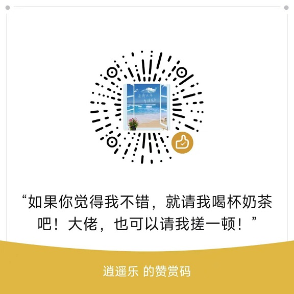

---

## 🧑‍💻 开发团队鸣谢（排名不分先后）

👨‍💼 **CTO**：xbclub 

🐋 **Docker 免费代理**：xbclub 

🤖 **AI**：xbclub 

💾 **服务器赞助商**：低调佬 

🎨 **图标设计师**：Yaseen 卷王、东叔 

💻 **前端开发**：xylplm、夏夏子、阿祖、傑仔、Hervey、Debugger.C、未命名、夕陽西辭等 

🛠️ **后端开发**：阿祖、Debugger.C、xylplm、onlyLTY 唯依、夏夏子、huangpj0210 未命名、xxww0098、xbclub 🇸 🇮 🇩 🇪、疾风剑豪索隆、spiritMC、xiaonaiquan、AllenPu2020、DDSRem、黑桃Ace等 

📱 **移动端开发**：奥特曼—迪迦、未命名、嘚嘚嘚 

🧩 **站点适配**：mantou568、阿祖、傑仔、四丿季、zjjxwhh、Yaseen1314、syueya、iovejieba、xylplm、jackloves111等 

🧪 **软件测试**：王建军、四丿季、傑仔、紫邪、dingding、苹果、Harry等 

🎉 **热心支持者**：陈洋、ryanandlp、雨十一、Vic990310、Aurora.、Estara、Serenalee、Meteor、Better_Call_XYZ、Qianlumanman_、柒夏7x等 —— 提供宝贵经验与无私分享 

🙏 **特别致谢**：参与测试与反馈的诸多朋友们支持！ 

  — Media-Saber 全体开发组

---

## 赞赏

如果觉得我们做的不错，可以请我们开发组喝一杯奶茶或者咖啡。:tea:

谢谢！ :heart:

|微信赞赏
| :---: |

**重要说明**

Media Saber 定位为**私密项目**，仅限开发组自用与少量受邀用户使用。虽然我们提供了赞赏功能，但需要特别强调：

- **项目属性**：本项目为私密项目，不接受任何形式的捐赠或收费，所有获得授权的用户享受平等的功能权限
- **赞赏含义**：Wiki 页面的赞赏功能仅作为对开发组辛苦付出的自愿致敬和鼓励
- **赞赏效果**：赞赏金额与使用权限、邀请资格完全无关，无论是否赞赏都不会改变您的用户权限状态
- **明确承诺**：赞赏不会为您带来任何特殊权利、特权、优先级、额外帮助或邀请资格
- **严正声明**：我们坚决拒绝任何形式的破解行为和公开传播，违反此承诺的行为将承担相应法律责任

我们的初心是为了保证项目的稳定性和可持续发展，坚持不商业化、不收费的原则。如果您已获得使用权限，感谢您的支持！如果你是有才能的 可在github isuse中证明并提交你的申请(不保证通过率)或者其他朋友私下邀请你，但拒绝任何居心不良的。

一切解释权在Media Saber 开发组！