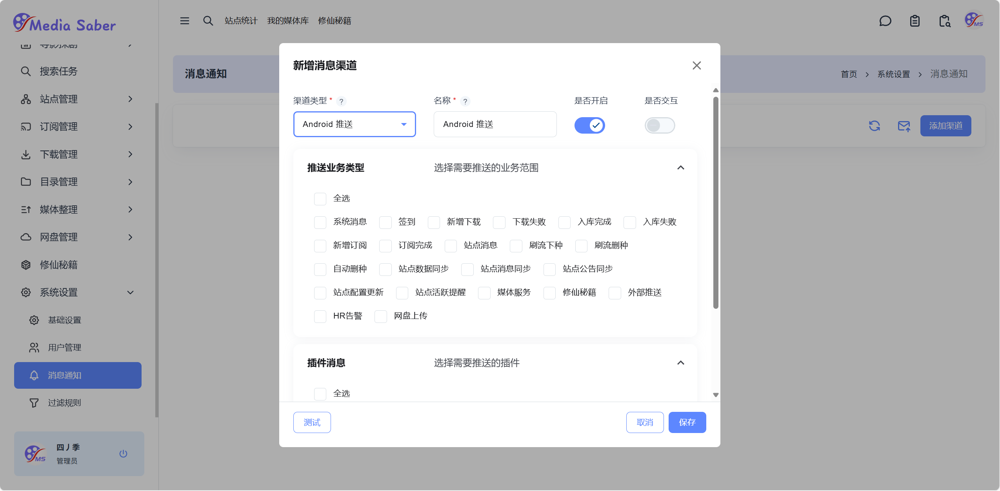

# Media Saber 客户端

> 全平台客户端，为你提供便捷的媒体管理体验

---

## 🌍 平台支持

### 📱 移动设备

- [安卓应用](/client/android/) - 功能完整的 Android 客户端
- [iOS 应用](/client/ios/) - 原生 iOS 应用体验

### 📲 可穿戴与桌面设备

- [小米手表客户端](/client/xiaomi_watch.md) - 在手腕上管理媒体的快应用
- [ESP32 桌面小助手](/client/esp32/) - 放在桌面的 Media Saber 状态屏与小智助手

### 🌐 浏览器工具

- [浏览器插件](/client/brower_tool.md) - Chrome 和 Edge 浏览器扩展

---

## ✨ 核心功能概览

### 📥 移动端功能
- 完整的媒体库管理
- 实时消息通知
- 个人中心和账户管理
- 站点数据查看
- 下载任务管理

### ⌚ 手表端功能
- 媒体服务速览
- 榜单推荐
- 站点数据统计
- 账户同步

### 🔧 浏览器插件功能
- 自动获取 PT 站点 Cookie
- 一键同步站点信息
- 云存储管理
- 下载管理
- 智能链接识别
- 右键菜单快速操作

---

## 🚀 快速开始

### 第一步：选择合适的平台

根据你的需求选择合适的客户端：

| 场景 | 推荐方案 | 链接 |
|------|--------|------|
| 日常管理媒体库 | 安卓/iOS 应用 | [安卓](/client/android/) \| [iOS](/client/ios/) |
| 手腕查看动态 | 小米手表客户端 | [小米手表](/client/xiaomi_watch.md) |
| 桌面常亮状态屏 | ESP32 桌面小助手 | [ESP32 桌面小助手](/client/esp32/) |
| 浏览器同步站点 | 浏览器插件 | [浏览器插件](/client/brower_tool.md) |

### 第二步：按平台指南安装

选定平台后，参考相应的安装指南进行配置：

- **安卓/iOS**：下载安装应用，登录账户即可使用
- **小米手表**：通过 AstroBox 安装快应用，完成账户绑定
- **ESP32 桌面小助手**：下载固件烧录到 ESP32-S3，完成 Wi-Fi 与 Media Saber 配置
- **浏览器插件**：从应用商店安装，输入服务器地址和登录信息

### 第三步：配置消息通知

在系统设置-消息通知-添加渠道(Android or iOS)的消息渠道。

---

## 📋 详细文档

### 🔵 安卓客户端
- [完整安卓文档](/client/android/)
- 支持消息推送
- 完整的媒体管理功能

### 🍎 iOS 客户端  
- [完整 iOS 文档](/client/ios/)
- 原生应用体验
- 与 iPhone/iPad 无缝协作

### ⌚ 小米手表客户端
- [完整手表文档](/client/xiaomi_watch.md)
- 支持 REDMI Watch 5/6 等主流型号
- 随时随地查看媒体和数据

### 🧩 ESP32 桌面小助手
- [ESP32 桌面小助手](/client/esp32/)
- [硬件 DIY](/client/esp32/hardware.md) / [接线与装配](/client/esp32/wiring.md)
- [固件烧录](/client/esp32/flashing.md) / [首次配置](/client/esp32/configuration.md)
- [MCP 网关部署](/client/esp32/mcp-gateway-compose.md) / [小智 MCP 对接](/client/esp32/xiaozhi-mcp.md)
- 支持桌面状态屏、消息中心与小智语音能力，[常见问题](/client/esp32/faq.md) 可辅助排查

### 🌐 浏览器插件
- [完整插件文档](/client/brower_tool.md)
- 支持 Chrome 和 Edge 浏览器
- 一键同步 PT 站点信息

---

## 💡 选择指南

### 我想在手机上管理媒体
👉 选择 [安卓应用](/client/android/) 或 [iOS 应用](/client/ios/)

### 我想在手表上快速查看
👉 选择 [小米手表客户端](/client/xiaomi_watch.md)

### 我想同步浏览器中的 PT 站点信息
👉 选择 [浏览器插件](/client/brower_tool.md)

### 我想拥有完整的控制体验
👉 组合使用：移动应用 + 浏览器插件

---

## 🔗 相关链接

- [主站访问](/) - Media Saber 文档主页
- [系统设置指南](/guide/install/) - 完整的服务端安装和配置
- [使用手册](/usage/main_page/) - 详细的功能使用说明

---

> 💡 **提示**：所有客户端都需要连接到运行中的 Media Saber 服务器。请确保您已正确部署并配置好服务端。