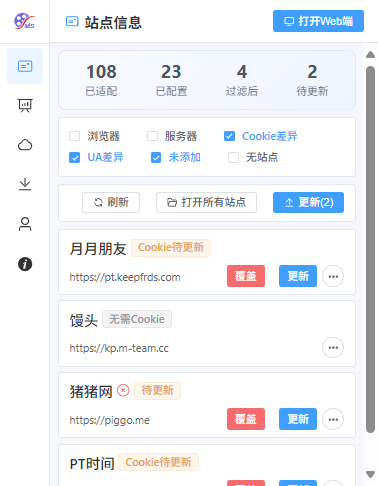
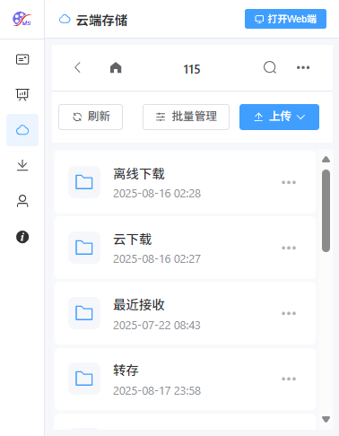
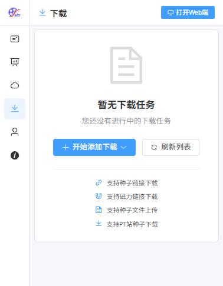
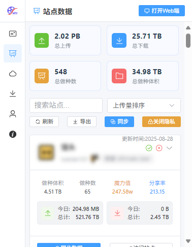

# 功能与界面

Media Saber Tools 将 Media Saber 的常用操作带到浏览器中，适合在浏览 PT 站点、云盘和下载页面时快速操作。

## ✨ 主要能力

- 站点 Cookie 和 User-Agent 获取与同步。
- 站点上传、下载、做种、等级和积分数据查看。
- 云存储文件浏览、上传、转存和离线下载。
- 磁力、HTTP、FTP、电驴和种子下载。
- PT 站点种子页面快捷下载。
- 网页磁力链接、电驴链接自动识别。
- 网页按钮和右键菜单快捷操作。
- 定时同步、通知和隐私模式。
- 在影视网站页面一键订阅影片，并查看是否已订阅。

## 🧭 常用页面

| 页面 | 用途 |
|---|---|
| 站点管理 | 查看浏览器与服务端站点信息，执行同步 |
| 站点数据 | 查看上传、下载、做种和积分统计 |
| 云存储 | 浏览云盘目录，执行上传、转存和离线下载 |
| 下载管理 | 查看任务、选择下载器并管理下载参数 |
| 用户信息 | 配置服务地址、同步方式和通知选项 |

## 🖼️ 界面预览

  

    
    
🌐 站点管理

  

  

    
    
☁️ 云存储管理

  

  

    
    
📥 下载管理

  

  

    
    
📊 数据统计

  

## 🎯 适用场景

### 浏览站点时同步信息

先在浏览器中登录 PT 站点，再打开扩展的站点管理页面，即可查看浏览器与 Media Saber 中的站点差异，并选择需要同步的站点。

### 浏览网页时快速下载

遇到磁力链接、电驴链接或 PT 种子时，可以直接使用网页按钮或右键菜单，不需要手动复制链接到 Media Saber。

### 管理云盘和下载任务

在扩展主界面中快速访问云存储和下载管理，适合处理临时转存、离线下载和下载任务检查。

下一步：[站点管理](./site-management.md)
