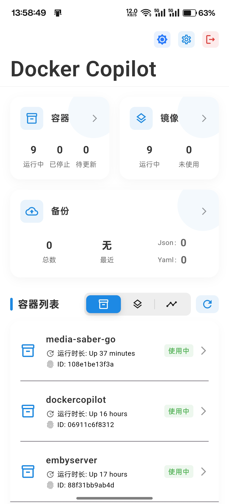

## Docker Copilot

Docker Copilot 是一款功能强大的 Docker 容器管理工具，提供直观的界面和便捷的操作方式，让 Docker 容器管理变得简单高效。

### 主要功能

- **容器更新**：直观显示更新状态，一键更新或更换版本
- **镜像管理**：清理未使用的镜像，释放存储空间
- **容器备份与恢复**：轻松备份容器配置，更换设备或处理硬盘故障时可快速还原
- **可视化管理**：图形化界面，操作简洁直观

### 快速开始

#### Web 版本

详细的安装步骤和配置说明请参考 [使用 DC 一键更新](../../guide/update/dc.md) 文档。

#### Android 应用

| 下载 | 反馈 |
|:--:|:--:|
| [点击下载 Docker Copilot Android](https://github.com/singleton-altman/docker_copilot_andriod_app/releases) | [GitHub Issues](https://github.com/singleton-altman/docker_copilot_andriod_app/issues) |

### 相关资源

- 📖 [Docker Copilot 详细安装与使用指南](../../guide/update/dc.md)
- 🔗 [GitHub 项目地址](https://github.com/onlyLTY/dockerCopilot)
- ⭐ 欢迎为项目点个 Star 支持开发者
- 📧 反馈邮箱：`onlylty@lty.wiki`
