# Media Saber ESP32 桌面小助手

> 把一块 ESP32-S3 小屏幕放在桌面上，让 Media Saber 的站点数据、NAS 状态、消息中心与小智语音能力随手可见。

<div align="center">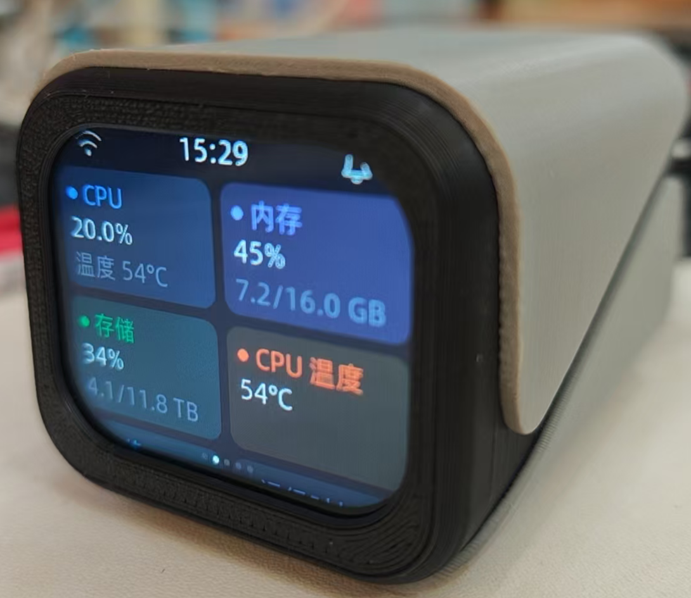</div>

::: tip 适合谁？

- 已经部署 Media Saber，希望桌面上有一块常亮状态屏的用户。
- 喜欢 DIY 硬件，愿意自己接线、烧录 ESP32-S3 固件的用户。
- 想同时体验小智 ESP32 语音交互与 Media Saber 数据看板的用户。

:::

## 🧭 项目介绍

Media Saber ESP32 桌面小助手基于 **ESP32-S3 N16R8** 与 **小智 ESP32** 固件生态二次开发，在小屏幕上提供五类能力：

1. **小智语音对话**：保留小智 ESP32 的语音、配网、OTA 等基础能力。
2. **MS 数据监控**：查看 NAS、站点等 Media Saber 数据。
3. **两步验证码**：把 PT 站点和自定义账号的两步验证码直接放到桌面，随看随输。
4. **触摸屏交互**：通过 2.0 寸触摸屏切换页面、进入详情、触发快捷指令。
5. **本地配置入口**：按固件版本支持在局域网内打开配置页，填写 Media Saber 服务地址与认证信息。

桌面主屏幕由 **5 个可左右滑动的页面**组成，把常用功能都放在第一层：


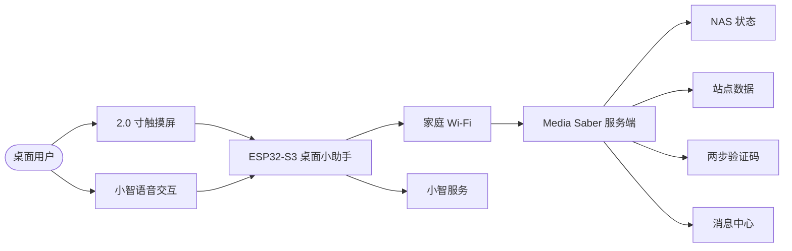

## ✨ 功能介绍

桌面主屏左右滑动切换 **5 个页面**，每个页面都是一个独立的功能屏。

### 🗣️ 第 1 屏：小智 AI

保留小智 ESP32 的语音交互体验，可用于日常对话、唤醒、联网状态提示等。

<div align="center">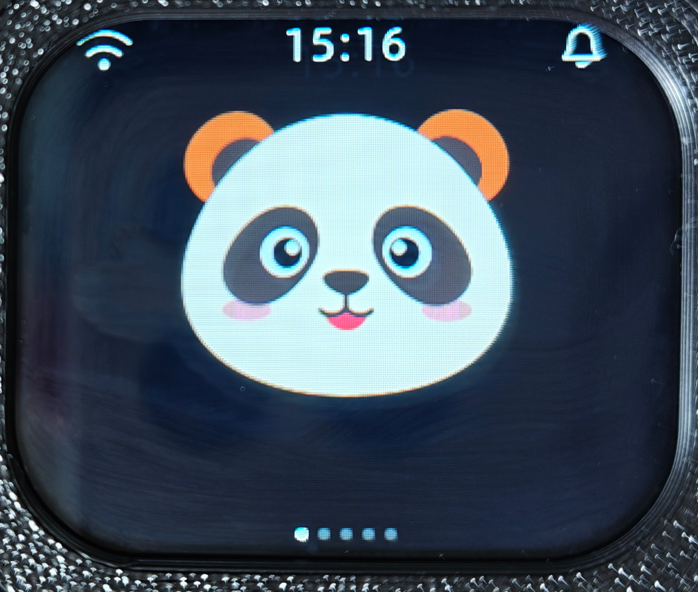</div>

### 🖥️ 第 2 屏：NAS 监控

在桌面快速查看 NAS 的 CPU、内存、存储、温度与网络状态，适合放在显示器旁边当状态屏。

<div align="center">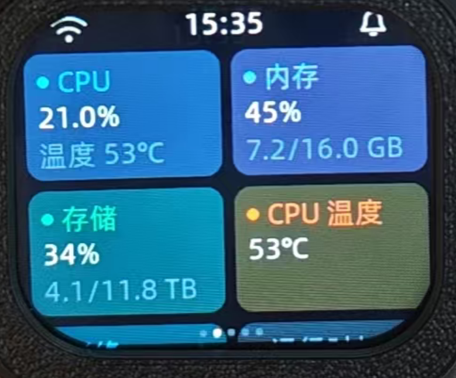</div>

### 🔐 第 3 屏：两步验证码（重点功能）

把 PT 站点和自定义账号的两步验证码直接显示在桌面上，登录时随看随输，不用再切回手机。

<div align="center">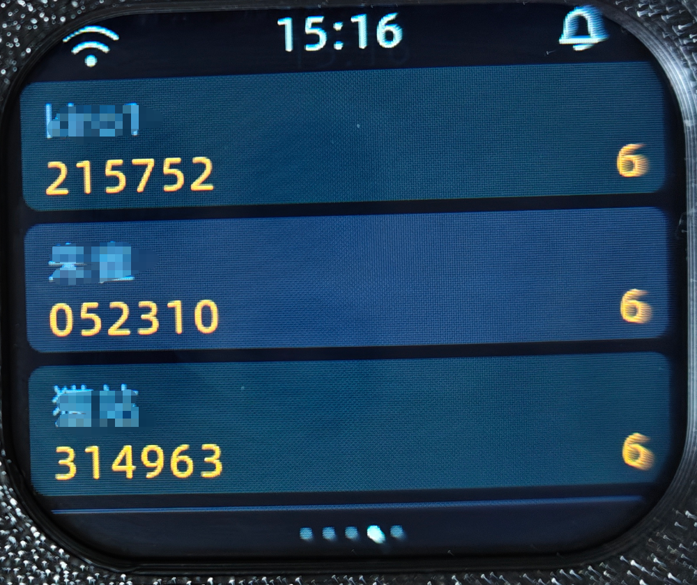</div>

**显示内容：**

- 每个账号一行：账号名 + 6 位验证码 + 剩余秒数倒计时。
- 验证码每 30 秒滚动一次，倒计时 ≤10 秒变金色，≤5 秒变红色，提醒你抓紧输入或等下一轮。
- 页面每秒刷新验证码与倒计时，每 60 秒重新从服务端拉取账号列表。

**验证码从哪来：**

- 验证码在 **设备本地** 按 TOTP（RFC 6238）算法实时生成，密钥不落盘、不写入设备持久存储。
- 账号列表由 **Media Saber 服务端** 统一下发，设备本身不维护账号，换设备无需重新配置。

**账号来源（在 Web 端管理，不在设备上配置）：**

| 来源 | 说明 |
|---|---|
| 自定义账号 | 在 Media Saber Web 端添加的两步验证账号（名称 + 密钥），可置顶 |
| 站点账号 | 自动从已配置 PT 站点的两步验证密钥派生，无需重复添加 |

::: tip 没有账号时

如果服务端没有配置任何两步验证账号，第 3 屏会提示你先在「应用 → 用户中心」配置好 Media Saber 后端。账号需要在 Web 端的对应页面添加，设备不提供新增入口。

:::

### 🌐 第 4 屏：站点总览

展示 Media Saber 里的站点今日数据，例如上传、下载、做种增量、签到状态等。

<div align="center">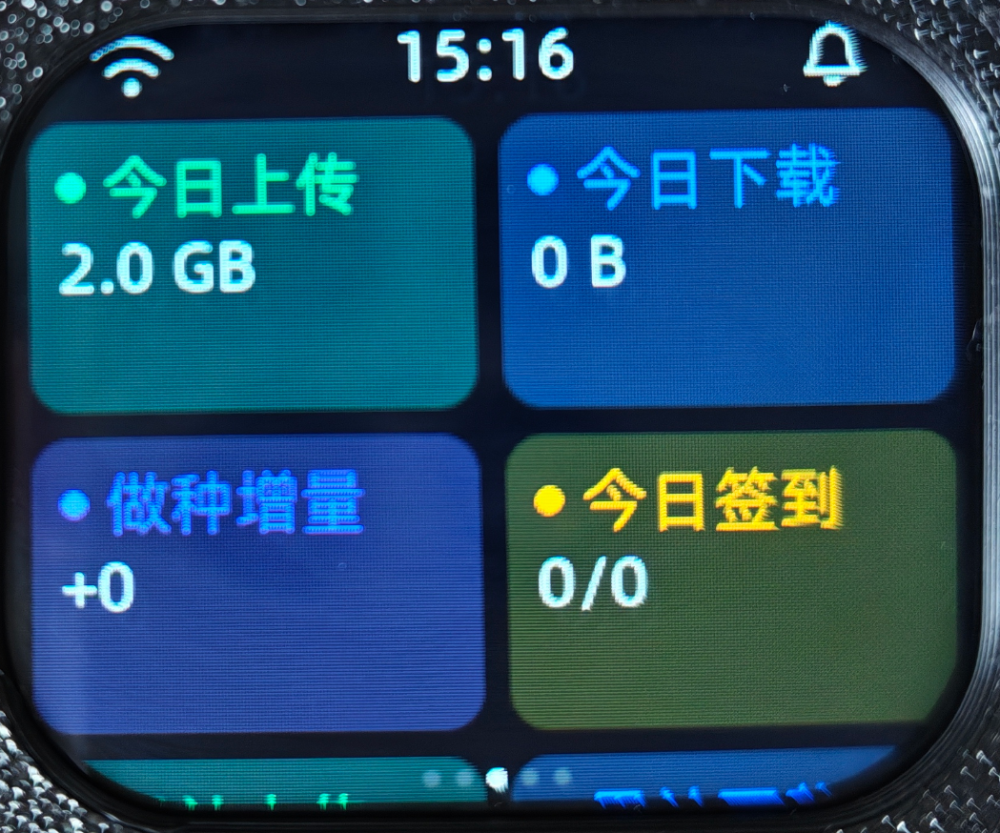</div>

### 📦 第 5 屏：应用入口

应用页是一个 2×2 网格，提供四个二级入口：媒体库、排行推荐、消息中心、用户中心。

<div align="center">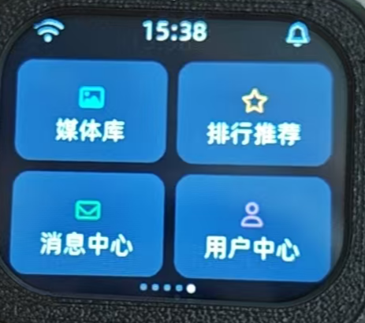</div>

#### 🎬 排行推荐 + 一键订阅

进入「排行推荐」可查看「正在热映」和「今日开播」两个榜单，点击任意一张卡片即可 **一键订阅**，无需打开手机或电脑。

<div align="center">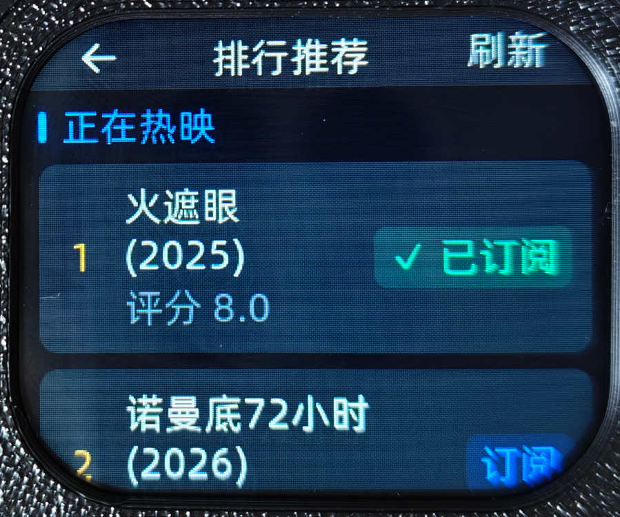</div>

**一键订阅流程：**

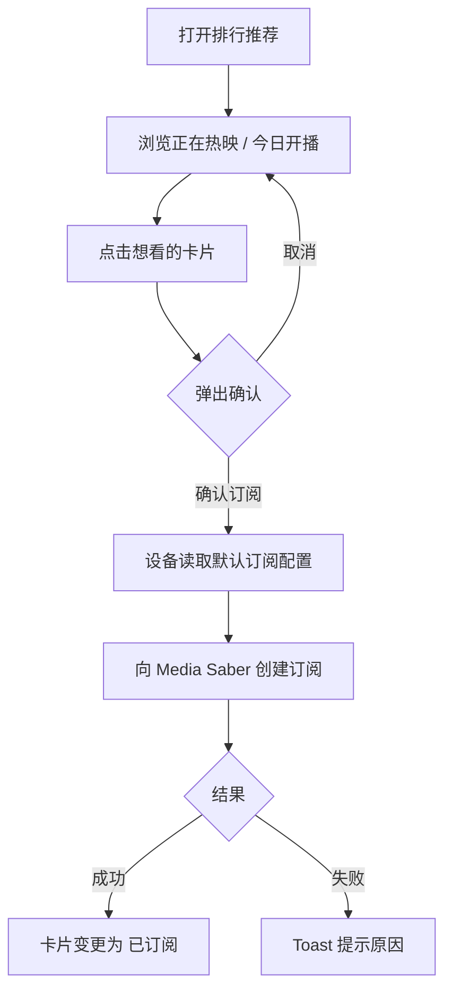

**订阅说明：**

- 点击卡片后会弹出二次确认，确认后设备会调用 Media Saber 的默认订阅配置创建订阅。
- 订阅成功后，卡片会显示「✓ 已订阅」标记；再次点击可取消订阅。
- 如果服务端没有设置默认订阅配置，会提示「请先在 Web 端设默认订阅配置」。

::: tip 排行推荐看不到数据？

请先在「应用 → 用户中心」配置好 Media Saber 后端地址与认证信息，并确认 Web 端已设置默认订阅配置。

:::

#### 💬 消息中心与快捷指令

消息中心可查看系统消息，并通过底部快捷指令抽屉一键向 Media Saber 后端发送常用指令。

<div align="center">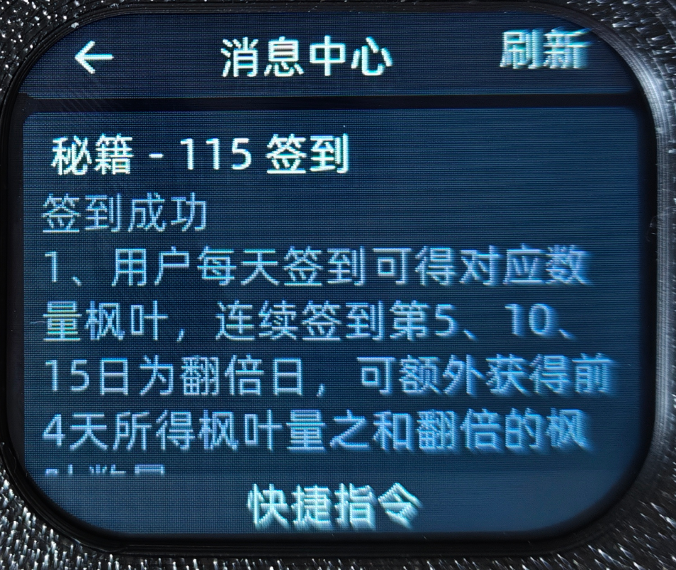</div>

当前快捷指令与 Media Saber 后端指令菜单保持一致：

| 按钮 | 后端命令 | 用途 |
|---|---|---|
| 更新配置 | `/suc` | 更新站点配置 |
| 签到 | `/ssi` | 执行站点签到 |
| 同步公告 | `/ssn` | 同步站点公告 |
| 同步消息 | `/ssm` | 同步站点消息 |
| 同步数据 | `/ssd` | 同步站点数据 |
| 订阅刷新 | `/dsr` | 刷新所有订阅 |
| 查漏集 | `/dme` | 检查剧集漏集 |
| 系统更新 | `/syu` | 检查并更新 Media Saber 服务端 |
| NAS 状态 | `/nas` | 查询 NAS 设备状态 |
| 获取帮助 | `/help` | 获取后端帮助信息 |

::: warning 注意

这里的“系统更新”是指 **Media Saber 服务端更新**，不是 ESP32 固件 OTA，也不是小智官方固件更新。

:::

## 🧩 DIY 物料清单

> 下表价格与采购链接先占位，后续会根据实际采购渠道补充。不同批次模块排针方向、丝印名称可能不同，请以实物与卖家资料为准。

| 类别 | 型号 / 关键词 | 数量 | 参考价格 | 采购链接 | 备注 |
|---|---|---:|---:|---|---|
| 主控板 | ESP32-S3 N16R8 开发板 | 1 | 26元 | [参考购买链接](https://m.tb.cn/h.RKa5ObG) | 16MB Flash + 8MB PSRAM，注意请选择排针向下焊好版本，推荐 双USB-C 版本，最好是能有天线底座的，方便wifi信号不足扩展 |
| 触摸屏 | TK020F1131 2.0 寸触摸屏 | 1 | 23元 | [购买链接](https://e.tb.cn/h.RKajhMdYmBfK8bG?tk=F3WQg6VdDhg) | ST7789 兼容，240×300，CST816 系列触摸 注意购买 **液晶屏+转接板+杜邦线**套餐，焊接用户可忽略 |
| 音频板 | LMD2718 + NS4168 音频模块 | 1 | 12元 | [购买链接](https://m.tb.cn/h.RKaNpsQ) | 当前固件使用的推荐音频方案 新手请购买已焊接版本 推荐购买**音频模块+喇叭** 套餐 方便省事 |
| 喇叭 | 4Ω2w 小喇叭 | 1 | 2元 | [购买链接](https://e.tb.cn/h.RKC0jeo14Vc2HV3?tk=4YyAg6VR51n) | 规格按音频模块与外壳空间选择 上面和音频板一起买了的忽略 |
| 连接线(焊接忽略) | 2.51mm * 10cm 母对母杜邦线 / 硅胶线 | 若干 | 1.5元 | [购买链接](https://m.tb.cn/h.RpeN62w) | 建议使用柔软细线，方便收纳进外壳|
| 连接线(焊接忽略) | 2.51mm 一母对二公杜邦线 / 硅胶线 | 1 | 2元 | [购买链接](https://m.tb.cn/h.Rpezvd5) | 建议使用柔软细线，方便收纳进外壳 短线即可|
| 外壳 | 3D 打印外壳 | 1 | 待补充 | 待补充 | 可先裸板调试，再装壳 |
| 数据线（可选） | USB-C 数据线 | 1 | 待补充 | 待补充 | 可以用手机充电线代替 |

::: warning 注意

以上购买链接 除了屏幕固件要求一致，其他配件**仅供参考**，只要**规格相同**，可以在其他链接购买，**哪儿便宜买哪儿**！

以上部分配件，焊接大佬可以忽略，可只采购核心配件！

:::


<div align="center">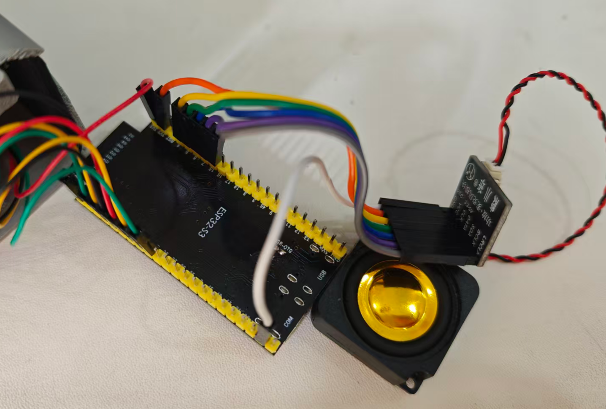</div>

## 🔌 接线信息

::: danger 接线前必读

- 请在断电状态下接线，确认无误后再通电。
- 当前方案统一按 **3.3V 逻辑** 连接，不要把屏幕或音频信号线接到 5V。
- ESP32-S3 的 IO 编号请以开发板丝印或资料为准，避免把 `GPIO` 与物理排针序号混淆。

:::

### 🖼️ 屏幕与触摸接线

<div align="center">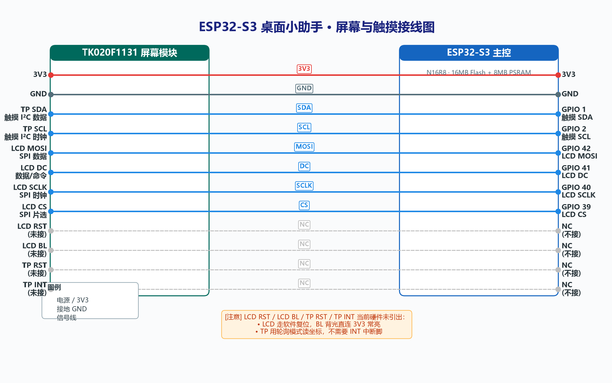</div>

| 屏幕模块端 | ESP32-S3 | 说明 |
|---|---|---|
| 3V3 | 3V3 | 屏幕与触摸供电 |
| GND | GND | 接地 |
| TP SDA | GPIO 1 | 触摸 I²C 数据 |
| TP SCL | GPIO 2 | 触摸 I²C 时钟 |
| LCD MOSI | GPIO 42 | 屏幕 SPI 数据 |
| LCD DC | GPIO 41 | 屏幕数据 / 命令切换 |
| LCD SCLK | GPIO 40 | 屏幕 SPI 时钟 |
| LCD CS | GPIO 39 | 屏幕 SPI 片选 |
| LCD RST | 悬空 / NC | 当前硬件未接，固件走软复位 |
| LCD BL | 悬空 / NC | 背光直连 3V3，常亮 |
| TP RST | 悬空 / NC | 当前硬件未接 |
| TP INT | 悬空 / NC | 当前硬件未接，固件使用轮询触摸 |

### 🔊 音频接线

<div align="center">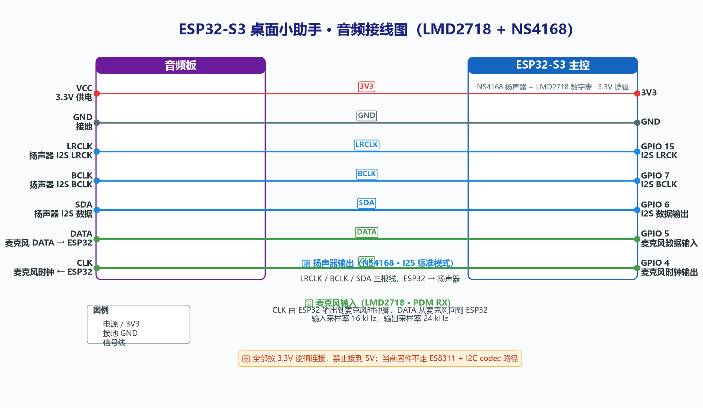</div>

| 音频模块端 | ESP32-S3 | 用途 |
|---|---|---|
| LRCLK | GPIO 15 | 扬声器 I2S LRCK |
| BCLK | GPIO 7 | 扬声器 I2S BCLK |
| SDA | GPIO 6 | 扬声器 I2S 数据 |
| DATA | GPIO 5 | 麦克风 DATA，输入到 ESP32 |
| CLK | GPIO 4 | 麦克风数字时钟 |
| VCC | 3V3 | 供电 |
| GND | GND | 接地 |

::: info 音频模块说明

当前固件以 **LMD2718 + NS4168** 音频方案为准。若你使用 INMP441、MAX98357A 或其它音频模块，请先确认对应固件是否支持，避免接线正确但驱动不匹配导致无声或无麦克风输入。

:::

## 🚀 ESP32-S3 小智固件烧录教程

可以参考[小智官方烧录教程](https://my.feishu.cn/wiki/Zpz4wXBtdimBrLk25WdcXzxcnNS)，也可以看看下面的步骤！

### 1. 准备工具

| 工具 | 用途 | 下载 / 说明 |
|---|---|---|
| ESP32-S3 开发板 | 被烧录设备 | 建议使用 N16R8 版本 |
| USB-C 数据线 | 连接电脑与开发板 | 必须支持数据传输 |
| 固件文件 | 写入设备 | [ESP32 固件下载地址](https://github.com/xylplm/media-saber-public/releases/tag/esp32) |
| Espressif Flash Download Tool | Windows 图形化烧录 | 适合新手 |
| esptool.py | 命令行烧录 | 适合 macOS / Linux / 高阶用户 |


::: tip 固件下载地址

当前固件发布地址链接：

<https://github.com/xylplm/media-saber-public/releases/tag/esp32>

请下载与你的硬件版本一致的 ESP32-S3 固件包。   如果你看到是ZIP压缩包 请下载后解压！

每个版本会同时提供两种固件包，按你的情况二选一即可：

- **合并固件包**（`media-saber-esp32s3-ms-helper-merged.zip`）：解压后只有一个 `media-saber-esp32s3-ms-helper.bin`，烧录到地址 `0x0` 即可，最省事，推荐新手使用。
- **分散固件包**（`media-saber-esp32s3-ms-helper-split.zip`）：解压后是 5 个分区固件 + `flash_args`，需要按地址分别烧录，适合只刷新某个分区、或排查问题的进阶用户。

:::

### 2. 进入下载模式

1. 用 USB 数据线连接 ESP32-S3 开发板与电脑。
2. 如果烧录工具无法识别串口，请按住 **BOOT** 键，再点按 **EN / RESET** 键，最后松开 **BOOT**。
3. 在电脑设备管理器或串口列表中确认出现 `COMx`、`/dev/ttyUSBx` 或 `/dev/ttyACMx`。

<div align="center">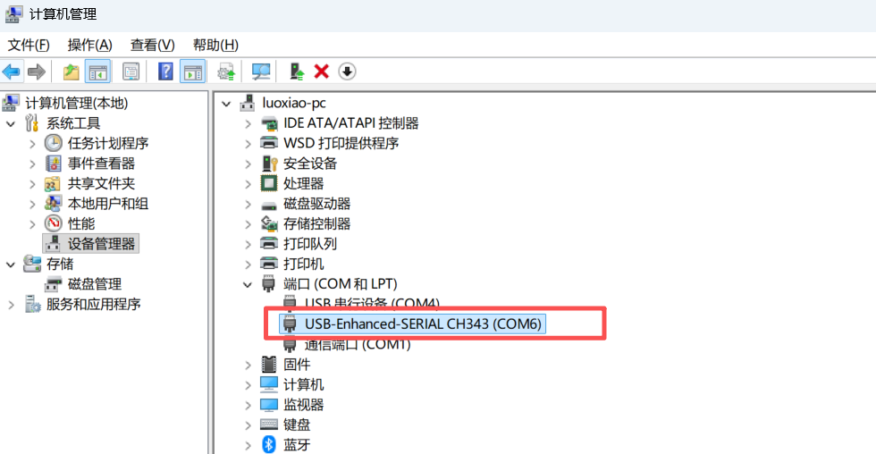</div>

### 3. 图形化烧录方式（Windows 推荐）

1. 打开 Espressif Flash Download Tool。
2. 芯片选择 **ESP32-S3**。
3. 选择正确串口，波特率可先用 `460800` 或 `921600`。
4. 如果固件包里提供 **合并固件**，通常只需要写入：

| 地址 | 文件 |
|---:|---|
| `0x0` | 合并固件，例如 `media-saber-esp32s3-ms-helper.bin` |

5. 如果固件包里是 **分散固件**，通常按以下地址填写：

| 地址 | 文件 | 说明 |
|---:|---|---|
| `0x0` | `bootloader.bin` | 引导程序 |
| `0x8000` | `partition-table.bin` | 分区表 |
| `0xd000` | `ota_data_initial.bin` | OTA 初始数据 |
| `0x20000` | `xiaozhi.bin` | 应用固件 |
| `0x800000` | `generated_assets.bin` | 资源分区（字体 / 形象 / 音效），缺失会丢 UI 资源 |

6. 点击开始烧录，等待进度完成后重启开发板。


### 4. 命令行烧录方式

先安装 esptool：

```bash
pip install esptool
```

擦除旧固件：

```bash
esptool.py --chip esp32s3 --port COM3 erase_flash
```

如果是合并固件：

```bash
esptool.py --chip esp32s3 --port COM3 --baud 921600 write_flash -z 0x0 media-saber-esp32s3-ms-helper.bin
```

如果是分散固件：

```bash
esptool.py --chip esp32s3 --port COM3 --baud 921600 write_flash -z \
  0x0 bootloader.bin \
  0x8000 partition-table.bin \
  0xd000 ota_data_initial.bin \
  0x20000 xiaozhi.bin \
  0x800000 generated_assets.bin
```

分散固件包内还附带了 `flash_args` 文件，可以用一行命令一次烧录全部分区（在解压后的目录里执行）：

```bash
esptool.py --chip esp32s3 --port COM3 --baud 921600 write_flash -z @flash_args
```

::: warning 路径与串口请替换

上面的 `COM3` 和固件文件名只是示例。Windows 用户通常是 `COMx`，macOS / Linux 用户通常是 `/dev/ttyUSBx` 或 `/dev/ttyACMx`。

:::

### 5. 首次启动与配置

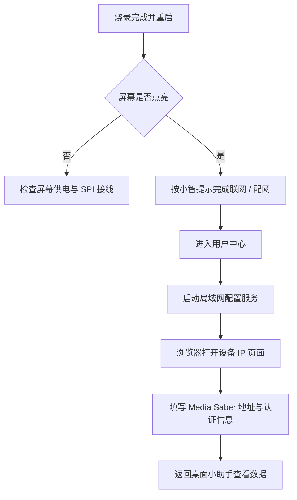

1. 烧录完成后重启设备，等待屏幕进入小智或 MS 桌面界面。
2. 按小智固件提示完成 Wi-Fi 配网。
3. 进入 **用户中心**，按页面提示启动局域网配置服务。
4. 在同一局域网电脑或手机浏览器中打开设备显示的地址。
5. 填写 Media Saber 服务地址与认证信息，保存后返回设备。
6. 进入 NAS、站点、消息中心页面，确认数据能正常加载。


## ✅ 使用建议

- **先裸板调试，后装外壳**：确认屏幕、触摸、音频、联网都正常后再固定。
- **先低波特率烧录**：如果 `921600` 不稳定，改用 `460800` 或 `115200`。
- **供电要稳定**：屏幕和音频同时工作时，劣质 USB 线可能导致重启。
- **背光常亮是当前硬件限制**：当前屏幕背光直接接 3V3，固件无法真正关闭背光。

## 🛠️ 常见问题

### ❌ 电脑找不到串口

- 换一根支持数据传输的 USB 线。
- 安装开发板对应的 USB 转串口驱动。
- 尝试按住 BOOT 后点按 EN / RESET，让设备进入下载模式。

### ❌ 烧录失败或中途超时

- 降低烧录波特率。
- 换 USB 口或 USB 线。
- 先执行 `erase_flash` 后再重新写入。

### ❌ 屏幕白屏 / 花屏 / 方向不对

- 确认屏幕型号是 TK020F1131，分辨率为 240×300。
- 检查 MOSI、SCLK、CS、DC 是否接反。
- 确认下载的是匹配该硬件版本的固件。

### ❌ 触摸位置不准

- 检查 TP SDA / TP SCL 是否接到 GPIO 1 / GPIO 2。
- 确认触摸屏 IC 为 CST816 系列兼容型号。
- 如果使用不同屏幕，需要重新适配触摸坐标方向。

### ❌ 没有声音或麦克风无输入

- 确认音频模块与固件支持的方案一致。
- 检查 LRCLK、BCLK、SDA、DATA、CLK 五根信号线。
- 确认音频模块供电为 3.3V。

### ❌ 看不到 Media Saber 数据

- 确认设备与 Media Saber 服务端在可互通的网络内。
- 检查服务地址、端口、认证信息是否正确。
- 在 Media Saber 服务端确认相关接口和消息中心功能可正常使用。

### ❌ 两步验证码页面为空

- 确认已在「应用 → 用户中心」配置好 Media Saber 后端。
- 在 Media Saber Web 端添加自定义两步验证账号，或确认 PT 站点已填写两步验证密钥。
- 账号列表每 60 秒刷新一次，添加后稍等片刻。

### ❌ 排行推荐无法订阅

- 确认已在「应用 → 用户中心」配置好 Media Saber 后端。
- 在 Media Saber Web 端设置好默认订阅配置（电影 / 电视剧）。
- 如果提示失败，按 Toast 文案在 Web 端检查订阅相关设置。

### ❌ 支持更换唤醒词吗？ 
A：支持，需要在用户界面打开web配置 进入web配置唤醒词 拼音

### ❌ 角色名称可以换吗？ 
A：可以，到小智AI管理后台控制面板——角色配置中修改AI角色名字，保存后生效。

注意：角色名字是大模型配置的智能体名称，与离线唤醒词"你好小智"无关，两者不存在关联。 控制台地址：https://xiaozhi.dev/console/

### ❌ 支持更换声音/音色吗？ 
A：支持，到小智AI网站控制台——配置角色中切换角色声音，可以先试听，然后提交保存配置。下次对话就会使用新配置的音色。 管理后台：https://xiaozhi.dev

### ❌ 请问能听声辨人记住我是谁吗？ 
A：可以，操作步骤：

到小智AI网站后台控制台——智能体——找到声纹识别
在下拉菜单中选择一段语音记录（建议较长且清晰的）
填写名称和描述（对话人和角色的关系）
点击OK按钮添加说话人
重新唤醒小智AI，下次对话中询问时，它会知道你是谁
注意：受技术限制，识别准确率不是100%；说话人越多，分辨准确率会下降。

### ❌ 我复刻的终端喇叭为什么没有声音？ 
A：

检查喇叭是否接好，一般红色线为正极，黑色线为负极
检查数字功放是否接对且接触良好，参考接线表格
如使用电脑USB口供电，喇叭功率达到3W可能会供电不足，建议改用5V2A及以上的USB充电头或5V2.1A的充电宝USB口供电
如确定接线正确仍无法解决，可更换备用喇叭和数字功放模块测试。

### ❌ 我复刻的终端喇叭有沙哑的声音/声音异常？ 
A：

喇叭有沙哑声一般是数字功放GAIN没有接地GND，或GND接线不稳定
喇叭中声音有沙沙的电声可能是电磁干扰，请将小智AI终端远离强磁场设备或模块，隔离充放电电源等
### ❌ 如何调整终端的音量大小？ 
A：

目前推荐的引脚并不支持音量调节


### ❌ 为什么终端"你好小极"无法唤醒/无反应？ 
A：

确认唤醒词正确（“你好小极"而非"小智小极"或其他）
检查麦克风引脚的接线是否正确且接触良好
注意INMP441麦克风默认是有麦克风图标和丝印字母带进声孔这一面朝上的
如接线正确仍无法解决，可更换备用麦克风测试
使用串口通信工具检查开发板输出信息也可帮助定位问题

### ❌ 终端提醒我配网，但是找不到xiaozhi-xxx WIFI？ 
A：这说明ESP32S3开发板的WIFI信号存在问题，可以：

临时用手按住开发板天线位置或绕线尝试增强天线信号
使用串口工具检查开发板输出信息，定位问题
### ❌ 如何重新配网WIFI/切换WIFI？ 
A：

将开发板重新上电/重启，在连接WIFI闪烁蓝灯时，按下Boot按钮然后松开，听到提示音重新进入WIFI配网模式
当小智AI连接上次配置的WIFI失败3次后，也会自动重新进入WIFI配网模式
注意：当前小智AI只默认记住上次连接的WIFI及密码，更换WIFI或WIFI/热点关闭，需要重新配置。

### ❌ 为什么我的屏幕没有点亮？ 
A：

检查屏幕接线是否正确且接触良好
面包板质量有好坏，有问题时可以使用万用表测试通联情况
如确定接线正确仍无法解决，可更换备用屏幕测试
