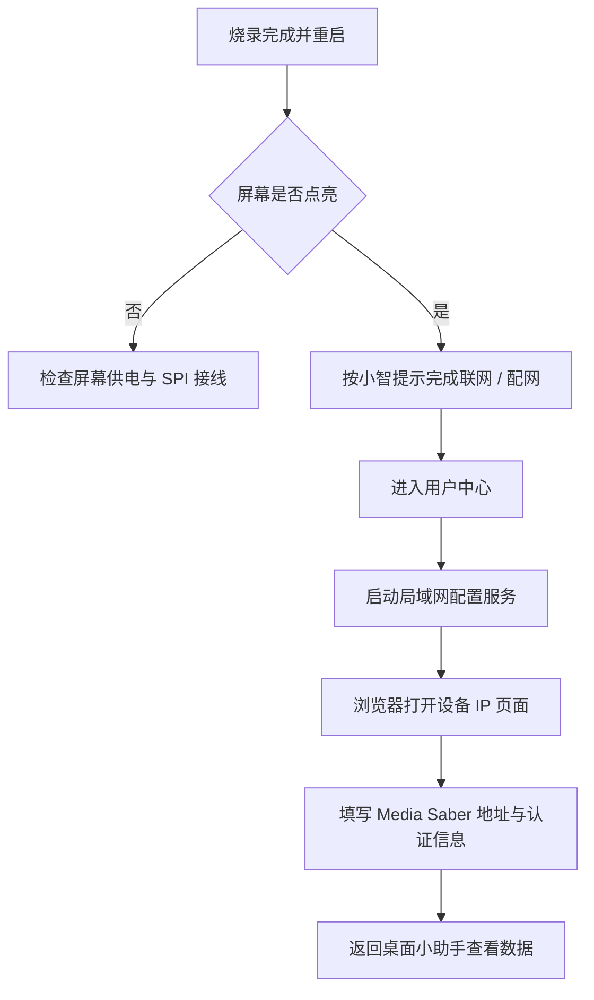

# 首次配置

固件烧录完成后，需要先完成 Wi-Fi 配网，再配置 Media Saber 服务地址与认证信息。

## 1. 首次启动

1. 烧录完成后重启设备，等待屏幕进入小智或 MS 桌面界面。
2. 按小智固件提示完成 Wi-Fi 配网。
3. 如果设备没有进入配网流程，请参考 [常见问题](./faq.md) 里的 Wi-Fi 与配网章节。

::: tip 网络要求

ESP32 桌面小助手需要能访问你的 Media Saber 服务端。最简单的方式是让设备、手机或电脑、Media Saber 服务端处在同一局域网内。

:::

## 2. 打开局域网配置服务

1. 在设备上进入 **应用入口**。
2. 打开 **用户中心**。
3. 按页面提示启动局域网配置服务。
4. 在同一局域网电脑或手机浏览器中打开设备显示的地址。

::: warning 配置完成后及时关闭

局域网配置服务只建议在填写配置时开启。配置完成后，请按页面提示关闭、退出或重启设备，避免长期暴露配置入口。

:::

## 3. 填写 Media Saber 配置

在配置页面填写：

| 配置项 | 说明 |
|---|---|
| 服务地址 | 你的 Media Saber 访问地址，例如局域网地址或反向代理地址 |
| 认证信息 | 用于访问 Media Saber 接口的认证信息 |
| 保存配置 | 保存后回到设备页面刷新数据 |

::: tip 地址填写建议

- 局域网部署优先填写设备可直接访问的内网地址。
- 如果使用反向代理，请确认 ESP32 所在网络能访问该地址。
- 如果地址打不开，先用同一 Wi-Fi 下的手机或电脑浏览器访问一次，确认网络链路正常。

:::

## 4. 验证数据是否正常

保存配置后，依次进入这些页面检查：

| 页面 | 验证方式 |
|---|---|
| NAS 监控 | 能看到 CPU、内存、存储、温度或网络状态 |
| 站点总览 | 能看到站点上传、下载、做种增量或签到状态 |
| 消息中心 | 能看到系统消息，并可尝试打开快捷指令抽屉 |
| 两步验证码 | 已配置账号时能看到账号名、验证码和倒计时 |
| 排行推荐 | 能看到榜单卡片，点击后出现订阅确认 |

## 5. Web 端需要提前准备什么？

部分功能依赖 Media Saber Web 端配置：

| 功能 | 需要提前准备 |
|---|---|
| 两步验证码 | 添加自定义两步验证账号，或在 PT 站点配置两步验证密钥 |
| 排行推荐订阅 | 设置默认订阅配置，区分电影和电视剧 |
| 站点总览 | 已正确配置站点，并能在 Web 端获取站点数据 |
| 消息中心快捷指令 | Media Saber 后端服务正常，相关指令权限可用 |
| NAS 监控 | 后端能正常查询 NAS 状态 |

## 6. 安全提示

- 两步验证码会显示在设备屏幕上，请避免让无关人员长期看到。
- 设备保存的是连接 Media Saber 所需的配置，请不要把已配置设备随意转借。
- 更换使用者、转让设备或返修前，建议重刷固件或清除配置。
- 局域网配置服务只在需要修改配置时开启。

## 7. 下一步

配置完成后，可以回到 [功能与界面](./features.md) 熟悉各页面操作；遇到问题请看：[常见问题](./faq.md)。
