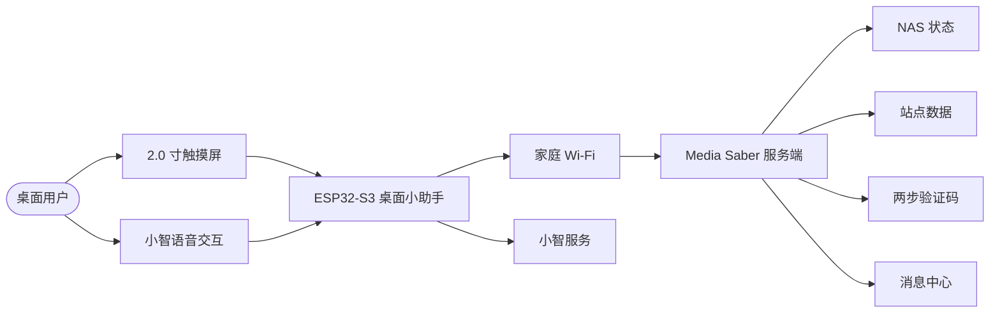
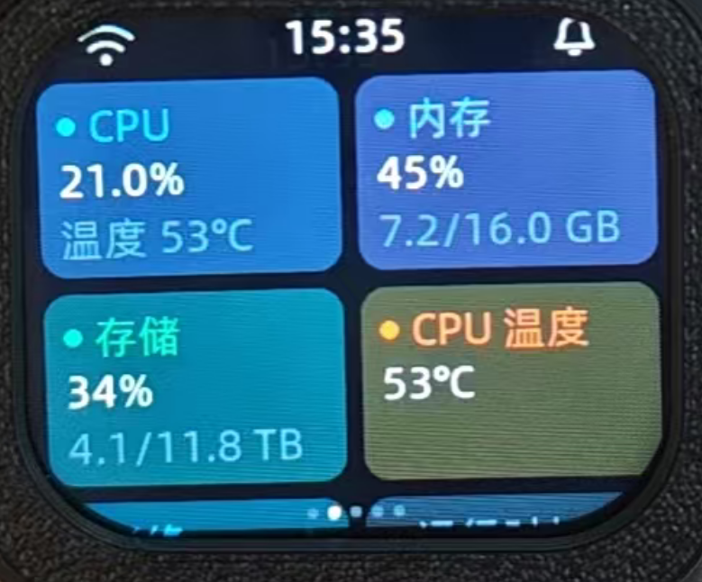
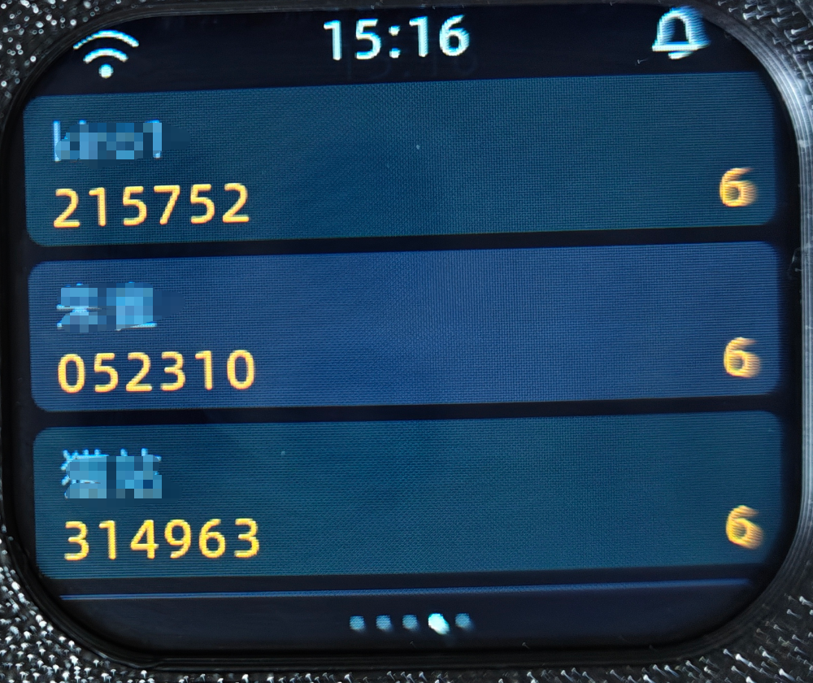
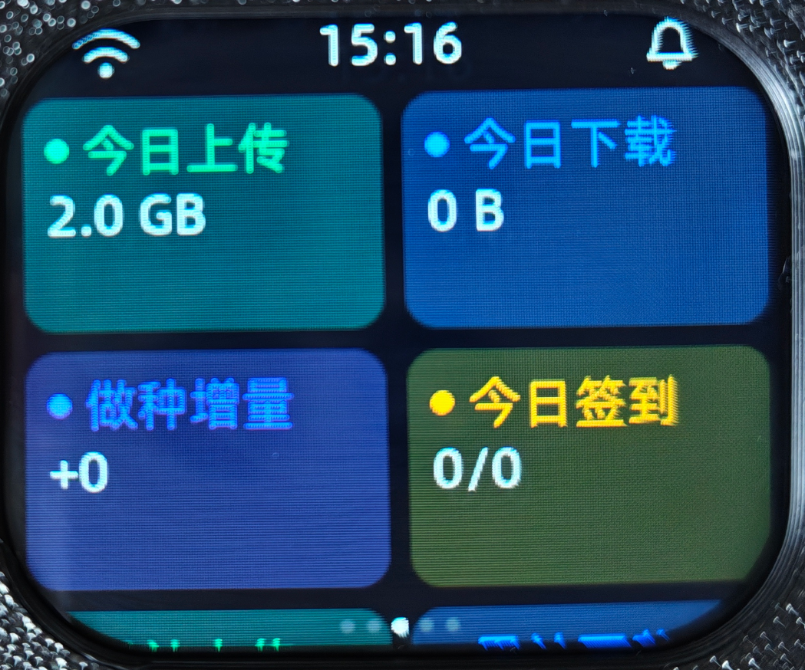
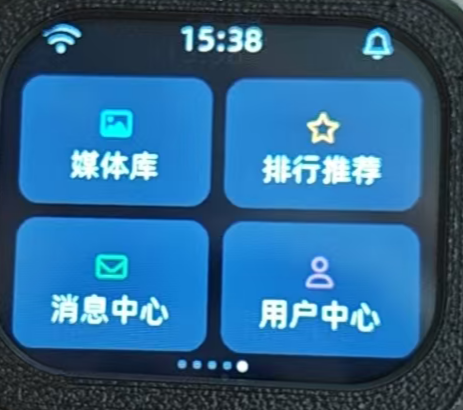
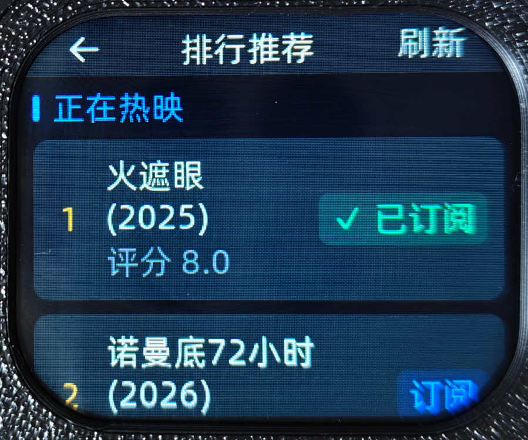
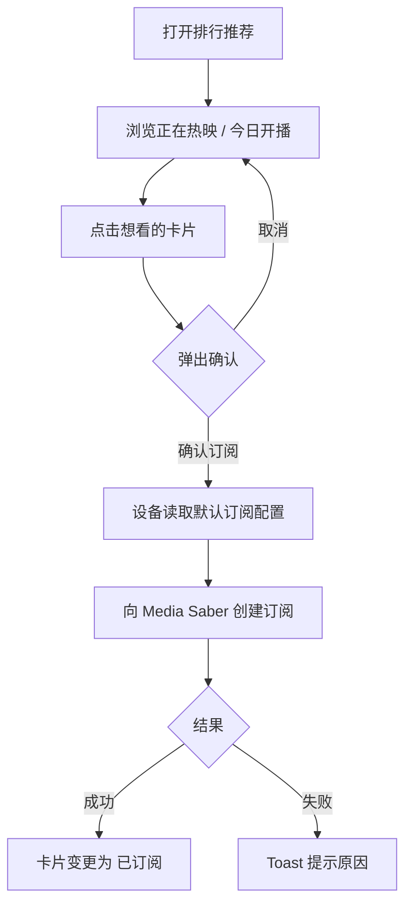
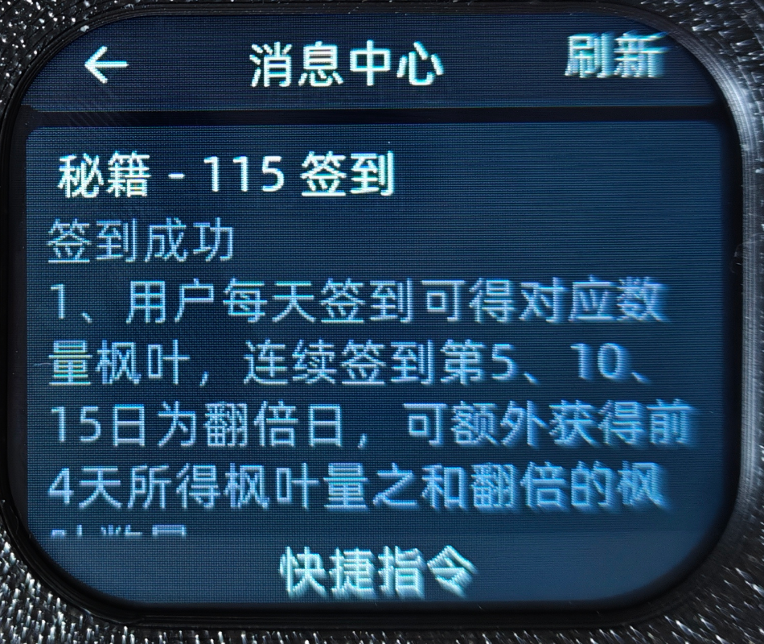

# 功能与界面

ESP32 桌面小助手把小智语音交互和 Media Saber 数据看板放在同一块触摸屏上。主屏左右滑动切换 **5 个页面**，常用功能都放在第一层。

## 🗣️ 第 1 屏：小智 AI

保留小智 ESP32 的语音交互体验，可用于日常对话、唤醒、联网状态提示等。

## 🖥️ 第 2 屏：NAS 监控

在桌面快速查看 NAS 的 CPU、内存、存储、温度与网络状态，适合放在显示器旁边当状态屏。

## 🔐 第 3 屏：两步验证码

把 PT 站点和自定义账号的两步验证码直接显示在桌面上，登录时随看随输，不用再切回手机。

**显示内容：**

- 每个账号一行：账号名 + 6 位验证码 + 剩余秒数倒计时。
- 验证码每 30 秒滚动一次，倒计时 ≤10 秒变金色，≤5 秒变红色，提醒你抓紧输入或等下一轮。
- 页面每秒刷新验证码与倒计时，每 60 秒重新从服务端拉取账号列表。

**验证码从哪来：**

- 验证码在 **设备本地** 按 TOTP（RFC 6238）算法实时生成，密钥不落盘、不写入设备持久存储。
- 账号列表由 **Media Saber 服务端** 统一下发，设备本身不维护账号，换设备无需重新配置。

**账号来源：**

| 来源 | 说明 |
|---|---|
| 自定义账号 | 在 Media Saber Web 端添加的两步验证账号，可置顶 |
| 站点账号 | 自动从已配置 PT 站点的两步验证密钥派生，无需重复添加 |

::: warning 注意旁观风险

验证码会直接显示在桌面屏幕上，请不要把设备放在无关人员可以长期看到的位置。

:::

## 🌐 第 4 屏：站点总览

展示 Media Saber 里的站点今日数据，例如上传、下载、做种增量、签到状态等。

## 📦 第 5 屏：应用入口

应用页是一个 2×2 网格，提供四个二级入口：媒体库、排行推荐、消息中心、用户中心。

### 🎬 排行推荐 + 一键订阅

进入「排行推荐」可查看「正在热映」和「今日开播」两个榜单，点击任意一张卡片即可 **一键订阅**，无需打开手机或电脑。

**一键订阅流程：**

**订阅说明：**

- 点击卡片后会弹出二次确认，确认后设备会调用 Media Saber 的默认订阅配置创建订阅。
- 订阅成功后，卡片会显示「✓ 已订阅」标记；再次点击可取消订阅。
- 如果服务端没有设置默认订阅配置，会提示「请先在 Web 端设默认订阅配置」。

::: tip 排行推荐看不到数据？

请先在「应用 → 用户中心」配置好 Media Saber 后端地址与认证信息，并确认 Web 端已设置默认订阅配置。

:::

### 💬 消息中心与快捷指令

消息中心可查看系统消息，并通过底部快捷指令抽屉一键向 Media Saber 后端发送常用指令。

当前快捷指令与 Media Saber 后端指令菜单保持一致：

| 按钮 | 后端命令 | 用途 |
|---|---|---|
| 更新配置 | `/suc` | 更新站点配置 |
| 签到 | `/ssi` | 执行站点签到 |
| 同步公告 | `/ssn` | 同步站点公告 |
| 同步消息 | `/ssm` | 同步站点消息 |
| 同步数据 | `/ssd` | 同步站点数据 |
| 订阅刷新 | `/dsr` | 刷新所有订阅 |
| 查漏集 | `/dme` | 检查剧集漏集 |
| 系统更新 | `/syu` | 检查并更新 Media Saber 服务端 |
| NAS 状态 | `/nas` | 查询 NAS 设备状态 |
| 获取帮助 | `/help` | 获取后端帮助信息 |

::: warning 注意

这里的“系统更新”是指 **Media Saber 服务端更新**，不是 ESP32 固件 OTA，也不是小智官方固件更新。

:::
