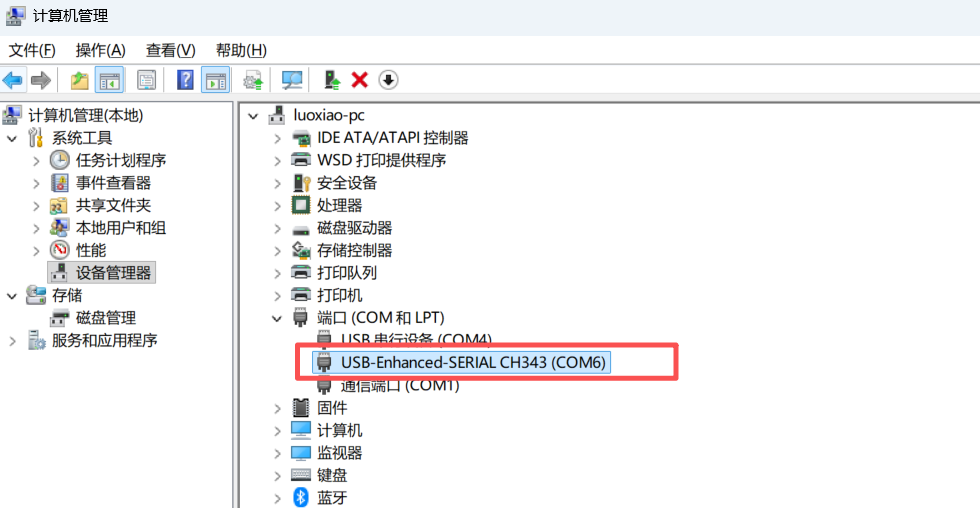

# 固件烧录

本页说明如何下载公开固件并写入 ESP32-S3。接线还没完成时，请先看：[接线与装配](./wiring.md)。

::: tip 官方参考

也可以参考[小智官方烧录教程](https://my.feishu.cn/wiki/Zpz4wXBtdimBrLk25WdcXzxcnNS)。如果你只想烧录 Media Saber 桌面小助手，按本页步骤即可。

:::

## 1. 准备工具

| 工具 | 用途 | 下载 / 说明 |
|---|---|---|
| ESP32-S3 开发板 | 被烧录设备 | 建议使用 N16R8 版本 |
| USB-C 数据线 | 连接电脑与开发板 | 必须支持数据传输 |
| 固件文件 | 写入设备 | [ESP32 固件下载地址](https://github.com/xylplm/media-saber-public/releases/tag/esp32) |
| Espressif Flash Download Tool | Windows 图形化烧录 | 适合新手 |
| esptool.py | 命令行烧录 | 适合 macOS / Linux / 高阶用户 |

## 2. 下载固件

当前固件发布地址：

<https://github.com/xylplm/media-saber-public/releases/tag/esp32>

请下载与你的硬件版本一致的 ESP32-S3 固件包。如果下载到的是 ZIP 压缩包，请先解压。

每个版本会同时提供两种固件包，按你的情况二选一即可：

| 固件包 | 文件 | 适合人群 |
|---|---|---|
| 合并固件包 | `media-saber-esp32s3-ms-helper-merged.zip` | 解压后只有一个 `media-saber-esp32s3-ms-helper.bin`，烧录到地址 `0x0` 即可，推荐新手使用 |
| 分散固件包 | `media-saber-esp32s3-ms-helper-split.zip` | 解压后是 5 个分区固件 + `flash_args`，适合只刷新某个分区或排查问题的进阶用户 |

## 3. 进入下载模式

1. 用 USB 数据线连接 ESP32-S3 开发板与电脑。
2. 如果烧录工具无法识别串口，请按住 **BOOT** 键，再点按 **EN / RESET** 键，最后松开 **BOOT**。
3. 在电脑设备管理器或串口列表中确认出现 `COMx`、`/dev/ttyUSBx` 或 `/dev/ttyACMx`。

<div align="center"></div>

::: tip 电脑找不到串口时

优先换一根确认支持数据传输的 USB 线，再安装开发板对应的 USB 转串口驱动。

:::

## 4. Windows 图形化烧录

1. 打开 Espressif Flash Download Tool。
2. 芯片选择 **ESP32-S3**。
3. 选择正确串口，波特率可先用 `460800` 或 `921600`。
4. 如果使用 **合并固件**，通常只需要写入：

| 地址 | 文件 |
|---:|---|
| `0x0` | 合并固件，例如 `media-saber-esp32s3-ms-helper.bin` |

5. 如果使用 **分散固件**，通常按以下地址填写：

| 地址 | 文件 | 说明 |
|---:|---|---|
| `0x0` | `bootloader.bin` | 引导程序 |
| `0x8000` | `partition-table.bin` | 分区表 |
| `0xd000` | `ota_data_initial.bin` | OTA 初始数据 |
| `0x20000` | `xiaozhi.bin` | 应用固件 |
| `0x800000` | `generated_assets.bin` | 资源分区（字体 / 形象 / 音效），缺失会丢 UI 资源 |

6. 点击开始烧录，等待进度完成后重启开发板。

## 5. 命令行烧录

先安装 esptool：

```bash
pip install esptool
```

擦除旧固件：

```bash
esptool.py --chip esp32s3 --port COM3 erase_flash
```

如果是合并固件：

```bash
esptool.py --chip esp32s3 --port COM3 --baud 921600 write_flash -z 0x0 media-saber-esp32s3-ms-helper.bin
```

如果是分散固件：

```bash
esptool.py --chip esp32s3 --port COM3 --baud 921600 write_flash -z \
  0x0 bootloader.bin \
  0x8000 partition-table.bin \
  0xd000 ota_data_initial.bin \
  0x20000 xiaozhi.bin \
  0x800000 generated_assets.bin
```

分散固件包内还附带了 `flash_args` 文件，可以用一行命令一次烧录全部分区（在解压后的目录里执行）：

```bash
esptool.py --chip esp32s3 --port COM3 --baud 921600 write_flash -z @flash_args
```

::: warning 路径与串口请替换

上面的 `COM3` 和固件文件名只是示例。Windows 用户通常是 `COMx`，macOS / Linux 用户通常是 `/dev/ttyUSBx` 或 `/dev/ttyACMx`。

:::

## 6. 烧录失败怎么办？

- 降低烧录波特率，例如从 `921600` 改成 `460800` 或 `115200`。
- 换 USB 口或 USB 线，优先使用电脑主板直连 USB 口。
- 确认已经进入下载模式，再重新开始烧录。
- 先执行 `erase_flash` 擦除旧固件后再重新写入。
- 如果分散固件启动异常，检查 `generated_assets.bin` 是否写入到 `0x800000`。

## 7. 烧录完成后

烧录完成后重启设备，等待屏幕进入小智或 MS 桌面界面。首次启动和 Media Saber 连接配置请继续看：[首次配置](./configuration.md)。
