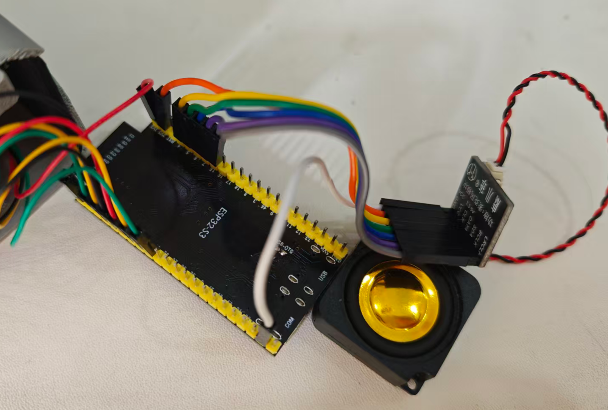

# 硬件 DIY

本页整理 ESP32 桌面小助手的推荐硬件、物料清单和选购注意事项。接线请继续查看：[接线与装配](./wiring.md)。

::: warning 购买前请先确认

下表价格与采购链接会随渠道变化而变化。不同批次模块排针方向、丝印名称可能不同，请以实物与卖家资料为准。

:::

## 🧩 推荐硬件组合

当前公开固件以这套组合为准：

| 模块 | 推荐规格 | 说明 |
|---|---|---|
| 主控板 | ESP32-S3 N16R8 | 16MB Flash + 8MB PSRAM |
| 触摸屏 | TK020F1131 2.0 寸触摸屏 | ST7789 兼容，240×300，CST816 系列触摸 |
| 音频板 | LMD2718 + NS4168 音频模块 | 当前固件推荐音频方案 |
| 喇叭 | 4Ω2W 小喇叭 | 规格按音频模块和外壳空间选择 |
| 连接线 | 母对母杜邦线 / 硅胶线 | 裸板调试更方便 |
| 外壳 | 3D 打印外壳 | 可先裸板调试，再装壳 |

## 🛒 物料清单

| 类别 | 型号 / 关键词 | 数量 | 参考价格 | 采购链接 | 备注 |
|---|---|---:|---:|---|---|
| 主控板 | ESP32-S3 N16R8 开发板 | 1 | 26元 | [参考购买链接](https://m.tb.cn/h.RKa5ObG) | 16MB Flash + 8MB PSRAM，建议选择排针向下焊好版本，推荐双 USB-C 版本，最好带天线底座 |
| 触摸屏 | TK020F1131 2.0 寸触摸屏 | 1 | 23元 | [购买链接](https://e.tb.cn/h.RKajhMdYmBfK8bG?tk=F3WQg6VdDhg) | ST7789 兼容，240×300，CST816 系列触摸；建议购买「液晶屏 + 转接板 + 杜邦线」套餐 |
| 音频板 | LMD2718 + NS4168 音频模块 | 1 | 12元 | [购买链接](https://m.tb.cn/h.RKaNpsQ) | 当前固件推荐音频方案，新手建议购买已焊接版本，也可购买「音频模块 + 喇叭」套餐 |
| 喇叭 | 4Ω2W 小喇叭 | 1 | 2元 | [购买链接](https://e.tb.cn/h.RKC0jeo14Vc2HV3?tk=4YyAg6VR51n) | 如果已经和音频板一起购买可忽略 |
| 连接线 | 2.54mm × 10cm 母对母杜邦线 / 硅胶线 | 若干 | 1.5元 | [购买链接](https://m.tb.cn/h.RpeN62w) | 建议使用柔软细线，方便收纳进外壳 |
| 连接线 | 2.54mm 一母对二公杜邦线 / 硅胶线 | 1 | 2元 | [购买链接](https://m.tb.cn/h.Rpezvd5) | 建议使用短线，方便供电分线 主要是GND不够，尾部遮挡，因此共用里面的插槽 |
| 外壳 | 3D 打印外壳 | 1 | 待补充 | 待补充 | 可先裸板调试，再装壳 |
| 数据线 | USB-C 数据线 | 1 | 略 | 略 | 必须支持数据传输，不能只支持充电 |

::: warning 非销售 / 非推广说明

本项目不销售硬件，也不参与任何商品推广或返利。表中的购买链接仅用于帮助你确认规格与形态，实际购买时只要型号、尺寸、接口和供电规格一致即可。你可以在淘宝、拼多多或其它平台自行比价，哪家合适买哪家。

:::

::: tip 焊接用户可以精简物料

如果你会焊接，部分杜邦线和转接配件可以忽略，只保留主控、屏幕、音频模块、喇叭等核心配件即可。

:::

## 🧭 选购注意事项

### 主控板

- 建议选择 **ESP32-S3 N16R8**，即 16MB Flash + 8MB PSRAM。
- 推荐双 USB-C 版本，调试和供电更方便。
- 如果家庭 Wi-Fi 信号一般，优先选择带外接天线座的版本。
- 注意开发板排针方向，避免装壳时和屏幕、音频模块冲突。

### 屏幕

- 当前固件以 **TK020F1131，2.0 寸，240×300** 为准。
- 屏幕驱动需兼容 ST7789，触摸 IC 需兼容 CST816 系列。
- 购买时建议选带转接板和杜邦线的套餐，裸屏排线不适合新手直接接线。

### 音频模块

- 当前固件以 **LMD2718 + NS4168** 音频方案为准。
- 如果你使用 INMP441、MAX98357A 或其它音频模块，请先确认对应固件是否支持。
- 接线正确但驱动不匹配时，可能出现无声、麦克风无输入或唤醒失败。

### 外壳

- 建议先裸板调试，确认屏幕、触摸、音频、联网都正常后再装壳。
- 外壳方案定稿前，可以先用支架、热熔胶或临时固定方式测试摆放角度。

## ✅ 下一步

硬件准备好后，请继续阅读：[接线与装配](./wiring.md)。
