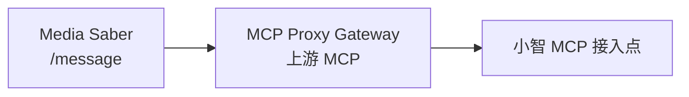

# MCP 网关接入 MS 服务

部署好 MCP Proxy Gateway 后，还需要把 Media Saber 自带的 MCP 服务添加为“上游 MCP”。这样小智通过网关连接后，才能调用 MS 的订阅、站点、媒体库等能力。

::: tip 先准备好这些信息

- Media Saber 访问地址，例如 `http://192.168.1.100:8888`。
- Media Saber API KEY。
- 已经能登录 MCP Proxy Gateway 管理界面。

:::

## 🧭 接入关系



Media Saber MCP 连接地址通常是：

```text
http://你的MS地址:端口/message
```

示例：

```text
http://192.168.1.100:8888/message
```

认证请求头为：

```text
Authorization: Bearer 你的API_KEY
```

## 1. 获取 Media Saber API KEY

1. 登录 Media Saber。
2. 进入 [我的信息](/usage/main_page/my_info.html)。
3. 切换到 **安全配置** 标签页。
4. 在 **API KEY 管理** 区域新增或复制已有 API KEY。
5. 保存好这个 API KEY，后面填入 MCP Proxy Gateway。

::: warning 注意 Bearer 格式

Media Saber MCP 使用 `Authorization` 请求头，值需要写成 `Bearer sk-xxxx`。在 MCP Proxy Gateway 中选择「Bearer Token」时，只需要把 `sk-xxxx` 这段 API KEY 填进去，网关会自动拼成 `Authorization: Bearer sk-xxxx`。

:::

## 2. 新建上游 MCP

登录 MCP Proxy Gateway 管理界面，进入：

```text
上游 MCP → 新建上游 MCP
```

按下面填写：

| 配置项 | 推荐填写 |
|---|---|
| 名称 | `Media Saber` 或 `MS MCP` |
| 传输方式 | `远程 HTTP` |
| 服务地址 | `http://你的MS地址:端口/message` |
| 认证方式 | `Bearer Token` |
| 凭证 | Media Saber API KEY，例如 `sk-xxxx` |
| 启用 | 开启 |
| 自动同步 | 开启 |

::: tip 服务地址怎么填？

如果你的 Media Saber Web 访问地址是：

```text
http://192.168.1.100:8888
```

那么 MCP 服务地址就是：

```text
http://192.168.1.100:8888/message
```

如果你通过 HTTPS 反向代理访问 Media Saber，也可以使用：

```text
https://你的域名/message
```

:::

## 3. 同步工具列表

保存上游 MCP 后，回到上游列表：

1. 找到刚创建的 `Media Saber` 上游。
2. 确认状态为启用。
3. 点击同步或等待自动同步。
4. 进入工具列表，确认能看到 Media Saber 相关工具。

如果工具列表为空，请先检查：

- Media Saber 地址是否可以从 MCP Proxy Gateway 容器访问。
- API KEY 是否正确且仍处于启用状态。
- 服务地址末尾是否带了 `/message`。
- 认证方式是否选择了 `Bearer Token`。

## 4. 推荐配置

### 小智接入场景

如果接下来要把这些工具提供给小智，建议：

- MCP Proxy Gateway 小智接入使用 **全量模式**。
- Media Saber 上游保持启用。
- 第一次接入时不要先配置屏蔽规则，确认可用后再精简工具。

### 工具太多怎么办？

可以先让小智全量接入确认成功，再到 MCP Proxy Gateway 中配置别名、屏蔽规则或分组，只保留适合语音调用的工具。

## 5. 常见问题

### 保存后同步失败

- 检查 `http://你的MS地址:端口/message` 是否能被网关容器访问。
- 如果网关和 MS 在不同 Docker 网络，优先使用 NAS IP + MS 端口。
- 如果 MS 走 HTTPS 反向代理，确认反向代理允许访问 `/message`。

### 返回认证失败

- 确认 API KEY 没有复制错。
- 确认 API KEY 在 Media Saber 的“我的信息 → 安全配置”里仍处于启用状态。
- 确认 MCP Proxy Gateway 的认证方式选择的是 `Bearer Token`，不是 `API Key Header`。

### 小智仍然调用不到 MS 工具

- 先在 MCP Proxy Gateway 工具列表里确认 MS 工具已经同步出来。
- 再检查 [小智 MCP 对接 MS](./xiaozhi-mcp.md) 中的小智接入状态是否在线。
- 确认小智接入模式使用的是 **全量模式**。

## 🔗 相关文档

- [Media Saber MCP 服务](/usage/ai/mcp.html)
- [API KEY 获取与管理](/usage/main_page/my_info.html)
- [MCP 网关 Compose 部署](./mcp-gateway-compose.md)
- [小智 MCP 对接 MS](./xiaozhi-mcp.md)
