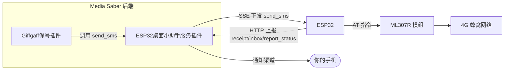

# 4G 短信与设备状态

ESP32 桌面小助手**可选**外挂一块 **ML307R 4G 模组**，实现短信收发中转：后端插件下发指令 → 小助手控制模组发短信；模组收到短信 → 回传后端通知你。配合 **[Giffgaff 保号](/usage/cultivation_secrets/giffgaff_keep_alive.html)** 等定时插件还能自动发保号短信。不接模组时，小智语音、NAS 看板、消息中心等**照常可用**，只是没有短信能力。此外，小助手会定时把设备状态（WiFi 信号、模组状态等）上报后端，并在用户中心页展示。

::: tip 适合谁？

- 有 Giffgaff 等需要定期发短信保号的手机卡，想让设备自动发，不用手动。
- 想让小助手接收某个号码的短信并通过 Media Saber 通知渠道转发给自己。
- 想在桌面看一眼设备的 WiFi 信号、短信模组连接状态。

:::

::: warning 这是可选扩展

4G 短信是 **可选功能**，不接 ML307R 模组的小助手一切照常使用，用户中心页也不会出现短信模组相关内容。本页内容仅对需要短信能力的用户。

:::

## 🔧 硬件准备

| 模块 | 推荐规格 |
|---|---|
| 4G 模组核心板 | ML307R 系列（兼容 ML307A / AIR780E / EC800E 封装），**必须为 AT 固件版**（非 DTU 透传版） |
| SIM 卡 | NanoSIM（如 Giffgaff 保号卡） |
| 天线 | 4G 主天线（核心板通常自带接口） |
| 电源 | 见下方「供电方案」，**不能直接用 ESP32 的 3V3** |

::: danger 固件版本必须对

下单时务必确认核心板刷的是 **AT 固件**。DTU（透传）固件会吃掉 AT 指令，无法收发短信。到手后用串口工具发 `AT`，回 `OK` 即为 AT 固件版。

:::

## 🔌 接线方案

ML307R 核心板 UART 为 TTL 3.3V，与 ESP32-S3 直连，无需电平转换。

| ML307R 引脚 | ESP32-S3 GPIO | 说明 |
|---|---:|---|
| GND | GND | **必须共地** |
| +5V | 独立 5V 电源 | 宽压输入（5~12V），或改用 BAT 接 3.7V 锂电池 |
| EN | GPIO10 | 电源使能（高电平通电），软件可控上电 / 硬重启 |
| RXD | GPIO9 | UART1 TX，ESP32 发 → 模组收 |
| TXD | GPIO8 | UART1 RX，模组发 → ESP32 收 |
| NET | 悬空 | 网络指示灯（可选接 LED 观察） |
| BOOT / USB_DN / USB_DP | 悬空 | 不用 |

> GPIO9/8/10 已确认未被屏幕（SPI）、触摸（I²C）、音频（I²S）、PSRAM、strapping pin 占用。

## ⚡ 供电方案（关键）

ML307R 待机仅 30~70mA，但 **短信 / 联网发射瞬间峰值电流可达约 2A**。供电要点：

| 方案 | 接法 | 评价 |
|---|---|---|
| **BAT + 3.7V 锂电池** ⭐推荐 | 锂电池正极 → BAT，负极 → GND + ESP32 GND | 电池天然扛 2A 放电，完全隔离 ESP32 3V3，最稳 |
| +5V 独立电源 | 5V → +5V，GND 共地 | 模组内部 LDO 降压，需独立 5V 源 |
| ESP32 5V(VBUS) + 电容 | 板上 5V 引脚 → +5V，就近加 470μF 电解 | 需 USB 源 ≥2A，加电容吸收尖峰 |
| ❌ 共用 ESP32 3V3 | — | 发射尖峰会拉跨 3V3，导致 ESP32 复位 / 音频爆音，**禁止** |

核心原则：**绝不用 ESP32 的 3V3 给 ML307R 供电**；GND 必须与 ESP32 共地。

## ⚙️ 工作原理

WiFi 仍是小助手连 Media Saber 后端的 **主链路**；ML307 仅作为短信专用模组，**不走 PPP 上网**，与小智网络流程完全隔离。

- **发短信**：后端插件（或保号插件调用）下发 `send_sms` 指令 → 小助手收到后通过 AT 指令让模组发送 → 发送结果回执上报后端。
- **收短信**：模组收到短信主动上报（URC）→ 小助手读出内容 → 上报后端 → 按你的通知渠道转发（企业微信 / Bark / Telegram 等）。
	- **设备状态**：小助手定时上报 WiFi 信号 / 连接状态 / 模组状态；后端在插件「设备与短信」页展示**最近一次上报**，用户中心页进入时显示本机快照。

### SSE 连接类型（`client` 参数）

小助手、Web 消息中心、手机 APP 都会连后端的 `/api/v1/eventMessage/event`，但用途不同。连接时请带上查询参数 **`client`**，后端才能正确统计「小助手是否在线」、并**只向小助手下发**发短信等设备指令：

| `client` 值 | 端 | 说明 |
|---|---|---|
| `esp32_desktop` | ESP32 桌面小助手 | 定制固件已默认带上；可收设备指令、发短信 |
| `web` | 浏览器 Web | 消息中心、系统升级通知等 |
| `app` | 手机 APP | 同上，与 Web 分开统计 |

::: warning 在线状态别看错

插件里「小助手在线」**只统计** `client=esp32_desktop` 的连接。仅开着浏览器或 APP 时，**不会**算作小助手在线，也无法下发短信。

:::

## 🧩 后端插件配置

在「秘术宝阁」安装并启灵 **[ESP32 桌面小助手服务](/usage/cultivation_secrets/esp32_desktop_assistant.html)** 插件。配置页为**自定义界面**（非通用动态表单），分两个选项卡：

| 选项卡 | 内容 |
|---|---|
| **基础设置** | 是否启灵、短信接收转发、失败通知 |
| **设备与短信** | 小助手在线状态、刷新、最近上报、手动填写手机号与内容**发送短信** |

::: tip 配合的固件

本插件需配合 **Media Saber ESP32 桌面小助手定制固件** 使用，不是任意 ESP32 设备都能用。设备制作与刷录见本目录 [引言](./README.md) 与 [固件烧录](./flashing.md)。**4G 模组为可选扩展**，不装模组也可刷同一固件使用除短信外的全部功能。

:::

**基础设置说明：**

| 配置 | 说明 |
|---|---|
| 短信接收转发 | 开启后，小助手收到新短信会通过你已开启的消息渠道转发给你（需装配 ML307R） |
| 失败通知 | 短信发送失败时发送通知（需打开插件消息通知） |

**短信内容说明：** 文本模式默认 GSM 字符集，适合英文 / 数字（保号短信一般够用）。中文短信需模组支持 UCS2 编码，作为进阶能力后续完善。

## 🔄 与 Giffgaff 保号联动

[Giffgaff 保号提醒](/usage/cultivation_secrets/giffgaff_keep_alive.html) 插件新增了 **发送方式** 选项，可让小助手自动发保号短信：

| 方式 | 行为 |
|---|---|
| 仅通知 | 原逻辑，发通知提醒你手动发短信 |
| 走短信 | 自动调用 ESP32 桌面小助手服务插件发送保号短信 |
| 两者都做 | 通知 + 短信都执行 |

选择「走短信」或「两者都做」时，保号插件会在触发条件时调用小助手服务插件发送保号短信。发送失败会按「失败通知」设置兜底告警。**自动保号同一天最多触发一次**，避免异常情况下重复发送。

::: tip 手动测试安全

保号插件的「手动运行一次」仍只走通知逻辑（测试用），不会真的发短信。自动定时触发到条件时才会按发送方式执行。

:::

## 📱 用户中心查看状态

在桌面 **应用入口 → 用户中心** 页面，会显示本机设备状态：

- **WiFi**：连接状态、SSID、IP、信号强度（dBm）。
- **短信模组**：仅装配了 ML307R 且握手成功才显示（纯 WiFi 设备无此行）。

状态在进入页面时取一次快照展示，不持续刷新。

## ✅ 验证步骤（模组到手后）

1. **确认 AT 固件**：串口发 `AT`，回 `OK` 即 AT 版。
2. **确认小助手在线**：打开插件「设备与短信」页，应显示「小助手在线」；若仅 Web/APP 开着会显示不在线。
3. **单条测试**：在插件「设备与短信」页填写号码与内容，点「发送短信」，手机收到即链路通。
4. **收件测试**：向 ML307 卡发一条短信，看是否通过通知渠道转发给你。
5. **保号联动**：Giffgaff 选「走短信」，等定时触发或临时把提醒天数调小测试。

## ❓ 常见问题

**Q：模组握手一直失败？**
检查：① 是否 AT 固件版（发 `AT` 回 `OK`）；② TX/RX 是否接反；③ 供电是否独立且充足（发射峰值 2A）；④ 共地是否接好；⑤ EN 是否拉高。

**Q：纯 WiFi 设备会被影响吗？**
不会。没接 ML307R 的设备，握手会重试几次后放弃并静默，不影响任何现有功能，用户中心也不会显示短信模组行。

**Q：能发中文短信吗？**
当前默认 GSM 字符集只支持英文 / 数字。中文需 UCS2 + PDU 编码，作为进阶能力。

**Q：设备状态上报有什么用？**
后端会保存最近一次上报，在插件「设备与短信」页可查看；用户中心页显示本机快照。后续可扩展离线告警等。

**Q：没装 4G 模组能用小助手吗？**
能。语音、NAS、站点、消息中心等都不依赖模组；只是无法收发短信，保号请用「仅通知」或手动发短信。
