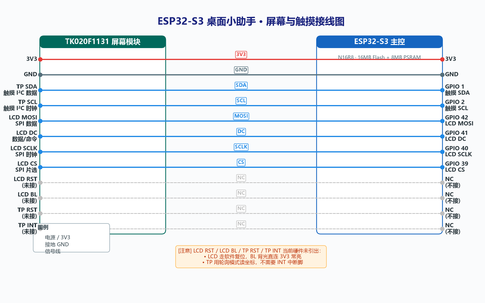
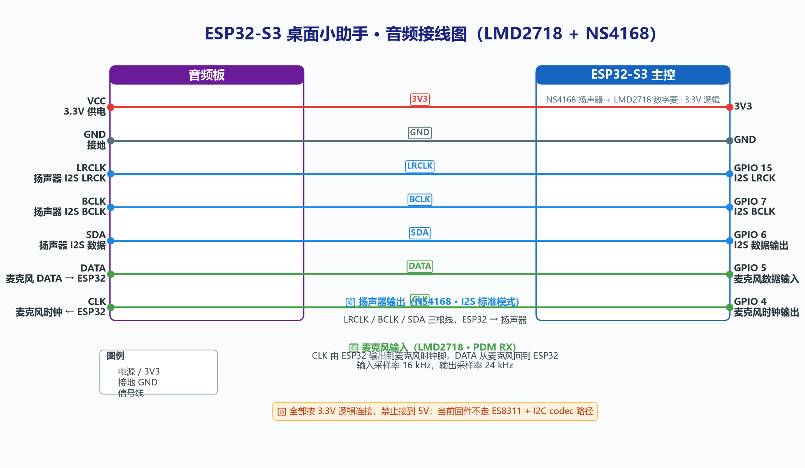
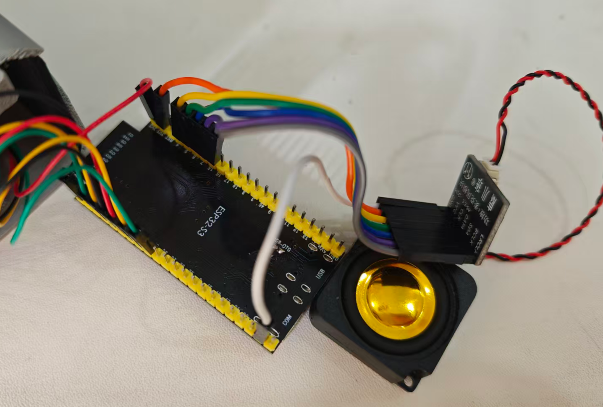

# 接线与装配

本页说明 ESP32-S3、触摸屏和音频模块的接线方式。还没有准备硬件时，请先看：[硬件 DIY](./hardware.md)。

::: danger 接线前必读

- 请在断电状态下接线，确认无误后再通电。
- 当前方案统一按 **3.3V 逻辑** 连接，不要把屏幕或音频信号线接到 5V。
- ESP32-S3 的 IO 编号请以开发板丝印或资料为准，避免把 `GPIO` 与物理排针序号混淆。
- 首次上电前建议用万用表检查 3V3 和 GND 是否短路。

:::

## 🖼️ 屏幕与触摸接线

| 屏幕模块端 | ESP32-S3 | 说明 |
|---|---|---|
| 3V3 | 3V3 | 屏幕与触摸供电 |
| GND | GND | 接地 |
| TP SDA | GPIO 1 | 触摸 I²C 数据 |
| TP SCL | GPIO 2 | 触摸 I²C 时钟 |
| LCD MOSI | GPIO 42 | 屏幕 SPI 数据 |
| LCD DC | GPIO 41 | 屏幕数据 / 命令切换 |
| LCD SCLK | GPIO 40 | 屏幕 SPI 时钟 |
| LCD CS | GPIO 39 | 屏幕 SPI 片选 |
| LCD RST | 悬空 / NC | 当前硬件未接，固件走软复位 |
| LCD BL | 悬空 / NC | 背光直连 3V3，常亮 |
| TP RST | 悬空 / NC | 当前硬件未接 |
| TP INT | 悬空 / NC | 当前硬件未接，固件使用轮询触摸 |

::: info 背光说明

当前屏幕背光直连 3V3，属于常亮方案。固件可以关闭画面内容，但无法真正断开背光供电。

:::

## 🔊 音频接线

| 音频模块端 | ESP32-S3 | 用途 |
|---|---|---|
| LRCLK | GPIO 15 | 扬声器 I2S LRCK |
| BCLK | GPIO 7 | 扬声器 I2S BCLK |
| SDA | GPIO 6 | 扬声器 I2S 数据 |
| DATA | GPIO 5 | 麦克风 DATA，输入到 ESP32 |
| CLK | GPIO 4 | 麦克风数字时钟 |
| VCC | 3V3 | 供电 |
| GND | GND | 接地 |

::: warning 音频模块要和固件匹配

当前固件以 **LMD2718 + NS4168** 音频方案为准。若你使用 INMP441、MAX98357A 或其它音频模块，请先确认对应固件是否支持，避免接线正确但驱动不匹配导致无声或无麦克风输入。

:::

## ✅ 上电前检查清单

- 屏幕 `3V3` 和 `GND` 没有接反。
- 触摸的 `TP SDA` / `TP SCL` 分别接到 GPIO 1 / GPIO 2。
- 屏幕 SPI 的 `MOSI`、`SCLK`、`CS`、`DC` 没有交叉。
- 音频模块 `VCC` 使用 3.3V 供电。
- 喇叭正负极已经接到音频模块输出端。
- USB-C 数据线支持数据传输，后续烧录时电脑能识别串口。

## 🧰 装配建议

- **先裸板调试，后装外壳**：确认屏幕、触摸、音频、联网都正常后再固定。
- **线材尽量短而软**：屏幕和音频模块放进外壳后，过硬的线容易顶住屏幕或造成接触不良。
- **注意 Wi-Fi 天线位置**：不要让金属外壳、喇叭磁铁或线束压住天线区域。
- **保留 USB 接口空间**：装壳后仍需要能插入 USB 线，用于供电、重刷和串口排查。

## 🔜 下一步

接线完成后，请继续阅读：[固件烧录](./flashing.md)。
