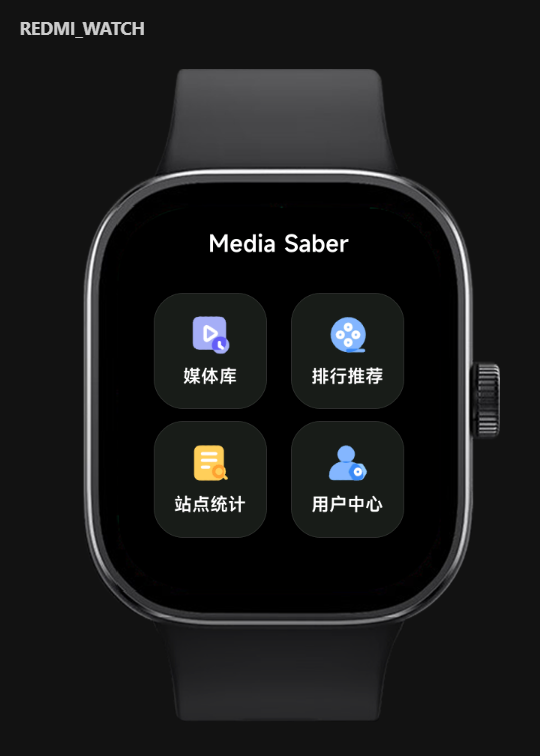
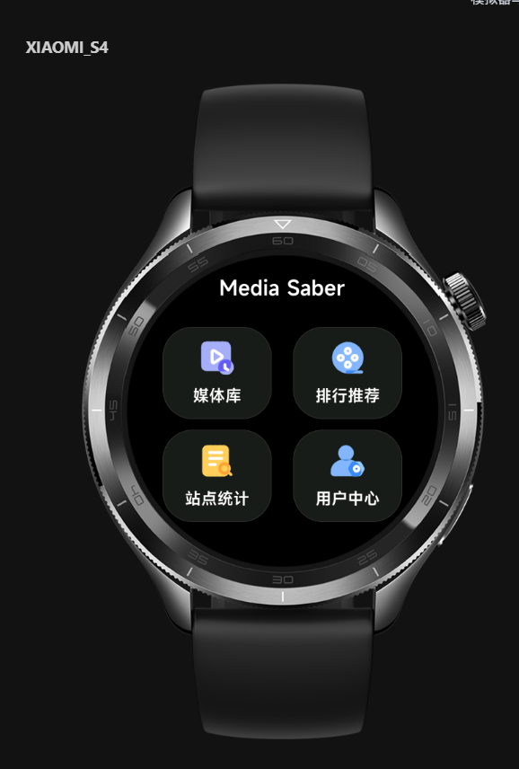
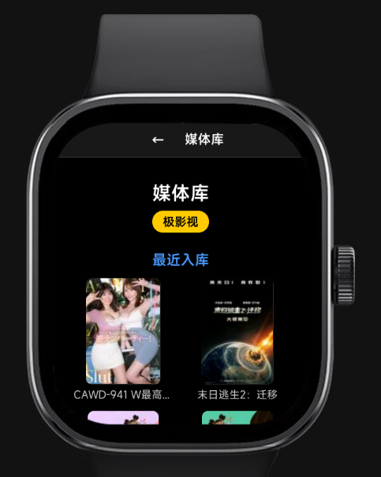
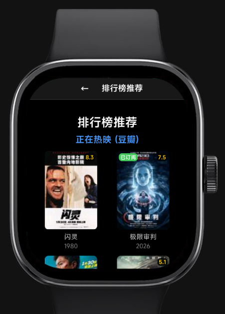
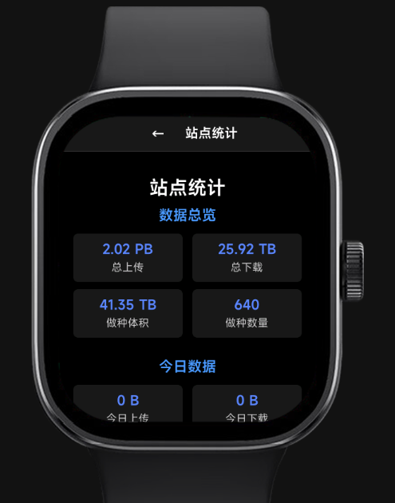
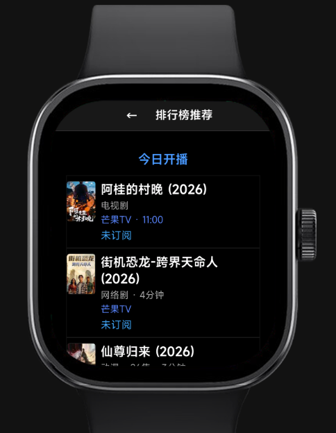

# Media Saber 小米手表客户端

> Media Saber 小米手表客户端是一款专为小米手表用户设计的应用，让你在手腕上也能轻松管理影音、追踪动态！

## 📱 主界面

  

    
    
REDMI Watch 5 主界面

  

  

    
    
Xiaomi Watch S4 主界面

  

---

## 📱 界面预览

  

    
    
📥 媒体服务界面

  

  

    
    
📈 榜单推荐界面

  

  

    
    
📊 站点数据界面

  

  

    
    
📺 今日开播界面

  

---

## ✅ 支持型号

### 📱 支持的手表设备

- **REDMI 系列**：REDMI Watch 5、REDMI Watch 6
- **Xiaomi 系列**：Xiaomi Watch S1 Pro、Xiaomi Watch S3、Xiaomi Watch S4 等主流小米手表

---

## ✨ 核心功能

### 📥 媒体服务

**功能特性**

- 最新入库媒体列表 - 实时获取最新添加到媒体库的内容
- 最近观看列表 - 快速访问你正在追看的剧集和电影
- 一键同步 - 手表与服务端数据实时同步

**使用方法**

- 在主屏幕选择"媒体库"即可浏览
- 点击条目查看详细信息
- 支持快速标记观看状态

### 📈 榜单推荐

**推荐内容**

- **正在热映榜** - 当前热映的豆瓣榜单
- **今日开播榜** - 今日新开播的电视剧
- **豆瓣排行** - 豆瓣评分排行推荐

**快捷操作**

- 浏览推荐内容
- 一键订阅感兴趣的作品
- 获取播出时间提醒

### 📊 站点数据

**数据概览**

- **总览统计** - 站点整体数据一览
- **今日数据** - 今日新增做种、上传等数据
- **站点列表** - 各个 PT 站点详细信息展示

**功能特点**

- 清晰的数据展示
- 实时数据同步
- 支持多站点对比

### 👤 个人中心

**功能介绍**

- **账户信息** - 显示登录用户信息
- **账户同步** - 支持多手表账户切换
- **数据同步** - 数据随身携带，随时随地访问

**同步管理**

- 轻松切换账户
- 一键同步最新数据
- 离线缓存支持

---

## 🚀 快速开始

### 📦 安装指引

#### 安装方式

安卓用户推荐使用 **AstroBox app** 连接小米手表：

1. 打开 AstroBox app
2. 选择「安装快应用」
3. 搜索或选择 **Media Saber 手表客户端**
4. 点击安装

#### 下载资源

获取最新版本：[GitHub Releases](https://github.com/xylplm/media-saber-xiaomi-watch-public/releases)

### 🔧 初始化步骤

安装完成后，按照以下步骤完成账户绑定：

**第一步：手表准备**
1. 通过小米运动健康连接手表
2. 打开手表上的 Media Saber 客户端
3. 点击「连接手机」，保持亮屏

**第二步：手机端同步**
1. 打开手机端 Media Saber
2. 进入【个人中心】→ 手表绑定
3. 点击「同步账户信息到手表」
4. 等待提示同步成功

**第三步：自动登录**
1. 回到手表
2. 自动登录完成，即可开始使用

---

## 🔧 故障排除

### 常见问题

**❌ 网络连接失败**

- ✅ 确保小米运动健康与手表保持活跃连接
- ✅ 检查手表与手机的蓝牙连接状态
- ✅ 确认 Media Saber 服务正在运行

**❌ 账户同步失败**

- ✅ 检查网络连接是否正常
- ✅ 确保手表保持亮屏状态
- ✅ 重新尝试同步账户信息

**❌ 配置存储失败**

- ✅ 这可能是框架问题，建议直接长按表冠重启手表
- ✅ 重启后大多数问题会自动解决
- ✅ 重启完成后重新同步账户信息

**❌ 数据显示不正确**

- ✅ 手动触发数据刷新
- ✅ 检查服务端数据是否正常
- ✅ 尝试重新连接手表

### 调试建议

遇到问题时可尝试：

1. 长按手表表冠重启设备
2. 在手机端重新同步账户信息
3. 卸载后重新安装客户端
4. 查看 Media Saber 服务端日志

---

## 📋 系统要求

| 项目 | 要求 |
|------|------|
| **手表型号** | REDMI Watch 5/6、Xiaomi Watch S1 Pro、S3、S4 等主流小米手表 |
| **系统要求** | 小米手表系统（快应用支持） |
| **网络连接** | 需要与服务端连接的网络 |
| **配对要求** | 需通过小米运动健康与手机配对 |
| **服务端** | Media Saber 服务需正常运行 |

---

## 🆕 版本信息

### v1.0（当前版本）

**🎉 核心功能**

- ✨ 媒体服务 - 最新入库、最近观看列表
- 📈 榜单推荐 - 正在热映、今日开播、豆瓣排行
- 📊 站点数据 - 总览、今日数据、站点列表
- 👤 个人中心 - 账户同步、数据随身

**🔧 功能特点**

- 支持多款小米手表型号
- 实时数据同步
- 简洁高效的手表界面
- 无缝账户绑定体验

---

## 📚 相关资源

- [GitHub 仓库](https://github.com/xylplm/media-saber-xiaomi-watch-public)
- [发布版本](https://github.com/xylplm/media-saber-xiaomi-watch-public/releases)
- [问题反馈](https://github.com/xylplm/media-saber-xiaomi-watch-public/issues)

---

> **💡 提示**：本客户端专为 Media Saber 用户设计，需要配合 Media Saber 服务使用。使用过程中请遵守相关法律法规和网站服务条款。
