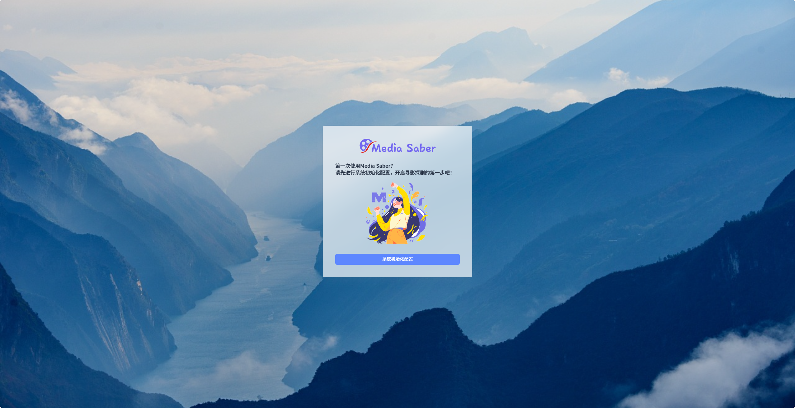

## 👋 欢迎使用 Media Saber

首先欢迎大家使用 **Media Saber**！  
如果你对这个项目感兴趣，也非常欢迎加入我们，一起开发与维护 Media Saber～

---

## 🎯 项目背景

**技术栈：**
- 🖥️ **前端**：Angular
- 📱 **移动客户端**：Flutter
- ⚙️ **后端**：Go

本项目由多位热心 Pter 成员联合开发，初衷是打造一款 **全新、高效、稳定、快速、功能强大且方便好用** 的媒体管理工具。

鉴于某些公开项目曝光度太高导致项目风险大，**Media Saber** 定位为**私密项目**，仅限开发组自用与少量受邀用户使用。

---

## 📢 重要说明

虽然我们提供了赞赏功能，但需要特别强调：

| 项目 | 说明 |
|------|------|
| 💰 **项目属性** | 本项目为私密项目，不接受任何形式的捐赠或收费，所有获得授权的用户享受平等的功能权限 |
| 🎁 **赞赏含义** | Wiki 页面的赞赏功能仅作为对开发组辛苦付出的自愿致敬和鼓励 |
| ⚖️ **赞赏效果** | 赞赏金额与使用权限、邀请资格完全无关，无论是否赞赏都不会改变您的用户权限状态 |
| ✅ **明确承诺** | 赞赏不会为您带来任何特殊权利、特权、优先级、额外帮助或邀请资格 |

:::danger 🚫 严正声明
我们坚决拒绝任何形式的破解行为和公开传播，违反此承诺的行为将承担相应法律责任。我们的初心是为了保证项目的稳定性和可持续发展，坚持不商业化、不收费的原则。

**一切解释权在 Media Saber 开发组！**
:::

---

## 📈 获得使用权限

✨ **如果您已获得使用权限，感谢您的支持！**

📝 **如何申请获得权限：**
1. 在 [GitHub Issue](https://github.com/xylplm/media-saber-public) 中证明你的才能（不保证通过率）
2. 通过朋友私下邀请
3. ⚠️ 拒绝任何居心不良的申请

---

## 📅 Media Saber 项目发展

| 版本 | 描述 |
|------|------|
| **1.0** | 原作者停止维护，项目源于 NasTool，由社区热心成员接力继续开发 |
| **2.0** | 项目正式独立，更名为 **Media Saber**，简称 **MSaber**（直译为 **媒体军刀**） |
| **3.0** | 已采用全新企业级架构：**Angular + Go** 全面重构，提高系统性能与可维护性 |

---

## 🔗 常用链接

- 🐳 **Docker 镜像**：<https://hub.docker.com/r/xylplm/media-saber>
- 📖 **Wiki 文档仓库**：<https://github.com/xylplm/media-saber-wiki>  
  （欢迎大家 PR 一起完善文档！）
- 💬 **GitHub 主仓库**：<https://github.com/xylplm/media-saber-public>

---

## 📚 开始之前推荐阅读

按以下顺序阅读，快速上手：

1. 📌 [**常见问题**](/guide/problem) - 安装/使用过程中的常见异常与解决方案
2. 🚀 [**安装之前**](/guide/init/initialize) - 镜像说明、部署前的准备事项
3. 🔧 [**初始化配置**](/guide/init/) - 完成系统初始化和基础配置
4. 📂 [**文件整理**](/usage/media_organization/) - 整理方式对比与建议

---

## 🎬 首次进入截图

下图展示了 Media Saber 初次启动后的主界面：

---

💡 **提示**：更多详细说明请查阅其他文档页面，祝你使用愉快！
