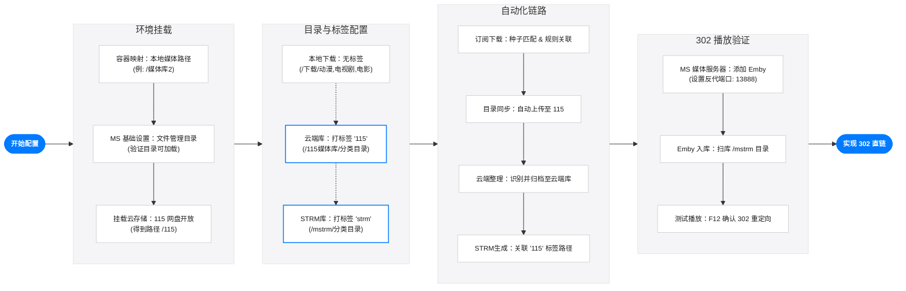
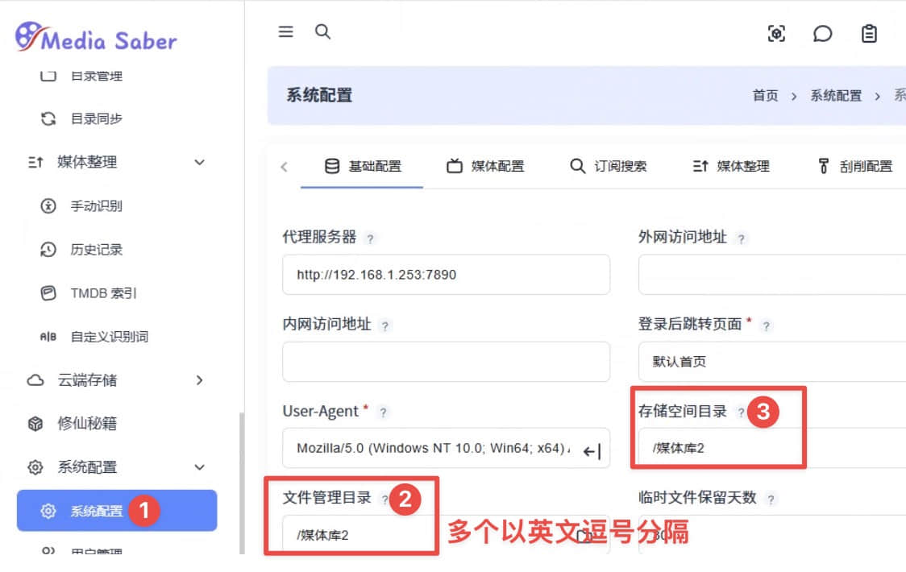
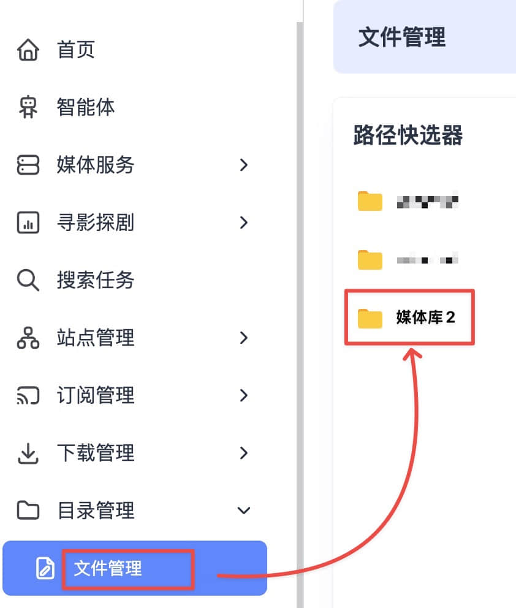
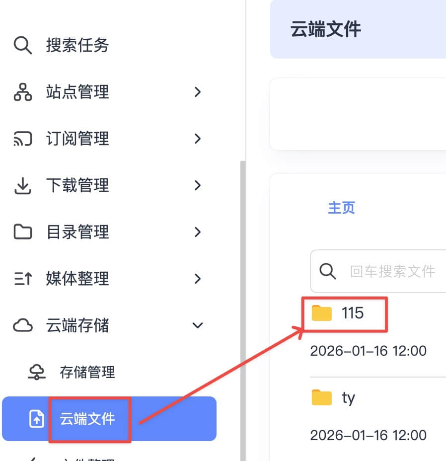
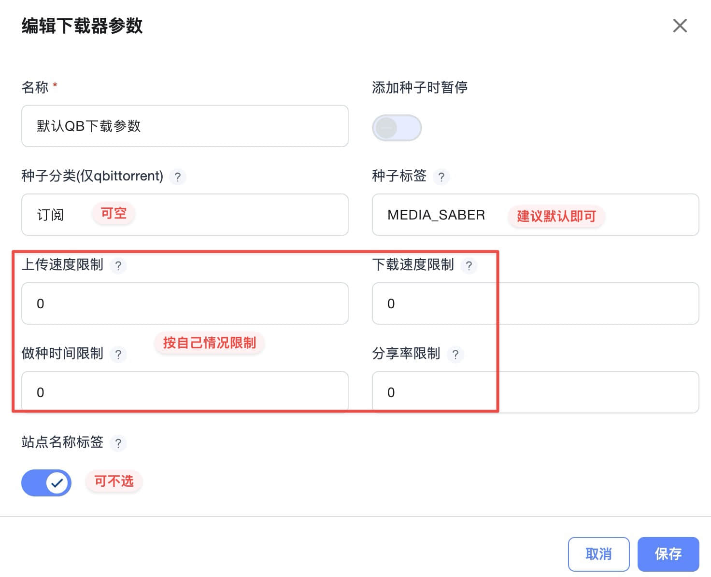
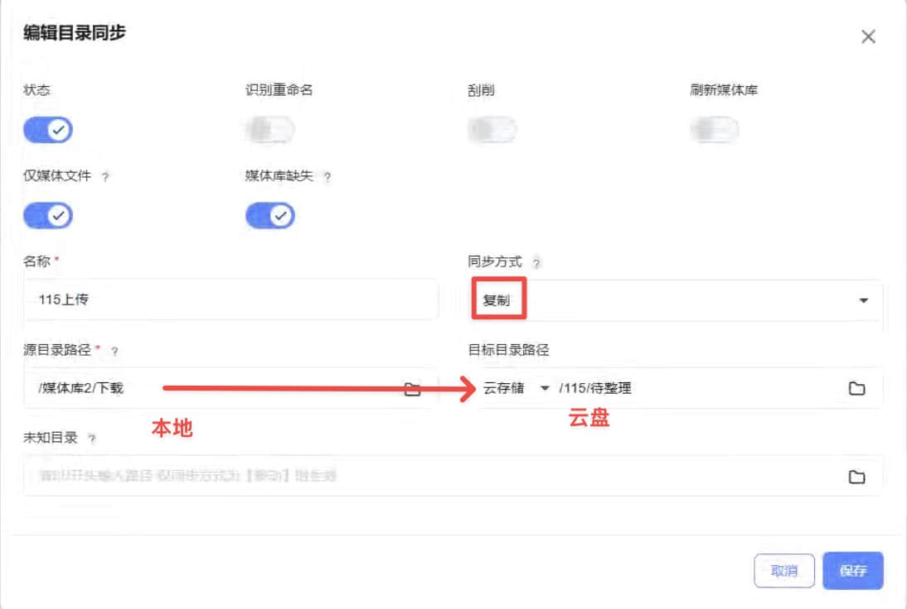
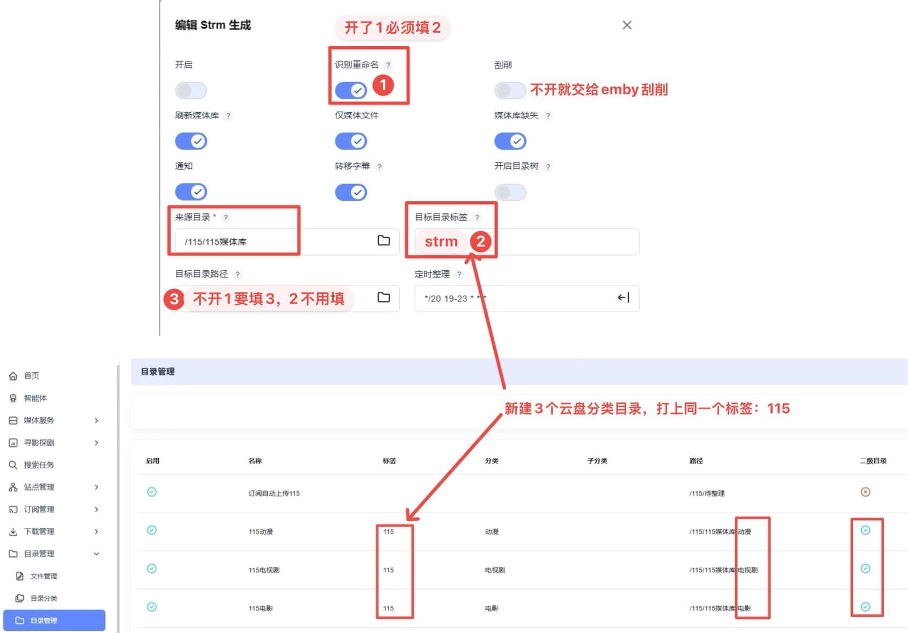
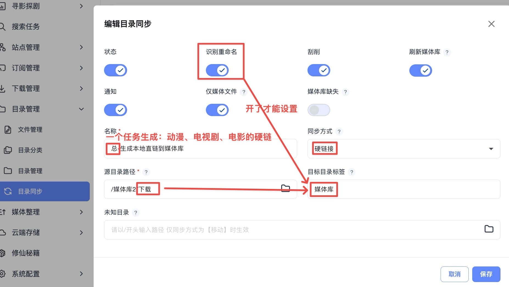
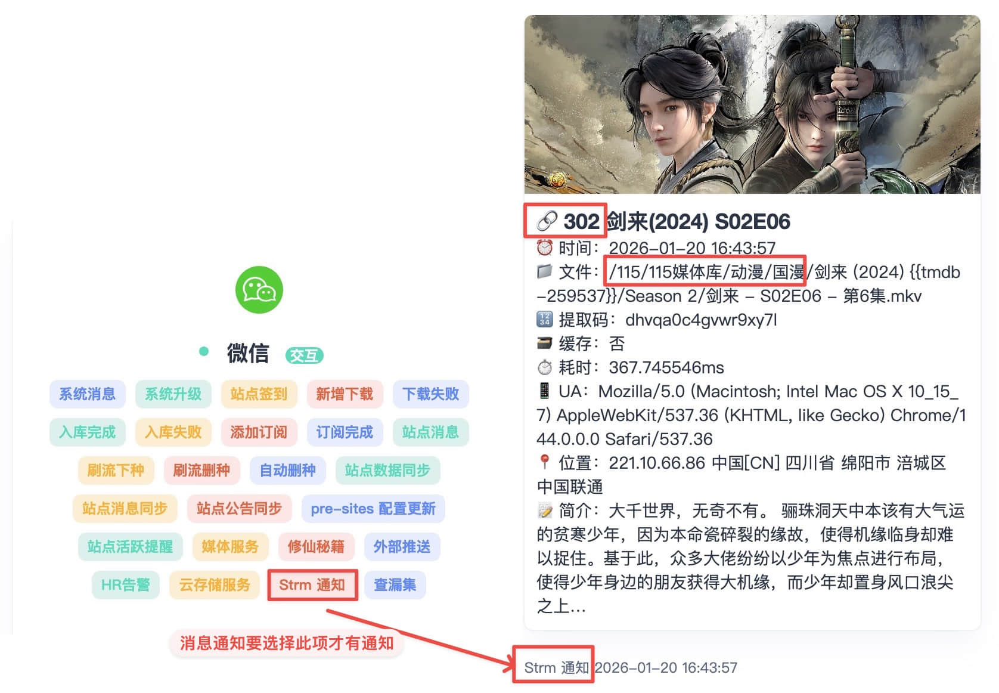

## strm 流程图

总流程：1.订阅下载到目录->2.自动上传云盘->3.自动整理网盘后分类->4.生成strm到本地->5.emby读取strm走302

核心步骤说明（对应图中逻辑）：
- 资源订阅 -> 本地下载：通过 MS 设置种子匹配规则并关联 QB 下载。
- 本地下载 -> 云端上传：利用目录同步功能将下载完成的文件推送到云盘。
- 云端上传 -> 自动整理：云存储整理功能将“待整理”变为“已分类媒体库”。
- 分类归档 -> 生成 STRM：基于整理后的云端路径，在本地指定目录生成 .strm 文件。
- Emby 入库 -> 302 播放：Emby 扫描 STRM，用户点击播放时，由 MS 劫持并重定向至云盘直链。

## 📋 详细配置步骤

## 一、前置准备

### 1.1 挂载硬盘路径

- ms-系统配置-系统配置-基础配置
    - 设置：存储空间目录、文件管理目录
        - 单个：/媒体库2
        - 多个以英文逗号分隔, 如：/媒体库2,/媒体库3,/media4,/volume2
        - 

#### 1.2.1 验证本地文件目录挂载

- 能在 目录管理-文件管理 里选择：`/媒体库2` 目录，并加载里面的文件
    - 

### 1.3 挂载云存储

1. ms-云存储-添加115网盘开放，得到一个云盘路径：`/115` 
2. 配置1个网盘自动上传路径，可以直接使用ms自动整理一条龙！也可交给cms/sa等软件自动整理

#### 1.3.1 验证云端存储目录挂载

- 在云端存储里能选择：`/115` 目录，并加载出云盘的文件
    - 

### 1.4 目录分类

- ms-目录管理-目录分类
    - 生成默认的分类即可
    - 如已存在分类不确定是否正确，可删除所有再点生成默认分类。

### 1.5 配置目录

需要创建如下目录：

| 目录用途 | 本地路径示例 | 目录分类标签 | 关键说明 |
| :--- | :--- | :--- | :--- |
| **本地下载** | `/媒体库2/下载/动漫...` | (空) | 仅作中转下载，无需标签 |
| **网盘分类** | `/115媒体库/动漫...` | `115` | **重要**：用于云端自动整理的目标 |
| **STRM库** | `/mstrm/动漫...` | `strm` | **重要**：Emby 最终挂载的目录 |

- ms-目录管理-目录管理
    - 新建3个 本地下载 的 分类目录，3个strm的分类目录、还有 `3个 115 目录` 后面自动整理会用到、如有需要还可以创建 3个 媒体库 目录。
    - 
    - 对着上面的图片配置，配完看看列表跟上图的选项 勾选 是否一致就行，自己改了路径的：可以自己用脑子跟图片的对应起来。
- **防止动漫分类到电视剧目录：**
    - `动漫` 目录要 移到 `电视剧` 的前面，目录是从上往下识别分类的。

#### 1.5.1 本地下载目录

- ms-目录管理-目录管理
    - 新建3个本地下载目录（/媒体库2/下载/动漫、/媒体库2/下载/电视剧、/媒体库2/下载/电影），下载目录`不用打任何目录分类标签`
    - ~~不建3个也行，只建一个下载目录，监控目录自动上传到待整理，但看本地时会比较难找。~~

#### 1.5.2 本地媒体库目录（可选）

- ms-目录管理-目录管理
    - 新建3个本地媒体库目录（/媒体库2/影视/动漫、/媒体库2/影视/电视剧、/媒体库2/影视/电影），打`媒体库` 标签

#### 1.5.3 网盘分类目录

- ms-目录管理-目录管理
    - 这个为：云盘自动整理后的跟目录：`待整理`->`已整理`后的媒体库目录，本文为：`115媒体库`。
    - 新建`3个云盘分类目录`（/115媒体库/动漫、/115媒体库/电视剧、/115媒体库/电影），打上同一个标签，如：`115`、天翼、夸克等。
    - 本文是打上了：`115`标签，用于识别115云盘，自动整理网盘。

#### 1.5.4 生成strm目录

---

## 🚀 首次大批量导入快速方案

::: tip 💡 快速导入选项

如需进行 **首次大规模导入** 115 网盘内容并生成 STRM，不想手动一步步配置，可使用以下方案快速完成：

**[🔗 115网盘目录树生成STRM](/usage/cloud_storage/115_tree_gen_strm/)** ⭐ **推荐首次快速导入**

- 在 115 网盘端一键导出目录树
- 在 Media Saber 中导入并批量生成 STRM
- 相比本文详细步骤可节省大量时间
- 特别适合媒库体积大、文件众多的场景

如果您希望了解详细的手动配置过程，请继续阅读本文的分步骤说明。

:::

---
#### 日常使用配置

- ms-目录管理-目录管理
    - 新建3个strm路径（/mstrm/动漫、/mstrm/电视剧、/mstrm/电影），打上对应的目录分类标签：`strm`

## 二、订阅下载

- 系统配置-系统配置-订阅搜索
    - 搜索前缀：搜索
    - 订阅前缀：订阅
    - 订阅搜索任务周期：0/30 18,19,23 * * *
    - 订阅RSS任务周期：*/30 * * * *
- 下载管理-下载参数
    - 
- 下载管理-下载器管理
    - 添加好qb下载器
- 系统配置-种子匹配
    - 设置电影/电视剧订阅的：`默认设置`
    - 
    - 上图为：`默认订阅4K，选择QB下载器，默认QB下载参数、要订阅和搜索的站点列表为空=全部站点`

## 三、自动上传

- ms-目录管理-目录同步-添加订阅自动上传115目录
    - 

## 四、入库

- 整体步骤：`对图配置先！能用后先备份一次，再按自己需求调整选项。`
    1. ms-媒体服务-媒体服务器-添加emby-设置好反代端口
    2. ms-目录管理-目录同步-添加订阅自动上传115目录
    3. 配置自动整理，按照配置的目录分类自动整理移动到云盘的路径，方便生成strm后，直接在emby加到媒体库
    4. 将现有网盘目录生成strm  /  订阅后自动上传后整理到媒体库路径后自动生成strm文件
    5. Emby设置-媒体库-将strm目录添加到媒体库（http(s)\:\/\/ip:prot/web/index.html#!/librarysetup）

### 4.1 ms配置媒体库

- ms里添加媒体库，设置媒体库的反代端口
    - 

### 4.2 云端自动整理

- ms-云端存储-文件整理-新增云存储整理
    - 只需注意，标签别打错
    - 

### 4.3 strm生成

- ms-系统配置-系统配置-基础设置
    - 
- ms-云端存储-Strm 生成-点：加号
    - 目录标签`115`是上面目录配的，必须对应上。
    - 来源路径选最终你整理后的:  `115媒体库` 路径，有些人可能叫 `emby`、`媒体库`
    - 

### 4.4 strm加到 媒体库

- 在emby中配置媒体库的文件夹，添加strm文件夹到媒体库并扫库，准备测试302播放
    - 按自己喜好分库入库：`/mstrm/动漫、/mstrm/电视剧、/mstrm/电影`

### 4.5 生成硬链 （可选）

- ms-目录管理-目录同步
    - 一个任务同步所有分类的硬链到本地媒体库目录
    - 

### 4.6 硬链加到 媒体库（可选）

- 在emby中配置媒体库的文件夹，添加 `硬链媒体库` 文件夹到媒体库并扫库
    - 按自己喜好分库入库：`/影视/动漫、/影视/电视剧、/影视/电影`

## 五、测试302

- 使用ms的媒体库302反代端口连接 emby，播放影视，看是否走了302直链播放（`看ms的消息即可`）
    - `必须使用ms的反代端口`，才会有消息推送，也才能走302播放！！！

### 5.1 Emby 播放

- 打开302端口emby地址(`本文设置的ms反代端口为：13888`)，播放一个视频看看F12请求是否有302重定向到115直链
    - 

### 5.2 查看ms消息

- ms-是否有302的消息通知
    - 

## 六、总结

这套 strm 一条龙方案，本质上是在本地算力与云端存储之间建立了一座极速桥梁。

它将复杂的“下载、上传、整理、扫库”流程转化为一套全自动的影音流水线：

- 空间重构：利用云端海量存储，彻底告别本地硬盘焦虑。
- 体验无损：通过 302 直链技术，绕过服务器带宽瓶颈，实现原画质秒开。
- 极简逻辑：仅需一次配置，即可实现“订阅即播放”的无感化观影体验。

PS：每个标题就是重点。

## FAQ

### Q: 为什么播放没有走 302？
A: 
1. 检查是否使用了 MS 的反代端口访问 Emby。
2. 检查 strm 文件内容中的路径是否与 MS 云存储配置的路径一致。

### Q:  MS 跟其他302工具能一起用吗？

A：**可以。**

MS只自动上传，不整理，也不反代。

1. 有 `cms/sa/onestrm` 的用户，可以ms只订阅后自动上传 到对应的云端自动整理目录
2. ms不整理，交给 `cms` 等应用自动监控 待整理 目录，自动整理后分类，维持原有的302播放端口继续使用，不使用ms的strm和emby反代端口。

