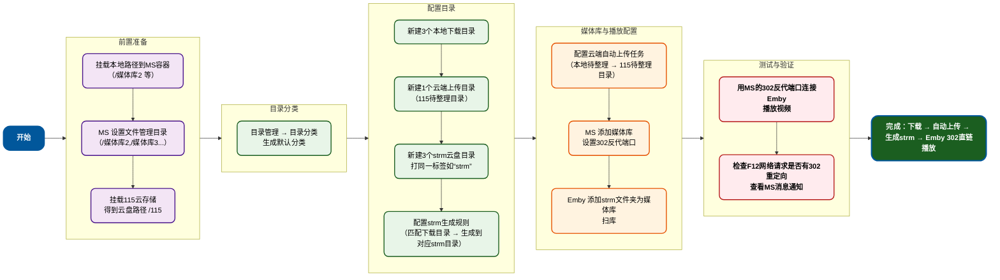
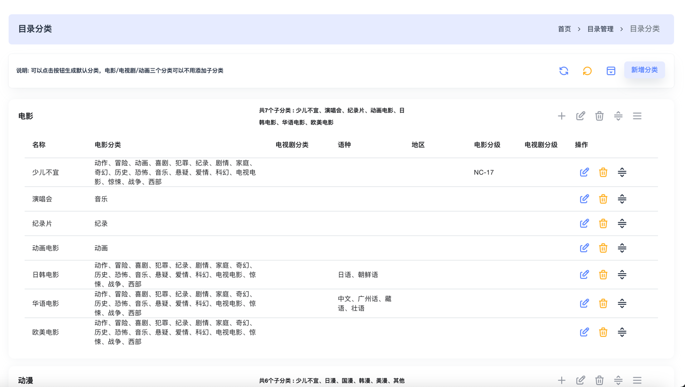
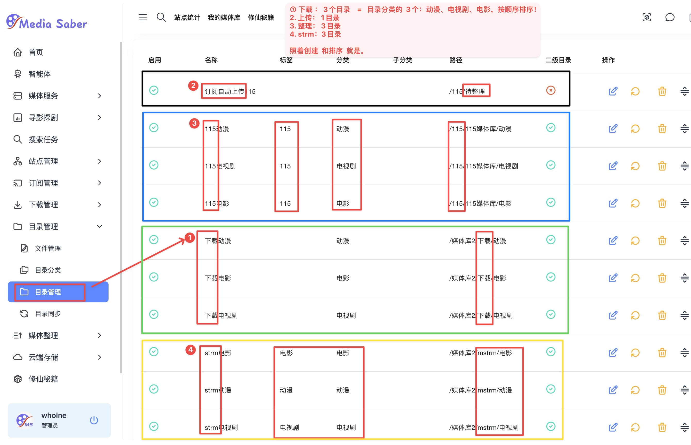
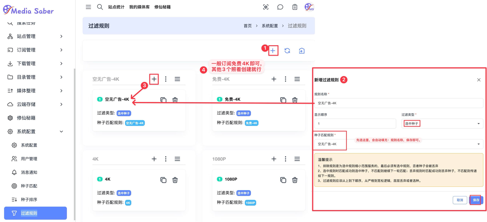
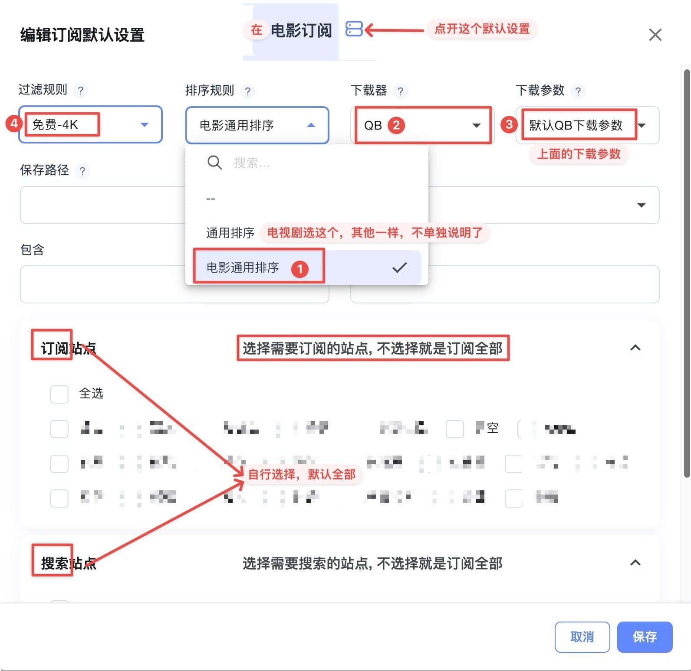
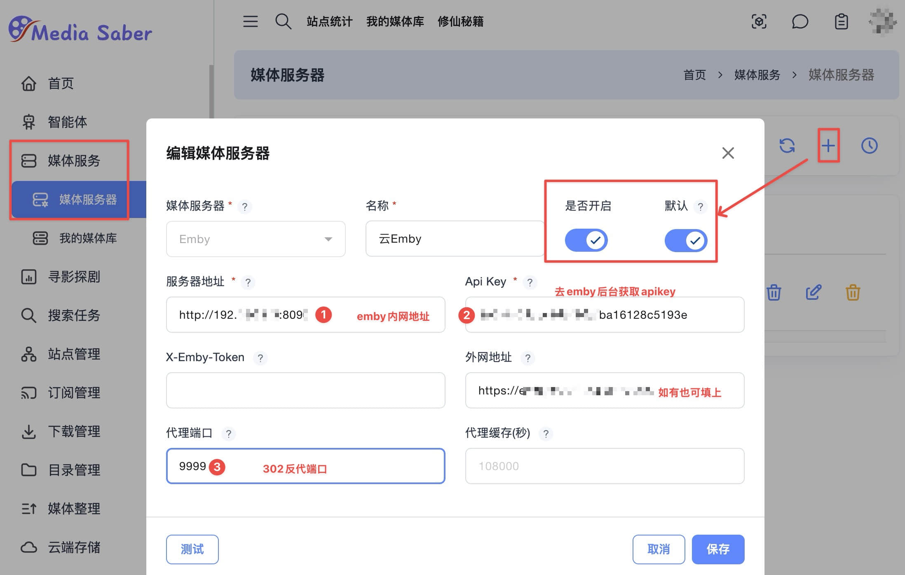
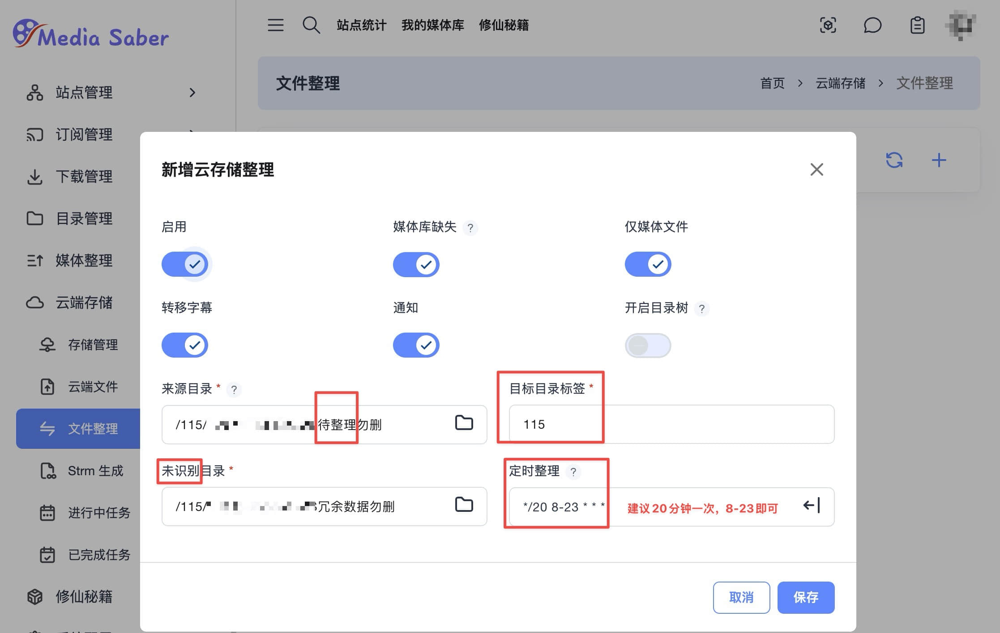
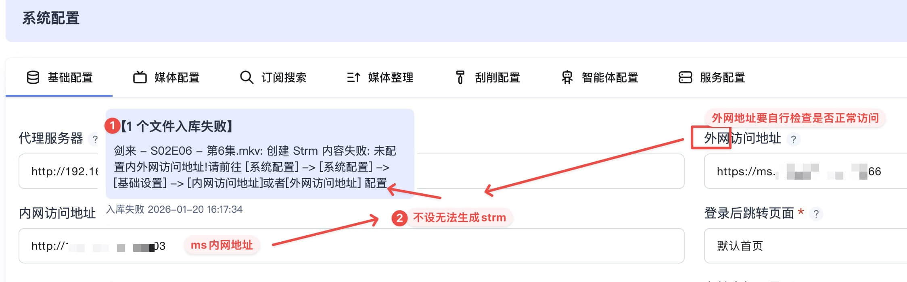
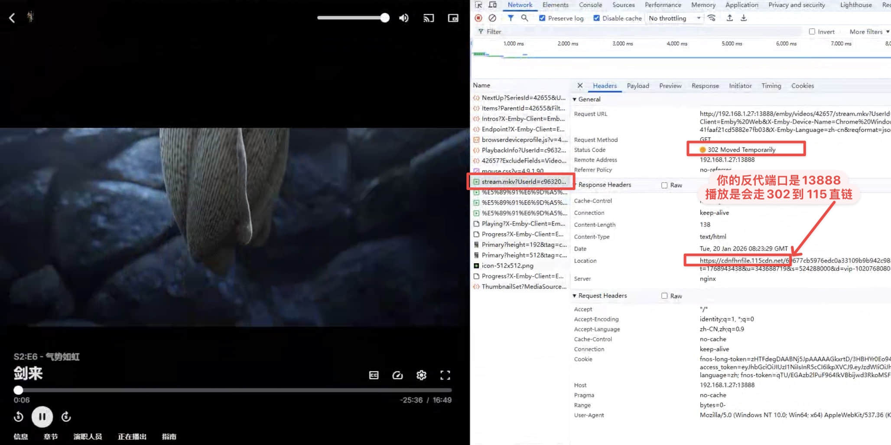

## strm 流程图

<font color="#c00000" >**总流程：1.订阅下载到目录->2.自动上传云盘->3.自动整理网盘后分类->4.生成strm到本地->5.emby读取strm走302**</font>



## 一、前置准备

### 1.1 挂载硬盘路径

- ms项目的 compose 文件的配置
    - 是否将要用来生成`strm`、`自动整理&上传` 的 文件路径 挂给了ms，如 `/媒体库2`
    - 


例如：

```yml
  volumes:
    - /vol1/1000/docker/media-saber:/app/config
   # 把所有想要挂载的盘放进来
   # 假设 /媒体库2：就是要 生成strm 的父目录，在里面建一个 mstrm 子目录作为strm的根目录
    - /vol2/1000/媒体库2:/媒体库2
    #- /vol2/1000/媒体库3:/媒体库3
    #- /vol2/1000/media4:/media4
```

### 1.2 设置文件管理目录

- ms-系统配置-系统配置-基础配置
    - 设置：存储空间目录、文件管理目录
        - 单个：/媒体库2
        - 多个以英文逗号分隔, 如：/媒体库2,/媒体库3,/media4,/volume2


#### 1.2.1 验证本地文件目录挂载

能在 目录管理-文件管理 里选择：`/媒体库2` 目录，并加载里面的文件


### 1.3 挂载云存储

1. ms-云存储-添加115网盘开放，得到一个云盘路径：`/115` 
2. 配置1个网盘自动上传路径，可以直接使用ms自动整理一条龙！也可交给cms/sa等软件自动整理


#### 1.3.1 验证云端存储目录挂载

- 在云端存储里能选择：`/115` 目录，并加载出云盘的文件


## 二、目录分类

- ms-目录管理-目录分类
    - 生成默认的分类即可
    - 如已存在分类不确定是否正确，可删除所有再点生成默认分类。




## 三、配置目录

根据：<font color="#c00000" >**总流程：1.订阅下载到目录->2.自动上传云盘->3.自动整理网盘后分类->4.生成strm到本地->5.emby读取strm走302**</font>

需要创建如下目录：

- ms-目录管理-目录管理
    - **新建3个 本地下载的 分类目录，3个strm的分类目录、1个自动上传的云端目录**、还有 `3个 115 目录` 后面自动整理会用到
    - 
    - 对着上面的图片配置，配完看看列表跟上图的选项 勾选 是否一致就行，自己改了路径的：可以自己用脑子跟图片的对应起来。
- **防止动漫分类到电视剧目录：**
    - `动漫` 目录要 移到 `电视剧` 的前面，目录是从上往下识别分类的。

### 3.1 订阅下载目录

- ms-目录管理-目录管理
    - 举例：`动漫`下载目录的配置，其他的只是将**分类**修改成：电影、电视剧，选项不变，名字自定义即可。
    - 搞不清楚的直接对着配什么也不要改
    - 
- 下载管理-下载参数
    - 
- 下载管理-下载器管理
    - 添加好qb下载器
- 系统配置-种子匹配
    - 配好规则，如：`空无广告-4K`、普通4K、1080P等，规则越少越好。
    - 正则表达式：`(去头尾广告|Pure|V2|纯净版|去头尾广告纯享版|非伪去头)`
    - 
- 系统配置-过滤规则
    - 新建规则-将种子匹配规则关联到规则，方便订阅的时候默认选择
    - 
- 订阅管理-电视剧订阅/电影订阅
    - 设置电影/电视剧订阅的：`默认设置`
    - 
    - 上图为：`默认订阅4K，选择QB下载器，默认QB下载参数、要订阅和搜索的站点列表为空=全部站点`


### 3.2 订阅上传目录

- ms-目录管理-目录管理
    - 举例：订阅自动上传目录 的配置，也就是后面的  自动整理网盘目录
    - 选取你要整理的 云端 115目录，看下图即可。
    - 

###  3.3 网盘分类目录

- ms-目录管理-目录管理
    - 新建`3个云盘分类目录`，打上同一个标签，如：`115`、天翼、夸克等。
    - 本文是打上了：115标签，用于识别115云盘，自动整理网盘。

###  3.4 生成strm目录

- ms-目录管理-目录管理
    - 新建3个strm路径，打上对应的目录分类标签

## 四、媒体库

- 整体步骤：`对图配置先！能用后先备份一次，再按自己需求调整选项。`
    1. ms-媒体服务-媒体服务器-添加emby-设置好反代端口
    2. ms-目录管理-目录同步-添加订阅自动上传115目录
    3. 配置自动整理，按照配置的目录分类自动整理移动到云盘的路径，方便生成strm后，直接在emby加到媒体库
    4. 将现有网盘目录生成strm  /  订阅后自动上传后整理到媒体库路径后自动生成strm文件
    5. Emby设置-媒体库-将strm目录添加到媒体库（http(s)://ip:prot/web/index.html#!/librarysetup）

    
### 4.1 ms配置媒体库

- ms里添加媒体库，设置媒体库的反代端口
    - 

### 4.2 云端上传任务

- ms-目录管理-目录同步-添加订阅自动上传115目录
    - 

### 4.3 配置云端整理

- ms-云端存储-文件整理-新增云存储整理
    - 

### 4.4 strm生成

- ms-系统配置-系统配置-基础设置
    - 
- ms-云端存储-Strm 生成-点：加号
    - 目录标签`115`是上面目录配的，必须对应上。
    - 来源路径选最终你整理后的:  `115媒体库` 路径，有些人可能叫 `emby`、`媒体库`
    - 


###  4.5 配置 Emby

- 在emby中配置媒体库，添加strm文件夹到媒体库并扫库，准备测试302播放


## 五、测试302

- 使用ms的媒体库302反代端口连接 emby，播放影视，看是否走了302直链播放（`看ms的消息即可`）

### 5.1 emby播放

- 打开302端口emby地址(`本文设置的ms反代端口为：13888`)，播放一个视频看看F12请求是否有302重定向到115直链
    - 

### 5.2 查看ms消息

- ms-是否有302的消息通知
    - 


## FAQ

### ms跟其他302工具能一起用吗？

- 可以：ms只自动上传，不整理，也不反代
    1. 有 `cms/sa/onestrm` 的用户，可以ms只订阅后自动上传 到对应的云端自动整理目录
    2. ms不整理，交给 `cms` 等应用自动监控 待整理 目录，自动整理后分类，维持原有的302播放端口继续使用，不使用ms的strm和emby反代端口。

