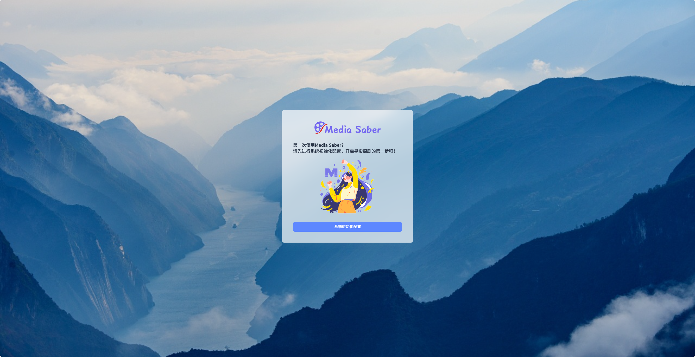
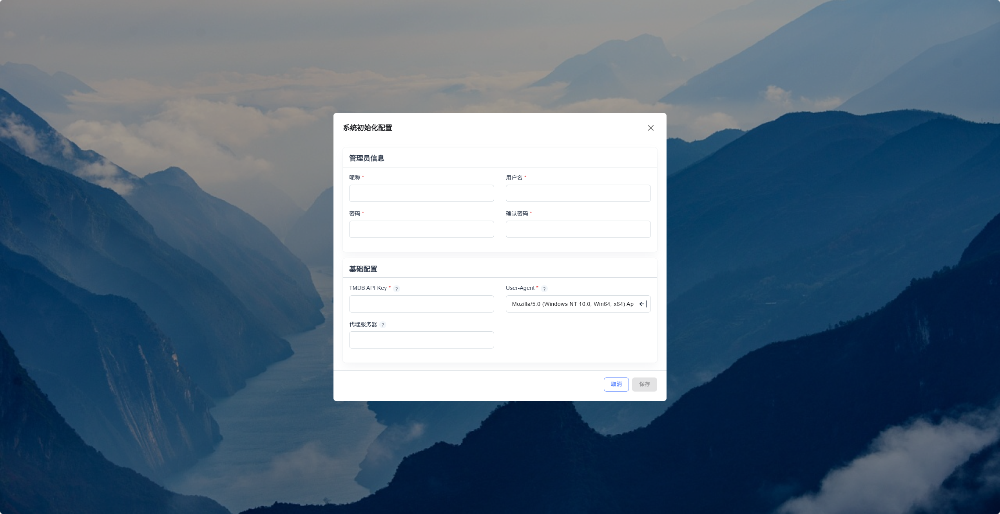
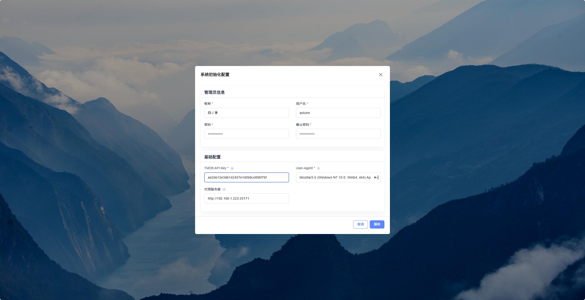
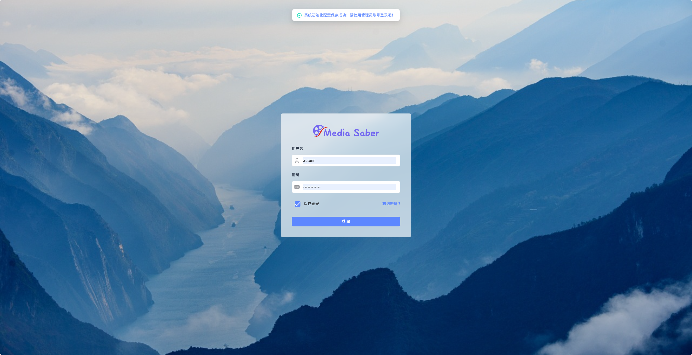
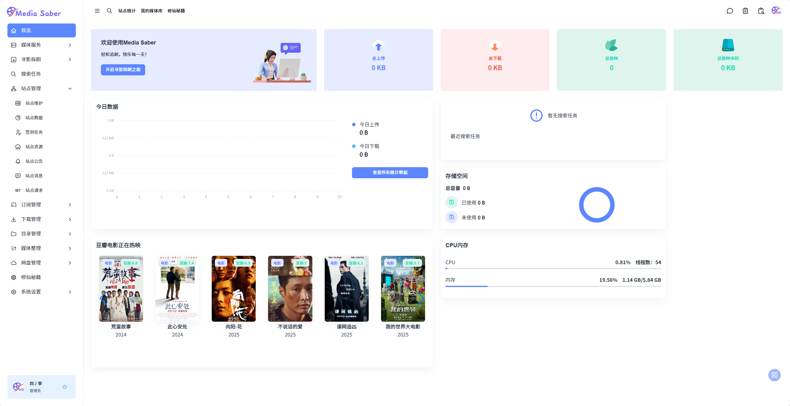

## 🚀 开始初始化配置

本页面将引导您完成 Media Saber 的初始化设置，包括 TMDB API Key 申请和系统配置。

---

## 📋 步骤一：申请 TMDB API Key

Media Saber 使用 TMDB 提供的电影和电视剧元数据服务，需先申请 TMDB API Key。

:::tip 📌 快速指南
如果您已经有 TMDB API Key，可跳过此步骤。更详细的教程请查看 [TMDB API Key 申请完整指南](/guide/tmdb)。
:::

### 申请步骤

1. 📱 访问 [TMDB 官网](https://www.themoviedb.org/) 并注册账号  
2. ⚙️ 登录后，点击右上角头像 → 选择 **Settings（设置）**  
3. 🔑 左侧导航栏点击 **API**，进入 API 页面  
4. ➕ 点击 **"Create"** 创建新 API 密钥，选择用途为 **Developer**  
5. 📝 填写基本信息（例如应用名称、用途说明等），提交申请  
6. ✅ 提交后即可在 API 页面看到你的 **API Key（v3 auth）**

:::warning ⚠️ 重要提示
- 申请过程通常无需审核，Key 会即时生成
- 请妥善保管 API Key，避免泄露
- 泄露的 Key 可在 API 页面删除并重新生成
:::

---

## 🖥️ 步骤二：进入初始化页面

在浏览器输入 `IP:port`，进入 Media Saber 初始化页面，点击 **系统初始化配置** 按钮。

### 2.1 填写配置信息

在弹出的对话框中输入以下信息：

| 字段 | 说明 | 是否必需 |
|------|------|--------|
| 昵称 | 系统显示的用户昵称 | ✅ 必需 |
| 用户名 | 登录账号 | ✅ 必需 |
| 密码 | 登录密码 | ✅ 必需 |
| TMDB API KEY | 从 TMDB 获取的 API Key | ✅ 必需 |
| 代理服务器 | 用于访问 TMDB 的代理地址 | ❌ 可选 |

> 💡 **TMDB API Key 获取**：如不清楚如何获取，请参考 [TMDB 详细申请教程](/guide/tmdb)

### 2.2 保存配置

点击保存按钮后，系统将自动跳转至登录页面，并弹出提示：

:::info ✅ 保存成功
系统初始化配置保存成功！请使用管理员账号登录吧！
:::

### 2.3 登录管理员账号

使用设置好的管理员账号登录，开始配置各项基本参数。

---

## 📚 下一步操作

完成初始化配置后，您可以继续进行以下操作：

| 操作 | 说明 | 链接 |
|------|------|------|
| 🗂️ 目录配置 | 配置媒体库目录和下载目录 | [目录配置指南](/guide/init/directory) |
| ⬇️ 下载器配置 | 配置 BT 下载器和其他下载工具 | [下载器配置指南](/guide/init/download) |
| 🎬 媒体服务 | 配置 Plex、Jellyfin 等媒体播放服务 | [媒体服务配置](/guide/init/media_server) |
| 📺 Medium 配置 | 配置 Medium（PT 追番工具）相关参数 | [Medium 配置指南](/guide/init/medium) |
| 🖧 系统设置 | 配置代理、端口等系统参数 | [系统设置指南](/guide/init/system_setting) |
| 🌐 站点配置 | 配置 PT/BT 站点信息 | [站点配置指南](/guide/init/sites) |

:::tip 💡 建议
按照表格顺序进行配置，会获得最佳效果。每个配置项都有详细的指南说明。
:::
