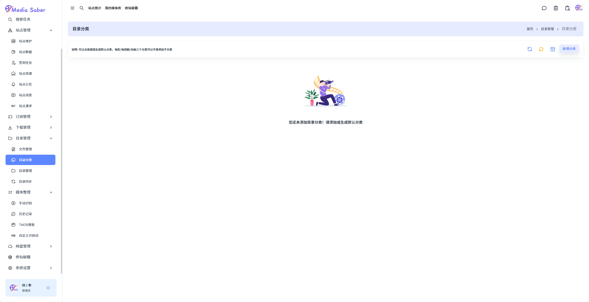
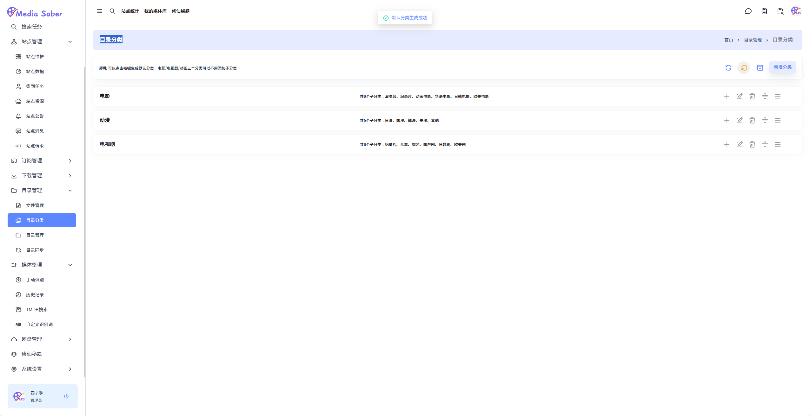
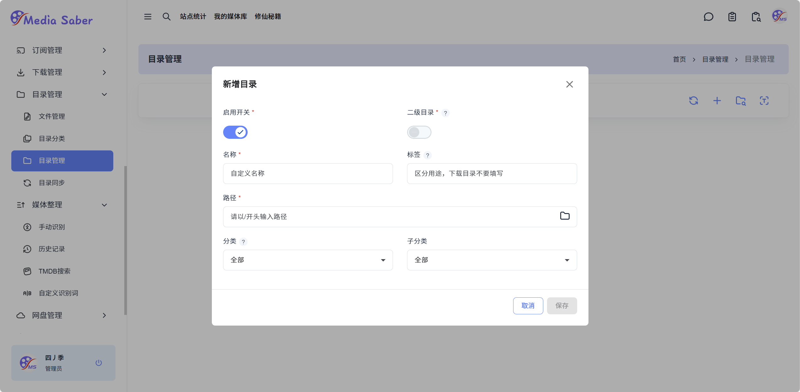
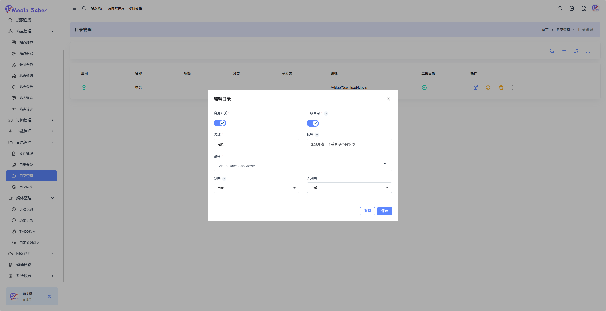
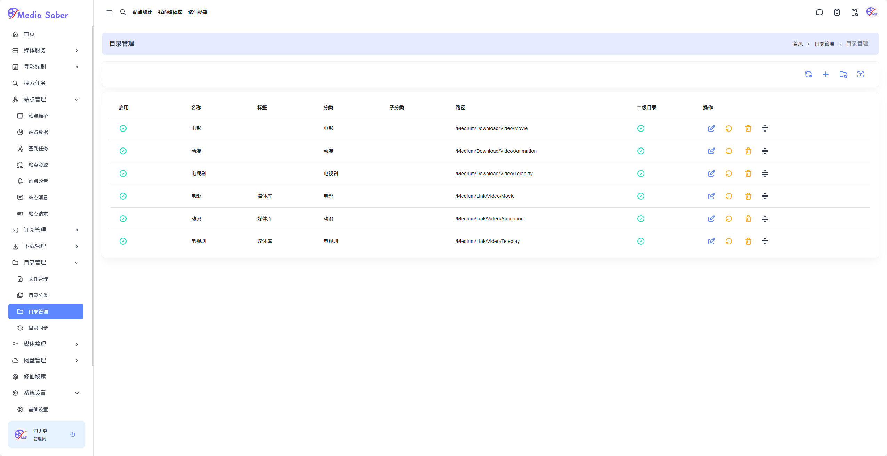
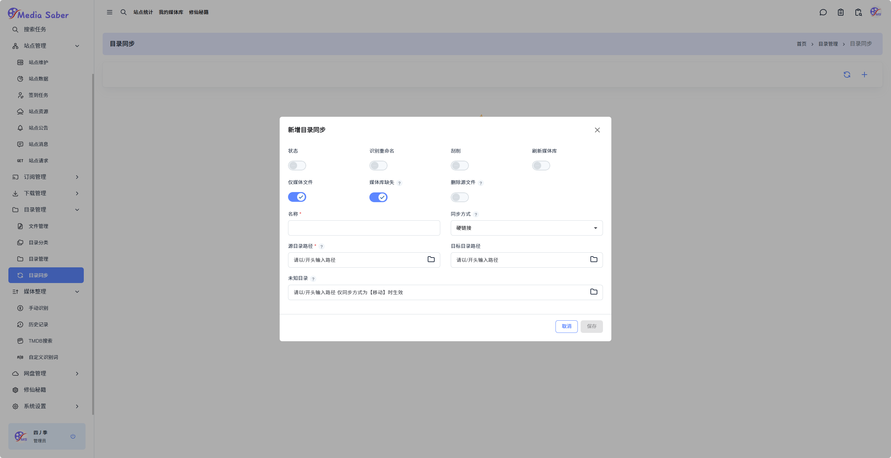
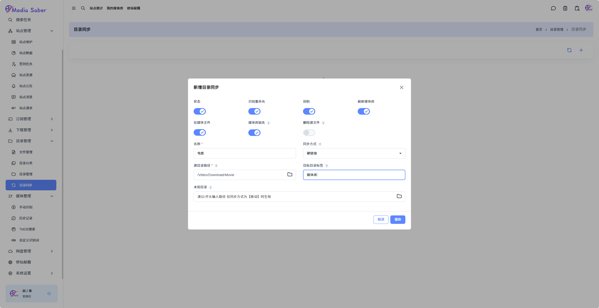
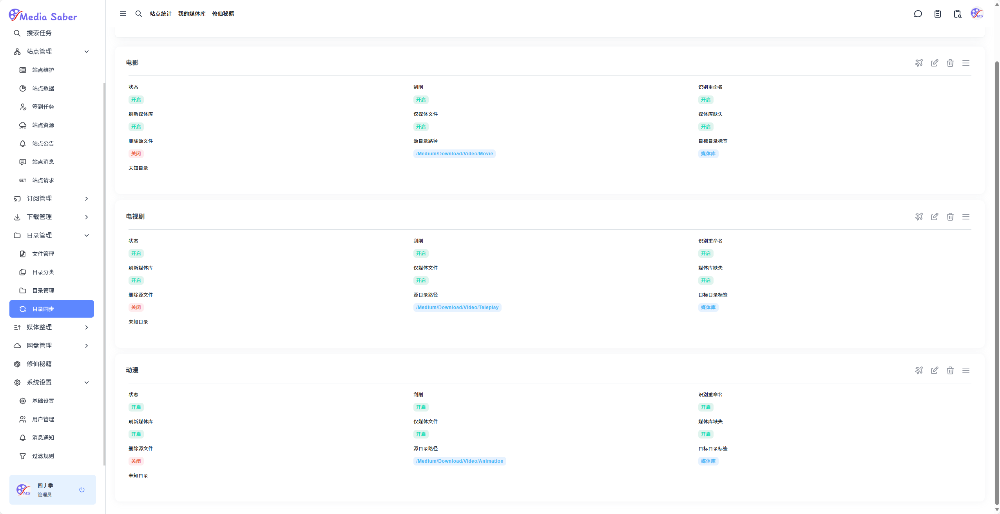

## 🗂️ 目录管理设置

本页面介绍如何在 Media Saber 中设置和管理媒体库目录、下载目录等关键路径配置。

---

## 📂 第一步：目录分类

**访问路径：** 目录管理 → 目录分类 → 点击生成默认分类

系统会自动生成默认的媒体分类（如电影、电视剧等），您也可以自定义分类。

:::warning ⚠️ 分类顺序很重要
- **匹配顺序**：系统从上到下匹配分类，请务必调整正确的顺序
- **自定义分类优先**：自定义分类（如动漫、纪录片）应放在电影和电视剧之前
- **兜底分类**：建议在每种标签类型的分类最后添加一个"全部"分类，避免媒体无法匹配
:::

---

## 🌐 第二步：目录管理

**访问路径：** 目录管理 → 目录管理 → 右上角 "+"

### 2.1 创建下载目录

按照目录分类为每个分类创建对应的下载目录。

### 2.2 创建媒体目录

按照目录分类为每个分类创建对应的媒体目录。

:::info 📝 目录标签说明
- **下载目录**：不填写标签
- **媒体库目录**：标签栏填写 `媒体库`
- **其他自定义目录**：根据用途标记，如 `115`（115网盘）、`strm`（Strm目录）等
- **二级目录**：根据需要勾选二级目录选项
:::  

:::

### 2.3 调整目录顺序

创建完成后，点击每个目录最左边的拖动按钮，调整目录的优先级顺序。

---

## 🔄 第三步：目录同步

**访问路径：** 目录管理 → 目录同步 → 右上角 "+"

自动同步和处理下载的媒体文件。

:::danger 🚨 重要：避免文件同步冲突
为了避免目录同步功能出现**未下载完成却转移文件**的情况，必须对下载器进行特殊配置！
:::

#### qBittorrent 配置

在 qBittorrent 设置中，**必须启用以下任意一项**：

1. **选项 A：为不完整的文件添加扩展名**
   - 设置 → 下载 → 启用 "为不完整的文件添加扩展名 .!qB"
   - 这样未完成的文件会带有 `.!qB` 后缀，不会被目录同步转移

2. **选项 B：保存未完成的 torrent 到临时文件夹**
   - 设置 → 下载 → 启用 "保存未完成的 torrent 到临时文件夹"
   - 未完成的文件会保存在临时文件夹，完成后再移动到目标目录

#### Transmission 配置

在 Transmission 设置中，**必须启用以下任意一项**：

1. **选项 A：在未完成的文件名后加上 ".part" 后缀**
   - 设置中启用相关选项，使未完成文件带有 `.part` 后缀
   - 不会被目录同步转移

2. **选项 B：启用临时目录**
   - 配置临时目录，未完成的文件保存在临时目录
   - 完成后再移动到目标目录

:::tip 💡 推荐做法
- **优先选择方案 A**（文件扩展名标记），配置更简单
- **确保选择其中至少一项**，否则容易出现文件同步冲突
:::

### 3.1 创建同步规则

分别为 `电影`、`电视剧`、`动漫` 创建同步规则。以 `电影` 为例：

**必选项：**
- ✅ 状态
- ✅ 识别重命名
- ✅ 刮削
- ✅ 刷新媒体库
- ✅ 仅媒体文件
- ✅ 媒体库缺失

**填写内容：**
- 名称：电影
- 同步方式：选择合适的方式
- 源目录路径：前面设置的下载目录路径
- 目标目录标签：`媒体库`

### 3.2 保存同步规则

完成配置后点击保存。

---

## 📌 下一步

完成目录管理设置后，您可以进行以下操作：
- [返回初始化设置](/guide/init/)
- [进行下载器配置](/guide/init/download)
- [查看站点配置](/guide/init/sites)
