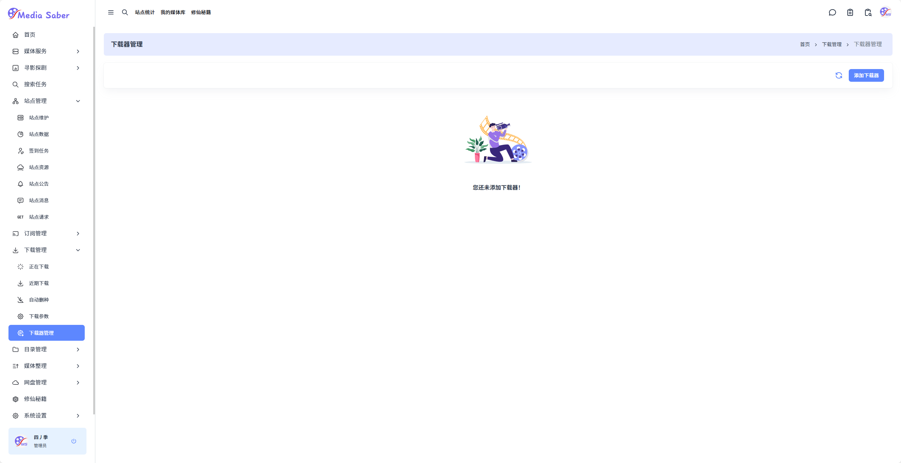
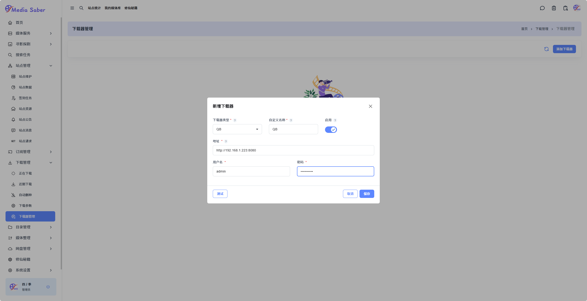
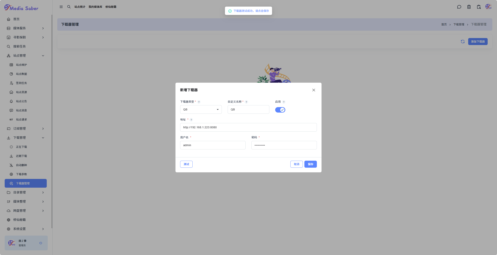
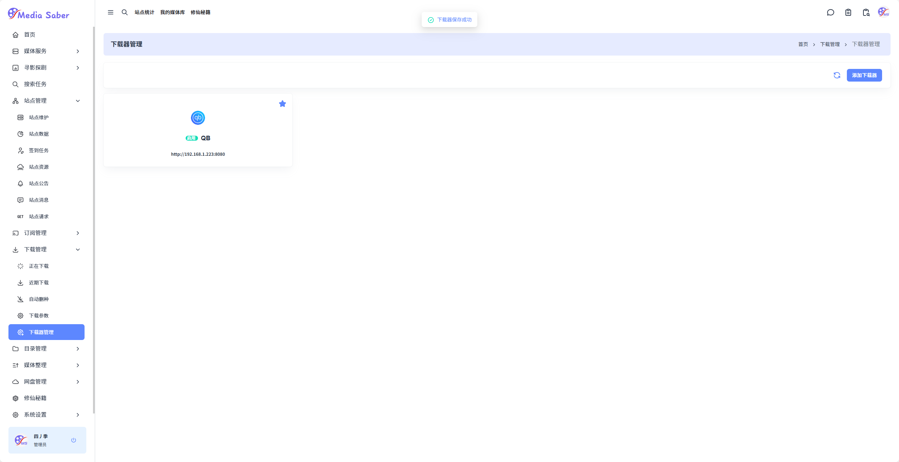
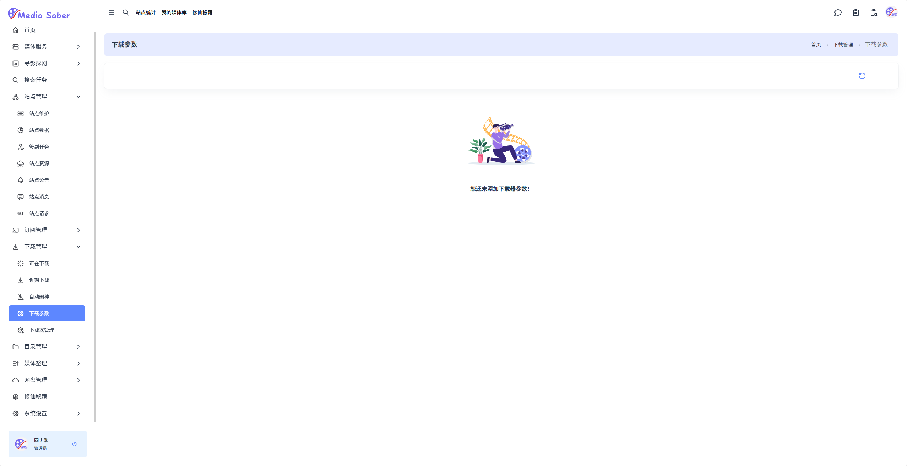
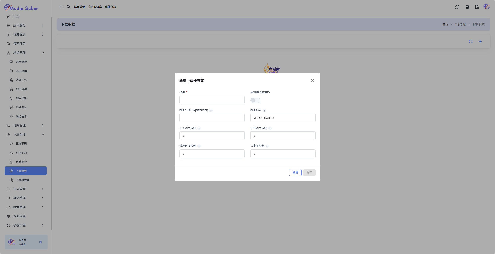
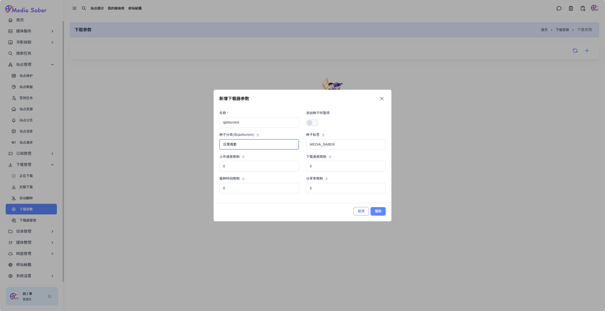
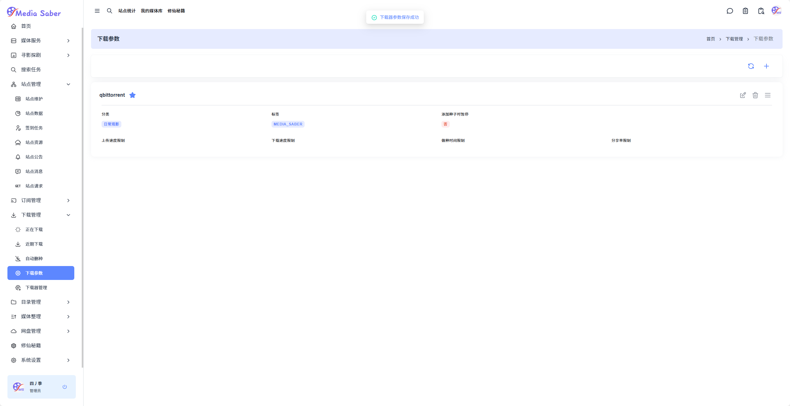

## ⬇️ 下载管理设置

本页面介绍如何在 Media Saber 中配置下载器和下载参数。

---

## 📥 第一步：添加下载器

**访问路径：** 下载管理 → 下载器管理 → 添加下载器

点击 "添加下载器" 按钮。

### 1.1 填写下载器信息

在弹出的对话框中输入以下信息：

| 参数 | 说明 |
|------|------|
| 下载器地址 | 下载器 WebUI 访问地址（如 http://IP:PORT） |
| 下载器用户名 | 下载器登录用户名 |
| 下载器密码 | 下载器登录密码 |

### 1.2 测试连接

点击 "测试" 按钮验证参数是否正确。

:::info ✅ 测试成功
下载器测试成功，请点击保存
:::

:::warning ❌ 测试失败
如果测试失败，检查以下内容：
- 下载器地址是否正确
- 用户名和密码是否正确
- 下载器服务是否正常运行
:::

### 1.3 保存配置

点击 "保存" 按钮保存下载器配置。

:::success ✨ 保存成功
下载器保存成功
:::

---

## ⚠️ 下载器设置警告

:::danger 🚨 重要：避免文件同步冲突
为了避免目录同步功能出现**未下载完成却转移文件**的情况，必须对下载器进行特殊配置！
:::

### qBittorrent 配置

在 qBittorrent 设置中，**必须启用以下任意一项**：

1. **选项 A：为不完整的文件添加扩展名**
   - 设置 → 下载 → 启用 "为不完整的文件添加扩展名 .!qB"
   - 这样未完成的文件会带有 `.!qB` 后缀，不会被目录同步转移

2. **选项 B：保存未完成的 torrent 到临时文件夹**
   - 设置 → 下载 → 启用 "保存未完成的 torrent 到临时文件夹"
   - 未完成的文件会保存在临时文件夹，完成后再移动到目标目录

### Transmission 配置

在 Transmission 设置中，**必须启用以下任意一项**：

1. **选项 A：在未完成的文件名后加上 ".part" 后缀**
   - 设置中启用相关选项，使未完成文件带有 `.part` 后缀
   - 不会被目录同步转移

2. **选项 B：启用临时目录**
   - 配置临时目录，未完成的文件保存在临时目录
   - 完成后再移动到目标目录

:::tip 💡 推荐做法
- **优先选择方案 A**（文件扩展名标记），配置更简单
- **确保选择其中至少一项**，否则容易出现文件同步冲突
:::

---

## ⚙️ 第二步：下载参数设置

**访问路径：** 下载管理 → 下载参数 → 右上角 "+"

为下载创建参数配置，用于控制下载行为。

### 2.1 填写参数信息

输入以下参数：

| 参数 | 说明 | 默认值 |
|------|------|--------|
| 下载器参数名称 | 此配置的名称标识 | 必填 |
| 种子分类 | 下载器中的分类名称 | 必填 |
| 种子标签 | 种子标签，便于识别和管理 | `MEDIA_SABER` |
| 上传速度限制 | KB/s，0 表示不限制 | 0 |
| 下载速度限制 | KB/s，0 表示不限制 | 0 |
| 做种时间限制 | 小时，0 表示不限制 | 0 |
| 分享率限制 | 比率，0 表示不限制 | 0 |

:::tip 💡 参数建议
- **默认不勾选** `添加种子时暂停`（直接开始下载）
- **0 值表示不限制**：上传/下载速度、做种时间、分享率都默认为 0（不限制）
- **多个参数**：可根据不同场景创建多个参数配置
:::

### 2.2 保存参数

点击 "保存" 完成参数设置。

:::success ✨ 保存成功
下载器参数保存成功
:::

---

## 📌 下一步

完成下载管理设置后，您可以进行以下操作：
- [返回初始化设置](/guide/init/)
- [进行目录配置](/guide/init/directory)
- [进行站点配置](/guide/init/sites)  
