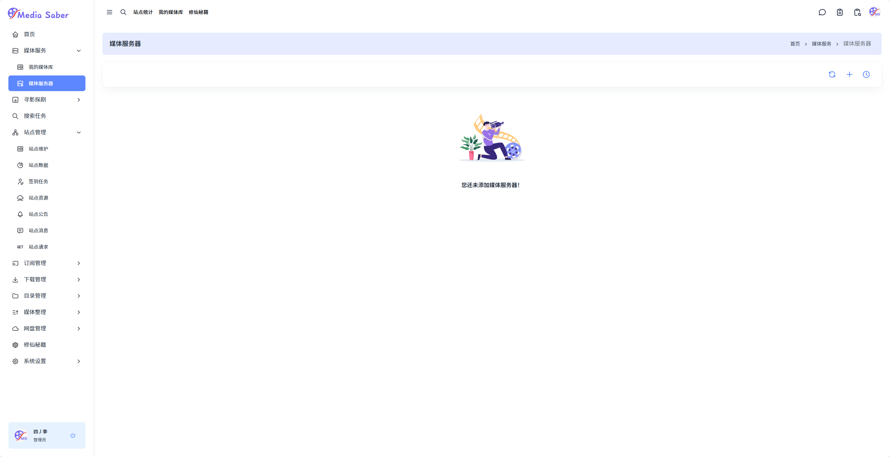
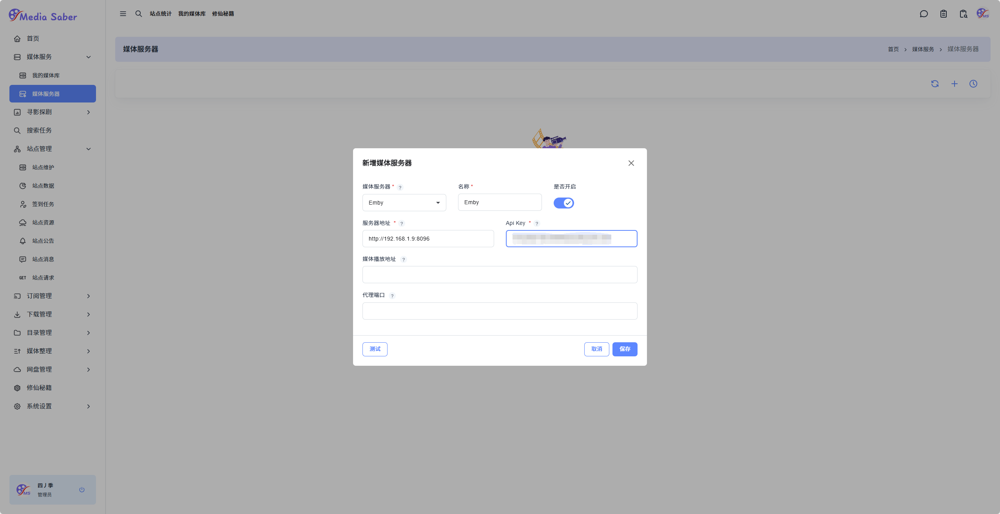
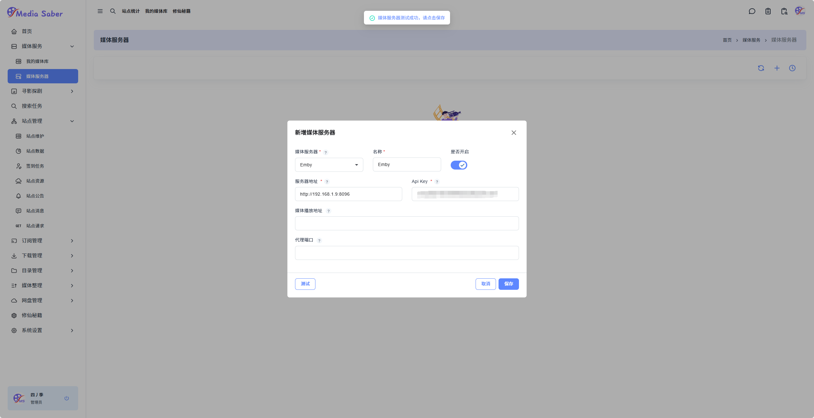
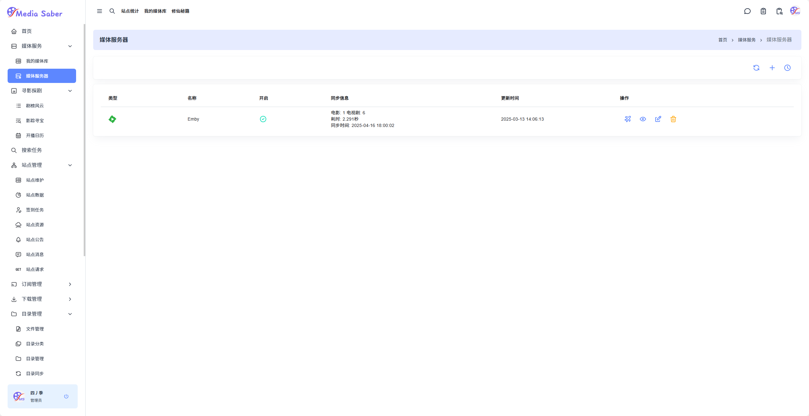
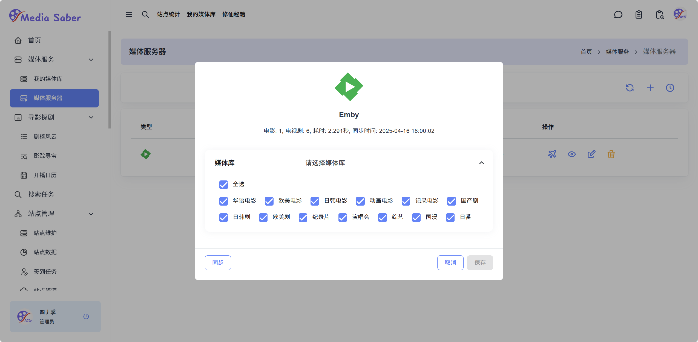
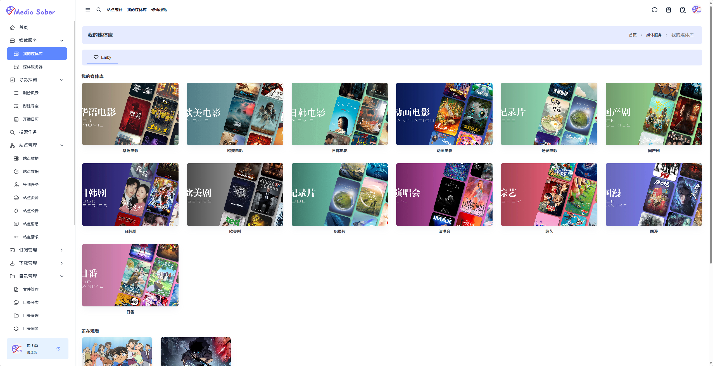

## 🎬 媒体服务设置

本页面介绍如何在 Media Saber 中配置媒体服务器（如 Emby、Jellyfin、Plex 等）。

---

## 🖥️ 第一步：添加媒体服务器

**访问路径：** 媒体服务 → 媒体服务器 → 右上角 "+"

添加您使用的媒体播放服务器。

### 1.1 填写服务器信息

以 Emby 为例，输入以下信息：

| 参数 | 说明 | 备注 |
|------|------|------|
| 名称 | 服务器的显示名称 | 例如：我的 Emby |
| 服务器地址 | 媒体服务器访问地址 | 建议填写外网访问地址 |
| API Key | 服务器 API 认证密钥 | 在服务器管理面板获取 |

:::tip 💡 地址配置建议
- **优先使用外网地址**：在服务器地址中填入外网访问地址（如 `http://domain.com:port`）
- **内网地址处理**：如果使用内网地址 `http://ip:port`，则需在 **媒体播放地址** 中填入外网访问地址
- **连通性优先**：确保 Media Saber 能正常连接到您的媒体服务器
:::

### 1.2 测试连接

点击 "测试" 按钮验证配置是否正确。

:::success ✅ 测试成功
媒体服务器测试成功，请点击保存
:::

### 1.3 同步媒体库

点击同步按钮，选择要同步的媒体库。

**同步步骤：**
1. 勾选需要同步的媒体库
2. 点击 **同步** 按钮
3. 点击 **保存** 确认

---

## 📚 第二步：查看媒体库

**访问路径：** 媒体服务 → 我的媒体库

完成媒体服务器设置后，即可在此查看媒体内容：

- 📺 媒体库列表
- 🎬 正在观看
- 📅 最新入库

---

## 🔔 可选：配置 Webhook

若你添加的是 Emby / Jellyfin / Plex，建议继续配置 Webhook：

1. 回到媒体服务器列表，打开对应服务器的 **Webhook 地址**
2. 复制内网或外网地址，粘贴到媒体服务器后台
3. 在 Media Saber 编辑页按需开启消息推送、选择事件类型

详细说明见：

- [媒体服务器 - Webhook 消息推送](/usage/media_services/server.html#webhook-消息推送)
- [Webhook 配置教程](/usage/other/webhook.html)

---

## 📌 下一步

完成媒体服务设置后，您可以进行以下操作：
- [返回初始化设置](/guide/init/)
- [进行系统设置](/guide/init/system_setting)
- [进行站点配置](/guide/init/sites)

