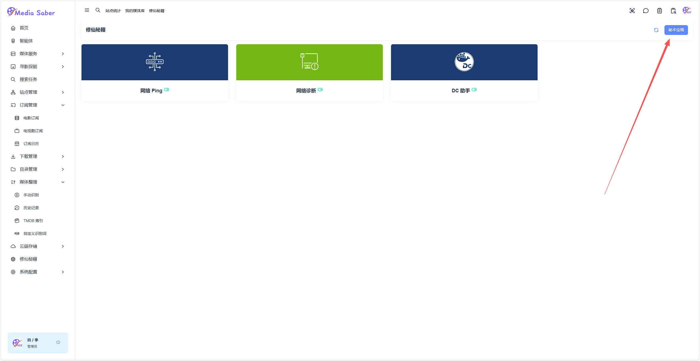
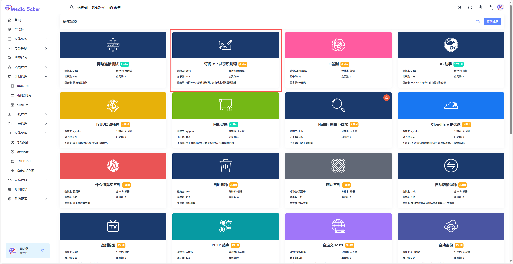
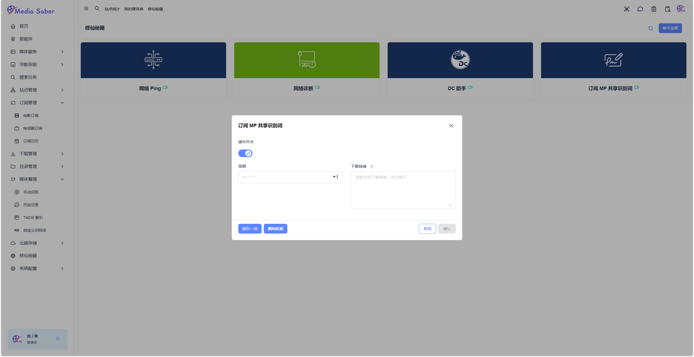
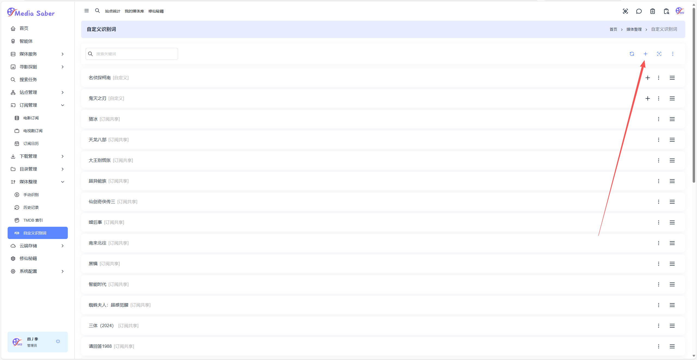
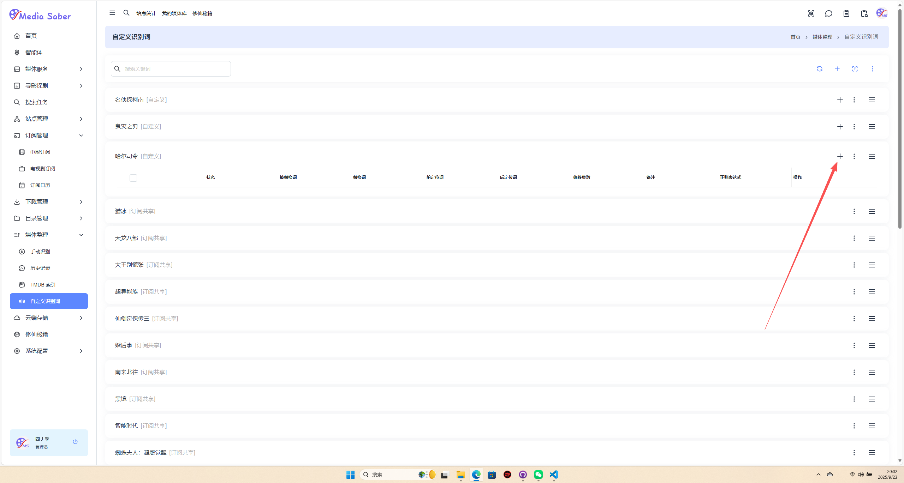
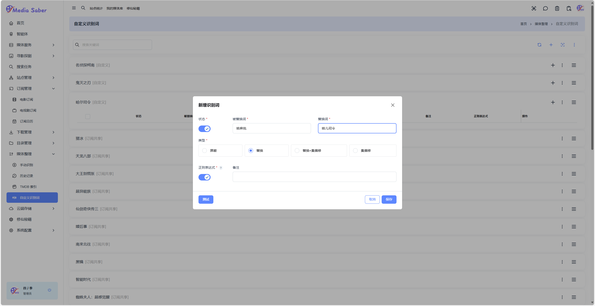

## 📺 媒体整理设置

本页面介绍如何在 Media Saber 中配置媒体识别词，用于自动识别和重命名下载的媒体文件。

---

## 🔗 第一步：订阅云识别词

**访问路径：** 修仙秘籍 → 右上角秘术宝阁 → 订阅 MP 云识别词

通过订阅共享的识别词库，快速获得社区维护的识别规则。

<div align="center"></div>
<div align="center"></div>

### 1.1 添加订阅

点击 "添加" 按钮。

<div align="center"></div>

:::info 📝 配置订阅
在秘术宝阁页面点击 "订阅 MP 云识别词（插件）"，在弹出页面中：
1. 手动填入 "更新周期 Cron" （定时更新周期）
2. 填入 "订阅链" （识别词库链接）
3. 点击保存
:::

### 1.2 推荐订阅链接

以下是推荐的识别词库链接（可根据需要添加多个）：

```shell
https://raw.githubusercontent.com/Putarku/MoviePilot-Help/main/Words/TV.txt
https://raw.githubusercontent.com/Putarku/MoviePilot-Help/main/Words/anime.txt
```

:::tip 💡 链接说明
- **TV.txt**：电视剧识别词库
- **anime.txt**：动漫识别词库
- 您也可以添加其他来源的识别词库
:::

---

## ✏️ 第二步：手动添加识别词

**访问路径：** 媒体整理 → 自定义识别词

用于创建和管理自定义识别词规则。

<div align="center"></div>

### 2.1 创建识别词组

点击右上角 "+" 按钮，输入要创建的识别词组名称。

例如：`哈儿司令`（这是一个识别词组的名称），点击保存。

<div align="center"></div>

### 2.2 添加识别规则

点击词组上的 "+" 按钮，在弹出框中配置：

| 项目 | 说明 |
|------|------|
| 替换方式 | 选择替换类型（文本替换或正则表达式） |
| 被替换词 | 原始文本（需要被替换的部分） |
| 替换词 | 目标文本（替换后的结果） |
| 正则表达式 | 仅在使用正则模式时勾选 |

<div align="center"></div>

:::warning ⚠️ 电视剧识别
电视剧涉及多集和多季的问题，需要使用正则表达式来处理：
- **勾选 "正则表达式" 选项**：处理复杂的集数格式
- **学习成本**：正则表达式需要一定的学习，根据需要研究相关规则
- **示例**：可在社区寻找常用的电视剧正则表达式模板
:::

---

## 📌 下一步

完成媒体整理设置后，您可以进行以下操作：
- [返回初始化设置](/guide/init/)
- [进行目录配置](/guide/init/directory)
- [进行系统设置](/guide/init/system_setting)
- [进行站点配置](/guide/init/sites)
