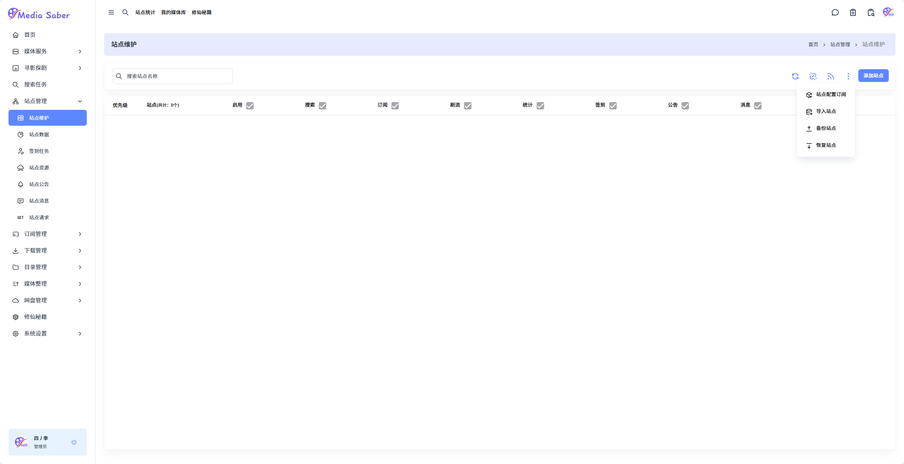
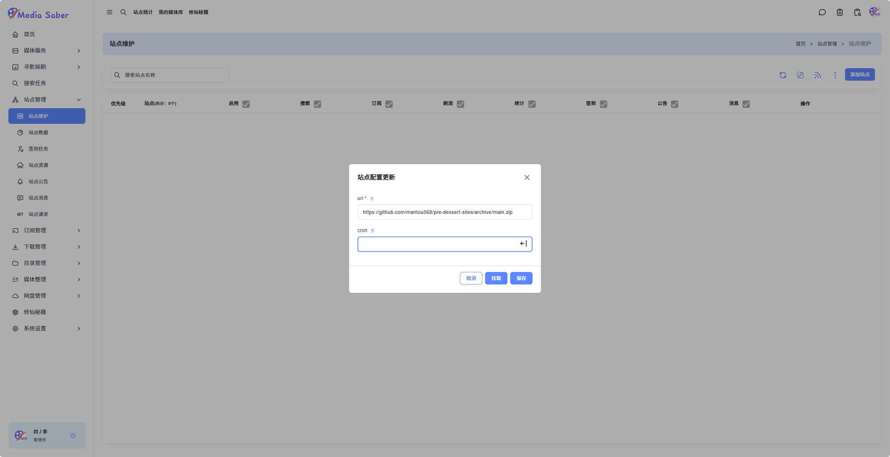

:::warning ⚠️ 重要提示
Media Saber 不提供任何资源库和站点配置文件！作为媒体管理工具，站点需要用户自行添加和维护。

更多详情请参考[站点适配文档](/usage/site_management/site_adaptation)了解如何创建和适配站点。
:::

## 📦 站点配置文件

在 Media Saber 中，站点配置是系统能否正常抓取媒体信息的核心基础。本文介绍两种常见的站点配置方式。

### 🌐 方式一：站点配置订阅（推荐）

**操作路径：**

`站点管理` → `站点维护` （点击站点维护右上角「更多」→「站点配置订阅」）

<div align="center"></div>

#### ⬇️ 获取站点配置（推荐使用）

社区贡献者提供了丰富的站点配置文件，如果你在初始化时配置了代理，可直接使用以下地址订阅：

```
https://github.com/mantou568/pre-dessert-sites/archive/main.zip
```

👉 **访问社区项目**：[pre-dessert-sites GitHub 仓库](https://github.com/mantou568/pre-dessert-sites)

:::info 💡 工作原理
- 订阅配置会在容器/环境启动时自动读取
- 配置文件更新后，需要重启容器/环境使其生效
- 或点击 **拉取** 按钮快速重新加载配置（无需重启）
:::

:::danger 🔒 安全提醒
第三方站点配置由社区用户维护，Media Saber 不对其合规性、安全性负责。请确保：

✓ 遵守当地法律法规  
✓ 仅用于合法用途  
✓ 自行承担使用风险
:::

**配置界面示意：**
<div align="center"></div>

#### ⏰ 配置定时自动更新

在 **cron** 栏中输入 Cron 表达式来设置自动更新计划。常见示例：

| 表达式 | 说明 |
|--------|------|
| `0 9 * * *` | 每天上午 9 点更新 |
| `0 0 * * 0` | 每周一凌晨更新 |
| `0 */6 * * *` | 每 6 小时更新一次 |
| `0 2 * * *` | 每天凌晨 2 点更新 |

💡 **快速生成方式：**

1. 点击输入框右侧的 **快速生成** 按钮，可视化生成 Cron 表达式
2. 或查看详细的 [Cron 规则文档](/usage/other/cron_rule) 了解更多表达式

#### ✅ 保存并立即拉取

1. 填写上述配置后，点击 **保存** 按钮
2. 点击 **拉取** 按钮立即获取最新的站点配置
3. 成功后将显示以下提示：

```
✓ 站点配置更新成功！
```

### 🔧 方式二：手动添加站点

如果你想自定义站点配置或创建私有站点，可以通过手动添加的方式。

#### 📂 站点配置文件结构

所有站点配置文件存放在容器内的 `/app/config/data/site_config/` 目录：

```
site_config/
├── commons/          # 站点框架的公共配置（必需）
│   └── ...          # 各站点共用的基础配置文件
└── sites/           # 具体站点的配置文件
    ├── site1.json
    ├── site2.json
    └── ...          # 所有配置文件都是 JSON 格式
```

- **commons 目录**：存放所有站点都需要的框架公共配置
- **sites 目录**：存放各个具体站点的配置文件（JSON 格式）

#### 🎨 站点图标配置

在 `/app/config/data/static/site_favicon/` 目录下放置站点图标：

**要求：**
- 格式：PNG 图片
- 尺寸：128×128 像素
- 命名规则：与站点配置文件保持一致（便于识别）

**示例：**
```
site_favicon/
├── tmdb.png          # TMDB 站点图标
├── douban.png        # 豆瓣站点图标
└── custom_site.png   # 自定义站点图标
```


---

## 📚 相关资源和提示

### 🔗 有用的链接

- 📖 [站点适配开发文档](/usage/site_management/site_adaptation) - 学习如何创建和适配新站点
- 🌟 [pre-dessert-sites](https://github.com/mantou568/pre-dessert-sites) - 社区站点配置仓库
- � [Cron 规则详解](/usage/other/cron_rule) - 了解 Cron 表达式的详细规则

### ✨ 最佳实践

1. **优先使用订阅方式** - 定期自动更新，减少手动维护
2. **定期检查日志** - 关注站点配置加载是否有错误
3. **备份重要配置** - 手动创建的站点配置应定期备份
4. **测试新站点** - 添加新站点后，先用测试链接验证
5. **遵守法律规范** - 仅使用合法、合规的站点资源

:::danger 🚫 重要声明
站点信息涉及隐私和访问规则敏感性，导入效果不予展示。请所有用户：

- ✅ 遵守国家法律法规
- ✅ 遵守站点使用条款
- ✅ 自行承担使用责任
- ❌ 不进行任何非法活动
:::
