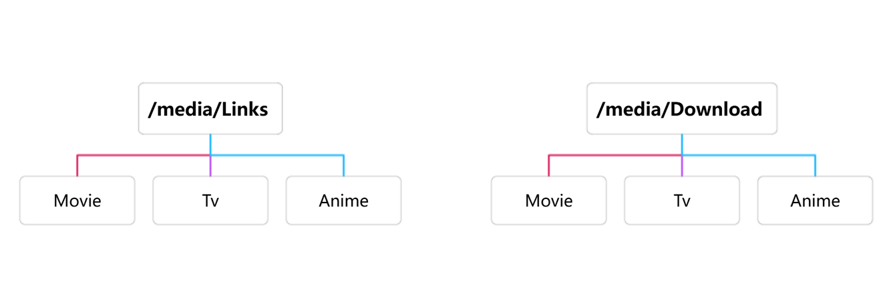
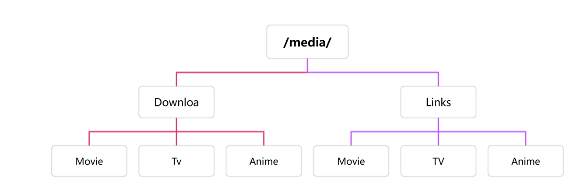

:::warning ⚠️ 前提要求
- Media Saber 使用 **Redis** 作为数据库，需要单独安装，推荐使用 `docker.io/redis:7.0.14-alpine`
- 更新可参考 [dc 一键更新](/guide/update/dc/) 里的 `使用 - 更新` 部分内容
:::

---

## 🏢 各品牌安装方式

选择您的 NAS 设备类型，点击下方链接进入对应品牌专区：

| 品牌 | 安装指南 |
|------|--------|
| 🌐 极空间 | [极空间 NAS 安装指南](/guide/install/zspace.md) |
| 🟢 绿联 | [绿联 NAS 安装指南](/guide/install/ugreen.md) |
| 🔷 群晖 | [群晖 NAS 安装指南](/guide/install/synology.md) |
| 🟠 UNRAID | [UNRAID 安装指南](/guide/install/unraid.md) |
| 📱 UGOS Pro | [UGOS Pro 安装指南](/guide/install/ugos.md) |

---

## 🐳 镜像信息

| 项目 | 内容 |
|------|------|
| 镜像名称 | `xylplm/media-saber` |
| 镜像地址 | <https://hub.docker.com/r/xylplm/media-saber> |
| 镜像标签 | `latest` 或指定版本号 |

---

## 📝 安装方式

### 方式一：Docker CLI 命令行安装

```shell
docker run -d \
  --name media-saber-go \
  --restart always \
  --network host \
  -e PUID=0 \
  -e PGID=0 \
  -e TZ=Asia/Shanghai \
  -e MS_PORT=3000 \
  -e MS_REDIS_HOST=10.0.0.1 \
  -e MS_REDIS_PASS=****** \
  -e MS_TIMEOUT=60000 \
  -e MS_PGSQL_USERNAME=postgres \
  -e MS_PGSQL_PASSWORD=ms888888 \
  -e MS_PGSQL_PATH=10.0.0.1 \
  -e MS_PGSQL_PORT=5431 \
  -e MS_PGSQL_DBNAME=ms \
  -e MS_AUTH_EMAIL=name@sample.com \
  -e MS_AUTH_SLOGAN=大佬牛逼 \
  -e MS_LOG_LEVEL=debug \
  -e MS_PGSQL_LOG_MODE=silent \
  -e MS_LOG_KEEP_DAYS=1 \
  -v /volume1/docker/media-saber/config:/app/config \
  -v /volume2/Medium:/Medium \
  xylplm/media-saber:latest
```
### 方式二：Docker Compose 文件安装

创建 `docker-compose.yml` 文件，内容如下：

```shell
version: "3"
services:
  msgo:
    image: qqaazz.msaber.fun/xylplm/media-saber:latest
    container_name: media-saber-go
    volumes:
      - /volume1/docker/media-saber/config:/app/config
      - /volume2/Medium:/Medium
    environment:
      - PUID=0
      - PGID=0
      - TZ=Asia/Shanghai
      - MS_PORT=3000
      - MS_REDIS_HOST=10.0.0.1
      - MS_REDIS_PASS=******
      - MS_TIMEOUT=60000
      - MS_PGSQL_USERNAME=postgres
      - MS_PGSQL_PASSWORD=ms888888
      - MS_PGSQL_PATH=10.0.0.1
      - MS_PGSQL_PORT=5431
      - MS_PGSQL_DBNAME=ms
      - MS_AUTH_EMAIL=name@sample.com
      - MS_AUTH_SLOGAN=大佬牛逼
      - MS_LOG_LEVEL=debug
      - MS_PGSQL_LOG_MODE=silent
      - MS_LOG_KEEP_DAYS=1
    network_mode: host
    restart: always
```

保存后，执行以下命令启动：

```shell
docker-compose up -d
```

---

## 📂 目录映射说明（重要）

:::info 💡 硬链接原理
同一存储空间的目录应直接映射根目录到容器中。不同映射目录在系统层会被认为是跨盘，从而无法进行硬链接。

建议认真学习：[Linux 硬链接与软链接：原理、应用与最佳实践](#)
:::

### ❌ 错误的映射方式

```shell
/media/links:/mnt/links
/media/Download:/mnt/Download
```

这种方式会导致不同目录被认为在不同的存储设备上，无法使用硬链接。
<div align="center"></div>

### ✅ 正确的映射方式

```shell
/media:/media
```

这样可以保持在同一存储空间内，支持硬链接操作。

<div align="center"></div>