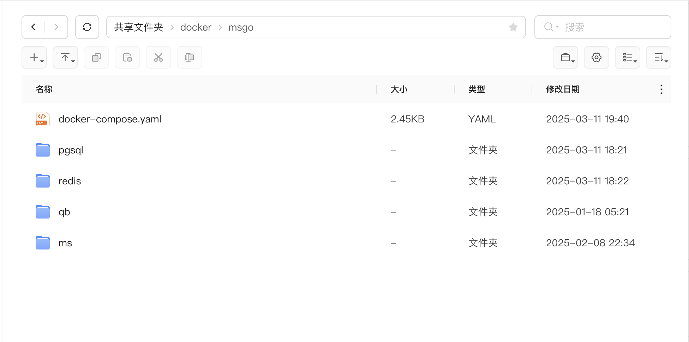

## 🐳 Docker Compose 全家桶安装

此处以 UGOS Pro 设备为例，完整演示全家桶安装方式。

:::info 📋 本页包含内容
- Redis 缓存数据库（必选）
- PostgreSQL 主数据库（必选）
- Media Saber 主服务（必选）
- Emby 媒体服务器（可选）
- qBittorrent 下载器（可选）
- 百度 OCR 识别服务（可选）
- Asynq 任务监控（可选）
:::

---

## 📁 项目目录结构



```txt
msgo/
├── redis/           # Redis 数据存储
├── pgsql/           # PostgreSQL 数据库
├── ms/              # Media Saber 配置
├── emby/            # Emby 配置（可选）
├── qb/              # qBittorrent 配置（可选）
└── docker-compose.yml   # Compose 配置文件
```

---

## 🔧 Compose 配置说明

:::warning ⚠️ 配置注意事项
- **全家桶方式**：一个 docker-compose.yml 文件部署所有服务
- **自定义网络**：默认使用自定义网络，容器间通过容器名+内部端口互访
- **Host 网络**：如需使用 host 网络，需将容器 IP 改为主机 IP
- **修改标记**：需要修改的地方使用 `xxx` 代替，请根据实际情况修改
:::

---

## 📝 完整 docker-compose.yml 配置

```yaml
services:
  # Redis 缓存数据库，必选
  redis:
    image: redis:latest
    container_name: redis
    restart: unless-stopped
    networks:
      - msgo_network
    volumes:
      - ./redis/data:/data
    environment:
      TZ: Asia/Shanghai
      GOSU_VERSION: 1.17

  # PostgreSQL 主数据库，必选
  pgsql:
    image: postgres:17-alpine
    container_name: pgsql
    restart: unless-stopped
    networks:
      - msgo_network
    volumes:
      - ./pgsql/data:/var/lib/postgresql/data
    environment:
      POSTGRES_DB: ms
      POSTGRESQL_WAL_COMPRESSION: lz4
      POSTGRESQL_MAX_CONNECTIONS: 2048
      POSTGRES_USER: postgres
      POSTGRES_PASSWORD: ms888888

  # Emby 媒体服务器，可选
  emby:
    image: linuxserver/emby:latest
    container_name: emby
    network_mode: bridge  # DLNA 和 Wake-on-Lan 需要 bridge
    environment:
      - PUID=0
      - PGID=0
      - GIDLIST=0
      - TZ=Asia/Shanghai
    devices:
      - /dev/dri:/dev/dri  # 硬件解码
    ports:
      - 8096:8096
    restart: unless-stopped
    privileged: true
    volumes:
      - ./emby/config:/config
      - /home/xxx/strm:/strm  # 修改为实际的 strm 目录路径

  # Media Saber 主服务
  msgo:
    image: xylplm/media-saber:latest
    container_name: msgo
    restart: unless-stopped
    networks:
      - msgo_network
    environment:
      TZ: Asia/Shanghai
      MS_PORT: 8888
      MS_AUTH_EMAIL: xxx  # 修改为实际邮箱（必填）
      MS_AUTH_SLOGAN: xxx  # 修改为实际标语（必填）
      MS_LOG_LEVEL: debug
      MS_LOG_KEEP_DAYS: 14
      MS_REDIS_HOST: redis:6379
      MS_REDIS_PASS:  # 如有密码请填写
      MS_TIMEOUT: 60000
      MS_PGSQL_DBNAME: ms
      MS_PGSQL_USERNAME: postgres
      MS_PGSQL_PASSWORD: ms888888
      MS_PGSQL_PATH: pgsql
      MS_PGSQL_PORT: 5432
      MS_PGSQL_LOG_MODE: prod
      MS_MQ_CONCURRENCY: 10
      MS_MCP_SERVER_HTTP_ADDR: "0.0.0.0:5000"
      MS_PATH_WATCH_TIME: 30
    privileged: true
    volumes:
      - ./ms/config:/app/config
    ports:
      - "8888:8888"

  # 百度 OCR 识别服务，可选
  ms-baidu-ocr:
    image: xylplm/media-saber-baidu-ocr:latest
    container_name: ms-baidu-ocr
    networks:
      - msgo_network
    environment:
      - TZ=Asia/Shanghai
      - OCR_APP_ID=xxx  # 修改为实际 app id
      - OCR_API_KEY=xxx  # 修改为实际 api key
      - OCR_SECRET_KEY=xxx  # 修改为实际密钥
    restart: unless-stopped

  # qBittorrent 下载器，可选
  qb:
    image: lscr.io/linuxserver/qbittorrent:14.3.9
    container_name: qb
    restart: unless-stopped
    networks:
      - msgo_network
    environment:
      PGID: 0
      PUID: 0
      TZ: Asia/Shanghai
      WEBUI_PORT: 8080
      TORRENTING_PORT: 6881
    volumes:
      - ./qb/config:/config
    ports:
      - "8080:8080"
      - "6881:6881"
      - "6881:6881/udp"

  # 任务队列监控，可选
  asynqmon:
    image: hibiken/asynqmon:latest
    container_name: asynqmon
    restart: unless-stopped
    networks:
      - msgo_network
    ports:
      - '38080:8080'
    environment:
      - TZ=Asia/Shanghai
    command: --redis-addr=redis:6379 --read-only=true

networks:
  msgo_network:
    name: msgo_network
```

---

## 🚀 启动和管理

### 启动全部服务

```bash
docker compose up -d
```

### 停止全部服务

```bash
docker compose down
```

### 查看日志

```bash
docker compose logs msgo -f
```

---

## 📌 相关文档

- [Compose 全家桶 + env 方案](/guide/install/compose_all_env.md) - 使用 .env 文件的完整配置方案
- [系统初始化](/guide/init/) - 完成安装后进行初始化配置
- [常见问题](/guide/problem.md) - 遇到问题时查看
