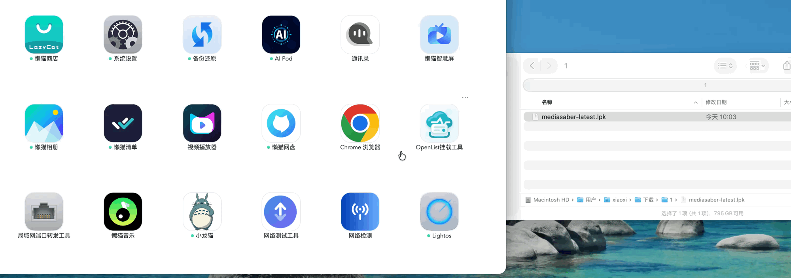
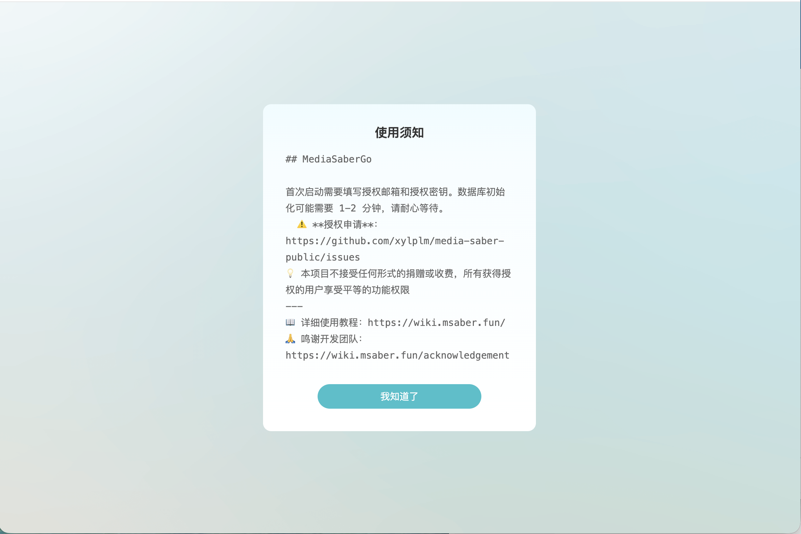
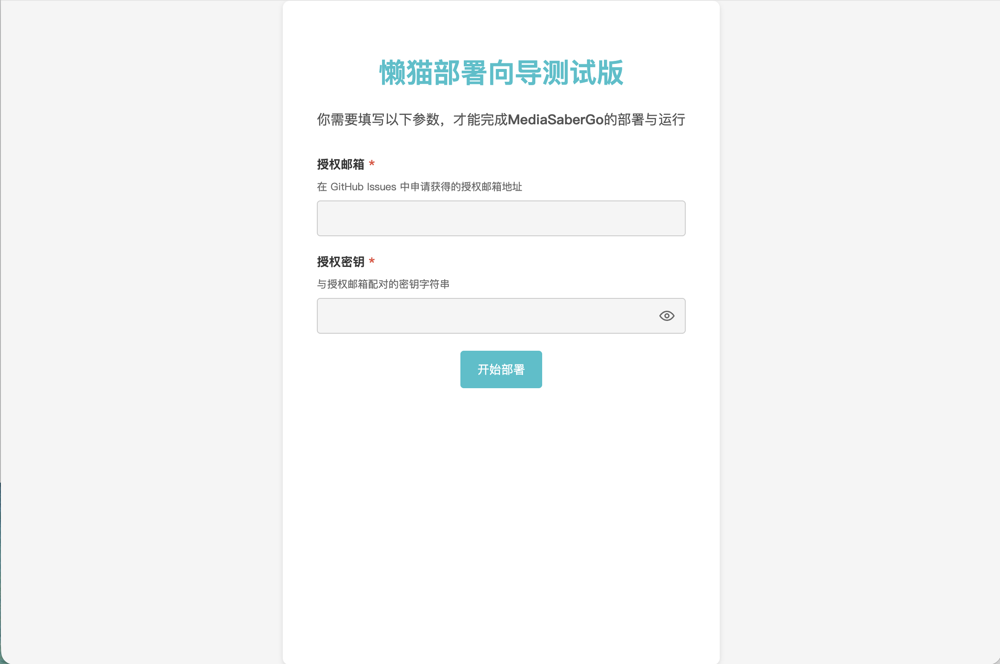
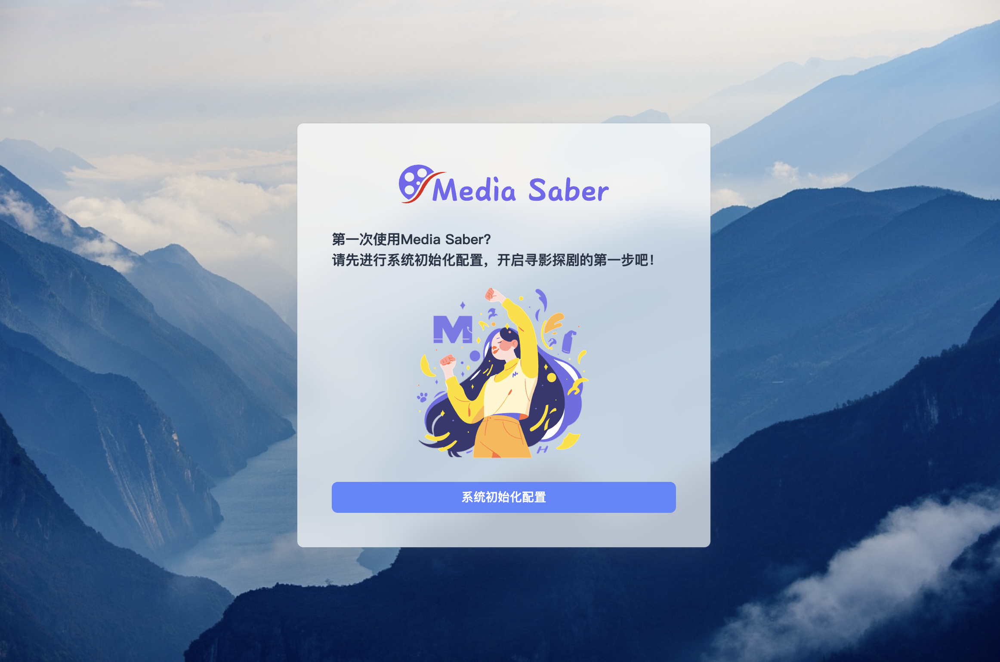

## 🐱 懒猫微服安装指南

:::info
本指南适用于 **懒猫微服（Lazycat MicroServer）** 用户，通过上传 `.lpk` 安装包的方式一键部署 Media Saber。
:::

:::tip 🙏 鸣谢
本懒猫微服安装教程及 LPK（ipk）安装包均由 **Levies** 大佬提供，感谢贡献！
:::

---

## 第一步：安装前准备

1. 确保你的懒猫设备已开机并连接网络
2. 在浏览器访问懒猫管理后台（通常在局域网内通过 IP 访问）
3. 下载 LPK 安装包：<https://github.com/xxika/MediaSaberGo_lazycat/raw/main/ipk/mediasaber-latest.lpk>
4. 准备好应用的 `.lpk` 安装包文件

:::tip
LPK 是懒猫微服的应用安装包格式，下载后通过 PC 客户端拖入即可自动安装。
:::

---

## 第二步：安装应用

### 手动上传 LPK 安装

1. 打开 **「懒猫微服」PC 客户端**
2. 将下载好的 `.lpk` 文件拖动到软件里面，即可完成自动安装

<div align="center"></div>

3. 等待安装完成
4. 打开刚刚安装的 **「MediaSaberGo」**

<div align="center"></div>

5. 点击 **「我知道了」**，进入部署向导页面，填上 Media Saber 申请的邮箱和密钥

:::warning
邮箱或密钥填写错误会导致运行错误，此时只需卸载后重新安装即可。
:::

<div align="center"></div>

6. 开始初始化

<div align="center"></div>

---

## 第三步：目录映射关系

懒猫微服中的应用运行在容器中，其目录通过映射（Binds）与宿主机的实际存储位置关联。

### 核心目录说明

| 容器内路径 | 宿主机实际路径 | 用途 | 持久化 |
|-----------|--------------|------|--------|
| `/lzcapp/var/` | `/lzcsys/data/appvar/<app-id>/` | 应用私有数据（数据库、配置、缓存等） | 是 |
| `/lzcapp/documents/` | `/lzcsys/data/document/<user>/.apps/<app-id>/` | 用户私有文稿目录 | 是 |
| `/lzcapp/pkg/content/` | 打包在 LPK 中的内容 | 只读静态资源 | 否（只读） |
| `/lzcapp/run/mnt/home/` | `/lzcsys/data/document/` | 用户公共文稿目录（旧版兼容） | 是 |

### 应用内目录映射示例

以 MediaSaberGo 为例：

| 容器内路径 | 懒猫映射路径 | 说明 |
|-----------|------------|------|
| `/app/config` | `/lzcapp/var/config` | 应用配置文件 |
| `/video` | `/lzcapp/var/video` | 视频媒体文件目录 |
| `/data` (Redis) | `/lzcapp/var/redis` | Redis 持久化数据 |
| `/var/lib/postgresql/data` (PgSQL) | `/lzcapp/var/pgsql` | 数据库文件 |

:::warning
**重要**：所有需要持久化的数据必须放在 `/lzcapp/var/` 下，否则应用重启后数据会丢失。
:::

---

## 第四步：规划目录结构

### 推荐的目录规划

```
/lzcapp/var/
├── app-data/              # 各应用共享的数据区
│   ├── downloads/         # 下载文件
│   ├── media/             # 媒体文件（视频、音乐）
│   │   ├── movies/        # 电影
│   │   ├── tv/            # 电视剧
│   │   └── music/         # 音乐
│   └── backup/            # 备份文件
├── config/                # 应用配置（如果支持多应用共享）
└── <app-specific>/        # 各应用私有数据
    ├── config/
    ├── data/
    └── ...
```

---

## 常见问题

**Q: 应用安装后无法访问？**

检查步骤：
1. 确认所有容器是否正常运行（管理后台 → 应用详情 → 容器状态）
2. 等待 1-2 分钟让数据库初始化完成
3. 检查应用日志是否有报错

**Q: 数据在哪里？怎么备份？**

应用数据统一存储在 NAS 的文件系统中。备份路径：
- 应用私有数据：`/lzcsys/data/appvar/<app-id>/`
- 用户文稿数据：`/lzcsys/data/document/<用户名>/`

你可以通过懒猫网盘（WebDAV）或 SMB 访问这些目录进行备份。

**Q: 磁盘空间不足？**

1. 检查 `/lzcsys/data/` 所在磁盘的剩余空间
2. 清理不需要的 Docker 镜像：管理后台 → 系统设置 → 清理
3. 移动媒体文件到其他存储设备并重新挂载

**Q: 如何迁移应用到另一台懒猫设备？**

1. 备份应用数据目录 `/lzcsys/data/appvar/<app-id>/`
2. 备份用户数据（如需要）
3. 在新设备安装相同应用
4. 将备份数据恢复到新设备的对应路径
5. 重启应用

---

### 相关文档

- [群晖 NAS 安装](/guide/install/synology.md)
- [UGOS PRO 安装](/guide/install/ugos.md)
- [绿联 NAS 安装](/guide/install/ugreen.md)
- [Unraid 安装](/guide/install/unraid.md)
- [极空间 NAS 安装](/guide/install/zspace.md)
- [故障排查](/guide/problem.md)
