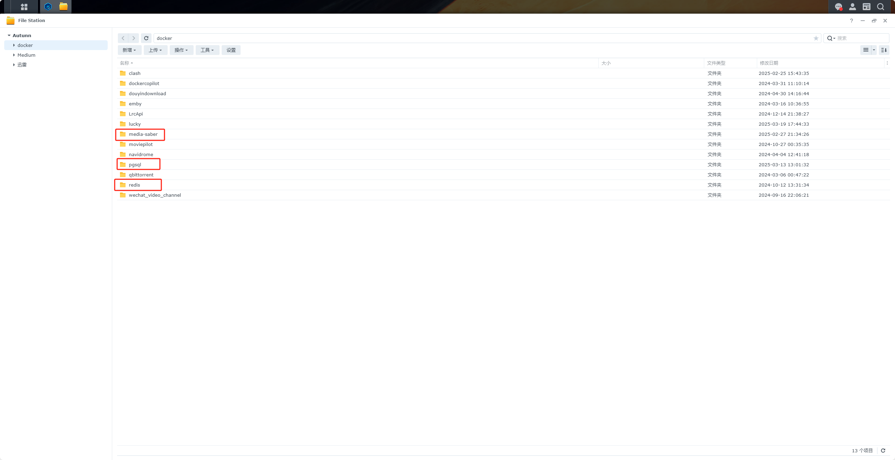
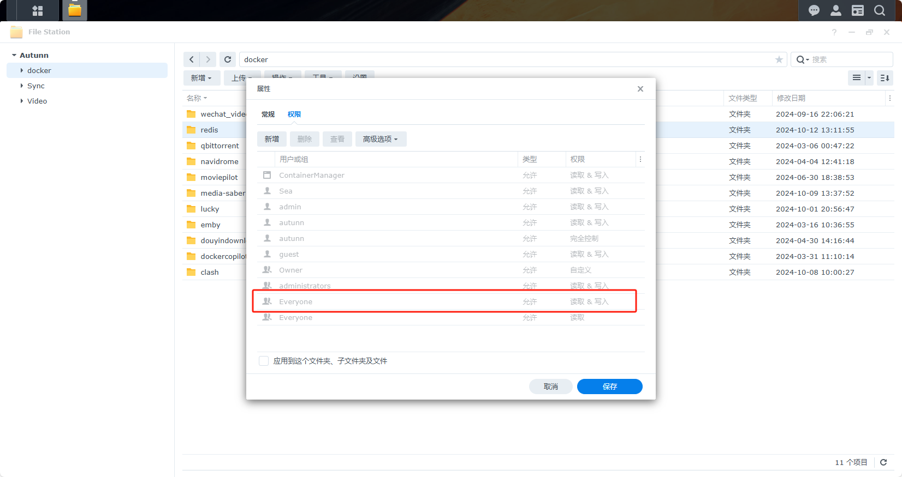
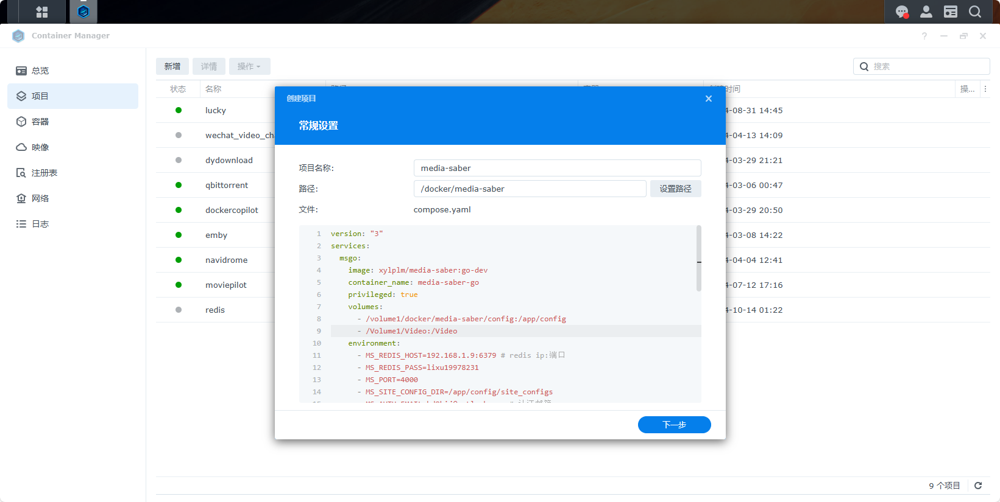

## 🖥️ 群晖 NAS 安装指南

:::info
本指南适用于 **群晖 NAS** 用户（DSM 7.2 及以上），通过 **Container Manager** 部署 Media Saber 及其相关服务。
:::

### 第一步：准备文件夹结构

打开 **File Station**，在主目录（`/`）下的 `docker` 文件夹中新建以下结构：

```
docker/
├── redis/
│   └── data          # Redis 数据持久化
├── pgsql/
│   └── data          # PostgreSQL 数据持久化
└── Media-Saber/
    ├── config        # 配置文件
    └── logs          # 日志文件
```

:::warning
- 所有文件夹必须具有 **写入权限**
- 避免将文件夹放在 USB 外置存储上（影响性能）
- 建议将数据存储在高速存储位置
:::

<div align="center"></div>  
<div align="center"></div>

---

### 第二步：部署 Redis

:::tip
推荐使用 **Container Manager** 的项目功能进行部署，支持 DSM 7.2 及以上版本。
:::

**操作步骤**：
1. 打开 **Container Manager** → 项目 → 新增项目
2. 项目名称：`redis`
3. 项目路径：选择 `/docker/redis` 文件夹
4. 来源：选择 **创建 docker-compose.yaml**
5. 粘贴以下配置

**docker-compose.yaml**：

```yaml
version: "3.3"
services:
  redis:
    image: qqaazz.msaber.fun/redis:7.4-alpine
    container_name: redis
    ports:
      - 6379:6379
    environment:
      - REDIS_PASSWORD=your-redis-password  # 修改为你的 Redis 密码
    volumes:
      - /volume1/docker/redis/data:/data
    restart: unless-stopped
```

| 参数 | 说明 | 
|------|------|
| `REDIS_PASSWORD` | 设置一个强密码（建议 8+ 字符） |
| `/volume1/docker/redis/data` | 根据实际存储位置修改（如 `/volume2/` 等） |

:::success
配置完成后点击「完成」，Container Manager 会自动拉取镜像并启动 Redis。通过日志可确认是否启动成功。
:::


---

### 第三步：部署 PostgreSQL

**操作步骤**：
1. 打开 **Container Manager** → 项目 → 新增项目
2. 项目名称：`pgsql`
3. 项目路径：选择 `/docker/pgsql` 文件夹
4. 来源：选择 **创建 docker-compose.yaml**
5. 粘贴以下配置

**docker-compose.yaml**：

```yaml
version: "3.8"
services:
  pgsql:
    image: qqaazz.msaber.fun/postgres:17-alpine
    container_name: ms-pgsql
    restart: unless-stopped
    volumes:
      - /volume1/docker/pgsql/data:/var/lib/postgresql/data
    environment:
      POSTGRES_USER: postgres
      POSTGRES_DB: ms
      POSTGRES_PASSWORD: your-secure-password  # 修改为你的数据库密码
      POSTGRESQL_WAL_COMPRESSION: lz4
      POSTGRESQL_MAX_CONNECTIONS: 2048
    ports:
      - 5431:5432
```

| 参数 | 说明 | 
|------|------|
| `POSTGRES_PASSWORD` | 设置强密码，需与 Media Saber 环境变量一致 |
| `POSTGRES_DB` | 数据库名称，默认为 `ms` |
| `5431:5432` | 主机端口改为未被占用的端口（如 5431） |
| `/volume1/docker/pgsql/data` | 根据实际存储位置修改 |

:::warning
**重要**：记住你设置的密码，在 Media Saber 部署时需要使用相同密码。
:::

:::tip
PostgreSQL 首次启动会初始化数据库，请耐心等待 2-3 分钟。通过查看日志可以确认初始化完成。
:::


---

### 第四步：部署 Media Saber

**操作步骤**：
1. 打开 **Container Manager** → 项目 → 新增项目
2. 项目名称：`media-saber`
3. 项目路径：选择 `/docker/Media-Saber` 文件夹
4. 来源：选择 **创建 docker-compose.yaml**
5. 粘贴以下配置

**docker-compose.yaml（独立部署方式）**：

```yaml
version: "3"
services:
  msgo:
    image: qqaazz.msaber.fun/xylplm/media-saber:latest
    container_name: media-saber-go
    volumes:
      - /volume1/docker/Media-Saber/config:/app/config
      - /volume2/Medium:/Medium  # 修改为你的媒体目录
    environment:
      - PUID=0
      - PGID=0
      - TZ=Asia/Shanghai
      - MS_PORT=3000
      - MS_REDIS_HOST=redis-host-ip:6379  # Redis 服务器 IP 和端口
      - MS_REDIS_PASS=your-redis-password  # Redis 密码
      - MS_TIMEOUT=60000
      - MS_PGSQL_USERNAME=postgres
      - MS_PGSQL_PASSWORD=your-secure-password  # PostgreSQL 密码（与上一步一致）
      - MS_PGSQL_PATH=pgsql-host-ip  # PostgreSQL 服务器 IP
      - MS_PGSQL_PORT=5431  # PostgreSQL 端口
      - MS_PGSQL_DBNAME=ms
      - MS_AUTH_EMAIL=your-email@example.com  # 认证邮箱
      - MS_AUTH_SLOGAN=YourAuthSlogan  # 认证口令
      - MS_LOG_LEVEL=info
      - MS_LOG_KEEP_DAYS=7  # 日志保留天数
    ports:
      - 3000:3000  # 容器端口映射
    restart: unless-stopped
```

**必须修改的参数**：

| 参数 | 说明 | 示例 |
|------|------|------|
| `MS_REDIS_HOST` | Redis 服务器地址 | `10.0.0.1:6379` 或 `redis` |
| `MS_REDIS_PASS` | Redis 密码 | 与第二步设置一致 |
| `MS_PGSQL_PATH` | PostgreSQL 服务器地址 | `10.0.0.1` |
| `MS_PGSQL_PASSWORD` | PostgreSQL 密码 | 与第三步设置一致 |
| `MS_AUTH_EMAIL` | 访问认证邮箱 | 你的真实邮箱 |
| `MS_AUTH_SLOGAN` | 认证口令 | 自定义密语 |
| `/volume2/Medium` | 媒体存储目录 | 实际媒体路径 |

:::warning
**注意事项**：
- 如果 Redis 和 PostgreSQL 在同一群晖上，可以使用 `redis` 和 `ms-pgsql` 作为主机名（需要相同网络）
- 或使用容器所在群晖的 IP 地址和对应端口
- 所有密码必须与前两步设置的密码一致
:::
<div align="center"></div>

:::warning ⚙️ 请修改以下参数为你的实际参数：

- REDIS_HOST 地址
- REDIS_PASS 密码
- MS_PGSQL_PATH pgsql数据库地址
- MS_PGSQL_PORT pgsql数据库端口
- MS_PGSQL_DBNAME pgsql数据库名
- MS_PGSQL_PASSWORD pgsql数据库密码
- MS_AUTH_EMAIL 访问邮箱认证
- MS_AUTH_SLOGAN 认证口令

其余参数保持默认即可
:::

<div align="center"></div>

---

### 第五步：一键部署（可选）

如果你需要同时部署 Media Saber、Redis 和 PostgreSQL，可以使用以下统一的 docker-compose 文件。

**操作步骤**：
1. 新增一个项目（项目名称：`media-saber-full`）
2. 粘贴以下配置

**docker-compose.yaml（全服务部署）**：

```yaml
version: "3.8"

services:
  redis:
    image: qqaazz.msaber.fun/redis:7.4-alpine
    container_name: ms-redis
    ports:
      - 6379:6379
    command: redis-server --requirepass your-redis-password
    volumes:
      - /volume1/docker/redis/data:/data
    restart: unless-stopped
    networks:
      - ms_network

  pgsql:
    image: qqaazz.msaber.fun/postgres:17-alpine
    container_name: ms-pgsql
    ports:
      - 5431:5432
    environment:
      POSTGRES_USER: postgres
      POSTGRES_DB: ms
      POSTGRES_PASSWORD: your-secure-password
      POSTGRESQL_WAL_COMPRESSION: lz4
      POSTGRESQL_MAX_CONNECTIONS: 2048
    volumes:
      - /volume1/docker/pgsql/data:/var/lib/postgresql/data
    restart: unless-stopped
    networks:
      - ms_network

  msgo:
    image: qqaazz.msaber.fun/xylplm/media-saber:latest
    container_name: media-saber-go
    environment:
      - PUID=0
      - PGID=0
      - TZ=Asia/Shanghai
      - MS_PORT=3000
      - MS_REDIS_HOST=ms-redis:6379
      - MS_REDIS_PASS=your-redis-password
      - MS_TIMEOUT=60000
      - MS_PGSQL_USERNAME=postgres
      - MS_PGSQL_PASSWORD=your-secure-password
      - MS_PGSQL_PATH=ms-pgsql
      - MS_PGSQL_PORT=5432
      - MS_PGSQL_DBNAME=ms
      - MS_AUTH_EMAIL=your-email@example.com
      - MS_AUTH_SLOGAN=YourAuthSlogan
      - MS_LOG_LEVEL=info
      - MS_LOG_KEEP_DAYS=7
    ports:
      - 3000:3000
    volumes:
      - /volume1/docker/Media-Saber/config:/app/config
      - /volume2/Medium:/Medium
    depends_on:
      - redis
      - pgsql
    restart: unless-stopped
    networks:
      - ms_network

networks:
  ms_network:
    driver: bridge
```

:::info
此方式将三个服务部署在同一网络中，容器可以直接通过容器名称通讯。无需指定 IP 地址，配置更加简洁。
:::

---

### 常见问题

**Q: 容器无法启动？**

1. 在 Container Manager 中找到对应容器
2. 点击 **日志** 选项卡查看错误信息
3. 根据错误信息修改配置并重启

**Q: 无法连接到数据库？**

检查清单：
- [ ] PostgreSQL 容器已启动（状态：运行中）
- [ ] 密码配置与环境变量一致
- [ ] IP 地址或容器名称正确
- [ ] 防火墙未阻止相关端口

**Q: Media Saber 登录异常？**

- 确保 Redis 和 PostgreSQL 已正常运行
- 检查认证邮箱和口令是否正确设置
- 查看日志获取具体错误信息

**Q: 如何修改已部署的服务配置？**

1. 在 Container Manager 中停止容器
2. 选择编辑，修改环境变量或挂载路径
3. 保存并重新启动

---

### 相关文档

- [Docker Compose 完整配置](/guide/install/compose_all.md)
- [独立服务部署](/guide/install/compose_standalone.md)
- [系统故障排查](/guide/problem.md)
- [系统初始化指南](/guide/init/)

