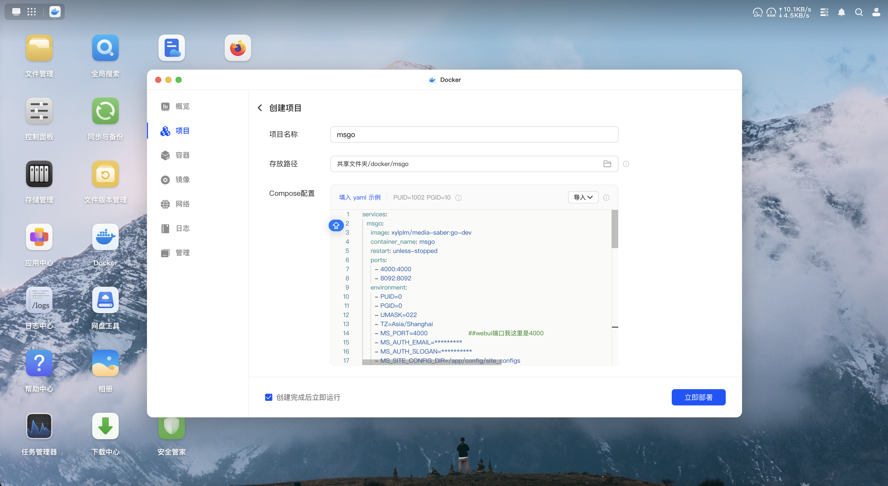

## 🖥️ UGOS PRO 安装指南

:::info
本指南适用于 **UGOS PRO** 系统用户，使用 **项目编排** 功能一键部署 Media Saber 全栈服务。
:::

### 第一步：准备目录结构

在 UGOS 存储中创建如下文件夹结构：

```
.
├── docker/
│   ├── msgo/
│   │   └── configs           # Media Saber 配置文件
│   ├── redis/
│   │   └── data              # Redis 数据持久化
│   └── pgsql/
│       └── data              # PostgreSQL 数据持久化
└── video/                    # 媒体文件存储目录
```

:::warning
- 确保所有文件夹具有读写权限
- 在同一存储空间中创建这些目录，避免跨盘影响硬链接
- 为媒体目录预留足够的存储空间
:::

---

### 第二步：部署全栈服务

在 UGOS 的 **项目编排** 中新建项目，粘贴以下 docker-compose 配置：

**docker-compose.yaml**：

```yaml
version: "3.8"

services:
  msgo:
    image: xylplm/media-saber:latest
    container_name: msgo
    restart: unless-stopped
    ports:
      - 8888:8888                      # Web UI 端口
      - 8092:8092                      # 媒体服务器反代端口
    environment:
      - PUID=0
      - PGID=0
      - UMASK=022
      - TZ=Asia/Shanghai
      - MS_PORT=8888                   # Web UI 端口
      - MS_AUTH_EMAIL=your-email@example.com  # 修改为你的邮箱
      - MS_AUTH_SLOGAN=YourAuthSlogan  # 修改为你的认证口令
      - MS_LOG_LEVEL=info
      - MS_REDIS_HOST=redis:6379
      - MS_REDIS_PASS=your-redis-password     # 修改为你的 Redis 密码
      - MS_TIMEOUT=60000
      - MS_PGSQL_USERNAME=postgres
      - MS_PGSQL_PASSWORD=your-db-password    # 修改为你的数据库密码
      - MS_PGSQL_PATH=pgsql
      - MS_PGSQL_PORT=5432
      - MS_PGSQL_DBNAME=ms
    volumes:
      - /path/to/docker/msgo/configs:/app/config    # 修改为实际路径
      - /path/to/video:/video                       # 修改为实际路径
    depends_on:
      - redis
      - pgsql
    networks:
      - msaber-net

  redis:
    image: redis:7-alpine
    container_name: redis
    restart: unless-stopped
    command: redis-server --requirepass your-redis-password  # 设置 Redis 密码
    ports:
      - 6379:6379
    volumes:
      - /path/to/docker/redis/data:/data               # 修改为实际路径
    environment:
      - TZ=Asia/Shanghai
      - PUID=0
      - PGID=0
    networks:
      - msaber-net

  pgsql:
    image: postgres:17-alpine
    container_name: pgsql
    restart: unless-stopped
    ports:
      - 5432:5432
    volumes:
      - /path/to/docker/pgsql/data:/var/lib/postgresql/data  # 修改为实际路径
    environment:
      - POSTGRES_USER=postgres
      - POSTGRES_DB=ms
      - POSTGRES_PASSWORD=your-db-password     # 设置数据库密码
      - POSTGRESQL_WAL_COMPRESSION=lz4
      - POSTGRESQL_MAX_CONNECTIONS=2048
      - TZ=Asia/Shanghai
    networks:
      - msaber-net

networks:
  msaber-net:
    driver: bridge
```

---

### 必须修改的参数

| 参数 | 说明 | 示例 |
|------|------|------|
| `MS_AUTH_EMAIL` | 访问认证邮箱 | `your-email@example.com` |
| `MS_AUTH_SLOGAN` | 认证口令 | 自定义密语 |
| `MS_REDIS_PASS` | Redis 密码 | 设置强密码（8+ 字符） |
| `MS_PGSQL_PASSWORD` | PostgreSQL 密码 | 与上面设置一致 |
| `/path/to/docker/msgo/configs` | Media Saber 配置目录 | 实际路径 |
| `/path/to/docker/redis/data` | Redis 数据目录 | 实际路径 |
| `/path/to/docker/pgsql/data` | PostgreSQL 数据目录 | 实际路径 |
| `/path/to/video` | 媒体文件目录 | 实际路径 |

:::success
**同一网络优势**：
- 三个服务部署在同一 docker 网络中
- 容器之间可以直接通过容器名称通讯
- 无需指定 IP 地址，配置更加简洁
:::

---

### 启动和管理

<div align="center"></div>

**启动方式**：
1. 在项目编排中粘贴配置
2. 点击「创建」或「启动」
3. 通过日志查看启动状态

**常用命令**（如需使用 SSH）：

| 操作 | 命令 |
|------|------|
| 查看容器状态 | `docker ps` |
| 查看服务日志 | `docker logs -f msgo` |
| 重启服务 | `docker restart msgo` |
| 进入容器 | `docker exec -it msgo bash` |

---

### 常见问题

**Q: 容器无法启动？**

检查步骤：
1. 查看项目编排的日志信息
2. 确认所有目录路径已正确修改
3. 检查端口是否被占用（8888、6379、5432）

**Q: 无法连接到数据库？**

- 确保 PostgreSQL 容器已成功启动
- 检查密码是否一致
- 验证网络配置（所有服务应在同一网络）

**Q: 硬链接失败？**

- 确保所有目录在同一存储空间中
- 避免跨越不同的物理存储设备
- 查看 [Linux 硬链接与软链接概念](https://developer.aliyun.com/article/1468577)

---

### 相关文档

- [群晖 NAS 安装](/guide/install/synology.md)
- [绿联 NAS 安装](/guide/install/ugreen.md)
- [Unraid 安装](/guide/install/unraid.md)
- [极空间 NAS 安装](/guide/install/zspace.md)
- [懒猫微服安装](/guide/install/lazycat.md)
- [故障排查](/guide/problem.md)
