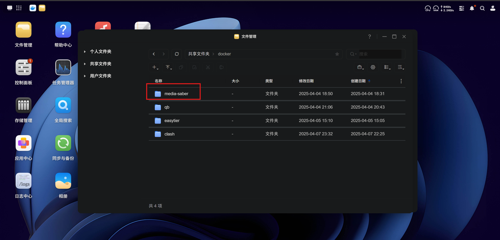
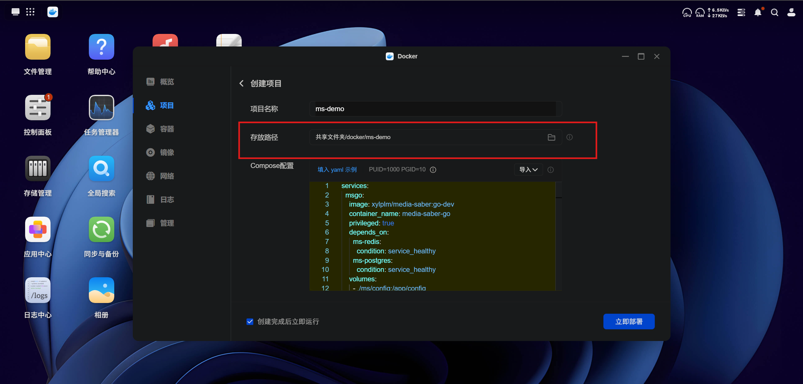
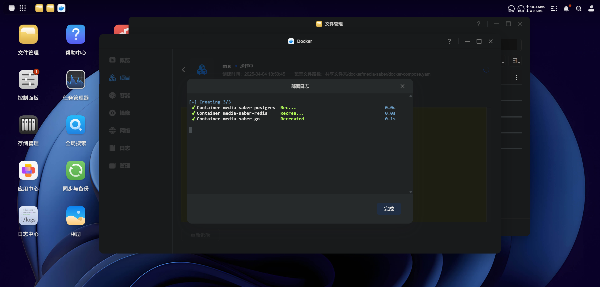

## 🖥️ 绿联 NAS 安装指南

:::info
本指南适用于 **绿联 NAS** 用户，使用 **Docker 项目编排** 功能一键部署 Media Saber 全栈服务。
:::

### 第一步：准备目录结构

打开 **文件管理器**，在 `docker` 目录下创建所需文件夹：

```
docker/
├── ms/
│   └── config               # Media Saber 配置文件
├── pg/
│   └── data                 # PostgreSQL 数据持久化
└── [你的媒体目录]/           # 根据下载器配置添加
```



:::tip
- 建议将 Docker 配置存放在 **SSD** 或高速存储位置
- 媒体目录应与下载器的输出目录一致
:::

---

### 第二步：部署全栈服务

打开 **Docker**，使用 **项目编排** 功能，粘贴以下配置：

**docker-compose.yaml**：

```yaml
version: '3.8'

services:
  msgo:
    image: xylplm/media-saber:latest
    container_name: media-saber-go
    depends_on:
      ms-redis:
        condition: service_healthy
      ms-postgres:
        condition: service_healthy
    ports:
      - "8888:8888"
    environment:
      - MS_PORT=8888
      - MS_REDIS_HOST=ms-redis:6379
      - MS_REDIS_PASS=your-redis-password            # 修改为你的 Redis 密码
      - MS_PGSQL_USER=postgres
      - MS_PGSQL_PASSWORD=your-db-password           # 修改为你的数据库密码
      - MS_PGSQL_PATH=ms-postgres
      - MS_PGSQL_PORT=5432
      - MS_PGSQL_DBNAME=media_saber
      - MS_AUTH_EMAIL=your-email@example.com         # 修改为你的邮箱
      - MS_AUTH_SLOGAN=YourAuthSlogan                # 修改为你的认证口令
      - MS_SITE_CONFIG_DIR=/app/config/site_configs
      - MS_LOG_MODE=file
      - MS_LOG_LEVEL=info
      - MS_PGSQL_LOG_MODE=prod
      - MS_LOG_KEEP_DAYS=14
    volumes:
      - ./ms/config:/app/config                      # Media Saber 配置目录
      - /path/to/your/media:/video1                  # 修改为实际媒体路径（可添加多个）
    restart: always
    networks:
      - bridge-network

  ms-redis:
    image: redis:7.0.14-alpine
    container_name: media-saber-redis
    restart: always
    command: redis-server --requirepass your-redis-password  # 设置 Redis 密码
    environment:
      - PUID=1000
      - PGID=10
    healthcheck:
      test: ["CMD", "redis-cli", "ping"]
      interval: 5s
      timeout: 3s
      retries: 5
    volumes:
      - ./redis/data:/data
    networks:
      - bridge-network

  ms-postgres:
    image: postgres:17-alpine
    container_name: media-saber-postgres
    restart: always
    environment:
      - POSTGRES_USER=postgres
      - POSTGRES_PASSWORD=your-db-password           # 设置数据库密码
      - POSTGRES_DB=media_saber
    healthcheck:
      test: ["CMD-SHELL", "pg_isready -U postgres"]
      interval: 5s
      timeout: 3s
      retries: 5
    volumes:
      - ./pg/data:/var/lib/postgresql/data
    networks:
      - bridge-network

networks:
  bridge-network:
    driver: bridge
```

---

### 必须修改的参数

| 参数 | 说明 | 示例 |
|------|------|------|
| `MS_REDIS_PASS` | Redis 密码 | 设置强密码（8+ 字符） |
| `MS_PGSQL_PASSWORD` | PostgreSQL 密码 | 与 Redis 密码保持一致风格 |
| `MS_AUTH_EMAIL` | 访问认证邮箱 | `your-email@example.com` |
| `MS_AUTH_SLOGAN` | 认证口令 | 自定义口令 |
| `/path/to/your/media` | 媒体存储路径 | 与下载器配置一致的路径 |
| `./ms/config` | Media Saber 配置目录 | 根据实际位置修改 |
| `./pg/data` | PostgreSQL 数据目录 | 根据实际位置修改 |

:::warning
**注意事项**：
- 密码参数要保持一致（Redis 密码、PostgreSQL 密码）
- 媒体目录映射需与下载器配置相一致
- 建议所有文件夹都在同一存储位置，避免跨盘
:::

---

### 部署步骤



1. 打开 **Docker** → **项目编排**
2. 点击 **新增项目**
3. 选择 **存放位置**（建议 SSD）
4. 粘贴上述 docker-compose.yaml 配置
5. 点击 **立即部署**



6. 部署完成后点击 **完成**

:::success
部署通常需要 1-3 分钟，期间会自动拉取镜像和初始化数据库。可通过日志查看进度。
:::

---

### 启动和管理

| 操作 | 说明 |
|------|------|
| 查看日志 | 在 Docker 中选择容器，查看日志选项卡 |
| 停止服务 | 在项目编排中点击项目，选择停止 |
| 重启服务 | 在项目编排中点击项目，选择重启 |
| 删除服务 | 在项目编排中点击项目，选择删除 |

---

### 常见问题

**Q: 部署后无法访问 Web UI？**

1. 确认三个容器都在运行中（查看 Docker 容器列表）
2. 检查端口 8888 是否被占用
3. 尝试在浏览器访问 `http://nas-ip:8888`

**Q: 容器启动失败？**

检查步骤：
- [ ] Redis 和 PostgreSQL 已成功启动（查看 healthcheck 状态）
- [ ] 密码参数一致
- [ ] 媒体目录路径正确
- [ ] 查看日志获取具体错误信息

**Q: 无法连接到数据库？**

- 确保 PostgreSQL 容器已启动
- 检查密码是否正确（`POSTGRES_PASSWORD` 与 `MS_PGSQL_PASSWORD` 一致）
- 验证网络配置（所有服务在 `bridge-network` 中）

**Q: 硬链接不工作？**

- 确保媒体目录与 Docker 配置在同一存储空间
- 避免跨越不同的物理存储设备
- 查看 [Linux 硬链接概念](https://developer.aliyun.com/article/1468577)

---

### 相关文档

- [群晖 NAS 安装](/guide/install/synology.md)
- [UGOS PRO 安装](/guide/install/ugos.md)
- [Unraid 安装](/guide/install/unraid.md)
- [极空间 NAS 安装](/guide/install/zspace.md)
- [懒猫微服安装](/guide/install/lazycat.md)
- [故障排查](/guide/problem.md)
