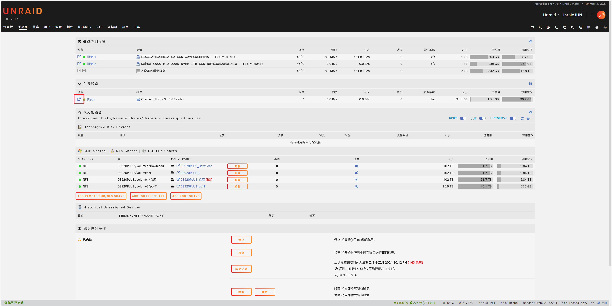
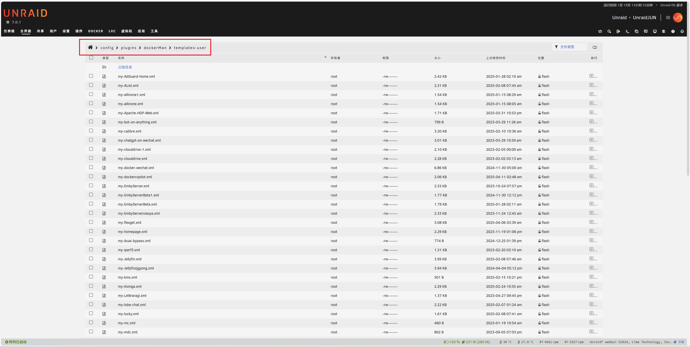
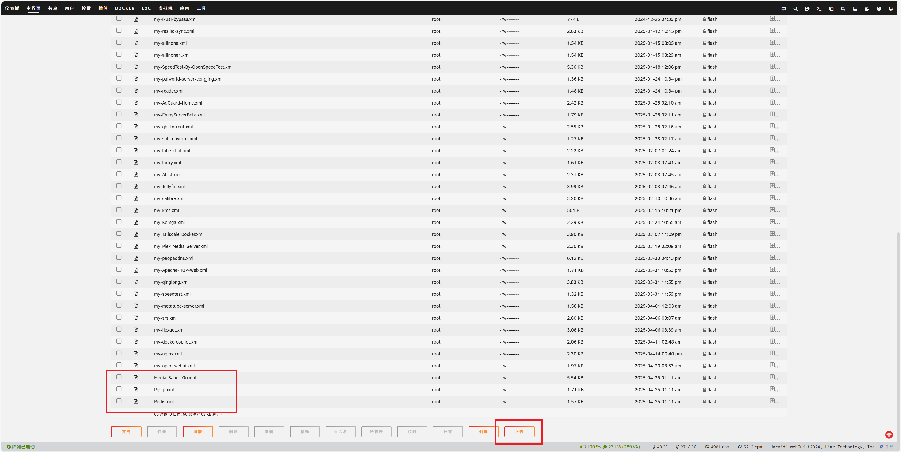
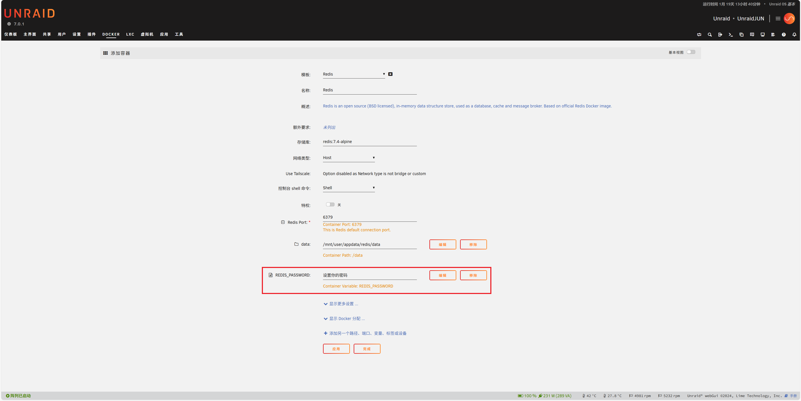
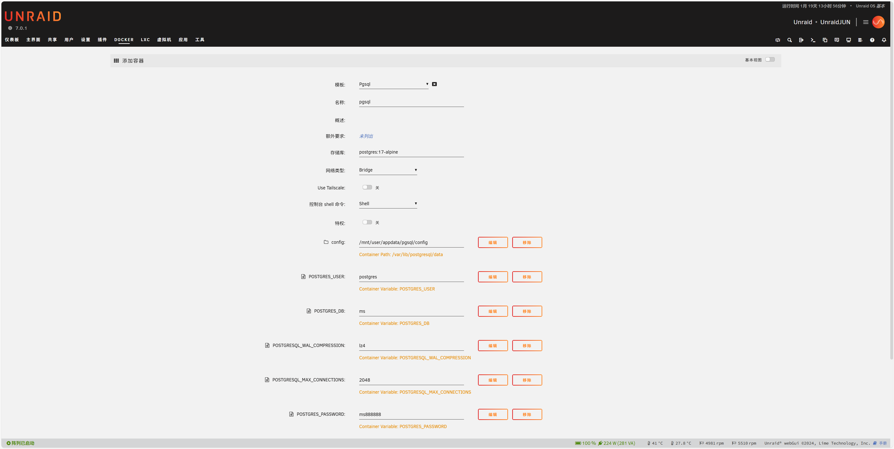
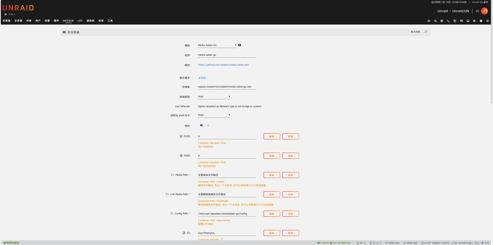

## 🖥️ UNRAID 安装指南

:::info
本指南适用于 **UNRAID** 系统用户，通过 **Docker** 模板部署 Media Saber 及其相关服务。
:::

### 第一步：准备 XML 模板文件

获取模板文件有两种方式：

**方式 1：下载预编译文件**

[下载 MSGO_UNRAID.zip](https://raw.githubusercontent.com/xylplm/media-saber-wiki/refs/heads/main/docs/guide/install/other/MSGO_UNRAID.zip) 并解压，得到三个 XML 模板文件。

**方式 2：手动创建（若下载失败）**

创建以下三个 XML 文件：

**Redis.xml**：

```xml
<?xml version="1.0"?>
<Container version="2">
  <Name>Redis</Name>
  <Repository>redis:7.4-alpine</Repository>
  <Registry>https://registry.hub.docker.com/_/redis/</Registry>
  <Network>host</Network>
  <Shell>sh</Shell>
  <Privileged>false</Privileged>
  <Config Name="Redis Port" Target="6379" Default="6379" Mode="tcp" Description="Redis 连接端口" Type="Port" Display="always-hide" Required="true" Mask="{8}">6379</Config>
  <Config Name="data" Target="/data" Default="" Mode="rw" Description="数据存储路径" Type="Path" Display="always" Required="false" Mask="false">/mnt/user/appdata/redis/data</Config>
  <Config Name="REDIS_PASSWORD" Target="REDIS_PASSWORD" Default="" Mode="" Description="Redis 访问密码" Type="Variable" Display="always" Required="false" Mask="false">your-redis-password</Config>
</Container>
```

**Pgsql.xml**：

```xml
<?xml version="1.0"?>
<Container version="2">
  <Name>pgsql</Name>
  <Repository>postgres:17-alpine</Repository>
  <Network>bridge</Network>
  <Shell>sh</Shell>
  <Privileged>false</Privileged>
  <Config Name="data" Target="/var/lib/postgresql/data" Default="" Mode="rw" Description="数据持久化路径" Type="Path" Display="always" Required="false" Mask="false">/mnt/user/appdata/pgsql/data</Config>
  <Config Name="POSTGRES_USER" Target="POSTGRES_USER" Default="" Mode="" Description="数据库用户名" Type="Variable" Display="always" Required="false" Mask="false">postgres</Config>
  <Config Name="POSTGRES_DB" Target="POSTGRES_DB" Default="" Mode="" Description="默认数据库名" Type="Variable" Display="always" Required="false" Mask="false">ms</Config>
  <Config Name="POSTGRES_PASSWORD" Target="POSTGRES_PASSWORD" Default="" Mode="" Description="数据库密码" Type="Variable" Display="always" Required="false" Mask="false">your-db-password</Config>
  <Config Name="POSTGRESQL_WAL_COMPRESSION" Target="POSTGRESQL_WAL_COMPRESSION" Default="" Mode="" Description="WAL 压缩" Type="Variable" Display="always" Required="false" Mask="false">lz4</Config>
  <Config Name="POSTGRESQL_MAX_CONNECTIONS" Target="POSTGRESQL_MAX_CONNECTIONS" Default="" Mode="" Description="最大连接数" Type="Variable" Display="always" Required="false" Mask="false">2048</Config>
  <Config Name="PORTS" Target="5432" Default="" Mode="tcp" Description="数据库端口" Type="Port" Display="always" Required="false" Mask="false">5431</Config>
</Container>
```

**Media-Saber-Go.xml**：

```xml
<?xml version="1.0"?>
<Container version="2">
  <Name>media-saber-go</Name>
  <Repository>qqaazz.msaber.fun/xylplm/media-saber:latest</Repository>
  <Network>host</Network>
  <Shell>sh</Shell>
  <Privileged>false</Privileged>
  <WebUI>http://[IP]:[PORT:8888]</WebUI>
  <Config Name="PUID" Target="PUID" Default="0" Mode="" Description="用户 ID" Type="Variable" Display="always" Required="false" Mask="false">0</Config>
  <Config Name="PGID" Target="PGID" Default="0" Mode="" Description="用户组 ID" Type="Variable" Display="always" Required="false" Mask="false">0</Config>
  <Config Name="Media Path" Target="/media" Default="" Mode="rw" Description="媒体文件路径" Type="Path" Display="always" Required="true" Mask="false">/mnt/user/your-media-path</Config>
  <Config Name="Config Path" Target="/app/config" Default="" Mode="rw" Description="配置文件路径" Type="Path" Display="always" Required="true" Mask="false">/mnt/user/appdata/mediaSaber-go/config</Config>
  <Config Name="TZ" Target="TZ" Default="" Mode="" Description="时区设置" Type="Variable" Display="always" Required="false" Mask="false">Asia/Shanghai</Config>
  <Config Name="MS_PORT" Target="MS_PORT" Default="" Mode="" Description="Web UI 端口" Type="Variable" Display="always" Required="false" Mask="false">8888</Config>
  <Config Name="MS_REDIS_HOST" Target="MS_REDIS_HOST" Default="" Mode="" Description="Redis 地址：端口" Type="Variable" Display="always" Required="false" Mask="false">127.0.0.1:6379</Config>
  <Config Name="MS_REDIS_PASS" Target="MS_REDIS_PASS" Default="" Mode="" Description="Redis 密码" Type="Variable" Display="always" Required="false" Mask="false">your-redis-password</Config>
  <Config Name="MS_TIMEOUT" Target="MS_TIMEOUT" Default="" Mode="" Description="超时时间（毫秒）" Type="Variable" Display="always" Required="false" Mask="false">60000</Config>
  <Config Name="MS_PGSQL_USERNAME" Target="MS_PGSQL_USERNAME" Default="" Mode="" Description="数据库用户名" Type="Variable" Display="always" Required="false" Mask="false">postgres</Config>
  <Config Name="MS_PGSQL_PASSWORD" Target="MS_PGSQL_PASSWORD" Default="" Mode="" Description="数据库密码" Type="Variable" Display="always" Required="false" Mask="false">your-db-password</Config>
  <Config Name="MS_PGSQL_PATH" Target="MS_PGSQL_PATH" Default="" Mode="" Description="PostgreSQL 服务器 IP" Type="Variable" Display="always" Required="false" Mask="false">127.0.0.1</Config>
  <Config Name="MS_PGSQL_PORT" Target="MS_PGSQL_PORT" Default="" Mode="" Description="PostgreSQL 端口" Type="Variable" Display="always" Required="false" Mask="false">5431</Config>
  <Config Name="MS_PGSQL_DBNAME" Target="MS_PGSQL_DBNAME" Default="" Mode="" Description="数据库名" Type="Variable" Display="always" Required="false" Mask="false">ms</Config>
  <Config Name="MS_AUTH_EMAIL" Target="MS_AUTH_EMAIL" Default="" Mode="" Description="认证邮箱（必填）" Type="Variable" Display="always" Required="true" Mask="false">your-email@example.com</Config>
  <Config Name="MS_AUTH_SLOGAN" Target="MS_AUTH_SLOGAN" Default="" Mode="" Description="认证口令（必填）" Type="Variable" Display="always" Required="true" Mask="false">YourAuthSlogan</Config>
  <Config Name="MS_LOG_LEVEL" Target="MS_LOG_LEVEL" Default="" Mode="" Description="日志级别" Type="Variable" Display="always" Required="false" Mask="false">info</Config>
  <Config Name="MS_LOG_KEEP_DAYS" Target="MS_LOG_KEEP_DAYS" Default="" Mode="" Description="日志保留天数" Type="Variable" Display="always" Required="false" Mask="false">7</Config>
  <Config Name="UMASK" Target="UMASK" Default="" Mode="" Description="文件权限掩码" Type="Variable" Display="always" Required="false" Mask="false">022</Config>
</Container>
```

---

### 第二步：上传 XML 模板文件

1. 打开 **UNRAID Web UI**
2. 点击 **主界面** 菜单栏
3. 点击 **Flash** 前的浏览图标

<div align="center"></div>

4. 按路径依次进入：`boot` → `config` → `plugins` → `dockerMan` → `templates-user`

<div align="center"></div>

5. 点击 **上传**，将三个 XML 文件上传至此目录

<div align="center"></div>

:::success
上传完成后，这些模板将在 Docker 容器创建时通过 **User Templates** 下拉菜单显示。
:::

---

### 第三步：创建 Redis 容器

1. 进入 **Docker** 菜单 → 点击 **添加容器**

<div align="center"></div>

2. 打开模板下拉菜单，在 **User Templates** 下选择 **Redis**
3. 修改 `REDIS_PASSWORD` 参数为你的 Redis 密码
4. 点击 **应用**

| 参数 | 值 | 说明 |
|------|-----|------|
| REDIS_PASSWORD | your-redis-password | 自定义强密码 |

---

### 第四步：创建 PostgreSQL 容器

1. 点击 **添加容器**
2. 打开模板下拉菜单，在 **User Templates** 下选择 **Pgsql**

<div align="center"></div>

| 参数 | 值 | 说明 |
|------|-----|------|
| POSTGRES_PASSWORD | your-db-password | 与 Redis 密码风格一致 |
| POSTGRES_DB | ms | 默认数据库名 |
| POSTGRES 端口 | 5431 | 避免与系统端口冲突 |

3. 点击 **应用**

:::tip
PostgreSQL 首次启动会初始化数据库，请耐心等待 1-2 分钟。
:::

---

### 第五步：创建 Media Saber 容器

1. 点击 **添加容器**
2. 打开模板下拉菜单，在 **User Templates** 下选择 **Media-Saber-Go**

<div align="center"></div>

**必须修改的参数**：

| 参数 | 值 | 说明 |
|------|-----|------|
| MS_REDIS_HOST | 127.0.0.1:6379 或 unraid-ip:6379 | Redis 服务器地址 |
| MS_REDIS_PASS | your-redis-password | 与第三步设置一致 |
| MS_PGSQL_PATH | 127.0.0.1 或 unraid-ip | PostgreSQL 服务器地址 |
| MS_PGSQL_PORT | 5431 | 与第四步设置一致 |
| MS_PGSQL_PASSWORD | your-db-password | 与第四步设置一致 |
| MS_AUTH_EMAIL | your-email@example.com | 你的认证邮箱 |
| MS_AUTH_SLOGAN | YourAuthSlogan | 自定义认证口令 |
| Media Path | /mnt/user/your-media-path | 实际媒体存储路径 |
| Config Path | /mnt/user/appdata/mediaSaber-go/config | 配置文件存储路径 |

:::warning
**重要**：
- 所有密码参数必须与前面步骤设置的密码一致
- 路径参数需要根据你的 UNRAID 实际存储结构修改
- Redis 和 PostgreSQL 必须已成功启动
:::

3. 点击 **应用**

---

### 部署完成

至此，所有三个容器（Redis、PostgreSQL、Media Saber）已部署完成。

**查看容器状态**：
1. 进入 **Docker** 菜单
2. 检查所有容器是否显示 **运行中** 状态

**访问 Web UI**：
- 打开浏览器，访问 `http://unraid-ip:8888`
- 使用你设置的邮箱和认证口令登录

---

### 常见问题

**Q: 上传 XML 文件后看不到模板？**

- 确认文件已上传到 `templates-user` 目录
- 重启 Docker 服务或刷新页面
- 检查 XML 文件是否完整且格式正确

**Q: 容器无法启动？**

1. 在 Docker 菜单中选择该容器
2. 查看容器的 **日志** 选项卡
3. 根据错误信息修改配置并重启

**Q: 无法连接到 Redis 或 PostgreSQL？**

检查清单：
- [ ] Redis 和 PostgreSQL 容器已启动（状态：运行中）
- [ ] 密码参数一致
- [ ] IP 地址和端口正确（可使用 127.0.0.1 或 unraid-ip）
- [ ] 防火墙未阻止相关端口

**Q: Media Saber 无法正常工作？**

- 确保 Redis 和 PostgreSQL 都已正常启动
- 检查日志获取具体错误信息
- 验证媒体目录路径是否正确

---

### 相关文档

- [群晖 NAS 安装](/guide/install/synology.md)
- [UGOS PRO 安装](/guide/install/ugos.md)
- [绿联 NAS 安装](/guide/install/ugreen.md)
- [极空间 NAS 安装](/guide/install/zspace.md)
- [故障排查](/guide/problem.md)
