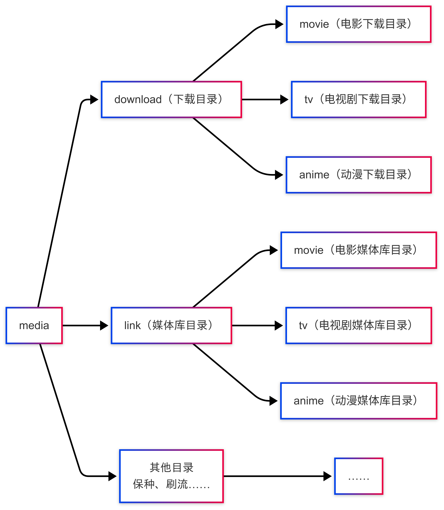
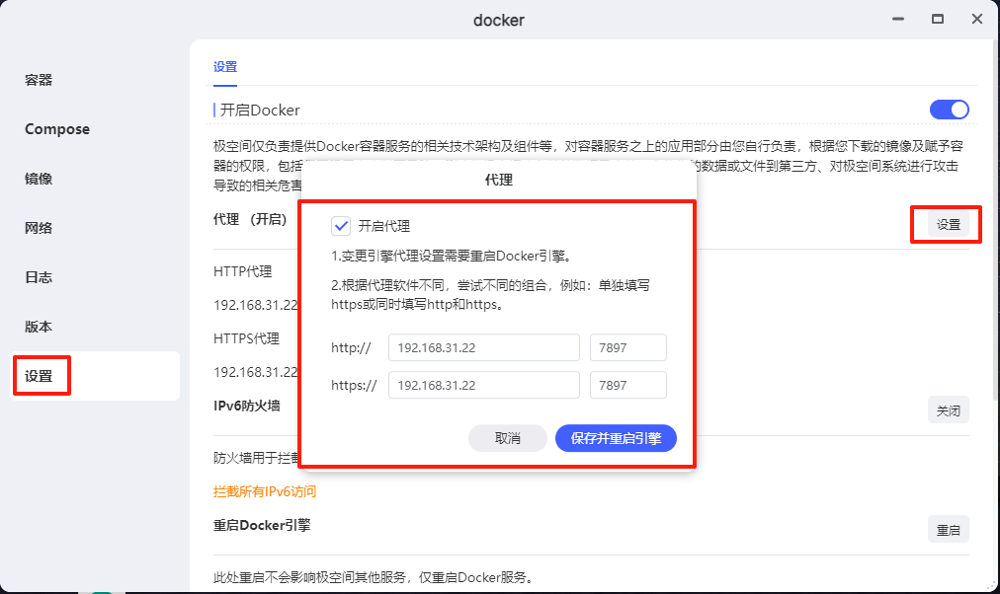
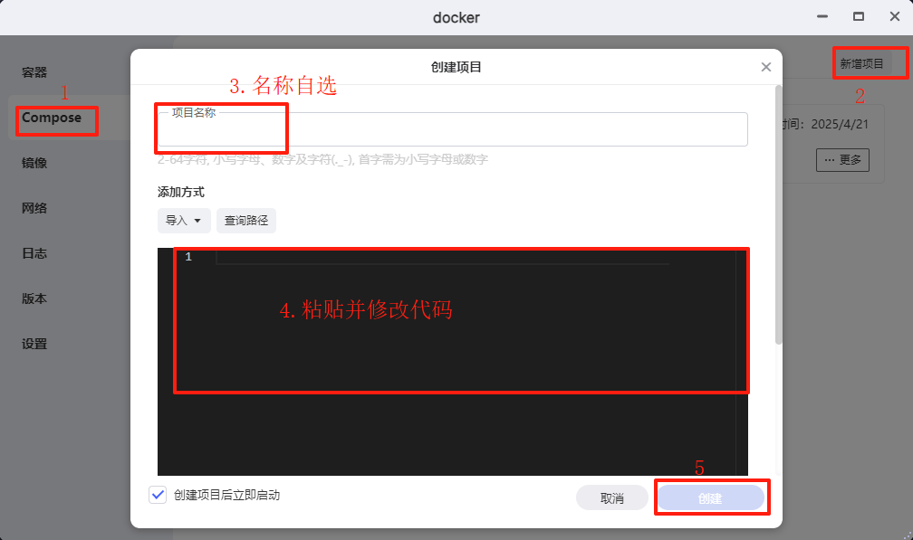

## 🖥️ 极空间 NAS 安装指南

:::info
本指南适用于 **极空间 NAS** 用户，通过 **Docker Compose** 一键部署 Media Saber 全栈服务。
:::

---

## 第一步：理解容器目录映射

:::warning **重要概念**
新手经常在目录映射时出错。为避免硬链接失败，必须理解以下映射原理。
:::

### 容器映射的基本原理

由于 Docker 容器是**隔离运行**的，容器无法直接访问 NAS 上的文件。通过 **目录映射** 可以让容器访问 NAS 上的文件。

**映射语法**：
```
宿主机路径:容器内路径
```

例如：`/docker/emby/config:/config`
- **左侧** (`/docker/emby/config`)：NAS 上的实际路径
- **右侧** (`/config`)：容器内的对应路径

### ❌ 错误的映射方式

将下载目录和媒体库目录分别映射：

```
映射一：/media/download:/media/download
映射二：/media/link:/media/link
```

**问题**：容器会将这两个目录视为不同的物理存储，无法进行硬链接。

### ✅ 正确的映射方式

只使用一条映射，映射到统一的父目录：

```
/media:/media
```

**优点**：
- 容器内所有文件位于同一逻辑存储
- 硬链接正常工作
- 配置简洁高效

:::tip
📌 记住：**同一存储空间的所有目录应映射到容器的同一根目录**，而非分别映射子目录。详见 [Linux 硬链接与软链接详解](https://developer.aliyun.com/article/1468577)
:::

---

## 第二步：规划目录结构

### Docker 容器配置目录

在 **SSD 固态硬盘** 上创建如下结构（用于存放配置，提高性能）：

```
Docker/
├── ms-go/
│   ├── ms/
│   │   └── config         # Media Saber 配置
│   ├── redis/
│   │   └── data           # Redis 数据
│   ├── pgsql/
│   │   └── data           # PostgreSQL 数据
│   ├── emby/
│   │   └── config         # Emby 配置（可选）
│   └── qb/
│       └── config         # qBittorrent 配置（可选）
```

### 媒体目录结构

将所有媒体相关目录放在统一的父目录中：

```
media/
├── download               # 下载目录
│   ├── movie
│   ├── tv
│   └── anime
├── link                   # 硬链接目录（Media Saber 整理后）
│   ├── movie
│   ├── tv
│   └── anime
└── other                  # 其他媒体文件
```

<div align="center"></div>

---

## 第三步：配置 Docker 环境

### 配置镜像加速器

确保 Docker 能正常拉取镜像。在极空间 Docker 设置中配置代理地址：

<div align="center"></div>

:::tip
使用极空间自带的 Docker 代理或自定义加速镜像，以加快镜像拉取速度。
:::

---

## 第四步：部署 Docker Compose

### 创建项目

进入 **Docker** → **Compose** 菜单，点击右上角 **新增项目**

<div align="center"></div>

### Compose 配置文件

粘贴以下配置，**自行修改带有注释的部分**：

```yaml
version: '3.8'

services:
  # Redis 缓存服务（必选）
  redis:
    image: redis:7-alpine
    container_name: redis
    restart: unless-stopped
    network_mode: bridge
    command: redis-server --requirepass your-redis-password  # 设置 Redis 密码
    ports:
      - "16379:6379"  # 极空间 6379 已被占用，改用 16379
    volumes:
      - /path/to/docker/ms-go/redis/data:/data  # 修改为实际路径
    environment:
      TZ: Asia/Shanghai
    healthcheck:
      test: ["CMD", "redis-cli", "ping"]
      interval: 5s
      timeout: 3s
      retries: 5

  # PostgreSQL 数据库（必选）
  pgsql:
    image: postgres:17-alpine
    container_name: pgsql
    restart: unless-stopped
    network_mode: bridge
    ports:
      - "5432:5432"
    volumes:
      - /path/to/docker/ms-go/pgsql/data:/var/lib/postgresql/data  # 修改为实际路径
    environment:
      POSTGRES_USER: postgres
      POSTGRES_DB: ms
      POSTGRES_PASSWORD: your-db-password  # 设置数据库密码
      POSTGRESQL_WAL_COMPRESSION: lz4
      POSTGRESQL_MAX_CONNECTIONS: 2048
      TZ: Asia/Shanghai
    healthcheck:
      test: ["CMD-SHELL", "pg_isready -U postgres"]
      interval: 5s
      timeout: 3s
      retries: 5

  # Media Saber（必选）
  msgo:
    image: xylplm/media-saber:latest
    container_name: msgo
    restart: unless-stopped
    network_mode: bridge
    privileged: true
    depends_on:
      redis:
        condition: service_healthy
      pgsql:
        condition: service_healthy
    ports:
      - "8888:8888"      # Web UI 端口
      - "8091:8091"      # Strm 代理端口（Emby 反代）
    volumes:
      - /path/to/docker/ms-go/ms/config:/app/config  # 修改为实际路径
      - /path/to/media:/media                        # 修改为实际媒体根目录
    environment:
      TZ: Asia/Shanghai
      MS_PORT: 8888                                    # Web UI 端口
      MS_AUTH_EMAIL: your-email@example.com           # 修改为你的邮箱
      MS_AUTH_SLOGAN: YourAuthSlogan                  # 修改为认证口令
      MS_LOG_LEVEL: info                              # 日志级别
      MS_LOG_KEEP_DAYS: 14                            # 日志保留天数
      MS_REDIS_HOST: 172.17.0.1:16379                 # Docker bridge 网关 IP（通常为 172.17.0.1）
      MS_REDIS_PASS: your-redis-password              # 与 Redis 密码一致
      MS_TIMEOUT: 60000                               # 请求超时（毫秒）
      MS_PGSQL_DBNAME: ms
      MS_PGSQL_USERNAME: postgres
      MS_PGSQL_PASSWORD: your-db-password             # 与 PostgreSQL 密码一致
      MS_PGSQL_PATH: 172.17.0.1                       # Docker bridge 网关 IP
      MS_PGSQL_PORT: 5432
      MS_PGSQL_LOG_MODE: prod
      MS_MQ_CONCURRENCY: 10

  # Emby 媒体服务器（可选）
  emby:
    image: amilys/embyserver:4.9.0.42
    container_name: emby
    restart: unless-stopped
    network_mode: bridge
    ports:
      - "8096:8096"     # Web UI
      - "1900:1900"     # DLNA 发现
      - "7359:7359"     # DLNA 广播
      - "8920:8920"     # HTTPS
    devices:
      - /dev/dri:/dev/dri  # 硬件解码（GPU 加速）
    volumes:
      - /path/to/docker/ms-go/emby/config:/config  # 修改为实际路径
      - /path/to/media:/media                       # 与 msgo 保持一致
    environment:
      UID: 0
      GID: 0
      GIDLIST: 0
      TZ: Asia/Shanghai
    privileged: true

  # qBittorrent 下载器（可选）
  qb:
    image: johngong/qbittorrent:4.3.9
    container_name: qb
    restart: unless-stopped
    network_mode: host  # 用于 UPnP 端口映射和 IPv6
    ports:
      - "8989:8989"     # Web UI
    volumes:
      - /path/to/docker/ms-go/qb/config:/config  # 修改为实际路径
      - /path/to/media:/media                    # 与 msgo 保持一致
    environment:
      UID: 0
      GID: 0
      UMASK: 022
      TZ: Asia/Shanghai
      WEBUIPORT: 8989
```

### 路径修改指南

点击极空间"创建项目"界面中的 **查询路径** 按钮，选择或新建目录，然后点击 **复制路径**，粘贴替换配置中的路径。

| 参数 | 说明 | 示例 |
|------|------|------|
| `/path/to/docker/...` | Docker 配置目录 | `/tmp/zfsv3/nvme12/xxx/data/Docker/ms-go/...` |
| `/path/to/media` | 媒体根目录 | `/tmp/zfsv3/sata1/xxx/data/media` |
| `your-redis-password` | Redis 密码 | 自定义强密码 |
| `your-db-password` | PostgreSQL 密码 | 自定义强密码 |
| `MS_AUTH_EMAIL` | 认证邮箱 | 你的真实邮箱 |
| `MS_AUTH_SLOGAN` | 认证口令 | 自定义口令 |

:::warning
**重要提示**：
- 所有密码参数务必设置，且需保持一致
- Redis 和 PostgreSQL 的密码务必在 Redis 配置和 msgo 配置中一致
- 媒体路径在所有容器中应保持相同（避免跨盘）
:::

---

## 启动和访问

修改配置完成后，点击 **创建** 等待镜像拉取和容器启动。

### Web 访问地址

| 服务 | 访问地址 | 说明 |
|------|---------|------|
| Media Saber | `http://nas-ip:8888` | 主 Web 应用 |
| qBittorrent | `http://nas-ip:8989` | 下载器（可选） |
| Emby | `http://nas-ip:8096` | 媒体服务器（可选） |

---

## 常见问题

**Q: 容器无法启动？**

检查步骤：
1. 进入 Docker 容器列表，查看容器状态
2. 点击容器日志查看错误信息
3. 常见原因：路径不存在、密码不一致、端口被占用

**Q: 无法连接到数据库或缓存？**

- 确认 Redis 和 PostgreSQL 容器已启动且状态为 **healthy**
- 检查 Redis 密码和 PostgreSQL 密码是否在所有配置中一致
- 极空间 Docker bridge 网关通常为 `172.17.0.1`（可通过 `docker network inspect bridge` 确认）

**Q: 硬链接失败？**

- 确保所有服务的媒体目录映射指向同一个路径
- 确保目录结构在同一存储空间中（不跨盘）
- 不要分别映射 `download` 和 `link` 目录，应映射它们的父目录 `media`

**Q: 镜像拉取失败？**

- 检查 Docker 代理配置是否正确
- 尝试手动配置国内镜像加速器
- 检查网络连接是否正常

**Q: 如何重启或更新容器？**

在 Compose 界面：
- 点击项目名称旁的 **操作** 按钮
- 选择 **重启**、**停止** 或 **删除** 等操作
- 更新镜像后重新创建项目

---

### 相关文档

- [群晖 NAS 安装](/guide/install/synology.md)
- [UGOS PRO 安装](/guide/install/ugos.md)
- [绿联 NAS 安装](/guide/install/ugreen.md)
- [Unraid 安装](/guide/install/unraid.md)
- [故障排查](/guide/problem.md)

