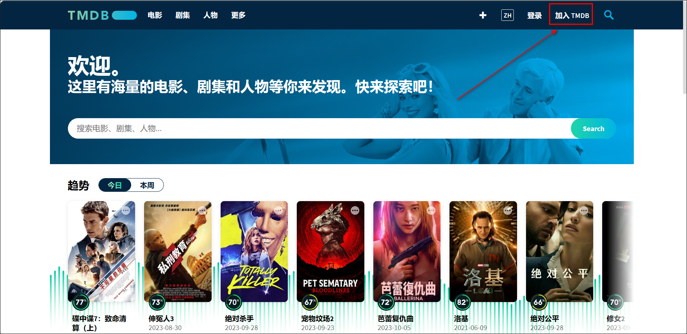
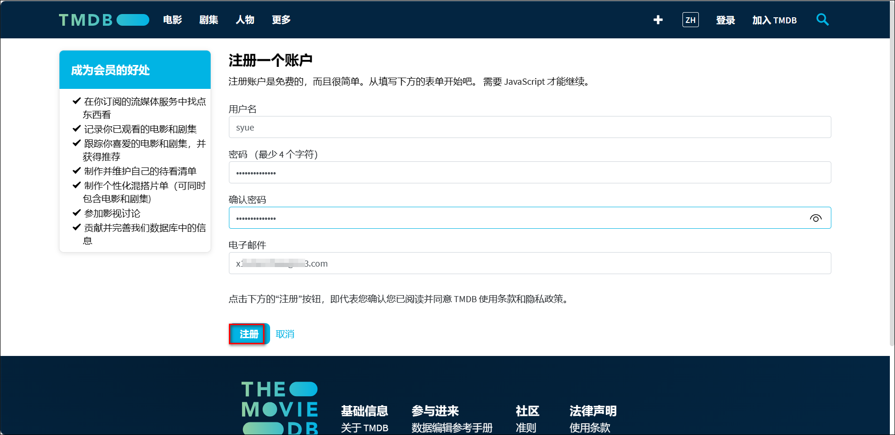
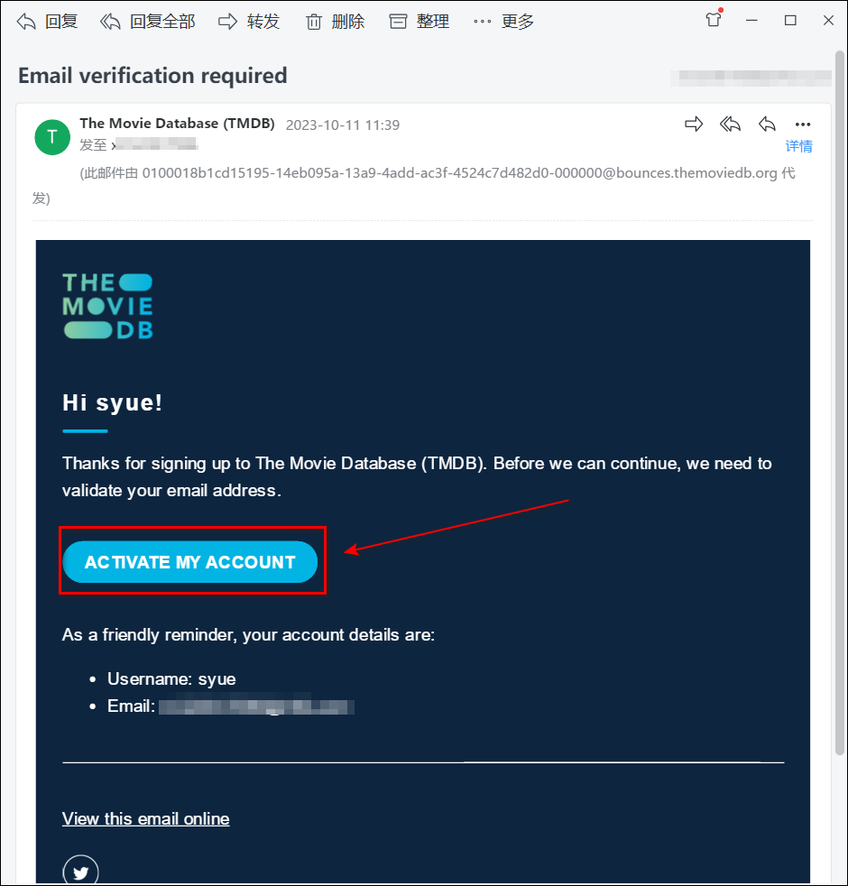
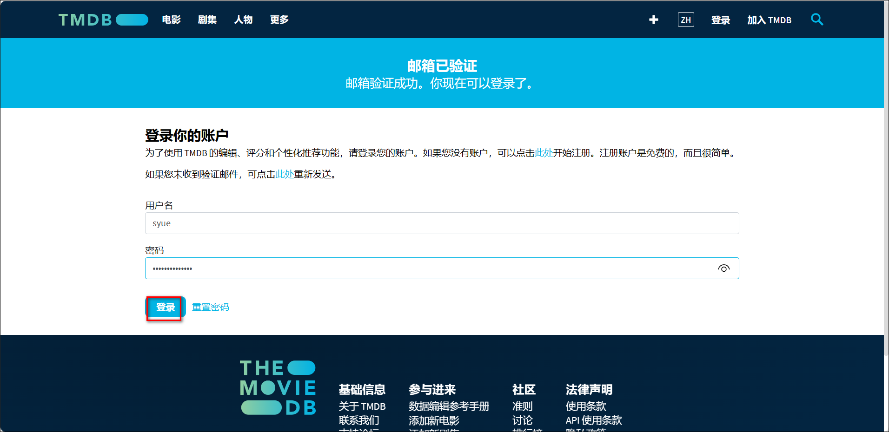
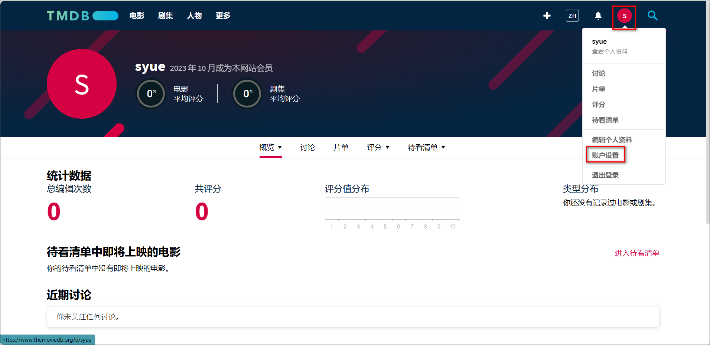
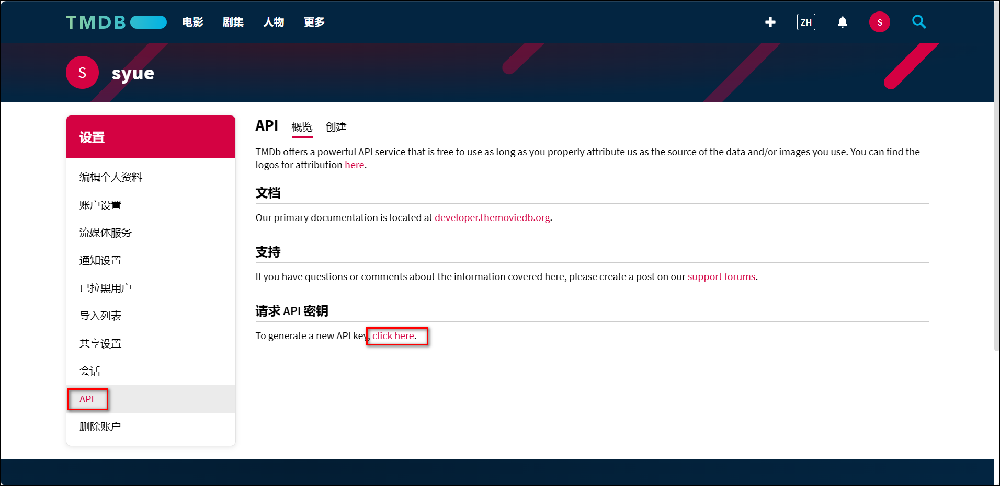
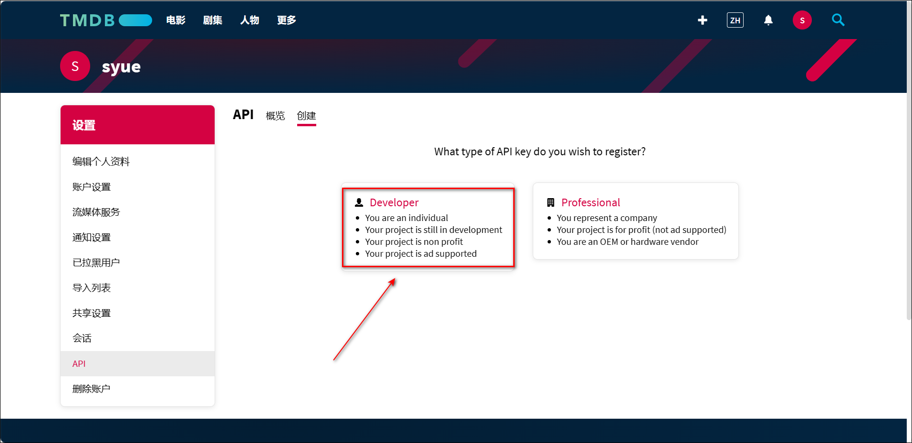
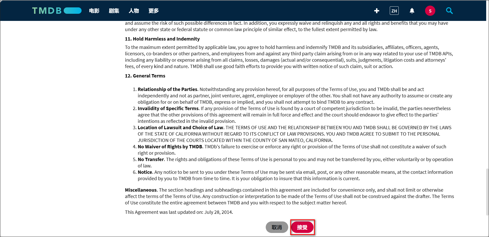
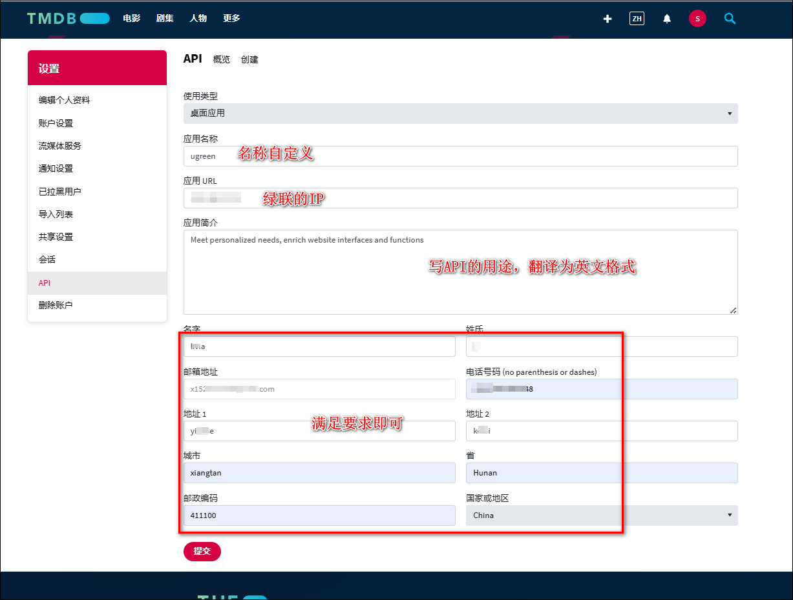
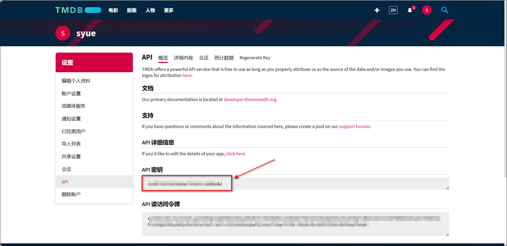

:::info 💡 什么是 TMDB？
TMDB（The Movie Database）是全球最大的开源电影和电视数据库。Media Saber 使用 TMDB 的 API 获取剧集信息、海报、分类等元数据，是系统正常工作的必要配置。
:::

## 📝 申请 TMDB API Key

Media Saber 需要使用 TMDB 提供的元数据接口服务，首次使用前请按以下步骤申请 API Key。

⏱️ **预计耗时：** 5-10 分钟

---

### 🔐 第 1 步：注册 TMDB 账号

1. 访问 [TMDB 官网](https://www.themoviedb.org/)
2. 点击右上角 **加入 TMDB**（或 Sign Up）

<div align="center"></div>

3. 填写注册表单：
   - **用户名**：自定义用户名
   - **邮箱**：使用有效的邮箱地址
   - **密码**：设置强密码
   - **确认密码**：再次输入密码

<div align="center"></div>

4. 点击 **Sign Up** 完成注册

5. **邮箱验证**：
   - TMDB 会向你的邮箱发送验证邮件
   - 打开邮件，点击 **ACTIVATE MY ACCOUNT** 激活账户

<div align="center"></div>

✅ **账户激活完成！**

---

### 🔑 第 2 步：登录并进入 API 管理

1. **登录 TMDB**：使用刚才注册的用户名/邮箱和密码登录

<div align="center"></div>

2. **进入账户设置**：
   - 点击右上角用户头像
   - 选择 **Settings**（设置）

<div align="center"></div>

3. **进入 API 页面**：
   - 在左侧菜单找到 **API** 选项
   - 点击进入 API 管理页面

<div align="center"></div>

4. **请求 API 密钥**：
   - 找到「请求 API 密钥」或「Request an API Key」
   - 点击下方的 `click here` 链接开始申请

---

### 📋 第 3 步：创建 API 应用

1. **选择用途**：
   - 选择 **Developer（开发者）** 选项
   - 点击继续

<div align="center"></div>

2. **接受使用条款**：
   - 阅读协议内容
   - 滑动到页面底部
   - 勾选 ✓ 「我同意 TMDB API 条款...」

<div align="center"></div>

3. **填写应用信息**：

<div align="center"></div>

**需要填写的字段：**

| 字段 | 填写内容 | 说明 |
|------|---------|------|
| **应用名称** | 如 `Media Saber` | 自定义名称，用于识别应用 |
| **应用 URL** | 如 `http://192.168.x.x:8080` | 填写你的 Media Saber 访问地址或局域网 IP |
| **用途描述** | 英文描述 | 说明为什么需要 API Key |

**用途描述示例（英文）：**
```
Meet personalized needs for media organization and management.
```

或翻译成中文后再翻译成英文：
- 用途：个人媒体库管理和组织
- 英文：Personal media library organization and management system.

4. **提交申请**：
   - 填写完所有信息后，点击 **Submit** 提交

---

### ✅ 第 4 步：获取和配置 API Key

1. **复制 API Key**：
   - 提交成功后，会显示你的 **API Key (v3 auth)**
   - 这就是你需要的密钥

<div align="center"></div>

2. **保存 API Key**：
   - ✅ 复制 API Key 到剪贴板
   - ✅ 妥善保管（不要分享给他人）

3. **在 Media Saber 中填写**：
   - 打开 Media Saber 初始化配置或 [基础设置](/usage/system_settings/basic_settings)
   - 找到 **TMDB API Key** 字段
   - 粘贴你复制的 API Key
   - 点击「测试」验证是否正确
   - 点击「保存」

💡 **验证成功标志：** 系统会提示「TMDB API Key 验证成功」或类似信息

---

## ⚠️ 常见问题

### 📌 页面没有显示 API Key？

**解决方案：**
1. 刷新 TMDB 网站页面
2. 退出重新登录
3. 重新进入 Settings → API，查看是否有新创建的应用

### 📌 API Key 无法验证/提示密钥无效？

**可能原因：**
- ❌ API Key 复制错误 → 重新复制并确认无空格
- ❌ 使用了错误的 Key 类型 → 确保使用的是「v3 auth」而非「v4 auth」
- ❌ TMDB 服务不可达 → 检查网络连接或配置代理

**解决方案：**
1. 重新登录 TMDB 账户
2. 进入 API 管理页面
3. 找到你创建的应用
4. 重新复制 **API Key (v3 auth)**，仔细检查无空格
5. 在 Media Saber 中测试

### 📌 TMDB API 请求限制？

TMDB 对免费 API 有请求限制：

- **免费版本**：40 请求/10 秒
- **超过限制**：短暂被限流，需等待几秒钟

**优化建议：**
- 避免频繁刷新同一条目
- 不要高频率同时批量请求
- 系统会自动处理限流，无需手动干预

### 📌 获取到 API Key 后还需要做什么？

1. ✅ 在 Media Saber 初始化时填写 TMDB API Key
2. ✅ 测试 API Key 是否生效
3. ✅ 添加站点配置文件（用于匹配种子信息）
4. ✅ 添加下载站点并配置 Cookie

此后 Media Saber 就可以正常获取剧集信息和海报了。

---

## 🔗 相关资源

- 🌐 [TMDB 官方网站](https://www.themoviedb.org/)
- 📖 [TMDB API 官方文档](https://developer.themoviedb.org/docs)
- 🚨 [常见问题排查](/guide/problem#无法正常显示剧集信息和海报)
- ⚙️ [初始化配置](/guide/init/initialize)
- 🔧 [基础设置](/usage/system_settings/basic_settings)

---

## 💡 提示

:::tip 🔒 安全建议
- 💾 **妥善保管 API Key**：不要分享给他人或公开发布
- 🔄 **定期检查**：在 TMDB 网站定期查看 API 配额使用情况
- ⚠️ **如果泄露**：可以在 TMDB 后台重新生成新的 API Key
:::

:::info 📚 下一步
配置完 TMDB API Key 后，继续进行：
1. [站点配置](/guide/init/sites) - 配置媒体站点
2. [初始化设置](/guide/init/initialize) - 完成系统初始化
3. [开始使用](/usage/) - 搜索、订阅、下载媒体
:::
