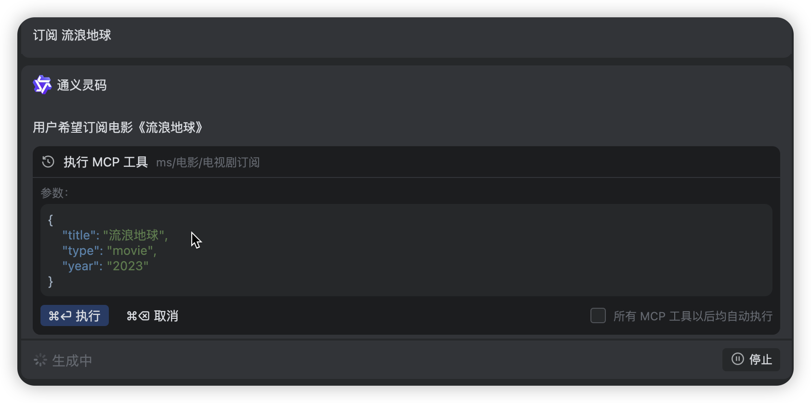
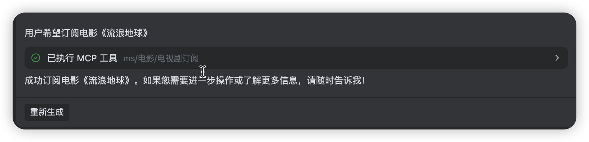

---
title: MCP服务
article: false
tags: null
categories: null
editor: markdown
date: 2025-08-09 12:16:17
---

# 🤖 Media Saber-MCP 简介

> 💬 一个基于 MCP（Model Context Protocol）的本地电影 / 电视剧订阅服务，让订阅像聊天一样简单。

::: tip 📦 Skills 技能包
如果您是第一次接触Media Saber的技能系统，推荐先查看[**Skills 技能包文档**](./skills.md)了解所有可用的技能和工具。本文档主要讲解MCP服务的配置和单个工具的详细说明。
:::

---

## 🎯 项目定位

Media Saber-MCP 把「我想看」变成「已订阅」—— 只需一句话，系统就能帮你追踪影片更新、自动入库，并实时推送状态。

**核心优势：**
- 🏠 **完全本地化** - 无需注册、无需云同步
- 🔒 **隐私可控** - 数据完全掌握在自己手中
- ⚡ **速度飞快** - 本地处理，即时响应

---

## 2. 功能一览

| 功能 | 说明 | 示例 |
|------|------|------|
| 🗣️ **自然语言订阅** | 解析影片名、年份、季数 | `订阅 复仇者联盟 2012` |
| 🎬 **多类型支持** | 电影 / 电视剧 / 动漫 | `订阅 权力的游戏 S01` |
| 🏆 **榜单浏览** | 按平台、分类、主题查看榜单 | `查看豆瓣电影榜单` |
| 🖥️ **NAS 状态** | 多品牌 NAS 硬件信息查询 | `查看NAS系统状态` |
| 🌐 **本地服务** | 零配置局域网访问 | 支持标准 streamable-http 协议连接 |

---

## 🚀 快速上手

::: tip 💡 提示
MCP服务已内置于Media Saber后端服务中，无需额外配置环境变量即可使用内置的 **MS MCP服务**（包含媒体、订阅、站点、媒体服务、云存储、系统等能力）。
:::

---

### 🔩 内置MCP工具一览

Media Saber MCP服务内置了丰富的工具，涵盖媒体管理、订阅、站点、云存储、系统等多个方面。

::: tip 💡 提示
以下工具列表仅供参考，具体可用工具请以实际MCP服务返回为准。
:::

#### 🎬 媒体相关

| 工具名称 | 说明 |
|---------|------|
| `search_tmdb` | 搜索电影/电视剧 TMDB 信息 |
| `get_tmdb_info` | 获取电影/电视剧 TMDB 详细信息 |
| `get_media_status` | 查询媒体状态（已发布站点、是否已入库等） |
| `get_miss_episodes` | 查询媒体库中有漏集的电视剧 |
| `get_media_servers` | 查询媒体服务列表 |
| `get_media_health` | 查询媒体健康中心，查看缺集、媒体信息未匹配、可升级等问题 |
| `get_media_health_detail` | 查询单个媒体健康问题详情 |
| `sync_libraries` | 同步媒体库 |

::: tip 💡 媒体健康中心
`get_media_health` 默认只返回仍需处理的问题，可按问题类型筛选缺集、未匹配、可升级，也可以按标题或媒体服务器筛选。需要查看某条问题的缺失集数、路径、风险提示或当前质量时，再使用 `get_media_health_detail` 查询详情。
:::

#### 📺 订阅相关

| 工具名称 | 说明 |
|---------|------|
| `subscribe_movie` | 订阅电影，订阅后自动搜索、下载 |
| `subscribe_tv` | 订阅电视剧，支持指定季数、起始集数、指定集数 |
| `refresh_subscribe` | 刷新订阅列表，立即开始搜索下载 |

#### 🌐 站点相关

| 工具名称 | 说明 |
|---------|------|
| `get_sites` | 查询站点列表 |
| `get_site_data` | 查询站点数据 |
| `today_site_data` | 查询站点今日数据汇总（上传量、下载量等） |
| `total_site_data` | 查询站点总数据统计（上传、下载、魔力、做种等） |
| `get_site_message` | 查询站点消息 |
| `get_site_notice` | 查询站点公告 |
| `sync_site_data` | 同步站点数据 |
| `sync_site_message` | 同步站点消息 |
| `sync_site_notice` | 同步站点公告 |
| `site_sign_in` | 站点签到 |
| `test_site` | 站点连通性测试 |
| `test_site_rss` | 站点 RSS 测试 |
| `update_site_configs` | 更新站点适配文件 |

#### 🎯 推荐相关

| 工具名称 | 说明 |
|---------|------|
| `recommend_movies` | 推荐电影（支持按年代、地区、类型、排序筛选） |
| `recommend_tvs` | 推荐电视剧（支持按年代、地区、类型、排序筛选） |

#### 🏆 榜单相关

| 工具名称 | 说明 |
|---------|------|
| `rank_media_sources` | 查询榜单平台列表 |
| `rank_categories` | 按榜单平台查询分类列表 |
| `rank_subjects` | 按榜单分类查询主题列表 |
| `rank_items` | 按榜单分类和主题查询媒体列表（支持分页） |

#### ☁️ 云存储 & 下载

| 工具名称 | 说明 |
|---------|------|
| `add_offline_download` | 添加云下载任务（支持 ed2k、magnet 链接） |
| `cloud_share_receive` | 云存储转存（支持 115 资源链接） |

#### 🔧 系统 & NAS 相关

| 工具名称 | 说明 |
|---------|------|
| `test_network` | 网络连接测试 |
| `get_nas_info` | 获取所有已启用 NAS 实例的系统状态与硬件信息（CPU、内存、存储、网络、GPU、风扇、电源等，支持极空间、绿联、飞牛、PVE，支持多设备） |

::: tip 💡 NAS 支持说明
- **支持设备**：极空间、绿联、飞牛、PVE
- **系统消息推送**：极空间、绿联、飞牛支持系统消息推送
- **多设备支持**：所有 NAS 信息都支持多设备，可同时管理和查看多台 NAS 的状态
- **使用方式**：在修仙秘籍中安装对应设备的服务助手即可体验
:::

---

### 🔌 第三方客户端连接

#### 🔗 连接地址

MCP服务现在直接通过Media Saber后端服务提供，有两种连接方式：

**方式一：使用容器默认端口（推荐）**

直接使用容器对外暴露的端口（如8888），加上 `/mcp/http` 路径即可：

```text
http://IP:8888/mcp/http
```

**方式二：使用后端内部端口**

后端服务默认监听 `22698` 端口，Docker中默认未映射该端口，需要自行添加端口映射：

```bash
# Docker 端口映射示例
-p 22698:22698
```

映射后连接地址为：

```text
http://IP:22698/mcp/http
```

::: tip 💡 提示
推荐使用方式一，无需额外映射端口，直接复用已有的服务端口即可。
:::

::: warning 📌 旧版本升级提示
新版本已将 MCP 连接路径由 `/message` 调整为 `/mcp/http`。如果升级后原有 MCP 客户端连接失败，请把连接地址末尾的 `/message` 改为 `/mcp/http`。
:::

#### ⚙️ 客户端手动配置

在可以使用的MCP客户端中添加服务：

1. ➕ **选择手动添加**
2. 📝 **填入连接地址**：如 `http://192.168.1.100:8888/mcp/http`
3. 🔧 **配置请求头**：
   - 字段名：`Authorization`
   - 字段值：`Bearer 您的API_KEY`

#### 📋 MCP JSON 配置（一键导入）

如果您使用的是 Cline、Claude Desktop 等采用通用 MCP 配置结构的客户端，可以直接使用以下 JSON：

若您使用 Cherry Studio，请参考下方“Cherry Studio 导入格式示例”。

```json
{
  "mcpServers": {
    "MediaSaber": {
      "transport": "streamable-http",
      "url": "http://IP:端口/mcp/http",
      "headers": {
        "Authorization": "Bearer 您的API_KEY"
      }
    }
  }
}
```

**示例（假设Media Saber地址为 `192.168.1.100:8888`，API KEY为 `sk-xxxx`）：**

```json
{
  "mcpServers": {
    "MediaSaber": {
      "transport": "streamable-http",
      "url": "http://192.168.1.100:8888/mcp/http",
      "headers": {
        "Authorization": "Bearer sk-xxxx"
      }
    }
  }
}
```

#### 🍒 Cherry Studio 导入格式示例

Cherry Studio 用于导入的 JSON 结构与通用 MCP 配置略有不同（如使用 `baseUrl`、`type: streamableHttp` 等字段），可参考以下格式：

```json
{
  "mcpServers": {
    "MvZt2NGC-JQRWGi-4t6dT": {
      "name": "MediaSaber",
      "description": "",
      "baseUrl": "http://IP:端口/mcp/http",
      "command": "",
      "args": [],
      "env": {},
      "isActive": true,
      "type": "streamableHttp",
      "headers": {
        "Authorization": "Bearer 您的API_KEY"
      }
    }
  }
}
```

其中 `MvZt2NGC-JQRWGi-4t6dT` 为 Cherry Studio 自动生成的服务 ID，实际导入时可保持默认生成值或替换为您自己的唯一标识。

::: tip 💡 提示
将上述JSON中的 `IP:端口` 替换为您的Media Saber实际访问地址，`您的API_KEY` 替换为实际的API KEY即可。如果使用HTTPS，请将 `http` 替换为 `https`。
:::

#### 🤖 接入小智 AI

如果你希望把 Media Saber MCP 能力接入小智 AI，推荐先通过 [MCP Proxy Gateway](https://github.com/xylplm/mcp-proxy-gateway) 聚合，再由网关连接小智 MCP 接入点。

操作路径：

1. [部署 MCP 网关](/client/esp32/mcp-gateway-compose.md)
2. [在 MCP 网关中添加 Media Saber MCP 上游](/client/esp32/mcp-gateway-ms-upstream.md)
3. [将 MCP 网关接入小智 AI](/client/esp32/xiaozhi-mcp.md)

#### 🔑 API KEY 获取

API KEY 需要在Media Saber系统中获取：

1. 🔐 登录Media Saber系统
2. 👤 前往 [我的信息](/usage/main_page/my_info.html) 页面
3. 🔒 切换到 **"安全配置"** 标签页
4. 🔑 在 **"API KEY 管理"** 区域新增或使用现有的API KEY
5. 📋 复制API KEY值用于MCP客户端配置

::: tip 💡 提示
详细的API KEY管理操作请参考 [API鉴权文档](/usage/other/api_auth)。
:::

::: warning ⚠️ 注意
配置MCP客户端时，需要将API KEY以 `Bearer` 格式添加到 `Authorization` 请求头中，如 `Bearer sk-xxxx`。具体API KEY获取方式请参考 [API鉴权文档](/usage/other/api_auth) 中的说明。
:::

#### 📸 效果示例




---

## ❓ 常见问题

### 🔧 MCP 服务无法使用？

**Q：为啥我的 MCP 服务无法使用？发送 订阅 xxx 直接给我回复解释？**

**A：** 请检查以下配置：

1. ✅ 确认已在 [基础设置](/usage/system_settings/basic_settings.html) 中配置了OpenAI API相关信息
2. ✅ 确认MCP客户端连接地址正确（如 `http://IP:8888/mcp/http`）
3. ✅ 确认MCP客户端中已正确配置Authorization请求头（格式为 `Bearer 您的API_KEY`）
4. 🔄 如问题仍存在，可以尝试更换客户端或重新配置连接信息

---

### 🔑 API KEY 相关

**Q：如何获取API KEY？**

**A：** 在 [我的信息](/usage/main_page/my_info.html) 页面的 **"安全配置"** 标签中，通过 **"API KEY 管理"** 功能新增或管理现有的API KEY。

**Q：API KEY配置错误会怎样？**

**A：** 如果API KEY配置错误或未配置，MCP服务将无法正常工作，可能返回认证失败的错误信息。

---

### 💬 支持的订阅语法

**Q：支持哪些话语？**

**A：** 支持以下格式：
- 📝 `订阅 + 名字`
- 📅 `订阅 + 名字 + 年份`
- 📺 `订阅 + 名字 + 季数`
- 🎯 `订阅 + 名字 + 季数 + 年份`

---


## 📚 相关文档

- 🎯 [Skills 技能包](/usage/ai/skills.md) - Media Saber 官方技能包集合，包含完整使用指南
- ⚙️ [基础设置](/usage/system_settings/basic_settings.html) - 配置OpenAI API相关设置
- 🔑 [我的信息 - API KEY管理](/usage/main_page/my_info.html) - 获取和管理MCP服务所需的API KEY

---

## 💎 推荐服务

::: tip 🚀 硅基流动推荐

推荐用户使用 **硅基流动AI服务**。现在点击链接填写邀请码注册，可立即获得 **2000万Tokens**！

**邀请链接：** [https://cloud.siliconflow.cn/i/LUTcWF0b](https://cloud.siliconflow.cn/i/LUTcWF0b)

**邀请码：** `LUTcWF0b`

💰 注册时请填写邀请码以获得奖励。

:::

::: tip 🚀 智谱 BigModel 推荐

我正在智谱大模型开放平台 BigModel.cn 上打造AI应用，智谱新一代旗舰模型 GLM-5 已上线，在推理、代码、智能体综合能力达到开源模型 SOTA 水平，通过邀请链接注册即可获得 **2000万Tokens** 大礼包，期待和你一起在 BigModel 上畅享卓越模型能力！

**邀请链接：** [https://www.bigmodel.cn/invite?icode=HBQppQEacLEt72DlDimk3enfet45IvM%2BqDogImfeLyI%3D](https://www.bigmodel.cn/invite?icode=HBQppQEacLEt72DlDimk3enfet45IvM%2BqDogImfeLyI%3D)

💰 点击链接注册即可领取大礼包。

:::

---

## 👨‍💻 开发 & 贡献

**作者：** 强大的 `J佬` 💪

---
