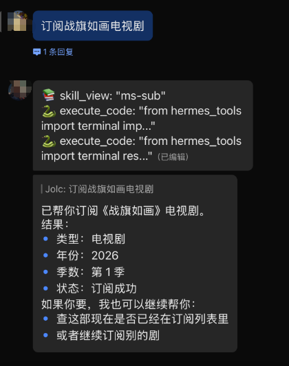
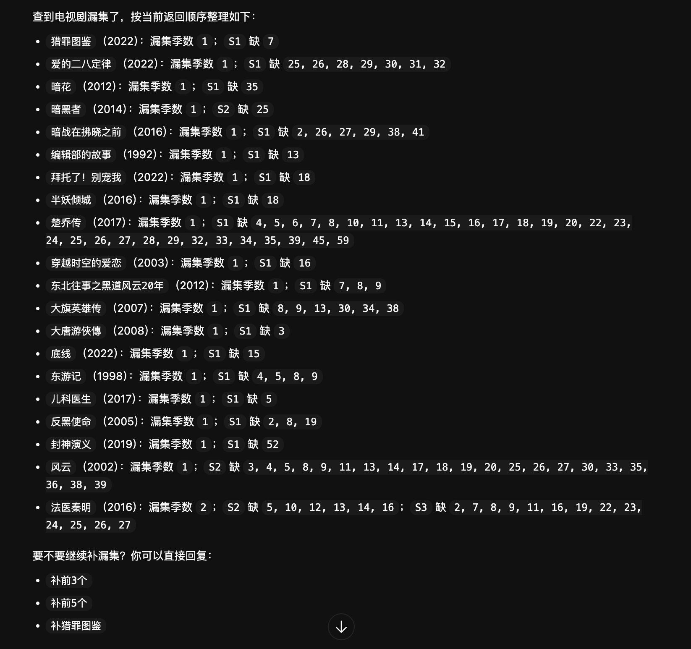
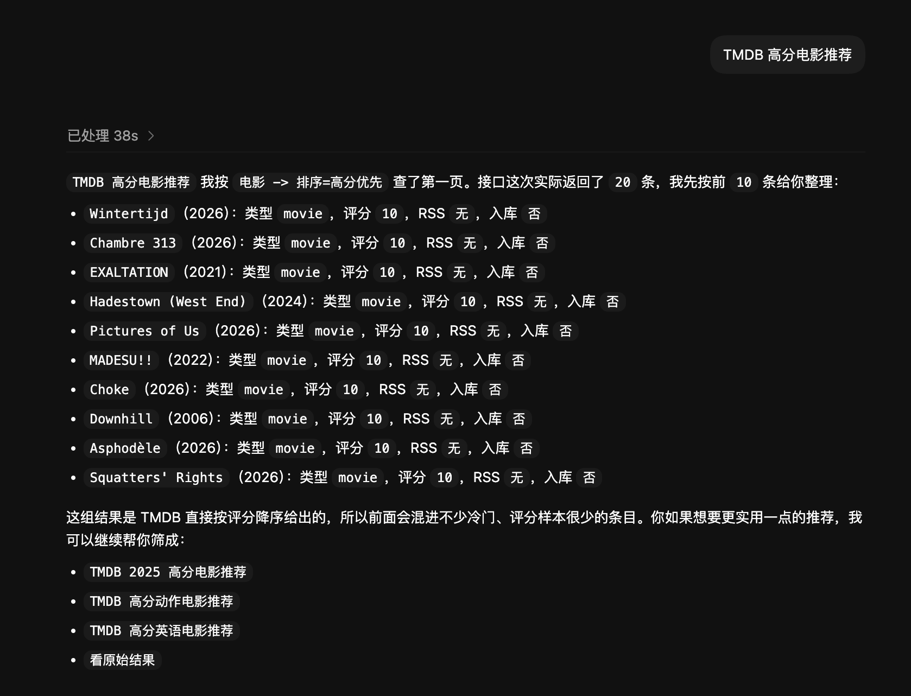
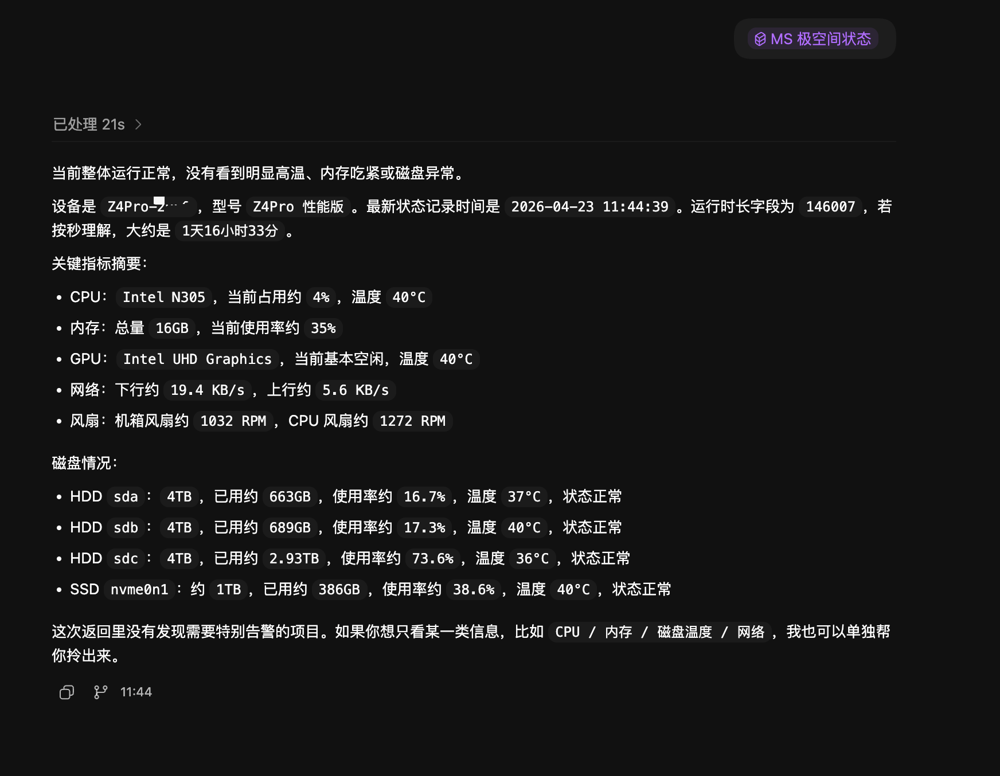

# 🎯 MS 技能包

> 💡 MS 技能包是一组专为 Media Saber 设计的 AI Agent 技能，安装后可直接在 OpenClaw 小龙虾、Hermes 爱马仕等客户端中通过自然语言完成影视订阅、漏集补齐、推荐与榜单浏览、云端资源查询、站点与下载管理、系统状态查询等操作。

📦 技能包仓库：<https://github.com/fanxuankai/cli-anything-harnesses>

---

## 📋 技能包列表

仓库 `skills/` 目录下目前共有 **12 个技能包**：

| 技能包 | 功能简介 | 依赖 CLI |
|---|---|---|
| `ms-sub` | 影视订阅 | `cli-anything-ms` |
| `ms-gap-filler` | 漏集补齐 | `cli-anything-ms` |
| `ms-recommend` | 影视推荐 | `cli-anything-ms` |
| `ms-rank` | 影视榜单 | `cli-anything-ms` |
| `ms-cloud-resource` | 云端资源查询与下载/转存 | `cli-anything-ms` |
| `ms-cloud-resource-rank` | 云端资源贡献榜 | `cli-anything-ms` |
| `ms-media-server` | 媒体服务器状态与同步 | `cli-anything-ms` |
| `ms-site-state` | 站点状态与统计 | `cli-anything-ms` |
| `ms-site-signin` | 站点签到查询与执行 | `cli-anything-ms` |
| `ms-download` | 下载器与下载任务管理 | `cli-anything-ms` |
| `ms-zspace-state` | 极空间系统状态 | `cli-anything-ms` |
| `cli-anything-cliproxyapi` | CLIProxyAPI 代理管理 | `cli-anything-cliproxyapi` |

::: tip 💡 前置依赖
除 `cli-anything-cliproxyapi` 外，其余 11 个技能均依赖 `cli-anything-ms`，技能安装完成后需确保该 CLI 可用：

```bash
pip install cli-anything-ms
```
:::

---

## 📦 一次性安装全部技能

如果你想一次装好所有技能包：

::: tabs

@tab npx 首次安装

```bash
npx skills add fanxuankai/cli-anything-harnesses --list
npx skills add fanxuankai/cli-anything-harnesses --skill ms-sub
npx skills add fanxuankai/cli-anything-harnesses --skill ms-gap-filler
npx skills add fanxuankai/cli-anything-harnesses --skill ms-recommend
npx skills add fanxuankai/cli-anything-harnesses --skill ms-rank
npx skills add fanxuankai/cli-anything-harnesses --skill ms-cloud-resource
npx skills add fanxuankai/cli-anything-harnesses --skill ms-cloud-resource-rank
npx skills add fanxuankai/cli-anything-harnesses --skill ms-media-server
npx skills add fanxuankai/cli-anything-harnesses --skill ms-site-state
npx skills add fanxuankai/cli-anything-harnesses --skill ms-site-signin
npx skills add fanxuankai/cli-anything-harnesses --skill ms-download
npx skills add fanxuankai/cli-anything-harnesses --skill ms-zspace-state
npx skills add fanxuankai/cli-anything-harnesses --skill cli-anything-cliproxyapi
```

注：`npx skills add ...` 适合首次安装或交互式添加/查看可用技能（更偏“添加/列出”语义）。

@tab npx 强制安装 / 覆盖（@openclaw/skills）

```bash
npx -y @openclaw/skills install fanxuankai/cli-anything-harnesses/skills/ms-sub --force
npx -y @openclaw/skills install fanxuankai/cli-anything-harnesses/skills/ms-gap-filler --force
npx -y @openclaw/skills install fanxuankai/cli-anything-harnesses/skills/ms-recommend --force
npx -y @openclaw/skills install fanxuankai/cli-anything-harnesses/skills/ms-rank --force
npx -y @openclaw/skills install fanxuankai/cli-anything-harnesses/skills/ms-cloud-resource --force
npx -y @openclaw/skills install fanxuankai/cli-anything-harnesses/skills/ms-cloud-resource-rank --force
npx -y @openclaw/skills install fanxuankai/cli-anything-harnesses/skills/ms-media-server --force
npx -y @openclaw/skills install fanxuankai/cli-anything-harnesses/skills/ms-site-state --force
npx -y @openclaw/skills install fanxuankai/cli-anything-harnesses/skills/ms-site-signin --force
npx -y @openclaw/skills install fanxuankai/cli-anything-harnesses/skills/ms-download --force
npx -y @openclaw/skills install fanxuankai/cli-anything-harnesses/skills/ms-zspace-state --force
npx -y @openclaw/skills install fanxuankai/cli-anything-harnesses/skills/cli-anything-cliproxyapi --force
```

注：`@openclaw/skills install ... --force` 保证覆盖已安装的同名技能，用于强制更新或脚本化安装（自动确认 `-y`）。

@tab OpenClaw 小龙虾

在 OpenClaw 对话框中逐条粘贴：

```text
请安装技能 https://github.com/fanxuankai/cli-anything-harnesses/tree/main/skills/ms-sub
请安装技能 https://github.com/fanxuankai/cli-anything-harnesses/tree/main/skills/ms-gap-filler
请安装技能 https://github.com/fanxuankai/cli-anything-harnesses/tree/main/skills/ms-recommend
请安装技能 https://github.com/fanxuankai/cli-anything-harnesses/tree/main/skills/ms-rank
请安装技能 https://github.com/fanxuankai/cli-anything-harnesses/tree/main/skills/ms-cloud-resource
请安装技能 https://github.com/fanxuankai/cli-anything-harnesses/tree/main/skills/ms-cloud-resource-rank
请安装技能 https://github.com/fanxuankai/cli-anything-harnesses/tree/main/skills/ms-media-server
请安装技能 https://github.com/fanxuankai/cli-anything-harnesses/tree/main/skills/ms-site-state
请安装技能 https://github.com/fanxuankai/cli-anything-harnesses/tree/main/skills/ms-site-signin
请安装技能 https://github.com/fanxuankai/cli-anything-harnesses/tree/main/skills/ms-download
请安装技能 https://github.com/fanxuankai/cli-anything-harnesses/tree/main/skills/ms-zspace-state
请安装技能 https://github.com/fanxuankai/cli-anything-harnesses/tree/main/skills/cli-anything-cliproxyapi
```

@tab Hermes 爱马仕

```bash
hermes skills install fanxuankai/cli-anything-harnesses/skills/ms-sub --force
hermes skills install fanxuankai/cli-anything-harnesses/skills/ms-gap-filler --force
hermes skills install fanxuankai/cli-anything-harnesses/skills/ms-recommend --force
hermes skills install fanxuankai/cli-anything-harnesses/skills/ms-rank --force
hermes skills install fanxuankai/cli-anything-harnesses/skills/ms-cloud-resource --force
hermes skills install fanxuankai/cli-anything-harnesses/skills/ms-cloud-resource-rank --force
hermes skills install fanxuankai/cli-anything-harnesses/skills/ms-media-server --force
hermes skills install fanxuankai/cli-anything-harnesses/skills/ms-site-state --force
hermes skills install fanxuankai/cli-anything-harnesses/skills/ms-site-signin --force
hermes skills install fanxuankai/cli-anything-harnesses/skills/ms-download --force
hermes skills install fanxuankai/cli-anything-harnesses/skills/ms-zspace-state --force
hermes skills install fanxuankai/cli-anything-harnesses/skills/cli-anything-cliproxyapi --force
```

:::

::: tip 💡 提示
`--force` 参数用于覆盖已存在的同名技能，避免旧版本残留，建议每次安装都带上。
:::

---

## ✨ 技能介绍

### 📺 ms-sub · 搜索与影视订阅

> 用 `cli-anything-ms` 搜索影视、订阅影视，并支持查看订阅列表

**工作流程：**

1. **拆分意图** — 一句话里有多个订阅对象时，按顺序逐个处理
2. **识别媒体类型** — 明确区分 `电影 (movie)` 或 `电视剧 (tv)`，类型不明确时会停下来询问
3. **提取标题** — 去掉「订阅电影」「帮我订阅」等外壳词，保留用于 TMDB 搜索的标题
4. **搜索 TMDB** — 唯一搜索源，不搜豆瓣
5. **筛选候选** — 精确匹配优先；多个候选时展示最多 3 个让用户确认；无结果时明确告知
6. **检查是否已订阅** — 通过 `rssId` 判断，已订阅直接回复 `ℹ️ 已订阅`，不重复操作
7. **新增订阅** — 未订阅时调用 `subscribe add`，成功后回复 `✅ 订阅成功`

**触发场景举例：**
- 订阅电影流浪地球
- 订阅电视剧西游记第二季
- 检查复仇者联盟有没有订阅，没有就订阅

::: tip 💡 说明
- 电视剧未指定季数时，默认订阅第 1 季
- 一句话包含多个订阅意图时，逐条处理并逐条返回结果
- 使用 TMDB 返回的规范标题和年份，不使用用户输入的原始文字
:::

**效果演示：**



**安装：**

::: tabs

@tab npx

```bash
npx -y @openclaw/skills install fanxuankai/cli-anything-harnesses/skills/ms-sub --force
```

@tab OpenClaw 小龙虾

在 OpenClaw 对话框中粘贴 GitHub 链接：

```text
请安装技能 https://github.com/fanxuankai/cli-anything-harnesses/tree/main/skills/ms-sub
```

或使用命令行：

```bash
openclaw skills install fanxuankai/cli-anything-harnesses/skills/ms-sub
```

@tab Hermes 爱马仕

```bash
hermes skills install fanxuankai/cli-anything-harnesses/skills/ms-sub --force
```

:::

---

### 🔍 ms-gap-filler · 漏集补齐

> 查电视剧漏集、确认补订阅，并按剧逐季转成 Media Saber 订阅

**工作流程：**

1. **检查漏集** — 无论说「查漏集」还是「补漏集」，都先调用 `media-server miss-episodes-check` 获取完整漏集列表
2. **汇总展示** — 按剧为单位给出摘要（标题、年份、漏集季数、缺少哪些集），不直接倾倒 JSON
3. **确认补齐范围** — 支持两种方式：
   - 指定某一部剧名（按标题近似匹配）
   - 补前 N 个（默认前 3 个，最多 10 个，按原始顺序计数）
4. **执行补订阅** — 直接使用漏集结果里的 `title`、`year`、`season`，不做 TMDB 搜索；每个漏集季执行一次 `subscribe add`
5. **返回结果** — 执行前告知将补哪些剧哪些季，执行后逐条返回并给出成功/失败汇总

**触发场景举例：**
- 查漏集
- 补漏集
- 把前 3 个补一下
- 补猎罪图鉴

::: tip 💡 说明
- 此技能只处理电视剧，不处理电影
- 漏集结果为空时直接告知「无漏集」，不继续执行
- 同一部剧有多个漏集季时，默认全部补，不逐季二次确认
- 单条失败不中断后续，最终给出完整汇总
:::

**效果演示：**



**安装：**

::: tabs

@tab npx

```bash
npx -y @openclaw/skills install fanxuankai/cli-anything-harnesses/skills/ms-gap-filler --force
```

@tab OpenClaw 小龙虾

在 OpenClaw 对话框中粘贴 GitHub 链接：

```text
请安装技能 https://github.com/fanxuankai/cli-anything-harnesses/tree/main/skills/ms-gap-filler
```

或使用命令行：

```bash
openclaw skills install fanxuankai/cli-anything-harnesses/skills/ms-gap-filler
```

@tab Hermes 爱马仕

```bash
hermes skills install fanxuankai/cli-anything-harnesses/skills/ms-gap-filler --force
```

:::

---

### 🌟 ms-recommend · 影视推荐

> 查看 ms 影视推荐时使用，通过 `cli-anything-ms` 逐步查询推荐来源、频道、动态选项和条目

**工作流程：**

1. **确定推荐来源** — 用户未指定平台时，先列出可用来源让用户选择；已指定时映射为 CLI alias（如 `豆瓣` → `douban`，`TMDB` → `tmdb`）
2. **确定频道** — 通常为 `movie` 或 `tv`，不明确时展示选项让用户确认
3. **读取动态选项** — 必须先读取当前平台和频道的筛选项，不硬编码参数；用户提到的偏好（如「高分」「2025」「动作」）按 `text` 匹配成真实 `value`
4. **获取推荐条目** — 构造完整 `--options` JSON 后查询，默认第 1 页、每页 10 条
5. **展示结果** — 输出简洁摘要（标题、年份、类型、评分、RSS 状态、入库状态），不直接倾倒 JSON

**触发场景举例：**
- 影视推荐
- 豆瓣电影推荐
- TMDB 高分电影推荐
- 推荐 2025 年动作片
- 推荐豆瓣电视剧，近期热度，华语

::: tip 💡 说明
- 此技能只做推荐浏览，不执行订阅
- 用户提到的筛选条件不在当前平台选项里时，会明确告知并要求调整
- 未指定筛选项时，为所有选项组填空字符串（使用平台默认值）
:::

**效果演示：**


**安装：**

::: tabs

@tab npx

```bash
npx -y @openclaw/skills install fanxuankai/cli-anything-harnesses/skills/ms-recommend --force
```

@tab OpenClaw 小龙虾

在 OpenClaw 对话框中粘贴 GitHub 链接：

```text
请安装技能 https://github.com/fanxuankai/cli-anything-harnesses/tree/main/skills/ms-recommend
```

或使用命令行：

```bash
openclaw skills install fanxuankai/cli-anything-harnesses/skills/ms-recommend
```

@tab Hermes 爱马仕

```bash
hermes skills install fanxuankai/cli-anything-harnesses/skills/ms-recommend --force
```

:::

---

### 🏆 ms-rank · 影视榜单

> 查看 ms 影视榜单时使用，通过 `cli-anything-ms` 逐步查询榜单来源、分类、主题和条目

**工作流程：**

1. **确定榜单来源** — 用户未指定平台时，先列出可用来源；已指定时映射为 CLI alias（如 `豆瓣` → `douban`，`TMDB` → `tmdb`）
2. **确定榜单分类** — 按 `name` 优先、`code` 次之匹配用户意图；多个候选时展示让用户确认
3. **确定榜单主题** — 同样按名称匹配，不明确时先展示候选，不自动选择
4. **获取榜单条目** — 默认第 1 页、每页 10 条；支持「前 N 个」和「第 N 页」
5. **展示结果** — 输出简洁摘要（标题、年份、类型、评分、是否已订阅、是否已入库）

**触发场景举例：**
- 影视榜单
- 豆瓣电视榜单
- 看豆瓣热播国产剧
- 榜单前 10 个
- 看电影年榜 2025

::: tip 💡 说明
- 此技能只做榜单浏览，不执行订阅
- 分类和主题有歧义时，一律要求用户确认，不猜测
:::

**效果演示：**

<div style="display:grid;grid-template-columns:1fr 1fr;gap:12px;">
  
  
</div>

**安装：**

::: tabs

@tab npx

```bash
npx -y @openclaw/skills install fanxuankai/cli-anything-harnesses/skills/ms-rank --force
```

@tab OpenClaw 小龙虾

在 OpenClaw 对话框中粘贴 GitHub 链接：

```text
请安装技能 https://github.com/fanxuankai/cli-anything-harnesses/tree/main/skills/ms-rank
```

或使用命令行：

```bash
openclaw skills install fanxuankai/cli-anything-harnesses/skills/ms-rank
```

@tab Hermes 爱马仕

```bash
hermes skills install fanxuankai/cli-anything-harnesses/skills/ms-rank --force
```

:::

---

### ☁️ ms-cloud-resource · 云端资源查询与下载

> 用 `cli-anything-ms` 查询云端资源，并可继续发起下载或转存

**工作流程：**

1. **解析查询意图** — 识别关键词、页码、前 N 个等筛选条件
2. **查询云端资源** — 调用云端资源搜索接口，返回可读摘要列表
3. **确认执行动作** — 用户可选择下载或转存某条资源
4. **执行任务** — 按选中序号或资源 ID 创建下载/转存任务
5. **结果回报** — 返回任务是否创建成功与关键提示

**触发场景举例：**
- 查庆余年云端资源
- 搜网盘资源
- 下载第 1 个云端资源
- 转存这个资源

**安装：**

::: tabs

@tab npx

```bash
npx skills add fanxuankai/cli-anything-harnesses --skill ms-cloud-resource
```

@tab OpenClaw 小龙虾

在 OpenClaw 对话框中粘贴 GitHub 链接：

```text
请安装技能 https://github.com/fanxuankai/cli-anything-harnesses/tree/main/skills/ms-cloud-resource
```

或使用命令行：

```bash
openclaw skills install fanxuankai/cli-anything-harnesses/skills/ms-cloud-resource
```

@tab Hermes 爱马仕

```bash
hermes skills install fanxuankai/cli-anything-harnesses/skills/ms-cloud-resource --force
```

:::

---

### 🏅 ms-cloud-resource-rank · 云端资源贡献榜

> 用 `cli-anything-ms` 查看云端资源 HASH 上报贡献榜

**工作流程：**

1. **识别榜单类型** — 支持今日榜、7 天榜、总榜、我的贡献等
2. **获取榜单数据** — 查询贡献排名与数量统计
3. **格式化展示** — 输出简洁榜单摘要，避免原始 JSON

**触发场景举例：**
- 云端资源贡献榜
- 洪荒封神榜
- 荣耀数量榜
- 今日榜 / 7 天榜 / 总榜
- 我的贡献排名

**安装：**

::: tabs

@tab npx

```bash
npx skills add fanxuankai/cli-anything-harnesses --skill ms-cloud-resource-rank
```

@tab OpenClaw 小龙虾

在 OpenClaw 对话框中粘贴 GitHub 链接：

```text
请安装技能 https://github.com/fanxuankai/cli-anything-harnesses/tree/main/skills/ms-cloud-resource-rank
```

或使用命令行：

```bash
openclaw skills install fanxuankai/cli-anything-harnesses/skills/ms-cloud-resource-rank
```

@tab Hermes 爱马仕

```bash
hermes skills install fanxuankai/cli-anything-harnesses/skills/ms-cloud-resource-rank --force
```

:::

---

### 🗂️ ms-media-server · 媒体服务器状态与同步

> 用 `cli-anything-ms` 查看媒体服务器状态、同步信息、媒体库和播放数据

**工作流程：**

1. **识别查询范围** — 站点状态、媒体库、同步历史、播放列表等
2. **调用对应接口** — 获取最新媒体服务器运行与同步数据
3. **整理输出** — 以中文摘要返回关键状态与异常信息

**触发场景举例：**
- 媒体服务器状态
- 媒体服务同步信息
- 媒体库列表
- 同步历史
- 正在播放 / 最近添加 / 继续观看
- 立即同步媒体库

**安装：**

::: tabs

@tab npx

```bash
npx skills add fanxuankai/cli-anything-harnesses --skill ms-media-server
```

@tab OpenClaw 小龙虾

在 OpenClaw 对话框中粘贴 GitHub 链接：

```text
请安装技能 https://github.com/fanxuankai/cli-anything-harnesses/tree/main/skills/ms-media-server
```

或使用命令行：

```bash
openclaw skills install fanxuankai/cli-anything-harnesses/skills/ms-media-server
```

@tab Hermes 爱马仕

```bash
hermes skills install fanxuankai/cli-anything-harnesses/skills/ms-media-server --force
```

:::

---

### 📊 ms-site-state · 站点状态与统计

> 用 `cli-anything-ms` 查看站点状态、上传下载量、魔力值、做种与签到状态

**工作流程：**

1. **识别统计维度** — 站点列表、总览、登录态、签到态、流量等
2. **批量查询站点** — 拉取每个站点的关键状态数据
3. **汇总输出** — 返回可读的状态与统计摘要

**触发场景举例：**
- 站点状态
- 站点统计
- 各站上传下载
- 哪些站没登录
- 今天站点数据

**安装：**

::: tabs

@tab npx

```bash
npx skills add fanxuankai/cli-anything-harnesses --skill ms-site-state
```

@tab OpenClaw 小龙虾

在 OpenClaw 对话框中粘贴 GitHub 链接：

```text
请安装技能 https://github.com/fanxuankai/cli-anything-harnesses/tree/main/skills/ms-site-state
```

或使用命令行：

```bash
openclaw skills install fanxuankai/cli-anything-harnesses/skills/ms-site-state
```

@tab Hermes 爱马仕

```bash
hermes skills install fanxuankai/cli-anything-harnesses/skills/ms-site-state --force
```

:::

---

### ✅ ms-site-signin · 站点签到

> 用 `cli-anything-ms` 查看站点签到记录，或执行指定站点/全部站点签到

**工作流程：**

1. **识别签到目标** — 查询记录、指定站点签到、全部签到
2. **执行或查询** — 调用站点签到接口并记录结果
3. **结果汇总** — 返回成功/失败站点与错误原因摘要

**触发场景举例：**
- 站点签到记录
- 哪些站点签到失败
- 给馒头签到
- 执行站点签到
- 全部站点签到

**安装：**

::: tabs

@tab npx

```bash
npx skills add fanxuankai/cli-anything-harnesses --skill ms-site-signin
```

@tab OpenClaw 小龙虾

在 OpenClaw 对话框中粘贴 GitHub 链接：

```text
请安装技能 https://github.com/fanxuankai/cli-anything-harnesses/tree/main/skills/ms-site-signin
```

或使用命令行：

```bash
openclaw skills install fanxuankai/cli-anything-harnesses/skills/ms-site-signin
```

@tab Hermes 爱马仕

```bash
hermes skills install fanxuankai/cli-anything-harnesses/skills/ms-site-signin --force
```

:::

---

### ⬇️ ms-download · 下载任务管理

> 用 `cli-anything-ms` 查看下载器、下载中任务与下载历史，并执行暂停/恢复/删除

**工作流程：**

1. **确定目标视图** — 下载器状态、下载中、下载历史
2. **获取任务列表** — 拉取任务并按用户指定条件筛选
3. **执行控制动作** — 支持暂停、恢复、删除指定下载任务
4. **回传执行结果** — 输出操作结果与失败原因

**触发场景举例：**
- 下载任务
- 下载器状态
- 下载中
- 下载历史
- 暂停这个下载
- 恢复下载
- 删除下载任务

**安装：**

::: tabs

@tab npx

```bash
npx skills add fanxuankai/cli-anything-harnesses --skill ms-download
```

@tab OpenClaw 小龙虾

在 OpenClaw 对话框中粘贴 GitHub 链接：

```text
请安装技能 https://github.com/fanxuankai/cli-anything-harnesses/tree/main/skills/ms-download
```

或使用命令行：

```bash
openclaw skills install fanxuankai/cli-anything-harnesses/skills/ms-download
```

@tab Hermes 爱马仕

```bash
hermes skills install fanxuankai/cli-anything-harnesses/skills/ms-download --force
```

:::

---

### 🖥️ ms-zspace-state · 极空间系统状态

> 查极空间系统信息、硬件状态和运行状态时使用，调用 `cli-anything-ms` 获取最新状态并用中文总结

**工作流程：**

1. **调用接口** — 固定执行 `plugin call --code zspace_service_assistant --body '{"action":"get_recent_state","body":{}}'`，不调用其他接口
2. **解析数据** — 真实状态在插件返回对象的 `data` 列表中，取最新一条记录
3. **提取重点信息** — 优先提取以下字段：
   - 设备名称、型号、运行时长
   - CPU 名称、占用率、温度
   - 内存总量、使用率
   - GPU 名称、占用率、温度（如有）
   - 网络上下行速度
   - 风扇转速
   - HDD 和 SSD 的容量、已用空间、温度、状态
4. **总结回复** — 先给一句整体状态概述，再补充关键指标摘要；只问某类指标时优先回答该部分

**触发场景举例：**
- 查极空间系统信息
- 查 CPU 温度
- 查内存使用率
- 查磁盘状态
- 查网络速度

::: warning ⚠️ 注意
此技能需要在 Media Saber 中已安装并启用「极空间服务助手」插件，否则接口调用会失败。
:::

::: tip 💡 异常提示规则
- CPU、GPU、磁盘或 SSD 温度明显偏高时，会显式提示关注
- 内存使用率较高时，会显式提示
- 某块磁盘或 SSD 的 `state` 不正常时，会点名指出
- 不做历史对比和趋势分析，不主动给出修复建议（除非用户追问）
:::

**效果演示：**



**安装：**

::: tabs

@tab npx

```bash
npx -y @openclaw/skills install fanxuankai/cli-anything-harnesses/skills/ms-zspace-state --force
```

@tab OpenClaw 小龙虾

在 OpenClaw 对话框中粘贴 GitHub 链接：

```text
请安装技能 https://github.com/fanxuankai/cli-anything-harnesses/tree/main/skills/ms-zspace-state
```

或使用命令行：

```bash
openclaw skills install fanxuankai/cli-anything-harnesses/skills/ms-zspace-state
```

@tab Hermes 爱马仕

```bash
hermes skills install fanxuankai/cli-anything-harnesses/skills/ms-zspace-state --force
```

:::

---

### 🔧 cli-anything-cliproxyapi · CLIProxyAPI 代理管理

> 通过 Management API 管理 CLIProxyAPI 代理服务器的完整 CLI 工具

**连接配置：**

优先级：`--url/--key` 参数 > 环境变量 `CPA_URL/CPA_KEY` > `~/.cliproxyapi-cli.yaml` 配置文件

```bash
# 方式一：环境变量
export CPA_URL=http://127.0.0.1:8317
export CPA_KEY=your-management-key

# 方式二：保存到配置文件
cli-anything-cliproxyapi config save-connection --url http://127.0.0.1:8317 --key your-key
```

**功能模块一览：**

| 模块 | 主要命令 | 说明 |
|---|---|---|
| `server` | `status` / `version` | 健康检查、获取最新版本 |
| `config` | `get` / `set-yaml` / `proxy-url` / `routing` / `retry` | 配置读写 |
| `auth` | `list` / `upload` / `download` / `status` / `codex-quota` | 认证文件管理 |
| `oauth` | `login` / `iflow-cookie` / `callback` / `status` | OAuth 登录 |
| `keys` | `list` / `add` / `delete`（支持 claude / gemini / codex / openai-compat / vertex） | API 密钥管理 |
| `models` | `list` / `aliases` / `excluded` | 模型管理 |
| `usage` | `stats` / `export` / `import` | 使用统计 |
| `logs` | `list` / `clear` / `errors` / `by-id` | 日志管理 |
| `amp` | `config` / `upstream-url` / `model-mappings` | Amp 集成 |
| `api-call` | `-X METHOD --url URL` | 通过代理发起通用请求 |

**OAuth 支持的登录提供商：**
`anthropic` / `codex` / `gemini` / `antigravity` / `qwen` / `kimi` / `iflow`

**使用示例：**

```bash
# 检查服务器状态
cli-anything-cliproxyapi server status

# 列出所有认证文件
cli-anything-cliproxyapi auth list

# 获取已启用 Codex 凭证额度
cli-anything-cliproxyapi auth codex-quota

# 发起 Claude OAuth 登录
cli-anything-cliproxyapi oauth login anthropic

# 添加 API 密钥
cli-anything-cliproxyapi keys claude add --api-key "sk-ant-..."

# 查看使用统计
cli-anything-cliproxyapi usage stats
```

**安装：**

::: tabs

@tab npx

```bash
npx -y @openclaw/skills install fanxuankai/cli-anything-harnesses/skills/cli-anything-cliproxyapi --force
```

@tab OpenClaw 小龙虾

在 OpenClaw 对话框中粘贴 GitHub 链接：

```text
请安装技能 https://github.com/fanxuankai/cli-anything-harnesses/tree/main/skills/cli-anything-cliproxyapi
```

或使用命令行：

```bash
openclaw skills install fanxuankai/cli-anything-harnesses/skills/cli-anything-cliproxyapi
```

@tab Hermes 爱马仕

```bash
hermes skills install fanxuankai/cli-anything-harnesses/skills/cli-anything-cliproxyapi --force
```

:::

---

## ❓ 常见问题

### 🔧 安装失败

**Q：执行安装命令后报错 `command not found: npx`？**

**A：** 说明本机未安装 Node.js。请先安装 Node.js（建议 v18 及以上）：

- 官网下载：<https://nodejs.org>
- 或使用 nvm：`nvm install --lts`

安装完成后重新执行安装命令。

---

**Q：执行安装命令后报错 `command not found: hermes`？**

**A：** 说明 Hermes 爱马仕未安装或未加入 PATH。请参考 Hermes 官方文档完成安装，或改用 npx 方式安装技能。

---

**Q：OpenClaw 对话框输入 GitHub 链接后没有反应或提示找不到技能？**

**A：** 请检查以下几点：
1. ✅ 确认粘贴的是完整 GitHub URL，格式为 `https://github.com/...`，不是短路径
2. ✅ 确认网络可以正常访问 GitHub，必要时配置代理
3. ✅ 确认 OpenClaw 版本支持从 GitHub 子目录安装技能（建议使用最新版本）
4. 🔄 如仍无法安装，改用命令行方式：`openclaw skills install fanxuankai/cli-anything-harnesses/skills/<技能名>`

---

**Q：安装时提示 `pip install cli-anything-ms` 失败？**

**A：** 常见原因及解决方法：

- **网络问题**：配置 pip 国内镜像源：
  ```bash
  pip install cli-anything-ms -i https://pypi.tuna.tsinghua.edu.cn/simple
  ```
- **Python 版本过低**：需要 Python 3.9 及以上，执行 `python --version` 确认版本
- **权限问题**：尝试加 `--user` 参数：
  ```bash
  pip install cli-anything-ms --user
  ```

---

### 🎯 技能不生效

**Q：技能安装成功，但 AI 没有按技能流程执行，直接给了普通回复？**

**A：** 技能安装后需要在新会话中才能生效（OpenClaw 在会话开始时加载技能快照）。请关闭当前对话，重新开启一个新会话后再试。

---

**Q：技能安装成功，执行时提示 `cli-anything-ms: command not found`？**

**A：** 技能依赖的 CLI 工具未安装。执行以下命令安装：

```bash
pip install cli-anything-ms
```

安装完成后确认可用：

```bash
cli-anything-ms --version
```

如果安装后仍提示找不到命令，可能是 pip 安装路径不在 PATH 中，尝试：

```bash
python -m pip install cli-anything-ms
# 或
pip install cli-anything-ms --user
# 然后将 ~/.local/bin 加入 PATH
```

---

**Q：执行订阅时提示「还没有安装秘籍」或「插件未启用」？**

**A：** 这是 Media Saber 后端返回的错误，说明对应插件未安装或未启用：
- `ms-sub` / `ms-gap-filler` / `ms-recommend` / `ms-rank` / `ms-cloud-resource` / `ms-cloud-resource-rank` / `ms-media-server` / `ms-site-state` / `ms-site-signin` / `ms-download`：确认 Media Saber 已正常运行，且 `cli-anything-ms` 配置的连接地址和 API Key 正确
- `ms-zspace-state`：需要在 Media Saber 中安装并启用「极空间服务助手」插件

---

**Q：`ms-zspace-state` 返回空列表或「状态数据结构异常」？**

**A：** 可能原因：
1. 极空间服务助手插件未启用，或插件版本过旧
2. 极空间设备当前离线或无法连接
3. Media Saber 与极空间之间的通信异常

建议先在 Media Saber 插件页面确认插件状态，再重试。

---

### 🔄 更新技能

**Q：如何更新已安装的技能到最新版本？**

**A：** 重新执行安装命令并带上 `--force` 参数即可覆盖旧版本：

::: tabs

@tab npx 首次安装

```bash
# 首次安装或交互式添加：
npx skills add fanxuankai/cli-anything-harnesses --skill <技能名>
```

@tab npx 强制覆盖 / 更新（建议用于已装技能）

```bash
# 强制覆盖已安装的同名技能（脚本或确保刷新时使用）：
npx -y @openclaw/skills install fanxuankai/cli-anything-harnesses/skills/<技能名> --force
```

@tab Hermes 爱马仕

```bash
hermes skills install fanxuankai/cli-anything-harnesses/skills/<技能名> --force
```

:::

---

## 📚 相关文档

- 🤖 [智能体介绍](./README.md) - AI 功能模块总览
- 🔌 [MCP 服务文档](./mcp.md) - MCP 集成和配置指南
- ⚙️ [基础设置](/usage/system_settings/basic_settings/) - 配置 AI API 相关设置
- 🔑 [我的信息](/usage/main_page/my_info/) - 获取和管理 API Key

---

## 🔗 相关仓库

- 📦 技能包仓库：<https://github.com/fanxuankai/cli-anything-harnesses>
