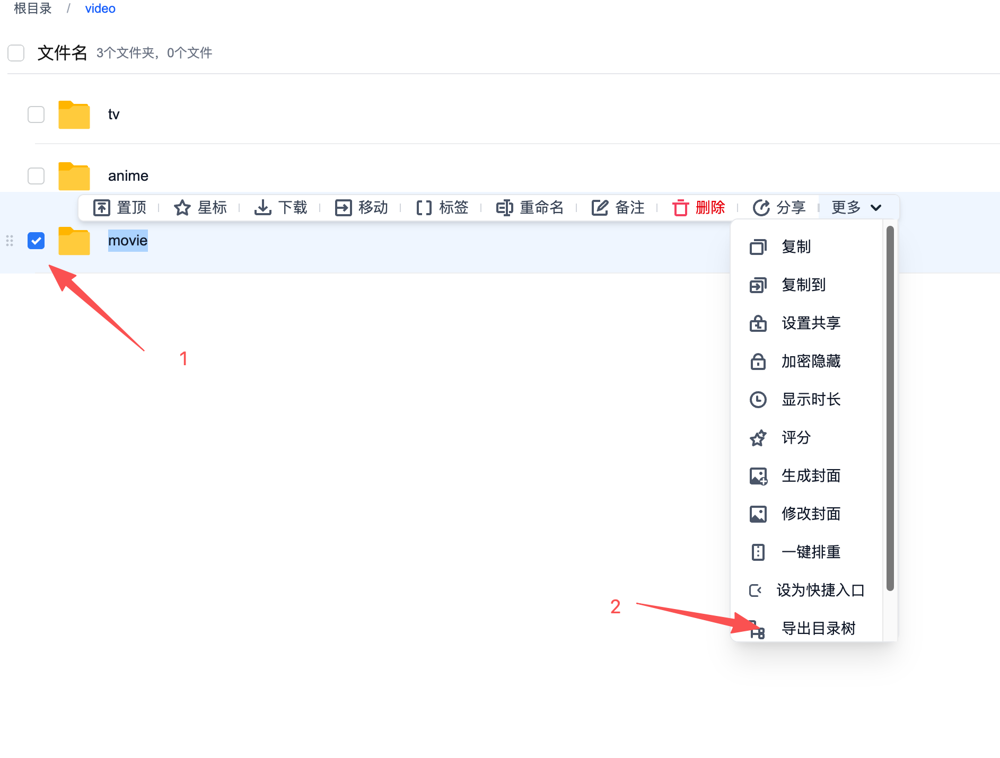

# 🔗 115网盘目录树生成STRM

> 📦 通过 115 网盘端生成目录树，然后在 Media Saber 中导入并快速生成 STRM 文件的完整教程。

---

## 📋 功能介绍

此功能允许用户直接在 115 网盘端选择文件夹生成目录树，再将目录树文件导入到 Media Saber 中自动生成对应的 STRM 文件，极大简化了大规模 STRM 生成的流程。

**核心优势：**
- ⚡ **快速批量处理** - 一次性生成大量 STRM 文件
- 📂 **灵活选择** - 按需选择 115 网盘中的文件夹
- 🔧 **配置灵活** - 支持预设分类或自定义规则
- 🛡️ **风控友好** - 提供最佳实践建议，降低风控风险

---

## 🎯 适用场景

此功能 **特别适合首次大批量生成 STRM** 的情况：

- 📦 **初始化媒体库** - 从 115 网盘导入大量影视资源时
- 🚀 **快速部署** - 无需逐个手动创建，一键批量生成
- 📊 **大规模数据** - 处理数千甚至数万个文件夹的场景
- ⏱️ **节省时间** - 相比逐个创建 STRM，可节省数倍工作时间

::: info 💡 说明

该功能主要面向 **首次大批量导入** 场景。对于后续日常新增少量文件的情况，可以继续使用常规的 STRM 生成方式或定期使用此功能进行补充导入。

:::

---

## 🚀 工作流程

### 第一步：115 端生成目录树

#### 📋 操作步骤

在 115 网盘端操作以生成目录树：

1. 🌐 **打开 115 网页端**
   - 使用浏览器访问 115 网盘官方网页版

2. ☑️ **勾选需要的文件夹**
   - 在网页端选择需要生成目录树的文件夹
   - 支持多个文件夹同时操作

3. 📤 **完成目录树生成**
   - 按照页面指引完成生成流程
   - 目录树会被导出为文件

#### 📸 参考图片

---

### 第二步：Media Saber 导入目录树生成 STRM

#### 📋 操作步骤

在 Media Saber 中导入目录树文件并生成 STRM：

1. 🎯 **打开 STRM 生成工具**
   - 进入「云端存储」→「STRM 生成」
   - 找到相应的生成界面

2. 📄 **点击"按文件生成"图标**
   - 在右上角找到按文件生成的功能按钮
   - 点击打开文件导入对话

3. 🎬 **配置 STRM 生成参数**
   - **分类选择**：选择对应的内容类型
     - 🎥 **电影** - 用于影视作品
     - 📺 **电视剧** - 用于连续剧集
     - 🎨 **动画** - 用于动画内容
   - **自定义规则** - 如有特殊需求，可配置自定义识别规则

4. 🗂️ **选择导入文件**
   - 点击文件路径选择框
   - 选择从 115 网盘导出的目录树文件

5. ▶️ **开始生成**
   - 点击「运行」按钮启动生成流程
   - 系统将自动处理目录树并生成对应的 STRM 文件

#### 📸 参考图片

---

## ⚠️ 重要建议（必看）

### 首次生成 STRM 前的配置

为避免在 STRM 生成过程中触发风控机制导致中断，**首次生成 STRM 时强烈建议关闭以下 4 个选项**：

::: warning 🛡️ 重要提示

这些选项在首次生成时关闭，可以大幅降低被风控中断的风险。待确认生成流程顺利完成后，再根据需要开启。

:::

| 选项 | 说明 | 首次推荐 |
|------|------|--------|
| 🔤 **识别重命名** | 自动识别并重命名文件 | ❌ 关闭 |
| 🎬 **刮削** | 在线获取媒体详细信息 | ❌ 关闭 |
| 📚 **刷新媒体库** | 自动刷新媒体库索引 | ❌ 关闭 |
| ⚠️ **媒库缺失** | 检测缺失的媒体信息 | ❌ 关闭 |

::: tip 💡 使用建议

1. 首次生成：关闭所有 4 个选项 → 生成 STRM 文件
2. 验证成功：确认 STRM 文件已正确生成
3. 后续生成：根据实际情况逐步开启需要的功能

:::

---

## 👑 永 V 用户补充说明

如果您是 115 永久会员，使用此功能时需要了解以下信息：

### 📊 生成性能说明

- ⏳ **处理时间较长** - 当媒体库体积过大时，目录树生成和 STRM 生成可能耗时较长，请耐心等待
- 💾 **资源占用** - 大文件夹的处理会消耗较多系统资源，建议在系统资源充足时运行

### 🔍 监控生成进度

为了实时了解生成进度和确认系统运行状态，建议使用浏览器开发者工具进行监控：

#### 📈 操作步骤

1. 🔧 **打开开发者工具**
   - 按 **F12** 快捷键
   - 也可右键选择「检查元素」

2. 🌐 **切换到网络面板**
   - 点击顶部菜单找到「网络」(Network) 标签
   - 此面板显示所有网络请求

3. 📊 **查看生成进度**
   - 观察网络请求的实时动态
   - 检查是否有错误请求（状态码为 4xx 或 5xx）
   - 确认请求能正常完成

::: tip 💡 提示

通过网络面板，您可以：
- 实时监控生成进度
- 及时发现和处理异常
- 了解系统的运行状况
- 有问题时提供调试信息给技术支持

:::

---

## ❓ 常见问题

### 生成过程被中断？

**Q：为什么生成 STRM 时出现中断或错误？**

**A：** 最常见的原因是 115 账户触发了风控机制。建议：

1. ✅ 确认已关闭首次生成前列出的 4 个选项
2. ⏰ 等待一段时间后重试（115 风控通常有恢复期）
3. 😊 分批处理 - 将大文件夹分成较小的批次逐个生成

### 目录树文件格式不对？

**Q：导入时提示文件格式错误怎么办？**

**A：** 请检查：

1. 📁 确认选择的是从 115 网盘导出的目录树文件
2. 📝 确保文件未被损坏或修改
3. 🔄 尝试重新在 115 网盘端生成目录树文件

### 生成的 STRM 文件不完整？

**Q：生成的 STRM 数量与预期不符？**

**A：** 可能的原因：

1. 📂 检查 115 网盘中的文件夹结构是否正确
2. 🔤 确认文件名和路径符合命名规范
3. 🎬 某些文件可能无法被正确识别，可查看日志获取详细信息

---

## 📚 相关文档

- 🌐 [115云盘配置](/usage/cloud_storage/storage_config/) - 了解如何配置 115 网盘接入
- 📦 [云端存储](/usage/cloud_storage/home/) - 云端存储功能完整使用指南
- 🔗 [STRM 生成详解](/usage/cloud_storage/strm_generate/) - 深入了解 STRM 生成的各项配置选项

---
