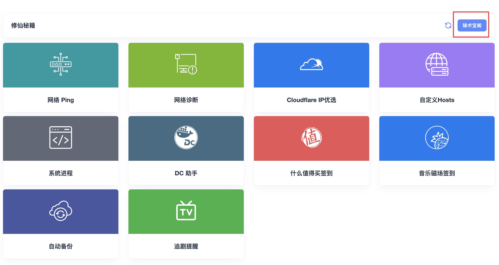

# 🧙‍♂️ 修仙秘籍

**修仙秘籍** 是Media Saber的核心扩展系统，提供了丰富的插件功能来增强媒体管理能力。通过插件系统，用户可以轻松扩展软件功能，满足各种个性化需求。

## 📋 功能模块

修仙秘籍包含以下主要功能：

### 🧩 插件管理
- **插件启灵**：从秘术宝阁启灵各种功能插件
- **插件配置**：配置已启灵插件实例的参数和选项
- **插件状态**：启用、封印或归墟插件实例
- **分神管理**：支持多实例插件的分神创建和管理

### 🏪 秘术宝阁
- **插件市场**：浏览和搜索可用插件
- **分神术**：支持单例模式（无天赋）和多实例模式（领悟）
- **梦萦收藏**：收藏喜爱的插件，便于快速访问
- **断缘取消**：取消收藏不需要的插件

## 🚀 快速开始

### 访问插件系统

点击左侧菜单 **"修仙秘籍"** 进入插件模块：

- **"修仙秘籍"** 页面：显示已启灵的插件实例及其配置
- **"秘术宝阁"** 页面：插件市场，可启灵和归墟插件

### 启灵插件

点击"秘术宝阁"进入插件市场页面，在此处可通过点击插件卡片来完成插件的启灵（安装）。插件支持两种启灵模式：

- **已启灵**：单例插件（无天赋分神术）已经启灵
- **X个分神**：多实例插件（领悟分神术）的启灵数量
- **未启灵**：插件尚未启灵，点击可进行启灵

### 插件状态管理

插件支持以下状态：
- **启灵**：安装并启用插件，创建可用的插件实例
- **封印**：保留插件实例但禁用功能
- **归墟**：完全删除插件实例

## 🔧 可用插件列表

### 📺 媒体管理类

- **[追剧提醒](/usage/cultivation_secrets/binge_watch/)**：订阅的电视剧更新时通知提醒
- **[短剧刮削](/usage/cultivation_secrets/short_play_monitor/)**：监控短剧目录，自动刮削和整理
- **[媒体服务刷新](/usage/cultivation_secrets/media_server_refresh/)**：定时刷新媒体服务器媒体库
- **[媒体服务清理](/usage/cultivation_secrets/media_server_clean/)**：清理媒体服务器大文件和特定内容
- **[媒体库封面生成](/usage/cultivation_secrets/media_cover_generator/)**：自动为媒体库生成封面图片
- **[媒体库文件夹合并](/usage/cultivation_secrets/media_library_folder_merge/)**：合并旧目录到带 TMDB ID 的新目录
- **[Plex 拼音本地化](/usage/cultivation_secrets/plex_localization_zh/)**：Plex 标题拼音排序与标签中文化
- **[NullBr 剧集云下载](/usage/cultivation_secrets/null_br_episode_download/)**：剧集批量云下载工具

### 📥 下载管理类

- **[IYUU自动辅种](/usage/cultivation_secrets/iyuu_auto_seed/)**：基于 IYUU 官方 API 自动辅种
- **[转种](/usage/cultivation_secrets/torrent_transfer/)**：转移下载器中的做种任务到另一个下载器
- **[DC助手](/usage/cultivation_secrets/docker_copilot/)**：Docker Copilot 自动更新和备份
- **[自动删种](/usage/cultivation_secrets/auto_delete_torrent/)**：基于多条件自动删除种子
- **[刷流](/usage/cultivation_secrets/brush/)**：PT 站点 RSS 自动刷流（刷子神器）
- **[Tracker替换](/usage/cultivation_secrets/tracker_editor/)**：批量替换种子 Tracker 地址
- **[下载器站点标签](/usage/cultivation_secrets/downloader_site_tag/)**：定时给种子添加站点标签
- **[下载器限速](/usage/cultivation_secrets/downloader_speed_limit/)**：按标签/分类自动上传限速

### ☁️ 云存储工具类

- **[云存储增量整理](/usage/cultivation_secrets/cloud_storage_watcher/)**：定时扫描云存储目录，增量整理文件
- **[115 生活事件](/usage/cultivation_secrets/open115_life_event/)**：拉取 115 操作事件，自动整理和生成 Strm
- **[云存储 HASH 上报](/usage/cultivation_secrets/cs_hash_reporter/)**：扫描本地目录，上报文件 HASH 到云端
- **[ED2K 链接 HASH 上报](/usage/cultivation_secrets/ed2k_hash_reporter/)**：从 ED2K 链接提取 HASH 上报
- **[CloudDrive2 刷新配置](/usage/cultivation_secrets/cloud_drive2_config/)**：配置 CD2 API 用于缓存刷新
- **[云备份](/usage/cultivation_secrets/cloud_backup/)**：定时同步本地文件至云存储，支持加解密
- **[目录定时清理](/usage/cultivation_secrets/directory_cleaner/)**：定时清理指定目录，支持黑白名单

### 🌐 网络工具类

- **[网络诊断](/usage/cultivation_secrets/network_diagnostics/)**：容器网络环境诊断
- **[自定义Hosts](/usage/cultivation_secrets/custom_hosts/)**：修改系统 hosts 文件
- **[Cloudflare IP优选](/usage/cultivation_secrets/cloudflare_speed_test_preferred/)**：测试 CF CDN 延迟和速度，自动优选 IP
- **[小米路由Hosts](/usage/cultivation_secrets/mi_hosts/)**：同步本地 Hosts 到小米路由器
- **[远程网络唤醒](/usage/cultivation_secrets/remote_wol/)**：通过 WOL 魔术包远程唤醒设备

### 💻 系统工具类

- **[系统进程](/usage/cultivation_secrets/system_process/)**：查看 Docker 容器系统进程
- **[自动备份](/usage/cultivation_secrets/auto_backup/)**：自动备份系统配置文件和数据库
- **[CPA 监控](/usage/cultivation_secrets/cpa_monitor/)**：巡检 CPA 认证文件，自动处理异常账号
- **[CookieCloud 同步](/usage/cultivation_secrets/cookiecloud_sync/)**：从 CookieCloud 同步站点 Cookie
- **[PT Depiler 站点](/usage/cultivation_secrets/ptd_import/)**：从 PT Depiler 导入站点数据
- **[企业微信可信 IP](/usage/cultivation_secrets/wework_white_ip_list/)**：定时更新公网 IP 到企业微信可信列表
- **[Giffgaff 保号提醒](/usage/cultivation_secrets/giffgaff_keep_alive/)**：Giffgaff 手机卡 180 天保号提醒
- **[时刻](/usage/cultivation_secrets/moment/)**：时刻提醒你，值得记住的瞬间

### 🖥️ NAS 服务助手类

- **[极空间服务助手](/usage/cultivation_secrets/zspace_service_assistant/)**：极空间系统消息推送和服务状态查询
- **[飞牛服务助手](/usage/cultivation_secrets/fnos_service_assistant/)**：飞牛 NAS 状态查询和告警通知
- **[绿联服务助手](/usage/cultivation_secrets/ugreen_service_assistant/)**：绿联 NAS 状态查询和告警通知
- **[PVE 服务助手](/usage/cultivation_secrets/pve_service_assistant/)**：Proxmox VE 节点状态查询和告警通知

### ✅ 签到工具类

- **[115 签到](/usage/cultivation_secrets/sign_115/)**：115 网盘每日签到
- **[98 签到](/usage/cultivation_secrets/sign98/)**：98 论坛自动签到
- **[HDHive 签到](/usage/cultivation_secrets/sign_hdhive/)**：HDHive 站点签到
- **[朱雀签到](/usage/cultivation_secrets/sign_zhuque/)**：朱雀站点修仙系统自动签到
- **[绿联NAS社区助手](/usage/cultivation_secrets/sign_ugreen/)**：绿联社区自动活跃
- **[音乐磁场签到](/usage/cultivation_secrets/hifini_sign/)**：音乐磁场自动签到
- **[药丸签到](/usage/cultivation_secrets/invites_sign/)**：药丸网自动签到
- **[晋江文学签到](/usage/cultivation_secrets/jjwxc_sign/)**：晋江文学城自动签到
- **[什么值得买签到](/usage/cultivation_secrets/smzdm_sign/)**：什么值得买自动签到
- **[柠檬神游](/usage/cultivation_secrets/lemon_shengyou/)**：柠檬站点每日免费神游
- **[发群聊消息](/usage/cultivation_secrets/shoutbox/)**：自动发送站点群聊区消息

### 📊 订阅管理类

- **[豆瓣榜单订阅](/usage/cultivation_secrets/douban_subject_subscribe/)**：自动添加未入库的影视订阅
- **[订阅 MP 共享识别词](/usage/cultivation_secrets/subscribe_mp_words/)**：订阅 MP 共享识别词并自动生成数据
- **[订阅精选推荐](/usage/cultivation_secrets/subscribe_smart_recommend/)**：智能推荐影视，推送交互卡片

## 📖 使用指南

### 插件配置

每个插件实例都有独立的配置界面，通常包含：
- **基础开关**：启用/禁用插件实例功能
- **定时任务**：设置自动执行时间
- **个性化参数**：根据插件功能的特定配置项
- **实例重命名**：可以为每个插件实例设置自定义名称

### 定时任务配置

大部分插件支持定时执行，使用Cron表达式设置执行时间。

> 📖 **详细说明**：关于Cron表达式的完整语法和更多示例，请参考：[Cron表达式说明文档](/usage/other/cron_rule)

常用示例：
- `0 2 * * *`：每天凌晨2点执行
- `0 */6 * * *`：每6小时执行一次
- `0 0 * * 0`：每周日凌晨执行

### 插件管理

在"修仙秘籍"主页面可以：
- 查看已启灵的插件实例运行状态
- 点击插件实例进入配置界面
- 重命名插件实例（编辑按钮）
- 归墟（删除）插件实例
- 启用/禁用插件实例功能

## ❓ 常见问题

### 插件启灵失败
- 检查网络连接是否正常
- 确认系统权限是否充足
- 查看错误日志定位具体问题

### 插件实例运行异常
- 检查插件实例配置是否正确
- 验证相关服务是否正常运行
- 查看插件日志获取详细信息

### 定时任务不执行
- 确认Cron表达式格式正确
- 检查系统时间是否准确
- 验证插件实例是否处于启用状态

### 分神术相关问题
- **无天赋插件**：只能启灵一个实例，无法创建分神
- **领悟分神术插件**：可以创建多个分神实例，每个实例独立配置

### 秘术宝阁相关
- **梦萦**：点击星形图标收藏喜爱的插件，便于快速查找
- **断缘**：取消收藏，星形图标会变为空心状态
- **造物主**：插件的开发者信息
- **弟子数**：插件的总安装次数
- **启灵数**：当前启灵的实例数量

---
