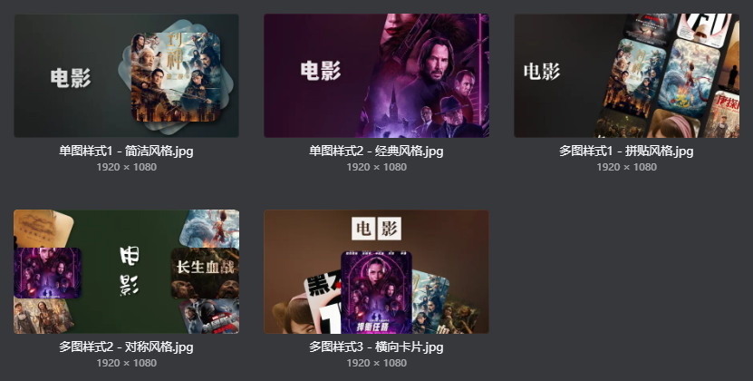

# 🎨 媒体库封面生成

**媒体库封面生成** 插件用于为你的电影、剧集等媒体库自动生成美观的封面图片，支持多种样式和自定义配置，让你的媒体库更「好看」也更容易识别。

## ⚙️ 功能特点

- 自动为媒体库生成美观的封面图片
- 支持多种封面模板样式（单图、多图等）
- 支持Emby和Jellyfin媒体服务器
- 灵活的图片排序和标题配置
- 定时执行和手动触发
- 低性能模式支持
- 任务执行通知

## 🚀 配置指南

在插件配置页面中可以看到所有相关字段，这里从使用角度给出详细说明：

### 📋 基本说明

本插件会自动为媒体库生成美观的封面图片。需要先部署独立的媒体封面生成API服务，然后配置API服务地址。插件使用后端现有的媒体服务器连接功能，支持Emby和Jellyfin。字体、样式等详细配置在API服务端进行。

### ⏰ 执行周期

- **执行周期 (cron)**
  - 选填
  - 定时执行封面生成的周期，支持5位cron表达式。默认每天凌晨2点执行。
  - 示例：`0 2 * * *`（每天凌晨2点）
  - 参考：[Cron表达式工具](https://tool.lu/crontab/)

### 📺 媒体服务器

- **媒体服务器**
  - 必填
  - 选择要生成封面的媒体服务器（支持Emby和Jellyfin）
  - 需要在媒体服务器配置中已添加相应服务器

### 🚫 排除媒体库

- **排除媒体库**
  - 选填
  - 要排除的媒体库名称，多个用英文逗号分隔，这些媒体库不会生成封面
  - 示例：`华语电影,欧美电影,动漫`

### 📸 图片排序

- **图片排序**
  - 选填
  - 生成封面前收集媒体库图片的顺序
  - 选项：
    - 默认排序
    - 上映年份倒序
    - 随机顺序

### 🔗 API服务地址

- **API服务地址**
  - 必填
  - 媒体封面生成API服务的地址，格式：http://host:port
  - 示例：`http://localhost:9897`
  - 需要先部署独立的API服务

#### 🐳 API服务部署指南

API服务基于Docker镜像 `xylplm/media-saber-media-cover-generator` 部署，支持零配置启动。以下是推荐的部署方式：

##### Docker Compose（推荐）

创建 `docker-compose.yml` 文件：

```yaml
version: '3.8'
services:
  media-cover:
    image: xylplm/media-saber-media-cover-generator:latest
    ports:
      - "9897:9897"
    volumes:
      - ./config:/app/config
    environment:
      - TZ=Asia/Shanghai
```

启动服务：

```bash
docker-compose up -d
```

##### Docker 命令行

```bash
docker run -d \
  -p 9897:9897 \
  -v ./config:/app/config \
  -e TZ=Asia/Shanghai \
  xylplm/media-saber-media-cover-generator:latest
```

##### 验证服务

启动后，访问 `http://localhost:9897/health` 检查服务状态。

**注意**：服务默认端口为9897，如需修改请调整端口映射。更多配置选项请参考 [Docker Hub 页面](https://hub.docker.com/r/xylplm/media-saber-media-cover-generator)。

### 🎨 封面模板

- **封面模板**
  - 选填
  - 选择封面模板样式。不选择则由API服务根据媒体库名称自动选择最合适的模板



  - 选项：
    - 单图样式1 - 简洁风格
    - 单图样式2 - 经典风格
    - 多图样式1 - 拼贴风格
    - 多图样式2 - 对称风格
    - 多图样式3 - 横向卡片

### 📢 通知

- **通知**
  - 选填
  - 开启后，任务执行成功或失败时会发送通知。记得在消息通知渠道中勾选本插件

### ⚡ 低性能模式

- **低性能模式**
  - 选填
  - 用于低性能设备，每次只处理1条并发，每次120s超时，每次间隔3秒，其他设备不建议开启

### 📝 标题配置

标题配置使用YAML格式，为每个媒体库配置中英文标题。格式示例：

```yaml
华语电影:
  - 华语电影
  - Chinese Movies
欧美电影:
  - 欧美电影
  - Western Movies
```

未配置的媒体库将使用媒体库名称作为中文标题，英文标题为空。

- **标题配置**
  - 选填
  - YAML格式的媒体库标题配置，为每个媒体库设置中英文标题

### 🔧 高级配置说明

所有关于封面生成的配置（模板样式、字体、颜色、背景等）都在API服务端的配置文件中进行设置。插件端只需要配置基本的业务信息（媒体服务器、标题等）。插件使用后端现有的媒体服务器连接、HTTP请求和任务调度功能，避免重复实现。

### 🛠️ 工具栏操作

- **运行一次 (run)**：立刻执行一次封面生成任务。

## 📖 使用说明

1. **部署API服务**：首先需要部署独立的媒体封面生成API服务，确保服务正常运行。
2. **配置媒体服务器**：在Media Saber中添加并配置Emby或Jellyfin服务器连接。
3. **配置插件**：在插件配置页面填写必要的参数，特别是API服务地址和媒体服务器选择。
4. **测试运行**：使用「运行一次」按钮测试配置是否正确，查看生成效果。
5. **设置定时任务**：根据需要配置cron表达式，设置自动执行周期。
6. **自定义标题**：如需自定义媒体库标题，使用YAML格式在标题配置中设置。
7. **监控通知**：开启通知功能，及时了解任务执行状态。

## ⚠️ 注意事项

- 必须先部署并启动媒体封面生成API服务，否则插件无法正常工作。
- 确保API服务地址可访问，且格式正确（http:// 或 https://）。
- 首次生成可能耗时较长，建议在低峰时段执行。
- 低性能模式仅适用于配置较低的设备，其他情况不建议开启。
- 标题配置使用严格的YAML格式，注意缩进和语法。
- 生成的封面会覆盖原有封面，建议提前备份重要文件。
- 插件依赖媒体服务器的连接配置，确保服务器信息正确。

## 🔗 相关链接

- [修仙秘籍主页](/usage/cultivation_secrets/main/)
- [Cron 表达式说明](/usage/other/cron_rule/)
- [媒体服务器配置指南](/usage/media_services/)
