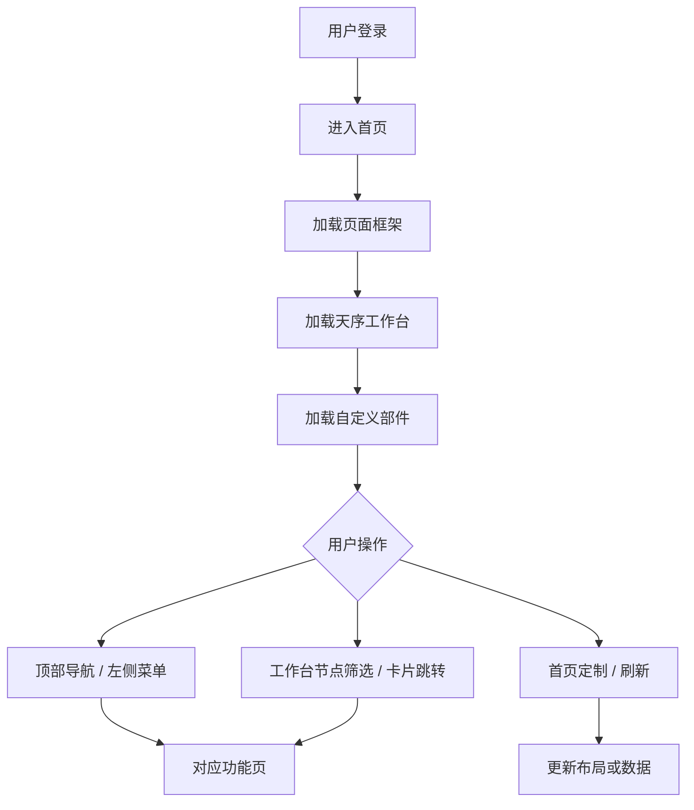

# 🏠 首页

MediaSaber 的首页是进入系统后的主界面，由 **页面框架** 与 **天序工作台 + 自定义部件** 组成：上面固定呈现今日流水线与关键状态，下面可按需扩展个性化部件。

## 🖥️ 主页面

主页面是系统整体框架，包含顶部导航栏、侧边栏、内容区域等核心组件。

### 🎯 顶部导航栏

位于页面顶部，包含系统核心功能的快捷入口：

#### 🔍 搜索入口

- **位置**：顶部导航栏左侧
- **功能**：打开搜索对话框
- **详情**：[搜索功能文档](/usage/search/search.html)

#### 📢 消息中心

- **位置**：顶部导航栏右侧（铃铛图标）
- **功能**：查看系统消息和通知
- **详情**：[消息中心文档](/usage/main_page/message_center.html)

#### 📋 系统日志

- **位置**：顶部导航栏右侧（文档图标）
- **功能**：查看系统运行日志
- **详情**：[系统日志文档](/usage/main_page/system_log.html)

#### 📊 业务日志

- **位置**：顶部导航栏右侧（带搜索图标的文档图标）
- **功能**：查看业务操作日志
- **详情**：[业务日志文档](/usage/main_page/business_log.html)

#### 👤 用户信息

- **位置**：顶部导航栏最右侧（用户头像）
- **功能**：访问用户相关设置和功能
- **子功能**：
  - [我的信息](/usage/main_page/my_info.html)
  - [定时任务](/usage/main_page/scheduled_tasks.html)
  - 帮助文档
  - 退出登录

### 📋 左侧导航菜单

位于页面左侧，提供系统各功能模块的导航：

#### 📁 导航结构

- **仪表台**：系统首页（天序工作台 + 自定义部件）
- **搜索**：各种搜索功能入口
- **订阅**：媒体订阅管理
- **站点**：站点配置和管理
- **媒体库**：媒体资源管理
- **工具**：实用工具集合
- **系统**：系统配置和管理

#### 🎛️ 菜单操作

- **展开/收缩**：通过侧边栏顶部按钮控制
- **滚动浏览**：支持滚动查看所有菜单项
- **快速导航**：点击菜单项直接跳转到对应功能页面

### 🛠️ 常用功能面板

- **图标**：增强现实图标
- **功能**：快速访问常用工具，包括种子名称识别、两步验证码、AES密钥生成、网络连接测试等
- **详情**：[常用功能文档](/usage/main_page/common_features.html)

### 🎨 右侧功能面板

通过顶部导航栏按钮可以打开右侧功能面板：

#### 💬 消息中心面板

- 通过消息中心按钮打开
- 实时显示系统消息和通知
- 支持消息交互和管理

#### ⚙️ 界面自定义面板

- 通过用户头像菜单中的「界面自定义」打开
- 支持主题明暗、界面风格（现代 / 玻璃）、主题配色、侧栏与卡片样式
- 玻璃风格下可配置背景壁纸（默认渐变 / 必应每日 / 网络图片 / 本地文件），并叠加任意配色
- 偏好随登录账号同步，换浏览器也会记住
- 详情请参考：[界面自定义文档](/usage/main_page/ui_customization.html)

### 📱 页面功能按钮

#### ⬆️ 返回顶部

- **位置**：页面右下角
- **功能**：当页面滚动到一定位置时显示，点击可快速返回页面顶部

#### 🔄 刷新首页

- **位置**：页面右下角
- **功能**：同时刷新天序工作台与下方自定义部件

#### 🎛️ 首页定制

- **位置**：页面右下角（布局图标）
- **功能**：打开自定义部件定制对话框（工作台本身固定展示，无需勾选）

## 🧭 天序工作台

工作台固定在首页顶部，汇总今日流水线与关键状态，**无需在定制器里勾选**。部分数据源暂时不可用时，仍会展示可用摘要，并可点击右下角刷新重试。

### 🌤️ 顶栏（问候与体检）

- 显示问候语、造物主称呼与一句今日洞察
- **体检分**可点击进入 [系统体检](/usage/system_settings/system_health.html)
- **开启寻影**跳转到发现页，方便继续找片

### 🔗 今日流转

点击流水线节点（站点 / 订阅 / 下载 / 整理 / 媒体库 / 观影），可筛选下方待办与动态；点「总览」回到全链路视角。媒体库节点在已配置媒体服务器时，会直接展示电影 / 剧集数量。

### ✅ 今日待办与动态

- **今日待办**：可行动事项，点击进入对应处理页
- **今日动态**：全链路或当前域的事件流，带进度的任务会显示进度条

### 📌 今日摘要

随选中的流转节点变化，展示该域关键指标；站点 / 下载 / 整理等域还会附带最近记录摘要，点击可直达详情页。

### 🖥️ 系统机体

默认展示本机 CPU、内存、存储与健康摘要。

若已启灵 NAS / PVE 服务助手类秘籍，可在卡片右上角在 **本机** 与各 NAS 实例之间切换：

- NAS 在线时展示 CPU / 内存 / 存储占用、温度与上下行
- 支持刷新与详情弹窗
- 首屏会等待 NAS 源识别完成后再显示本机或 NAS，避免先闪一下「系统机体」

相关秘籍见 [修仙秘籍 · NAS 服务助手](/usage/cultivation_secrets/)。

### 📚 媒体库态势

已配置媒体服务器时展示电影 / 剧集数量与最近同步时间，可跳转同步；未配置时引导前往媒体服务器设置。

### 🏅 Hash 贡献榜

展示今日（或你上次在完整榜单中选择的范围）前三名与一句个人战绩摘要：

- 行内可点击造物主，跳转其云端资源（见 [云端资源](/usage/cloud_storage/resource.html)）
- 可刷新榜单，或打开完整贡献榜（含鼓励文案、自己的 ID 与排名）
- 卡片底部的**境界条**展示你的当前境界与仙石余额：点击左侧打开「我的境界」弹窗，点击右侧排名区直达完整贡献榜（特权境界用户会看到身份色敕封样式）

上报能力仍由 [云存储 HASH 上报](/usage/cultivation_secrets/cs_hash_reporter.html) 等秘籍提供；榜单入口已固定在工作台，不再作为独立首页部件。

贡献与消费的完整规则见 [修为境界](/usage/user_level/)。

## 🧩 自定义部件

工作台下方为可选扩展部件区。新用户默认为空，可按需添加站点迷你指标、榜单、系统负载、观影报告等。

### 已迁入工作台、不再出现在定制列表的部件

以下能力已由天序工作台承接，旧配置中的对应部件会被自动忽略，也不会再出现在「添加部件」列表：

| 原部件 | 现入口 |
| --- | --- |
| 系统-欢迎使用 | 工作台顶栏问候与洞察 |
| 秘籍-NAS 信息 | 工作台「系统机体」 |
| Hash 上报贡献榜 | 工作台「Hash 贡献榜」 |

### 首页定制怎么用

1. 点击页面右下角「首页定制」
2. 从分类目录添加部件，或在预览区长按卡片拖拽排序
3. 支持部件尺寸预设（紧凑 / 横向 / 焦点，视部件类型而定）
4. 保存后立即生效；刷新按钮会同步刷新工作台与部件

### 数据刷新

- 工作台与各部件支持右下角统一刷新
- 系统机体（NAS）、Hash 贡献榜等卡片另有独立刷新
- 部分部件仍会按自身节奏自动更新

## 🔄 交互流程

## ⚙️ 页面配置

### 🎨 界面自定义

通过界面自定义功能可以调整：

- **主题模式**：亮色 / 暗黑
- **界面风格**：现代 / 玻璃（与配色正交，可叠加）
- **主题颜色**：多种预设配色
- **背景壁纸**（仅玻璃风格）：默认渐变、必应每日、网络图片、本地文件
- **遮罩浓度**（非默认渐变）：轻 / 标准 / 浓
- **侧边栏状态**：展开 / 收缩默认偏好
- **卡片样式**：阴影 / 边框
- **同步方式**：写入当前账号，跨浏览器登录后自动带回

详细配置请参考：[界面自定义文档](/usage/main_page/ui_customization.html)

### 📐 响应式适配

#### 桌面设备

- 完整显示侧边栏
- 工作台左右分栏、多列部件网格
- 鼠标操作优化

#### 移动设备

- 侧边栏默认隐藏，通过按钮切换
- 工作台与部件改为单列
- 定制器支持触控长按拖拽排序

## 🎯 使用技巧

1. **先看工作台**：流转节点 + 待办，优先处理异常与可行动项
2. **体检分进中心**：顶栏体检分一键进入系统体检，不必再找独立体检小部件
3. **NAS 与本机同框**：启灵服务助手后，在系统机体切换数据源即可
4. **扩展再定制**：把榜单、迷你指标等放在下方部件区，保持首屏清爽
5. **统一刷新**：右下角刷新可同时更新工作台与部件

通过首页的天序工作台与自定义部件，可以快速掌握今日流水线状态，并按个人习惯扩展指标展示。
