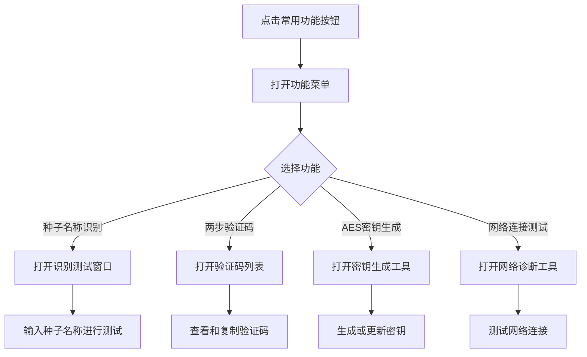

# 🛠️ 常用功能

常用功能是 MediaSaber 提供的实用工具集合，位于顶部导航栏，方便用户快速访问常见任务。

## 📍 访问位置

- **位置**：顶部导航栏右侧（增强现实图标）
- **触发方式**：点击"常用功能"按钮，打开功能菜单

## 🎯 功能列表

### 1️⃣ 种子名称识别

**功能描述**：对种子文件名称进行识别测试，帮助系统准确识别进制名称和元数据。

- **图标**：文字识别图标
- **用途**：
  - 测试系统对种子名称的识别和解析能力
  - 协助调试名称识别规则
  - 验证识别结果的准确性
- **使用场景**：
  - 种子名称识别不准确时进行调试
  - 测试自定义识别规则是否有效
  - 查看系统如何解析复杂的种子名称

### 2️⃣ 两步验证码

**功能描述**：查看已配置的站点两步验证码，用于站点访问或操作认证。

- **图标**：钥匙图标
- **用途**：
  - 查看所有已配置的两步验证码
  - 快速复制验证码进行站点登录或操作
  - 管理各站点的认证信息
- **使用场景**：
  - 访问需要两步验证的站点时
  - 执行需要认证的操作时
  - 查看和管理多个站点的验证码

### 3️⃣ AES密钥生成

**功能描述**：生成用于 AES 加密的密钥，供系统加密敏感信息使用。

- **图标**：钥匙图标（绿色）
- **用途**：
  - 生成新的 AES 加密密钥
  - 初始化加密配置
  - 更新现有密钥
- **使用场景**：
  - 系统首次部署时生成加密密钥
  - 定期更换密钥以提升安全性
  - 为敏感数据配置加密保护

### 4️⃣ 网络连接测试

**功能描述**：测试系统与各地网络的连接速度和延迟，评估网络连接质量。

- **图标**：网络图标（黄色）
- **用途**：
  - 测试网络连接速度和延迟
  - 诊断网络连接问题
  - 评估网络性能
- **使用场景**：
  - 页面加载缓慢时进行网络诊断
  - 检查到特定服务器的连接质量
  - 验证网络代理或加速工具是否有效
  - 排查网络故障问题

## 📋 功能交互流程

## 💡 使用建议

### 网络连接测试详解

网络连接测试是诊断网络问题的重要工具，包含以下检测方式：

#### 连接延迟测试
- **测试方式**：向目标服务器发送请求，测量往返时间（RTT）
- **正常标准**：
  - 本地网络：< 50ms
  - 区域网络：50-100ms
  - 远程网络：100-200ms
- **诊断建议**：延迟过高时检查网络连接质量

#### 连通性检测
- **测试方式**：检查是否能到达目标服务器
- **失败原因排查**：
  - 网络连接中断
  - 防火墙阻止
  - DNS解析失败
  - 服务器离线

#### 带宽评估
- **测试方式**：测试实际网络传输速度
- **性能指标**：
  - 上传速度
  - 下载速度
  - 丢包率

### 网络故障排查

1. **第一步**：使用"网络连接测试"诊断网络状况
2. **第二步**：根据测试结果判断是否为网络问题
3. **第三步**：如非网络问题，检查系统其他配置

### 种子识别优化

1. 使用"种子名称识别"测试系统识别能力
2. 根据识别结果调整识别规则
3. 重新测试直到识别准确

### 安全管理

1. **定期更新 AES 密钥**：保护敏感数据安全
2. **管理两步验证码**：确保站点访问安全
3. **备份重要密钥**：防止丢失

## ⚙️ 相关配置

常用功能与系统多个模块关联：

- **网络诊断**：与网络配置模块关联
- **加密管理**：与安全模块关联
- **站点认证**：与站点管理模块关联
- **识别规则**：与名称识别模块关联

详细配置请参考对应的功能文档。

## 🔗 相关文档

- [系统设置](/usage/system_settings/)
- [站点管理](/usage/site_management/)
