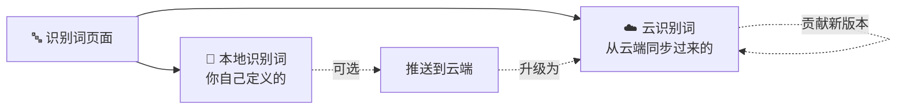
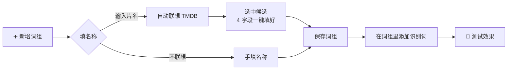
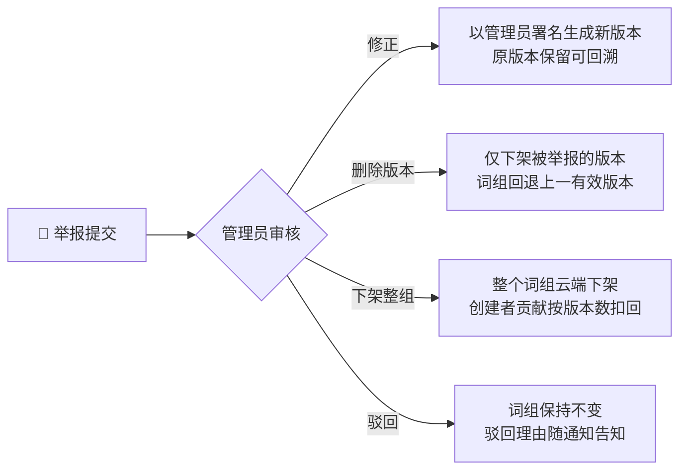
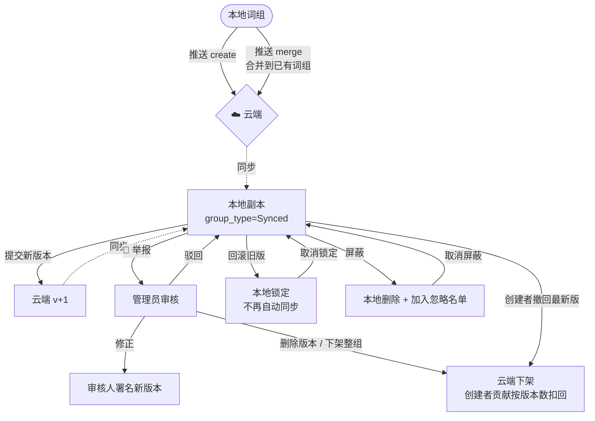
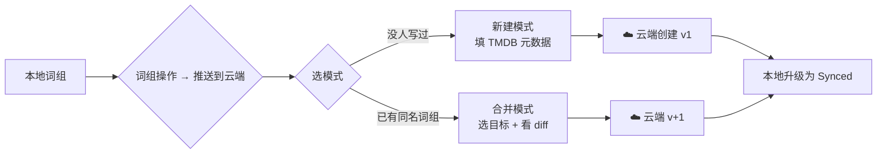

# 🔤 识别词

> 当文件名 / 种子标题没办法被系统正确识别成"哪部影视、哪一季、哪一集"时，识别词就是你的**翻译器**——把异常的文本"擦干净"，让刮削、订阅、整理重新听得懂。

::: tip 💡 一句话理解
识别词 = **文件名 → 真实媒体信息**之间的一组规则。能屏蔽噪声、替换错词，甚至修正错位的集数。
:::

---

## 🗺️ 页面总览

识别词页面分两个 Tab：



| Tab | 来源 | 你能做什么 |
|---|---|---|
| 📁 **本地识别词** | 自己创建（Custom 类型） | 完全自由：新增 / 编辑 / 删除 / 推送到云端 |
| ☁️ **云识别词** | 从云端拉取的副本（Synced 类型） | 启停词条、协作编辑提交新版本、举报、回滚、屏蔽 |

::: info 🧠 为什么分两个
本地词组只服务你自己；云识别词组是"社区共建"——你能用别人写好的，也能给别人写好的提改进。云端是单一来源，本地副本会随云端最新版本自动同步。
:::

---

## 🧩 识别词类型（4 种）

::: tabs

@tab 屏蔽

🚫 把文件名里的某段噪声**直接擦掉**。

| 适用场景 | 举例 |
|---|---|
| 字幕组前后缀、群组水印、不规范分辨率标签 | `[字幕组] One.Piece.E1076` → `One.Piece.E1076` |

填写：**被替换词**

@tab 替换

🔄 把"原词"换成"目标词"——最常用的功能。

| 适用场景 | 举例 |
|---|---|
| 中英文别名映射、错别字纠正、季数纠错 | `One.Piece` → `海贼王` |

填写：**被替换词** + **替换词**

@tab 集偏移

🔢 文件里的集数是 1076，但 TMDB 上分了 21 季、第 21 季只到 184 → 让系统**算一下**得到对的集数。

| 适用场景 | 举例 |
|---|---|
| 跨季连续编号、分季错位 | `EP+1`、`2*EP`、`2*EP-1` |

填写：**前定位词** + **后定位词** + **偏移集数表达式**（`EP` 代表原集数）

> ⚠️ **必须勾选「正则」**：集偏移依赖正则定位集数位置。

@tab 替换 + 集偏移

🔄➕🔢 替换的同时一并完成集数运算——比上面两条单独写更省事。

| 适用场景 | 举例 |
|---|---|
| 既要改名字，又要修集数 | `One.Piece.S01E1076` → `海贼王.S21E184` |

填写：以上三类的字段**全都要**。

:::

---

## 📋 字段速查

每条识别词的字段：

| 字段 | 说明 | 哪些类型用 |
|---|---|---|
| **状态** | 启停开关。停用的词条不参与识别 | 全部 |
| **备注** | 给自己看的说明（强烈建议填）| 全部 |
| **被替换词** | 要被处理的目标文本 | 屏蔽 / 替换 / 替换+集偏移 |
| **替换词** | 替换成什么 | 替换 / 替换+集偏移 |
| **前定位词** | 集数前面的标志，比如 `S\d+E` | 集偏移 / 替换+集偏移 |
| **后定位词** | 集数后面的标志，比如 `\.` | 集偏移 / 替换+集偏移 |
| **偏移集数** | `EP` 代表原始集数，支持 `+ - * /` 运算 | 集偏移 / 替换+集偏移 |
| **正则** | 开关；开启后所有"词"按正则解析 | 集偏移强制；其它可选 |

---

## 📁 本地识别词（自己写）

::: note 🎯 适用场景
- 你下载的某个具体剧集 / 站点 / 字幕组的命名习惯只在你这里出现
- 临时验证一条规则
- 还没准备好分享给别人
:::

### 页面元素

```text
┌──────────────────────────────────────────────────────┐
│ 🔍 搜索框    🔄 刷新    ➕ 新增词组    🧪 测试    📂 更多 │
├──────────────────────────────────────────────────────┤
│ ▼ 词组A  [✏️编辑]  [📂更多操作]                       │
│   ├ 词条1                                             │
│   ├ 词条2                                             │
│   └ 词条3                                             │
│ ▼ 词组B  ...                                          │
└──────────────────────────────────────────────────────┘
                       ↓ 勾选词条
┌──────────────────────────────────────────────────────┐
│ 已选 3 条   [🗑️ 批量删除]   [📂 更多 ▾]   [✕]         │
└──────────────────────────────────────────────────────┘
```

| 入口 | 功能 |
|---|---|
| ➕ 新增词组 | 创建新的本地词组（标题 / TMDB Id / 媒体类型 / 年份） |
| ✏️ 编辑词组 | 修改词组的元数据 |
| 📂 词组内更多 | 全部启用 / 全部停用当前词组内的词条 / 删除当前词组 / 推送到云端 |
| 📂 顶部更多 | 全部展开 / 全部折叠 / 全部启用 / 全部停用 / 清空 |
| 🧪 测试 | 名称识别测试（[详细说明](/usage/media_organization/name_recognition_test.html)）|
| 🛟 浮动条 | 勾选词条后出现，承载所有"批量类"操作（删除 / 启用 / 停用）|

### 新增流程



::: tip 🪄 联想小技巧
名称栏支持 TMDB 联想：边输边搜，选中候选会自动补齐 **TMDB Id / 媒体类型 / 年份**——你只需输片名。
:::

::: warning ⚠️ TMDB 元数据规则
**TMDB Id 和「媒体类型」必须成对出现**：填了 TMDB Id 就必须选媒体类型；不填 TMDB Id 时两者都可以留空。
:::

---

## ☁️ 云识别词（社区共建）

::: note 🎯 适用场景
- 看到别人有写好的规则，直接拿来用
- 把自己的规则贡献回去给社区
- 多设备共享同一份识别词配置
:::

### 同步状态

每个云识别词组顶部会有个状态徽章：

| 徽章 | 含义 | 行为 |
|---|---|---|
| 🟢 **最新版本** | 本地副本就是云端最新版 | 自动同步、可协作编辑 |
| 🟡 **已锁定版本** | 你手动回滚锁定到了某个旧版本 | 自动同步会**跳过该词组** |
| 🔴 **云端已移除** | 云端这条词组已被作者撤回 / 删除 | 只能阅读 / 删除本地副本 |

### 你能做什么

| 操作 | 入口 | 影响范围 |
|---|---|---|
| 协作编辑（提交新版本） | 词组操作 → ✏️ 编辑并提交新版本 | ☁️ 云端 |
| 移动 / 拆分词条到其它词组 | 主列表勾选词条 → 浮动条「移动到词组」 | ☁️ 云端 |
| 举报词组 | 词组旁 🚩 按钮 / 词组更多菜单 | ☁️ 云端（提交给管理员审核）|
| 撤回最新版本 | 版本历史 → 撤回（仅创建者）| ☁️ 云端 |
| 回滚到旧版本 | 版本历史 → 回滚到此版本 | 📁 仅本地（锁定）|
| 取消锁定 | 版本历史顶部 → 取消锁定 | 📁 仅本地（同时立即拉最新版本）|
| 删除云端词组 | 词组操作 → 删除云端词组 | ☁️ 云端 + 📁 本地（需删除权限，通常是管理员或词组创建者）|
| 屏蔽词组 | 词组操作 → 屏蔽 | 📁 仅本地（删副本 + 加入忽略名单）|
| 取消屏蔽 | 同步菜单 → 管理屏蔽词组 → 取消屏蔽 | 📁 仅本地（立即拉回云端最新版）|
| 批量启停词条 | 顶部更多 / 词组更多 / 勾选词条后的浮动条 | 📁 仅本地 |

::: warning ⚠️「删除云端词组」影响所有人
- 从云端软删除该词组，**所有订阅用户下次同步时自动移除本地副本**，无法恢复。
- 你的本地副本会被顺带删除并加入忽略名单，同名词组重建后不会再次自动同步（如需重新订阅，可在屏蔽管理中取消屏蔽）。
- 也可以在「协作编辑」中把词条**全部删除**后提交，效果等同删除整个词组——适合清掉只剩一条问题词条的词组。
:::

::: warning ⚠️「撤回」VS「回滚」别搞混
- **撤回**：会**改云端**——把云端最新版本软删除，所有人都受影响。仅创建者本人可操作。
- **回滚**：只**改你本地**——把本地副本停留在某个旧版本，不影响云端。云端继续往前走。
:::

::: tip 💪 维护即修为
为云识别词 **提交新版本** 可获得仙石奖励（计入修为境界成长）；订阅他人词组不计分。详见 [修为境界](/usage/user_level/)。
:::

### 三种筛选器

主列表搜索框旁边有三个筛选条件，可以叠加：

| 筛选 | 作用 |
|---|---|
| 🎬 TMDB ID | 精确匹配某个影视 ID |
| 📺 媒体类型 | 仅看电视剧 / 仅看电影 |
| ⚠️ 仅显示异常 | 仅看包含异常词条的词组（异常 = 该词条在协作合并时与他人冲突）|

### 同步配置

主列表右上角的同步菜单：

| 配置 | 默认 | 说明 |
|---|---|---|
| 自动同步 | ✅ | 关闭后只能手动同步 |
| 自动启用新词条 | ✅ | 同步到新词条时自动设为启用；关闭后可通过「云识别词」顶部更多中的「全部启用」，或在指定词组的更多菜单中补启用 |

### 🚩 举报词组（管理员审核）

看到误杀大片的问题词组（比如拿常见单词、剧名当「被替换词」），可以提交举报，由**管理员人工审核**处理——不再依赖社区投票自动删除。

#### 怎么举报

词组卡片旁的 🚩 按钮（或词组更多菜单 → 举报词组），选择类型并填写原因：

| 举报类型 | 适用场景 |
|---|---|
| **误杀** | 被替换词过泛（常见单词 / 剧名），导致其它剧集被错误替换 |
| **违规内容** | 词条包含违规或恶意内容 |
| **其他** | 其它需要管理员介入的问题 |

::: warning ⚠️ 一词组仅可举报一次
每个词组终身只能举报一次，重复提交会被拒绝。提交前建议先用[名称识别测试](/usage/media_organization/name_recognition_test.html)确认问题确实存在，并在原因里写清「误杀了哪些剧、问题词条是什么」，方便管理员核实。
:::

#### 审核会怎么处理



::: tip 🎁 举报有奖
举报经审核**通过**（无论修正、删版本还是下架整组），你会收到仙石奖励，额度与终身 / 每日上限可在「修仙秘籍 → 基础配置」中查看；**驳回**则无奖励，理由会随系统通知告知。
:::

结果会通过系统通知告知（🎉 举报审核通过 / 📋 举报未通过），下架整组时创建者也会收到贡献扣回通知。

---

## ⚡ 一键启用 / 停用

当你首次同步云识别词时没有开启「自动启用新词条」，可以不用逐条打开开关：直接使用更多菜单中的「全部启用」。本地识别词和云识别词各自独立操作，互不影响。

| 你想做什么 | 入口 | 实际影响范围 |
|---|---|---|
| 启用 / 停用当前页面类别的全部词条 | 顶部 📂 更多 → 全部启用 / 全部停用 | 当前 Tab 的全部词条，**不受分页、搜索结果或面板展开状态限制** |
| 启用 / 停用一个词组的全部词条 | 词组 📂 更多 → 全部启用 / 全部停用 | 仅当前词组，不影响其它词组 |
| 启用 / 停用挑选出的词条 | 勾选词条 → 底部浮动条 → 更多 | 仅已勾选的词条 |

::: tip 💡 推荐用法
- 首次同步后发现许多云识别词条未启用：进入「云识别词」→ 顶部 📂 更多 → **全部启用**。
- 只信任某一个来源或题材：在该词组的 📂 更多中选择 **全部启用**。
- 想暂时排除一组规则：在该词组的 📂 更多中选择 **全部停用**；之后随时可一键恢复。
:::

::: warning ⚠️ 操作会立即影响后续识别
「全部停用」不会删除词条，但这些词条会立刻停止参与后续名称识别。建议先用[名称识别测试](/usage/media_organization/name_recognition_test.html)确认规则效果，再调整大范围状态。
:::

---

## 🧪 协作流程



::: details 🔍 几个关键细节
- **每次写操作云端都会立刻反推到本地**：推送 / 移动 / 提交新版本 / 撤回，都会主动触发一次单点同步，列表立刻是最新的，不用等下一轮自动同步
- **乐观锁版本冲突保护**：你在编辑某个词组时若已被他人改动，提交会被拒绝并自动重新加载最新版让你重新合并
- **元数据修改是「轻量提交」**：只改 TMDB / 标题不需要填写改动说明，云端会自动生成 `[系统]` 备注
- **版本号严格递增**：v1 → v2 → v3 不会乱序，举报下架的版本号不会被复用
:::

---

## 🛟 浮动批量条

无论本地还是共享，**勾选 1 条以上词条**就会从底部出现统一的浮动条：

```text
┌──────────────────────────────────────────────────────┐
│ 已选 N 条   [主操作]   [📂 更多 ▾]   [✕ 关闭]         │
└──────────────────────────────────────────────────────┘
```

| 区域 | 本地识别词 | 云识别词 |
|---|---|---|
| 主操作 | 🗑️ 批量删除 | ➡️ 移动到词组 |
| 更多菜单 | 批量启用 / 批量停用 | 批量启用 / 批量停用 |

::: tip 💡「移动到词组」就是 dialog 内有两种模式
- **新建词组**：把选中的词条拆出去成一个新的云端词组
- **合并到已有**：把选中的词条搬到另一个已有的云端词组里（冲突的会标 ⚠️ 异常）
:::

---

## 💡 实战案例

### 案例 1：海贼王季数错位

下载到的种子文件名：

```text
One.Piece.S01E1076.1999.1080p.CR.WEB-DL.x264.AAC-ADWeb.mkv
```

但 TMDB 上海贼王分了 21 季，1076 集对应的是 **S21E184**。

**新增一条「替换 + 集偏移」**：

| 字段 | 内容 |
|---|---|
| 类型 | 替换 + 集偏移 |
| 备注 | `海贼王 S01 → S21（892-1099）`|
| 被替换词 | `One.Piece.S01E(89[2-9]\|(9\|10)\d{2}).1999` |
| 替换词 | `海贼王.S21E\1.1999` |
| 前定位词 | `S21E` |
| 后定位词 | `\.` |
| 偏移集数 | `EP-892` |
| 正则 | ✅ |

::: details 🧩 正则解释
- `(89[2-9]\|(9\|10)\d{2})` 匹配 892-1099 的所有集数（捕获组 1）
- 替换词里的 `\1` 引用捕获组 1
- 替换后 S21E1076 进入集偏移阶段，前后定位词在 `S21E` 和 `\.` 之间提取数字 1076，按 `EP-892` 算出 184，最终结果 `海贼王.S21E184.1999`
:::

### 案例 2：分享给社区

写完海贼王这条规则觉得有用，可以贡献给社区：



推送成功后，本地词组会自动升级为「云识别词」，参与未来的同步。

### 案例 3：使用别人的、但发现一条错的

在云识别词里翻到一条规则，但发现某个词条会误伤其他文件：

1. 进入词组 → ✏️ 编辑并提交新版本
2. 把那条词条修正 → 填写改动说明（比如 `修正：S20 集数偏移条件过宽`）
3. 提交 → 云端 v+1，所有同步该词组的人下次同步时都能拿到改进版

如果作者写得有问题、或者你不想再要：

- 常见单词 / 剧名被拿去当「被替换词」误杀一片 → 🚩 举报词组，管理员审核后修正或下架
- 整个词组都不想要 → 词组操作 → 屏蔽（删本地副本 + 加入忽略名单）
- 反悔 → 同步菜单 → 管理屏蔽词组 → 取消屏蔽（自动拉回最新版本）

---

## 📤 导入 / 导出

::: note 📦 用途
- **本地词组** → 导出 → 文本字符串 → 给朋友 / 备份
- 朋友给你一段文本 → 导入 → 进本地词组列表

导入导出仅作用于**本地词组**——云识别词的传播路径是「推送到云端」+「同步」。
:::

入口在词组面板内的 📂 更多操作菜单。

::: tip 💡 分享建议
导出的字符串会带上备注，**强烈建议每条识别词都写好备注**，这样别人导入时一眼就知道是干嘛的。
:::

---

## ✅ 使用建议

::: tip 🌟 五条心法
1. **每条都写备注** — 三个月后回来看自己写的正则会感谢现在的你
2. **先测试再正式用** — [名称识别测试](/usage/media_organization/name_recognition_test.html) 是你最好的朋友
3. **优先用云识别词组** — 别人验证过、覆盖面广、有人在维护
4. **本地写好的考虑推送** — 让社区一起受益，自己也省得多设备同步
5. **正则保守一点** — 范围缩到刚好够用，避免误伤其它无关文件
:::

::: warning 🛡️ 注意事项
- **集偏移类型必须开正则** — 这不是建议，是技术要求
- **TMDB Id 和媒体类型成对** — 否则保存会被后端拒绝
- **不要拆光一个云识别词组的所有词条** — 至少留 1 条，否则会导致词组变空被云端拒绝
- **回滚 ≠ 撤回** — 看清按钮文案再点
:::

---

## 🔗 相关文档

- 🧪 [名称识别测试](/usage/media_organization/name_recognition_test.html)
- 📂 [手动识别](/usage/media_organization/manual_identification.html)
- 🗂️ [整理历史](/usage/media_organization/history.html)
- 💾 [TMDB 缓存](/usage/media_organization/tmdb_cache.html)
- 🏔️ [修为境界](/usage/user_level/)——提交新版本可赚取仙石
