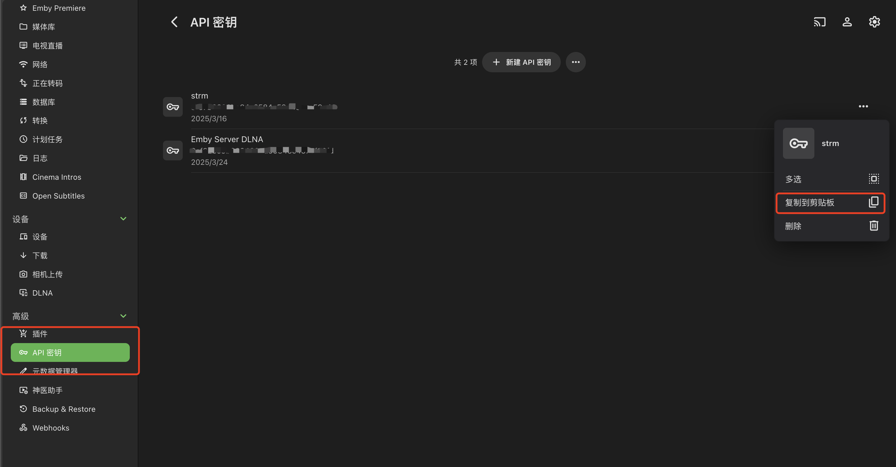

# 🎬 Emby

## 📋 简介

Emby是一个功能强大的媒体服务器软件，可以管理和播放存储在各种设备上的多媒体内容。它支持多种媒体格式，并提供友好的用户界面，可以在各种设备上访问媒体库。

## ⚙️ 配置说明

### 🔧 配置字段

- 📡 **服务器地址**：Emby服务器的访问地址，通常为 `http://IP:PORT` 或 `https://域名` 格式
- 🔑 **API密钥**：访问Emby API所需的密钥
- 📂 **媒体播放地址 / 外网地址**：用于远程访问的播放地址（可选）
- 🚪 **代理端口**：用于strm302播放的代理端口（可选）
- 🔔 **代理通知**：开启后发送媒体代理相关通知（可选）
- 🔀 **媒体路径映射**：把媒体服路径映射为 Media Saber 可访问路径；同步/巡检/代理共用（可选）
- ☁️ **网盘挂载路径**：用于声明网盘挂载前缀，帮助代理正确识别并解析直链（可选）

### 🌐 获取API密钥

1. 登录Emby管理界面
2. 进入"高级"->"API密钥"页面
<div align="center"></div>
3. 点击"添加新密钥"按钮
4. 输入应用名称（如"Media Saber"）
5. 复制生成的API密钥

### 📋 配置步骤

1. 在媒体服务器页面点击"新增媒体服务器"
2. 选择"Emby"作为服务器类型
3. 填写服务器名称（自定义）
4. 输入服务器地址（Emby服务器的IP和端口）
5. 输入API密钥
6. 点击"测试"按钮验证配置
7. 测试成功后点击"保存"

## 🚀 媒体代理（STRM 必读）

- 网盘直链场景下，Emby 的 `.strm` 播放需要启用媒体代理处理直链分发
- 若未配置媒体代理，通常无法完成 `302` 跳转播放
- 详细配置请查看：[[媒体代理能力详解]](/usage/media_services/media_proxy)

## 🔔 Webhook 配置（播放事件通知 + 观影报告）

配置 Emby 的 Webhook 后，Media Saber 可以实时接收播放、入库等事件：

- 用于**消息通知**（如"XX开始播放XX""新增入库"等推送）
- 用于 [观影报告](/usage/media_services/play_stats.html) 的「实时」播放统计来源（相比定时估算更精准）

**推荐做法：**

1. 在 Media Saber 保存该 Emby 媒体服务器
2. 打开列表/编辑页中的 **Webhook 地址**
3. 复制内网或外网完整地址（按媒体服务 ID 生成）

**地址格式：**

```
http[s]://your-domain.com[:port]/api/v1/webhook/mediaServer/{媒体服务ID}?apiKey=your-api-key
```

> 🔑 优先用页面一键复制。手动配置时，`{媒体服务ID}` 是保存后显示的服务 ID；`your-api-key` 见 [我的信息 - API KEY 管理](/usage/main_page/my_info.html)。也可去掉 `apiKey` 参数改用请求头鉴权，详见 [API 鉴权文档](/usage/other/api_auth.html)。

在 Emby 控制台 `设置` → `服务器` → `Webhook` 中添加该地址即可，完整的分步图文教程（含测试验证）请查看：👉 [Webhook 配置文档 - Emby 章节](/usage/other/webhook.html#🎬-emby-webhook配置)

## 🔌 strm302代理播放配置

Emby支持通过strm302代理播放功能，特别适用于网盘资源的远程播放。

### 🔌 关于"代理端口"的补充说明

"代理端口"配置是为有 **strm302 播放需求** 的用户准备的。

**strm302 应用场景简述：**  
当媒体库为网盘资源（即通过 strm 文件构建的媒体库）时，在远程播放（例如在公司播放家中媒体库）时，strm302 可以直接建立网盘播放通道，而无需占用家庭服务器的上行带宽。

> 📝 若无相关需求，此项可忽略。

**配置说明：**

- 填入一个未被占用的端口号  
- **该端口需在部署 ms 时进行端口映射**（非常重要）
- 访问emby就需要访问配置的302端口，如截图配置了代理端口8097，访问emby地址为 http://127.0.0.1:8097 
- 经过测试，emby版本最高[4.9.0.42]，再高版本302不生效，如使用302不生效且版本高于4.9.0.42的请做降级处理。

---

### 配置说明

- 填入一个未被占用的端口号
- 该端口需在部署时进行端口映射（非常重要）
- 访问Emby就需要访问配置的302端口，如配置了代理端口8097，访问Emby地址为 http://127.0.0.1:8097
- 经过测试，Emby版本最高[4.9.0.42]，再高版本302不生效，如使用302不生效且版本高于4.9.0.42的请做降级处理

## 🆕 新增代理字段说明

### 🔔 代理通知

开启后，媒体代理在处理播放请求时可以发送相关通知，方便排查代理是否生效、是否发生跳转或回退。

- 适合需要观察代理运行情况的用户开启
- 仍需在消息通知渠道中勾选 **媒体代理** 推送类型
- 若不需要通知提醒，可保持关闭

### 🔀 媒体路径映射

把 Emby 返回的路径映射为 Media Saber 可访问路径。**同步入库、字幕巡检、健康中心、文件写入**使用映射后路径；**媒体代理/直链**也使用同一规则。

- 每行填写一条规则
- 格式为 `原路径前缀:目标路径前缀`（左侧=媒体服路径，右侧=MS 可访问路径）
- 例如：`/msgo/strm:/video/strm`
- 修改后请对该媒体服务器执行一次**全量同步**，再跑字幕巡检

适用场景：

- Emby 容器路径与 Media Saber 容器路径不一致（如 `/msgo/strm` vs `/video/strm`）
- Emby 扫描的是本地挂载目录，但实际文件来源于网盘
- Docker 容器内路径和宿主机路径不一致

### ☁️ 网盘挂载路径

用于告诉媒体代理哪些路径属于网盘挂载目录，例如 `cd2`、`rclone`、`alist` 挂载出来的目录。

- 每行填写一个路径前缀
- 例如：`/115/media`
- 命中后代理会按去掉该前缀后的相对路径继续解析直链
- 对非 `.strm` 的网盘路径尤其有帮助

适用场景：

- 媒体文件本身就在网盘挂载目录中
- 希望代理优先识别这类路径并直接进入直链解析流程

## ⚠️ 注意事项

- 确保Emby服务器在网络中可访问
- API密钥需要具有足够的权限以访问媒体库信息
- 建议使用Emby 4.9.0.42或更低版本以确保所有功能正常工作
- 需要确保防火墙设置允许相关端口通信
- 对于远程访问，建议配置HTTPS以提高安全性
