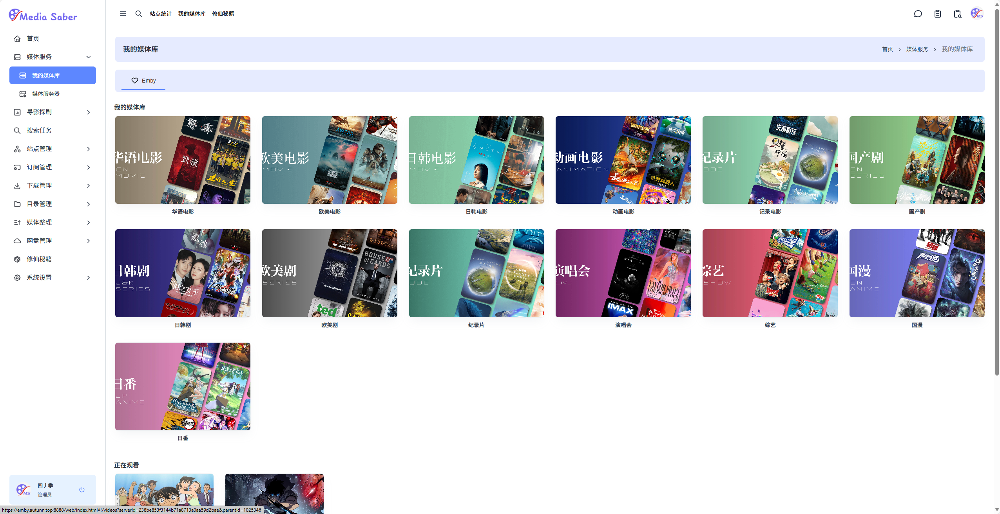

# 📚 我的媒体库

## ⚡ 快速了解

“我的媒体库”用于集中查看媒体服务器中的媒体分类与动态内容，包括：

- 媒体库分类（电影、电视剧、音乐等）
- 正在播放
- 近期观看
- 最新入库

---

## 🎯 功能模块

### 📂 我的媒体库

显示媒体服务器中所有的媒体库分类，如电影库、电视剧库、音乐库等。不同类型的媒体服务器可能采用不同的展示方式：

- **标准媒体服务器**（Emby、Jellyfin等）：以图片形式展示媒体库封面
- **特殊媒体服务器**（极空间、Plex等）：以文字形式展示媒体库名称

点击媒体库可直接跳转到媒体服务器对应的媒体库页面。

### ▶️ 正在播放

显示当前正在播放的媒体内容（电影、电视剧等），可点击条目直接跳转到对应播放页面。

### 📺 近期观看

显示用户最近观看过的媒体内容，便于继续观看未完成的影片或剧集。

### 🆕 最新入库

显示最近添加到媒体库的媒体内容，让用户及时了解媒体库的最新更新。

---

## 🖥️ 多服务器支持

如果配置了多个媒体服务器，可通过顶部标签页切换查看各自媒体库信息。

- 点击服务器标签切换到对应服务器
- 每个服务器的媒体库信息独立展示
- 支持主流媒体服务器：Emby、Jellyfin、Plex、极空间等

---

## 🔄 媒体库同步与自动更新

本页展示的数据来自 [媒体服务器](/usage/media_services/server.html) 的同步结果，不会在本页直接发起全量同步。

- 手动同步：媒体服务器卡片上的 **同步媒体库**
- 自动同步：媒体服务器页配置 **定时任务**
- 同步后会更新：媒体库分类、正在播放、近期观看、最新入库
- 同步也会刷新健康中心、字幕快照所依赖的媒体项事实
- 本页只展示「媒体库启用范围」内勾选启用的媒体库及其内容

同步说明详见：[媒体服务器 · 媒体库同步](/usage/media_services/server.html#媒体库同步)

---

## ⚠️ 注意事项

- 确保媒体服务器处于可访问状态
- 媒体服务器需要正确配置 API 密钥
- 某些功能可能需要媒体服务器的特定版本支持
- 图片加载失败时会显示默认占位图
- 数据陈旧时，请先到媒体服务器页手动同步，而不是只刷新本页
- 媒体服务器上新增的媒体库默认未启用，需到 [媒体库启用范围](/usage/media_services/server.html#媒体库启用范围) 手动勾选后才会出现在本页