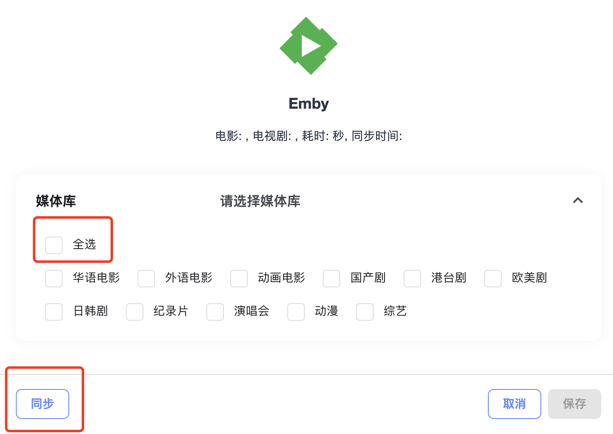
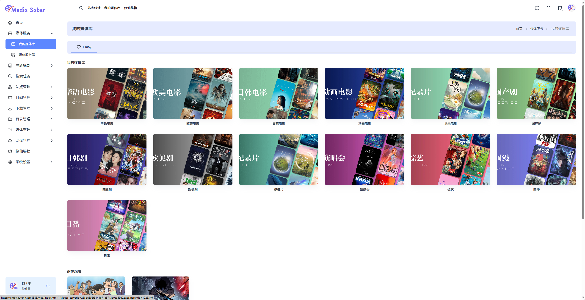

# 📺 媒体服务 - 媒体服务器

---

## 📋 媒体服务器列表

媒体服务器列表页面展示了所有已添加的媒体服务器，支持多种媒体服务器类型，如 Emby、Jellyfin、Plex 等。

### 🎯 功能操作

- 🔄 **刷新**：点击刷新按钮可重新加载媒体服务器列表数据
- ➕ **新增媒体服务器**：添加新的媒体服务器配置
- ⏰ **定时任务**：设置媒体库自动同步的定时任务
- ✏️ **编辑**：修改现有媒体服务器配置
- ❌ **删除**：删除不需要的媒体服务器配置
- ▶️ **同步**：手动同步媒体服务器的媒体库数据
- 👁️ **同步历史记录**：查看媒体服务器的同步历史记录
- 🗑️ **删除同步历史记录**：清除媒体服务器的同步历史记录

### 📊 状态显示

- **类型**：显示媒体服务器的类型图标（Emby、Jellyfin、Plex等）
- **名称**：自定义的媒体服务器名称
- **开启**：显示媒体服务器是否启用
- **默认**：显示是否为默认媒体服务器
- **同步信息**：显示最近一次同步的统计信息（电影数、电视剧数、耗时等）
- **更新时间**：显示配置的最后更新时间

---

## 📚 支持的媒体服务器类型

系统支持多种主流媒体服务器：

- 🎬 **Emby**：功能强大的媒体服务器 [[查看配置教程]](/usage/media_services/emby)
- 🧊 **Jellyfin**：开源的媒体服务器 [[查看配置教程]](/usage/media_services/jellyfin)
- 🔵 **Plex**：流行的媒体服务器 [[查看配置教程]](/usage/media_services/plex)
- 🟢 **绿影视 (UGoS)**：绿联私有云设备上的媒体服务器 [[查看配置教程]](/usage/media_services/ugos)
- 🔵 **极影视 (极空间)**：极空间私有云设备上的媒体服务器 [[查看配置教程]](/usage/media_services/zspace)

每种媒体服务器都需要相应的配置信息，如服务器地址和API密钥。 点击上面的查看配置教程可以获得每一种支持的媒体服务器的详细配置方式。
---


## ➕ 新增媒体服务器

以 **Emby** 为例，输入服务器地址、名称、Api Key，点击"保存"即可完成添加。

<div align="center"></div>

> 💡 建议在服务器地址中直接填入**外网访问地址**。  
> 若填写的是内网地址（例如 `http://ip:port`），则必须在"媒体播放地址"中填入外网访问地址以保证远程可访问。

### 🎛️ 媒体服务器配置字段

- 📺 **媒体服务器**：选择媒体服务器类型（Emby/Jellyfin/Plex等）
- 📝 **名称**：自定义媒体服务器名称
- ✅ **是否开启**：控制媒体服务器是否启用
- ⭐ **默认**：设置为默认媒体服务器，用于判断媒体是否存在或缺失集数
- 其他字段：根据媒体服务器类型填写相应的字段

### 🧪 测试连接

在保存前可以点击"测试"按钮验证配置是否正确，测试通过后再保存配置。

---


## 🔄 同步媒体服务器

点击操作栏中的同步按钮（小飞机图标）。

<div align="center"></div>

选择需要同步的媒体服务器，然后点击"同步"。

<div align="center"></div>

同步完成后，可以在"我的媒体库"中查看同步效果。

<div align="center"></div>

---

## ⏰ 定时同步任务

可以通过"定时任务"按钮设置媒体库的自动同步计划，系统将在指定时间自动同步所有启用的媒体服务器。

---

## 🚀 媒体代理新能力

媒体服务新增了统一的 **媒体代理** 能力，用来处理 Emby、Jellyfin、Plex 的播放请求。新方案不再只依赖单一的 `302` 跳转，而是会根据客户端能力、直链可用性和网络环境，自动选择最合适的播放方式。

### ✨ 新增功能

- **统一代理三类媒体服务器**：Emby、Jellyfin、Plex 共用同一套播放代理主链路，减少不同服务之间的行为差异
- **三段式播放分发**：优先尝试直链跳转；不适合跳转时改为服务端中继；直链失败时再回退到原媒体服务器代理
- **客户端感知分发**：可根据客户端、设备、请求头、请求方式等条件决定是直出、转中继还是回源
- **直链可用性探测**：返回给客户端前会优先探测直链是否可用，避免把无效链接直接下发给播放器
- **PlaybackInfo 预处理**：在播放前预热媒体路径缓存，并对播放源顺序做优化，改善多版本资源和不同客户端的播放体验
- **更完整的路径解析**：支持路径缓存、API 补查、路径映射、白名单、`.strm` 解析、符号链接解析、二次 URL 映射等能力
- **图片与字幕缓存增强**：除了播放链路，还补充了图片、字幕等静态资源的代理与缓存优化
- **Go 内置代理替代旧方案**：代理能力由 Go 服务直接提供，逐步替代依赖外部 nginx 模板的旧实现

### 🎯 解决的问题

新代理主要用来改善这些典型场景：

- 某些客户端不稳定跟随 `302` 跳转
- 私网直链返回给外网客户端后无法访问
- `Range` 拖动、`HEAD` 探测、跨域等兼容性不稳定
- 直链获取失败时，过去只能直接播放失败，缺少自动兜底
- Emby、Jellyfin、Plex 之前的代理逻辑分散，维护成本高

---

## ⚙️ 媒体代理工作原理

新的媒体代理会把一次播放请求拆成 4 个阶段：

1. **识别请求**
   根据请求路径自动判断当前是 Emby、Jellyfin 还是 Plex，并识别这是播放、下载、转码、图片还是 `PlaybackInfo` 请求。

2. **解析媒体源**
   从缓存或媒体服务器接口中获取真实文件路径，然后依次完成：
   - `.strm` 链接解析
   - 路径映射
   - 白名单判断
   - 直链获取
   - 直链地址二次改写

3. **决定分发方式**
   代理会综合客户端类型、请求方法、是否为私网直链、直链探测结果、是否命中代理规则等信息，生成最终分发策略。

4. **执行响应并自动降级**
   如果首选方案失败，会自动切换到下一层兜底方案，尽量保证客户端还能继续播放。

### 🔁 三种分发模式

- **直链跳转（Redirect）**  
  适合客户端能直接访问目标地址、并且直链稳定可用的场景。此时代理返回 `302/307`，让客户端直接去播放真实资源。

- **直链中继（Relay Link）**  
  适合客户端不方便直接访问直链，或者直链带有敏感鉴权、私网地址、兼容性较差的场景。此时由服务端代替客户端去请求真实直链，再把数据流式转发给播放器。

- **原站代理（Relay Origin）**  
  当直链解析失败、中继失败、命中强制代理规则，或者请求本身更适合走原媒体服务器时，会自动回退到原媒体服务器继续处理。

### 🧭 典型处理流程

```text
客户端发起播放请求
  -> 识别媒体服务器类型与请求意图
  -> 解析真实媒体路径与直链
  -> 判断当前应走 Redirect / Relay Link / Relay Origin
  -> 首选方案失败时自动降级
  -> 返回最终可播放结果
```

### 🛡️ 兼容性与稳定性设计

- 对 `GET`、`HEAD`、`Range` 等常见播放请求做兼容处理
- 对私网直链、跨域、跳转次数、防环路等场景做保护
- 对同一资源的直链获取、探测和路由决策做缓存，减少重复请求
- 保留回滚能力，联调期间出现兼容问题时可以切回旧链路

### 📌 与旧代理方案的区别

- 旧方案更偏向“拿到直链就跳转”，新方案改为“先判断，再分发，再自动兜底”
- 旧方案依赖外部 nginx 模板，新方案以 Go 内部代理为主
- 新方案更强调客户端兼容性，尤其是移动端、拖动播放、私网链接和多种播放器差异
- 新方案把 Emby、Jellyfin、Plex 的代理能力统一到同一套架构里，后续维护和扩展更容易


---

## ⚠️ 注意事项

- 确保媒体服务器可以正常访问
- API密钥需要具有足够的权限以获取媒体库信息
- 建议设置一个默认媒体服务器用于媒体状态检查
- 定期同步媒体库以保持数据准确性
- 若启用了媒体代理，建议同时确认代理端口、外网访问地址与直链可达性配置正确
