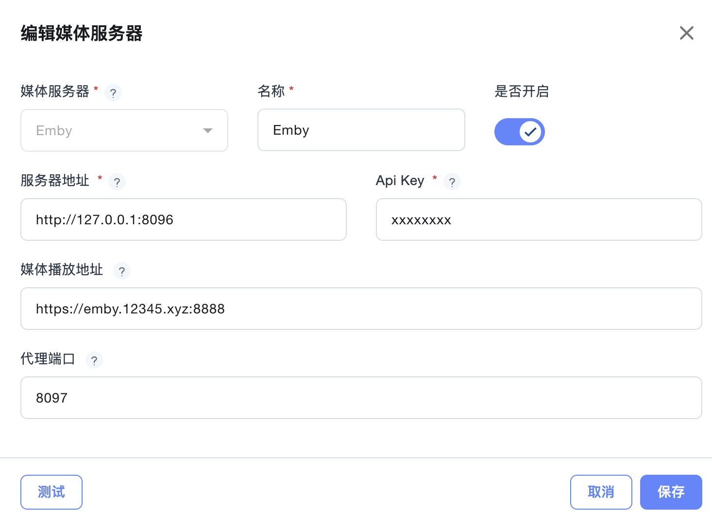
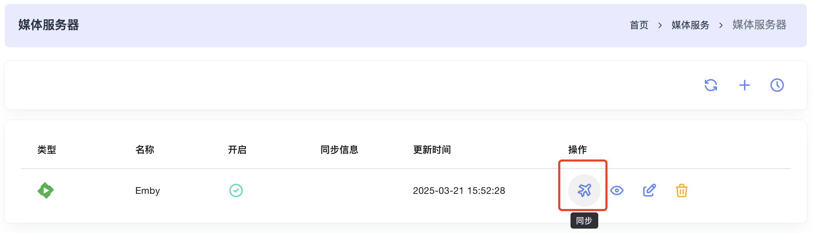

---
---
title: 媒体服务器
article: false
order: 20
tags:
  - 媒体服务器
  - Emby
  - Jellyfin
  - Plex
  - Webhook
categories:
editor: markdown
date: 2026-07-12 12:16:17
---

# 📺 媒体服务 - 媒体服务器

媒体服务器页用于新增、编辑、同步和管理各类媒体服务实例。页面以卡片网格展示，可直接查看启灵状态、默认同步结果与快捷操作。

---

## ⚡ 快速操作流程

建议按以下顺序完成媒体服务器配置：

1. 新增媒体服务器并填写基础信息
2. 点击「测试」确认连接可用
3. 保存后执行一次手动同步
4. 按需配置定时同步任务
5. Emby / Jellyfin / Plex 建议配置 Webhook 消息推送
6. 如涉及网盘 `.strm` 播放，配置媒体代理

---

## 📋 媒体服务器列表

媒体服务器列表展示所有已添加的媒体服务器，支持 Emby、Jellyfin、Plex、绿影视、飞牛影视、极影视等类型。

### 🎯 功能操作

- 🔄 **刷新**：重新加载媒体服务器列表
- ➕ **新增媒体服务器**：添加新的媒体服务器配置
- ⏰ **定时任务**：设置媒体库自动同步计划
- ✏️ **编辑**：修改现有媒体服务器配置
- ❌ **删除**：删除不需要的媒体服务器配置
- ▶️ **同步**：手动同步媒体库数据
- 👁️ **同步历史记录**：查看同步历史
- 🗑️ **删除同步历史记录**：清除同步历史
- 🔗 **Webhook 地址**：仅 Emby / Jellyfin / Plex 显示，一键查看并复制内网 / 外网地址

### 📊 状态显示

- **类型**：媒体服务器类型图标
- **名称**：自定义名称
- **开启**：是否启灵
- **默认**：是否作为默认媒体服务器
- **同步信息**：最近一次同步统计（电影数、电视剧数、耗时等）
- **更新时间**：配置最后更新时间

---

## 📚 支持的媒体服务器类型

| 类型 | 说明 | 教程 |
| --- | --- | --- |
| Emby | 功能强大，生态成熟 | [查看](/usage/media_services/emby.html) |
| Jellyfin | 开源免费，社区活跃 | [查看](/usage/media_services/jellyfin.html) |
| Plex | 使用体验完善，插件生态丰富 | [查看](/usage/media_services/plex.html) |
| 绿影视 (UGoS) | 绿联私有云设备上的媒体服务器 | [查看](/usage/media_services/ugos.html) |
| 飞牛影视 (FNOS) | 飞牛系统中的媒体服务器 | [查看](/usage/media_services/fnos.html) |
| 极影视 (极空间) | 极空间私有云设备上的媒体服务器 | [查看](/usage/media_services/zspace.html) |

每种媒体服务器都需要填写对应的地址、密钥或其他鉴权信息。点击上表教程可查看详细配置方式。

---

## ➕ 新增媒体服务器

以 **Emby** 为例，输入服务器地址、名称、Api Key，点击「保存」即可完成添加。

> 💡 建议在服务器地址中直接填入**外网访问地址**。  
> 若填写的是内网地址（例如 `http://ip:port`），则必须在「媒体播放地址」中填入外网访问地址以保证远程可访问。

### 🎛️ 媒体服务器配置字段

- 📺 **媒体服务器**：选择类型（Emby / Jellyfin / Plex 等）
- 📝 **名称**：自定义显示名称
- ✅ **是否开启**：控制是否启灵
- ⭐ **默认**：默认媒体服务器，用于判断媒体是否存在或缺失集数
- 🆔 **服务 ID**：保存后生成的只读标识，配置 Webhook 时会用到
- 其他字段：按媒体服务器类型动态展示（地址、API Key、Cookie 等）

### 🧪 测试连接

保存前可点击「测试」验证配置；测试通过后再保存。

---

## 🔔 Webhook 消息推送

Emby / Jellyfin / Plex 支持在媒体服务器编辑页直接配置 Webhook 消息推送。

### 推送开关与事件

| 配置项 | 说明 |
|------|------|
| 启用消息推送 | 总开关。关闭后不会通过消息渠道推送，但 Webhook 仍会接收并处理业务（如观影报告实时采集） |
| 推送事件类型 | 可多选。不选或全选表示推送全部事件 |

常见事件包括播放开始 / 停止 / 进度、媒体入库 / 删除、用户登录等，具体选项由后端按服务器类型下发。

### 一键获取 Webhook 地址

保存媒体服务器后，可在以下入口打开地址弹窗：

1. 列表卡片上的 **Webhook 地址** 按钮
2. 编辑弹窗中的 **Webhook 地址** 按钮

弹窗会按已启用的 API Key 生成地址，并尽量同时给出：

- **内网地址**：媒体服务与 Media Saber 同内网时优先使用
- **外网地址**：媒体服务需要跨网络访问时使用

若暂时无法生成，会给出明确原因：

| 原因 | 处理方式 |
|------|----------|
| 尚未配置访问地址 | 到系统设置填写内网主机地址 / 外网访问地址 |
| 尚未启用 API Key | 到账户安全设置创建并启用 API Key |
| 当前类型不支持 | 仅 Emby / Jellyfin / Plex 支持媒体服务级 Webhook |

> 地址中包含 API Key，请勿分享。停用或删除对应 Key 后，地址会立即失效。

### 推荐配置顺序

1. 先在 Media Saber 保存 Emby / Jellyfin / Plex 媒体服务器
2. 打开 **Webhook 地址**，复制内网或外网地址
3. 到媒体服务器后台粘贴该地址
4. 回到 Media Saber，按需开启消息推送并选择事件类型
5. 在媒体服务器侧触发播放 / 入库等事件，确认消息与观影报告是否生效

完整后台配置步骤见：[Webhook](/usage/other/webhook.html)

---

## 🔄 同步媒体服务器

推荐按以下步骤操作：

1. 点击操作栏中的同步按钮
2. 选择需要同步的媒体服务器
3. 点击「同步」并等待任务完成
4. 在「我的媒体库」中检查同步结果

---

## ⏰ 定时同步任务

可通过「定时任务」设置媒体库自动同步计划，系统会在指定时间自动同步所有已启灵的媒体服务器。

---

## 🚀 媒体代理

媒体服务已支持统一媒体代理，用于处理 Emby、Jellyfin、Plex 的播放请求，并根据客户端能力、直链可用性和网络环境自动选择更合适的分发方式。

对于 Emby、Jellyfin、Plex 的网盘 `.strm` 播放场景，建议必须配置媒体代理；否则通常无法完成 `302` 跳转播放。

完整说明请查看：

- 👉 [媒体代理能力详解](/usage/media_services/media_proxy.html)

---

## ⚠️ 注意事项

- 确保媒体服务器地址可访问，API 密钥权限正确
- 建议设置一个默认媒体服务器，用于媒体状态检查、健康中心与缺集判断
- 建议定期同步媒体库，保持媒体数据准确
- Webhook 消息推送与 Webhook 接收是两回事：关掉推送不会影响观影报告实时采集
- 若启用了媒体代理，请同时确认代理端口、外网访问地址与直链可达性配置正确
