---
title: Webhook
article: false
tags:
  - Webhook
  - 媒体服务器
categories:
  - 使用文档
  - 其它
editor: markdown
dateCreated: 2023-05-12T04:26:30.172Z
date: 2026-07-12 12:16:17
---

# 🪝 Webhook

Webhook 是一种轻量级的回调机制，允许外部服务在特定事件发生时通知 Media Saber。通过配置 Webhook，你可以实现第三方服务与 Media Saber 的实时通信，并自动触发相关操作。媒体服务器集成只是其中一种应用场景。

## 🎯 支持的 Webhook 类型

Media Saber 支持以下类型的 Webhook 集成：

- Emby Webhook
- Jellyfin Webhook
- Plex Webhook
- 开放消息渠道 Webhook

> 💡 配置好 Emby / Jellyfin / Plex 的 Webhook 后：  
> 1. 可在 [媒体服务器](/usage/media_services/server.html#webhook-消息推送) 中控制是否通过消息渠道推送，以及推送哪些事件  
> 2. 播放事件还会自动汇入 [观影报告](/usage/media_services/play_stats.html)，作为最精准的「实时」观看统计来源

## 🖥️ 在 Media Saber 中配置媒体服务 Webhook

推荐先在 Media Saber 完成媒体服务侧配置，再去媒体服务器后台粘贴地址。

### 1. 获取 Webhook 地址

1. 进入 **媒体服务 → 媒体服务器**
2. 新增或编辑 Emby / Jellyfin / Plex
3. 保存后点击 **Webhook 地址**
4. 按场景复制 **内网地址** 或 **外网地址**

同内网优先使用内网地址，延迟更低也更稳定；媒体服务只能从外网访问 Media Saber 时，使用外网地址。

### 2. 控制消息推送

在媒体服务器编辑页可配置：

| 配置项 | 说明 |
|------|------|
| 启用消息推送 | 总开关。关闭后不发消息，但 Webhook 仍会接收并处理业务 |
| 推送事件类型 | 可多选。不选或全选表示推送全部事件 |

也就是说：

- **接收 Webhook**：始终生效，用于观影报告实时采集等业务
- **消息推送**：可按服务器、按事件类型单独控制

### 3. 前置条件

若地址弹窗提示无法生成，请先处理：

| 提示 | 处理方式 |
|------|----------|
| 尚未配置访问地址 | 系统设置中填写内网主机地址 / 外网访问地址 |
| 尚未启用 API Key | 账户安全设置中创建并启用 API Key |
| 当前类型不支持 | 仅 Emby / Jellyfin / Plex 支持媒体服务级 Webhook |

> 地址中包含 API Key，请勿分享。停用或删除对应 Key 后，地址会立即失效。


## 📨 开放消息渠道 Webhook

系统提供了一个开放的 Webhook 接口，允许外部系统通过配置的消息渠道发送通知。

**接口地址：** `/api/v1/message/openSend`

**请求方法：** POST

**请求头要求：**
- Content-Type: application/json
- apiKey: 您的API密钥（获取方法请参考[我的信息](/usage/main_page/my_info.html)） 不一定需要添加请求头，使用此接口需要API密钥认证，请参考统一的[API鉴权文档](/usage/other/api_auth)了解详细信息。

**请求体格式：**
```json
{
  "title": "消息标题",
  "content": "消息内容",
  "imageUrl": "https://example.com/image.jpg",
  "proxy": false
}
```

| 参数 | 类型 | 必填 | 说明 |
|------|------|------|------|
| title | string | 是 | 消息标题 |
| content | string | 是 | 消息内容 |
| imageUrl | string | 否 | 完整的图片地址（可选） |
| proxy | bool | 否 | 是否需要代理（可选），开启后图片将转换为ms接口代理地址 |


### 📝 请求示例

**使用 cUrl:**
```
curl -X POST "http[s]://your-domain.com[:port]/api/v1/message/openSend" \
  -H "Content-Type: application/json" \
  -H "apiKey: your-api-key" \
  -d '{"title": "消息标题", "content": "消息内容"}'
```

**使用 wget:**
```
wget -qO- "http[s]://your-domain.com[:port]/api/v1/message/openSend" \
  --header="Content-Type: application/json" \
  --header="apiKey: your-api-key" \
  --post-data='{"title": "消息标题", "content": "消息内容"}'
```

**使用 JavaScript fetch:**
```
fetch('http[s]://your-domain.com[:port]/api/v1/message/openSend', {
  method: 'POST',
  headers: {
    'Content-Type': 'application/json',
    'apiKey': 'your-api-key'
  },
  body: JSON.stringify({
    title: '消息标题',
    content: '消息内容'
  })
})
.then(response => response.json())
.then(data => console.log(data))
.catch(error => console.error('Error:', error));
```


### 🔐 安全说明

使用此接口需要API密钥认证，请参考统一的[API鉴权文档](/usage/other/api_auth)了解详细信息。

### ⚠️ 注意事项

1. 请确保API密钥的安全性，不要在公开场合泄露
2. 发送的消息将通过系统中配置的消息渠道进行推送
3. 可以在消息通知页面测试配置的消息渠道是否正常工作

### 🛠 常见应用配置示例

#### 青龙面板

在青龙面板的配置文件中添加以下配置：

```
## 14. 自定义推送
export WEBHOOK_URL="http[s]://your-domain.com[:port]/api/v1/message/openSend"
export WEBHOOK_HEADERS="Content-Type:application/json"$'\n'"apiKey:your-api-key"
export WEBHOOK_BODY='title:$title
content:$content'
export WEBHOOK_METHOD="POST"
export WEBHOOK_CONTENT_TYPE="application/json"
```

其中：
- `your-domain.com[:port]` 是您的Media Saber服务地址和端口
- `your-api-key` 是您的API密钥

#### QD签到框架

在QD签到框架中，通过"工具箱-自定义推送"进行配置：

- 请求方法：POST
- 地址：`http[s]://your-domain.com[:port]/api/v1/message/openSend`
- Header配置：
  ```json
  {
    "apiKey": "your-api-key"
  }
  ```
- 类型：application/json
- POST Data：
  ```json
  {
    "title": "{t}",
    "content": "{log}"
  }
  ```

其中：
- `your-domain.com[:port]` 是您的Media Saber服务地址和端口
- `your-api-key` 是您的API密钥
- `{t}` 和 `{log}` 是QD签到框架的内置占位符

#### Lucky

在Lucky的DDNS任务编辑中，通过Webhook启用进行配置：

- 接口地址：`http[s]://your-domain.com[:port]/api/v1/message/openSend`
- 请求头：
  ```
  apiKey: sk-XXXX
  ```
- 请求体：
  ```json
  {"title":"🛜域名同步反馈","content":"IP地址：\n#{ipAddr} \n域名更新成功列表：\n#{successDomainsLine}\n域名更新失败列表：\n#{failedDomainsLine}\n同步触发时间: \n#{time}"}
  ```
- 接口调用成功包含的字符串：`SUCCESS` （或者禁用Webhook接口调用成功字符串检测）

填写完成后可点击 `Webhook手动触发测试` 按钮测试是否正确，最后点击修改任务保存修改。

其中：
- `your-domain.com[:port]` 是您的Media Saber服务地址和端口
- `sk-XXXX` 是您的API密钥


## 🎬 Emby/Webhook配置

**1. 进入Webhook设置**

打开Emby控制台，进入`设置` → `服务器` → `Webhook`，点击`添加Webhook`：

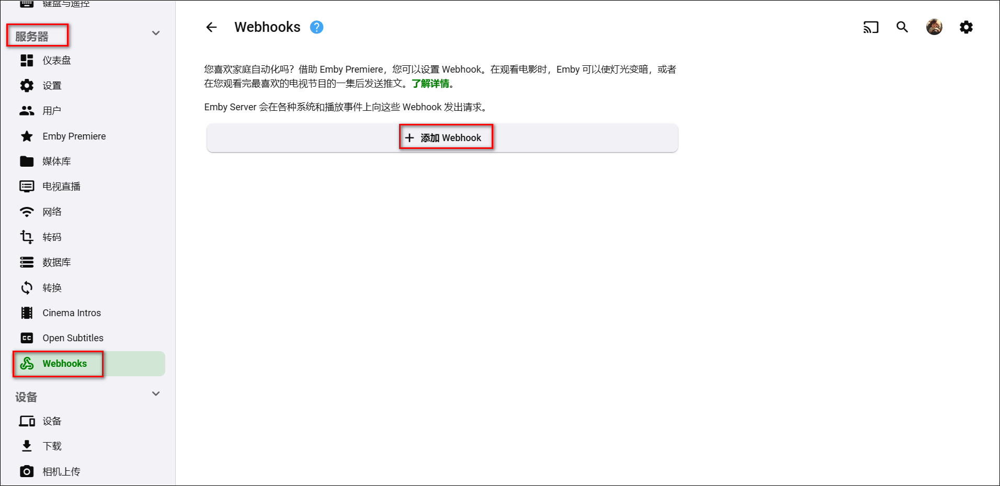

**2. 配置Webhook参数**

填写以下信息：

- **名称**：自定义Webhook名称
- **URL**：`http[s]://your-domain.com[:port]/api/v1/webhook/emby?apiKey=your-api-key`
- **请求内容类型**：选择`application/json`

> 🔑 **API Key配置**：请参考[API鉴权文档](/usage/other/api_auth.html)获取配置说明

配置完成后可以点击`发送测试Webhook`验证配置：

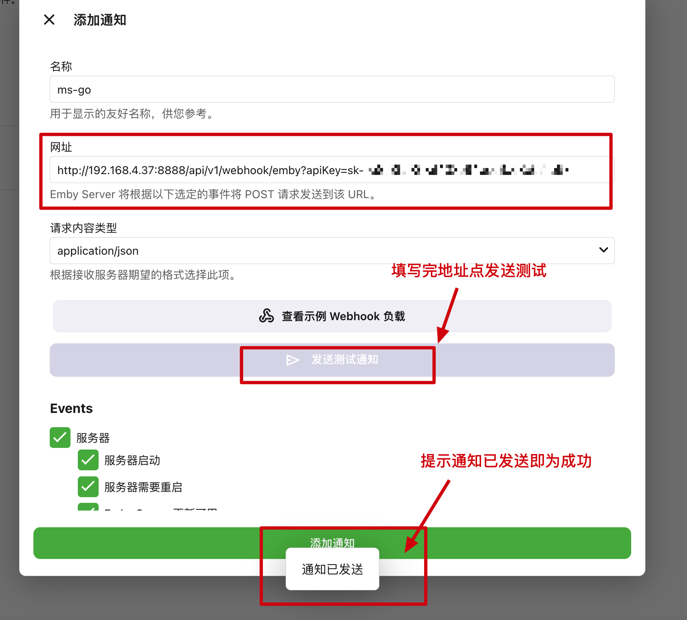

**3. 验证测试消息**

配置成功后，Media Saber应该会收到一条测试信息：

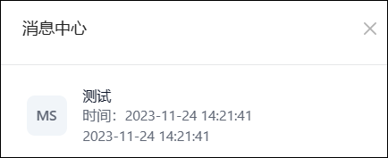

**4. 配置事件和用户**

继续选择要触发通知的事件、用户和媒体库，按需选择您想监控的选项：

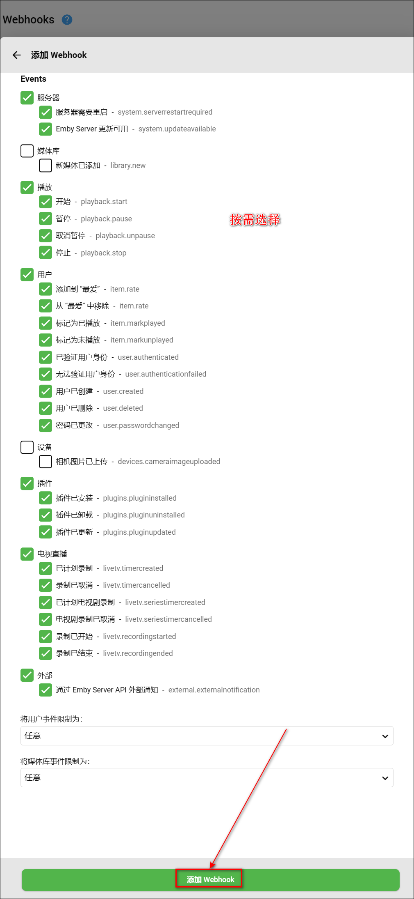

**5. 完成配置**

填写完所有信息后，点击`添加Webhook`完成配置：

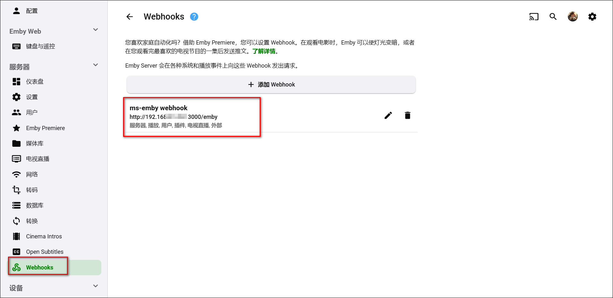

**6. 测试功能**

此时在Emby中操作您刚刚勾选的事件时，Media Saber会收到相关信息通知：

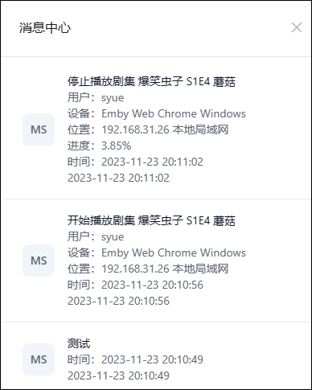

## 🐙 Jellyfin Webhook配置

> GitHub文档说明：<https://github.com/jellyfin/jellyfin-plugin-webhook>

**1. 安装Webhook插件**

打开Jellyfin控制台，进入`插件` → `目录`，找到Webhook插件并点击：

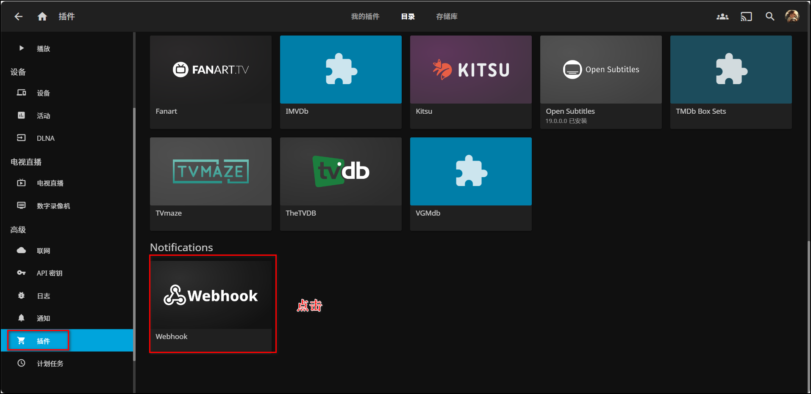

点击`安装Webhook`：

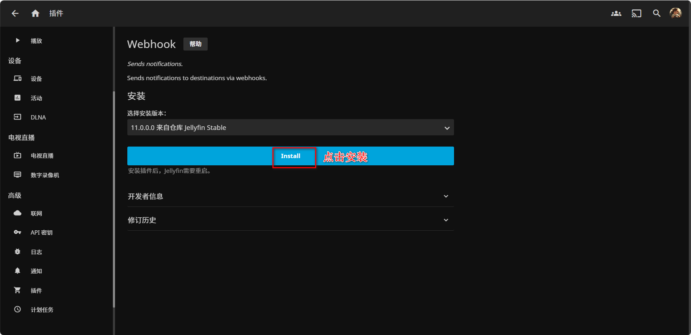

**2. 重启Jellyfin服务**

安装完成后会提示重启Jellyfin服务，按要求重启后状态显示`active`表示成功：

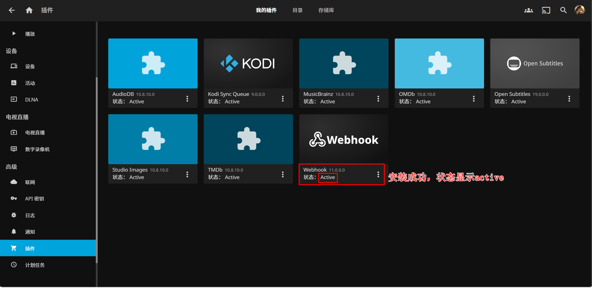

**3. 配置Webhook**

在插件设置中，填写以下信息：

- **Server Url**：Jellyfin服务器URL
- 点击`Add Generic Destination`按钮新增一个Hook

配置以下参数：

- **Webhook Name**：自定义Webhook名称
- **Webhook Url**：`http[s]://your-domain.com[:port]/api/v1/webhook/emby?apiKey=your-api-key`
- **Notification Type**：勾选你想触发通知的通知类型
- **User Filter**：勾选你想触发通知的用户
- **Item Type**：勾选你想监控的媒体类型
- **Send All Properties** 和 **Template**：二选一即可，默认勾选`Send All Properties (ignores template)`
- 点击`Add Request Header`，新增一组请求头：
  - Key: `Content-Type`
  - Value: `application/json`

设置完成后点击保存：

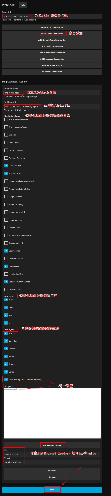

**4. 完成配置**

此时Webhook设置完成：

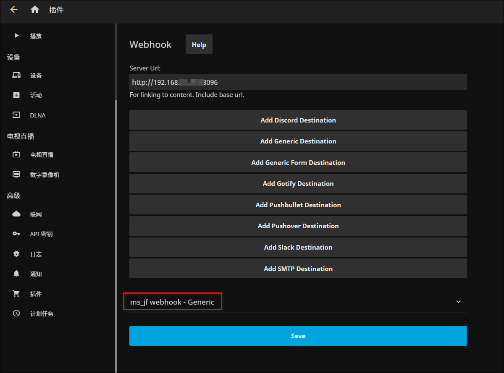

**5. 测试功能**

在Jellyfin中操作您勾选的通知类型时，Media Saber会收到相关信息：

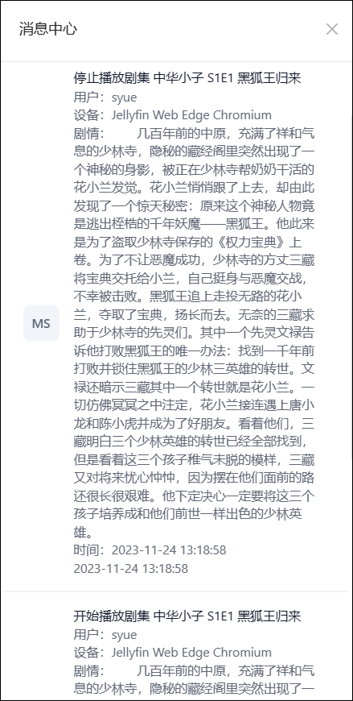

**6. 调试日志（可选）**

如果Webhook未正常工作，可以启用调试日志来排查问题。

编辑`logging.default.json`文件，在文档中的"Serilog"下添加一行内容：

```json
"Jellyfin.Plugin.Webhook": "Debug"
```

记得在`"System": "Warning"`的末尾添加逗号：

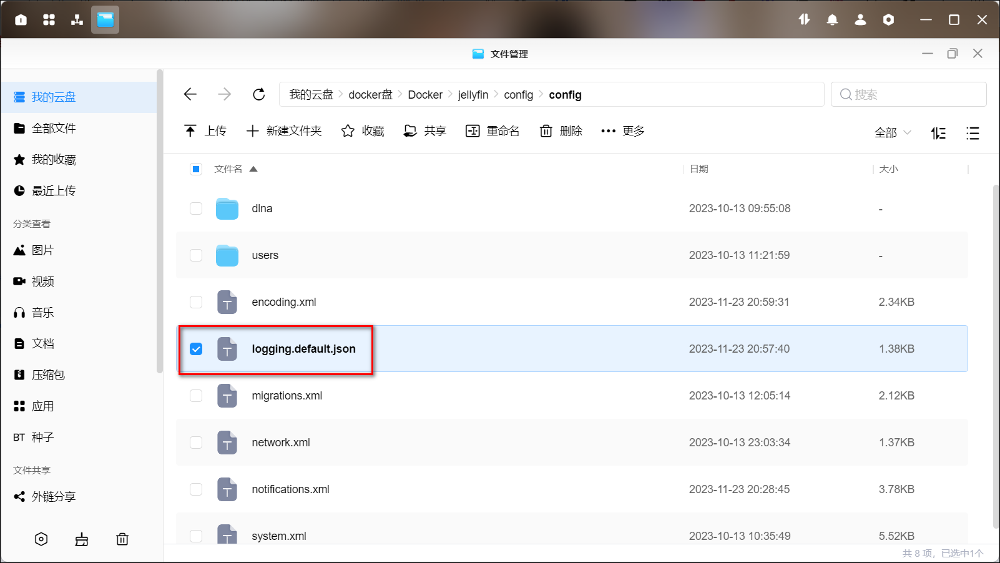
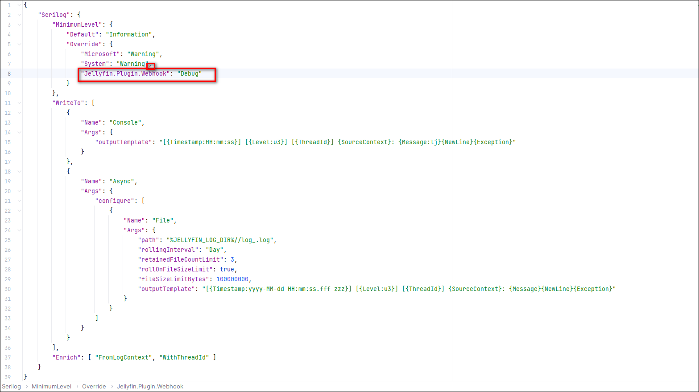

## 🎬 Plex Webhook配置

**1. 进入Webhook设置**

打开Plex控制台，进入`设置` → `Webhook`：

**2. 添加Webhook**

点击`添加Webhook`按钮，输入以下信息：

- **URL**：`http[s]://your-domain.com[:port]/api/v1/webhook/plex?apiKey=your-api-key`

> 🔑 **API Key配置**：请参考[API鉴权文档](/usage/other/api_auth.html)获取配置说明

**3. 完成配置**

点击保存完成Webhook配置。

**4. 测试功能**

在Plex中播放或操作媒体时，Media Saber会收到相关信息通知。

## ⚠️ 注意事项

1. **网络连接**：确保 Media Saber 服务地址可以从媒体服务器访问；同内网优先用内网地址
2. **API Key 配置**：正确配置 API Key 以确保身份验证通过，详细获取方法请参考 [我的信息 - API KEY管理](/usage/main_page/my_info.html#-api-key-管理)
3. **地址获取**：优先使用媒体服务器页的「Webhook 地址」一键复制，避免手写拼错
4. **消息与接收分离**：在 Media Saber 关闭「启用消息推送」后，仍会接收 Webhook 并处理观影报告等业务
5. **事件选择**：根据实际需求选择合适的事件类型，避免过多不必要的通知
6. **连接监控**：定期检查 Webhook 连接状态，确保通信正常
7. **性能优化**：在生产环境中建议关闭调试日志以提升性能

## 🔗 相关文档

- [媒体服务器](/usage/media_services/server.html)
- [观影报告](/usage/media_services/play_stats.html)
- [API 鉴权](/usage/other/api_auth.html)
