# 📱 飞书消息渠道配置

飞书渠道适合用于团队内通知和远程交互。本文按“飞书平台配置 -> Media Saber 配置 -> 联调验证”完整展开，避免漏项。

## 📋 配置流程概览

1. 在飞书开放平台创建企业自建应用
2. 为应用添加机器人能力并获取 App ID、App Secret
3. 在 Media Saber 中填入 App ID、App Secret 并应用配置
4. 回到飞书平台完成事件订阅与权限配置
5. 发布应用并在飞书客户端验证

## ✅ 前置检查

开始前请先确认：

1. 你可以登录飞书开发者平台并有应用管理权限
2. Media Saber 已可正常访问外网
3. 你已经准备好在消息通知中新增一个“飞书”渠道

> 图片来源为你指定的教程页面，已下载到本地目录 `./image/feishu/`。

## 🧭 飞书开发者平台配置

### 步骤一：创建企业自建应用

1. 登录飞书开发者平台。
2. 创建企业自建应用，填写应用名称、描述等基础信息。
3. 创建成功后进入应用管理页。

预期结果：进入应用详情页，可继续添加应用能力。

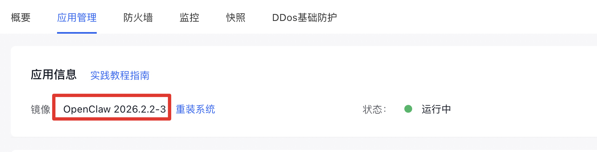

### 步骤二：添加机器人能力

1. 在左侧导航找到“添加应用能力”。
2. 在能力列表中选择“机器人”。
3. 添加完成后，确认机器人能力已启用。

预期结果：应用具备收发消息能力。

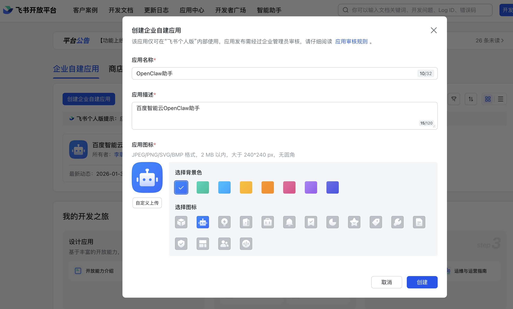
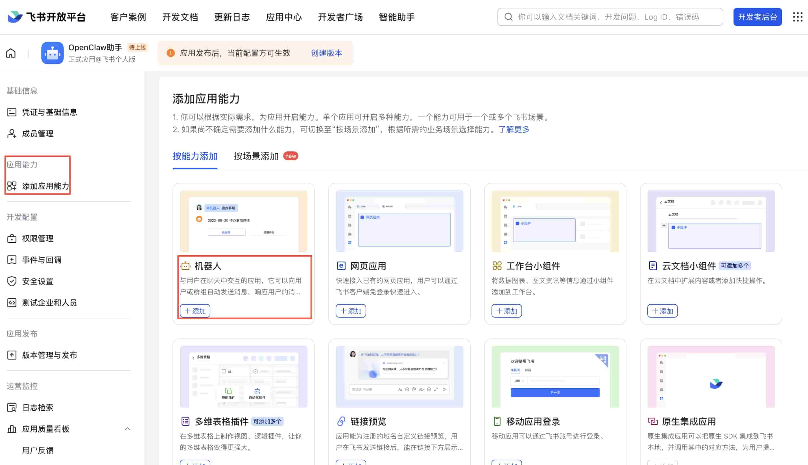

在应用基础信息页面记录后续要用到的凭证：

1. App ID
2. App Secret

### 步骤三：在 Media Saber 中先接入飞书应用

1. 进入 Media Saber：系统设置 -> 消息通知 -> 添加渠道。
2. 渠道类型选择“飞书”。
3. 填入上一步保存的 App ID、App Secret。
4. 推荐 使用配对模式 默认已打开
4. 点击保存，等待配置执行成功。

预期结果：Media Saber 成功保存飞书渠道配置，并开始尝试建立长连接。

> 这一步一定要执行成功后，再继续配置飞书平台的事件与回调。

### 步骤四：配置事件与回调、订阅事件、配置权限

1. 再次回到飞书开发者后台页面，在应用管理页左侧导航栏找到 事件与回调 
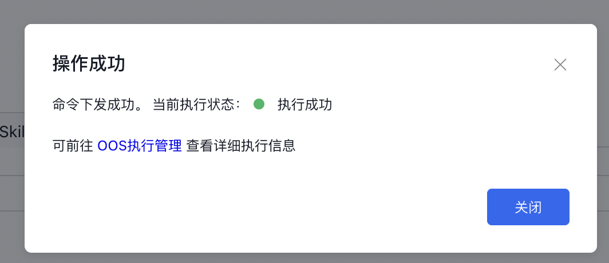
2. 事件配置和回调配置均使用使用长连接模式。注意：如果这一步提示未建立长连接，请检查自己的APP ID和APP Secret是否已正确配置，返回步骤三重新执行或重启ms重试即可。
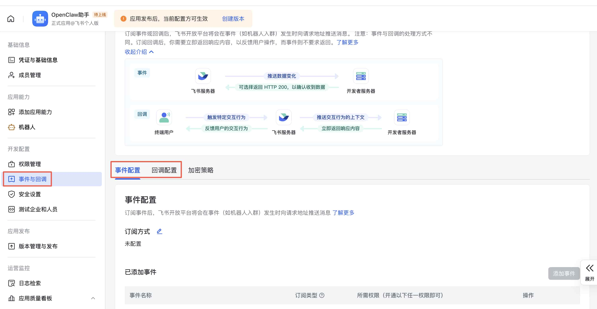
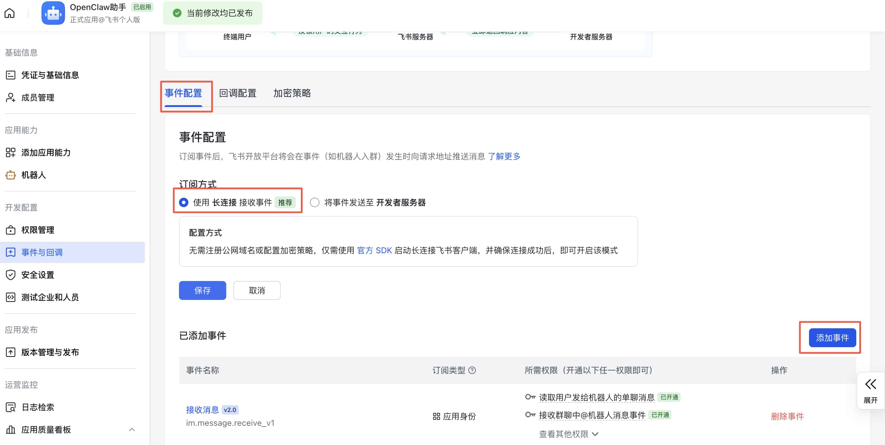
3. 点击事件配置中的 添加事件，在弹出的事件列表中，选择消息与群组 分类，勾选 接收消息，点击 “确定”，完成事件订阅。
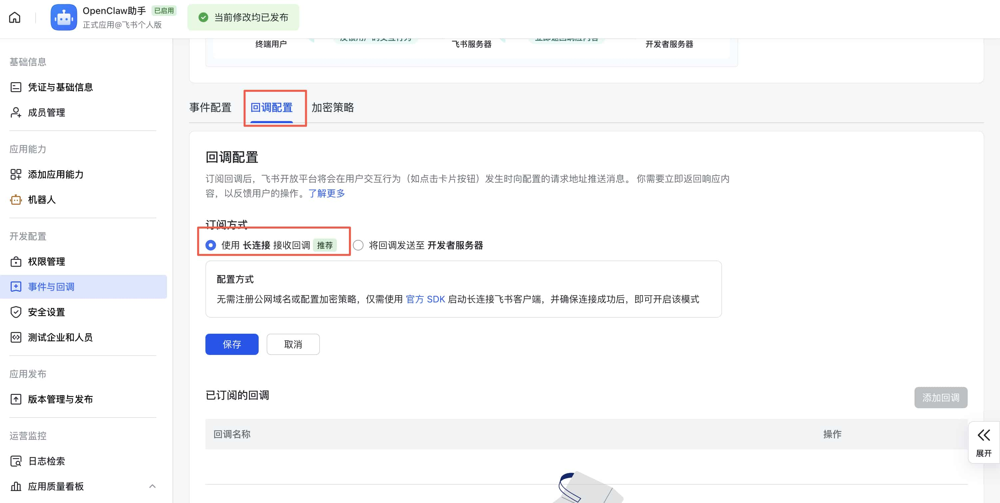
4. 配置飞书应用权限，打开在应用管理页左侧导航栏找到权限管理。
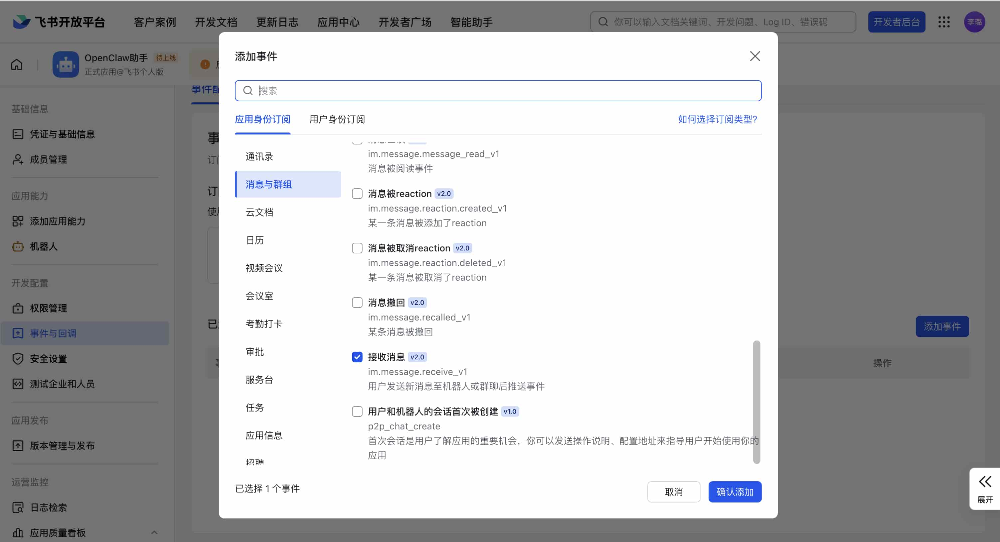
选择 批量导入/导出权限
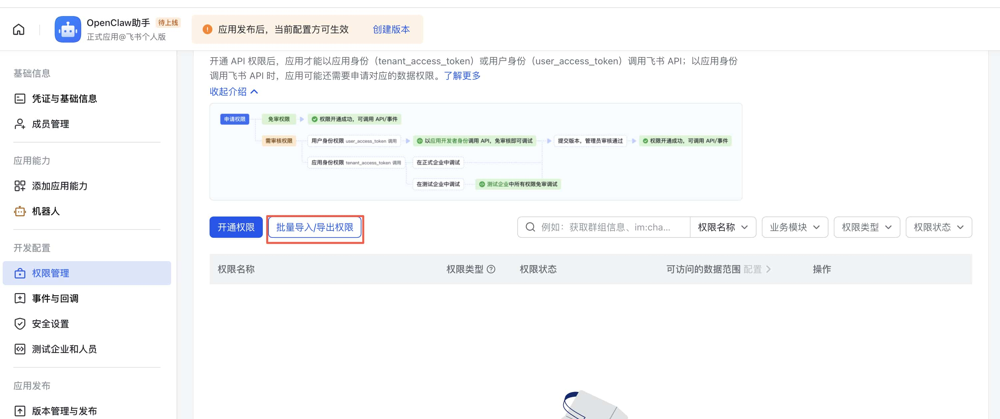
将以下命令粘贴进文本域：

```json
{
   "scopes": {
      "tenant": [
         "aily:file:read",
         "aily:file:write",
         "application:application.app_message_stats.overview:readonly",
         "application:application:self_manage",
         "application:bot.menu:write",
         "cardkit:card:write",
         "contact:user.base:readonly",
         "contact:user.employee_id:readonly",
         "corehr:file:download",
         "docs:document.content:read",
         "event:ip_list",
         "im:chat",
         "im:chat.access_event.bot_p2p_chat:read",
         "im:chat.members:bot_access",
         "im:chat:read",
         "im:message",
         "im:message.group_at_msg:readonly",
         "im:message.group_msg",
         "im:message.p2p_msg:readonly",
         "im:message:readonly",
         "im:message:send_as_bot",
         "im:resource",
         "sheets:spreadsheet",
         "wiki:wiki:readonly"
      ],
      "user": [
         "aily:file:read",
         "aily:file:write",
         "contact:contact.base:readonly",
         "im:chat.access_event.bot_p2p_chat:read"
      ]
   }
}
```

配置好的页面如下：
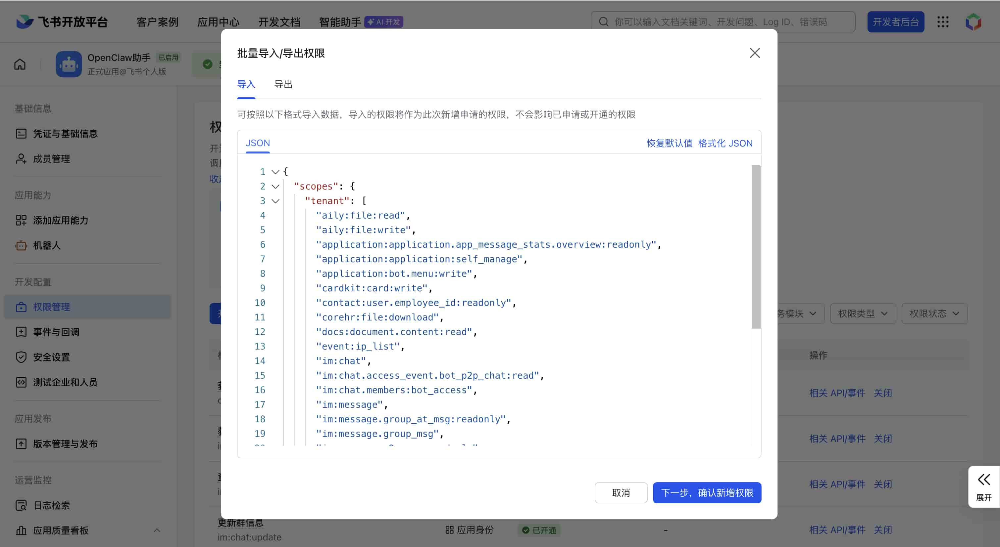

预期结果：

1. 事件订阅已生效
2. 长连接状态正常
3. 权限配置完成


### 步骤五：验证飞书接入

1. 发布刚才编辑好的应用，在顶部导航处点击创建版本，进入版本详情
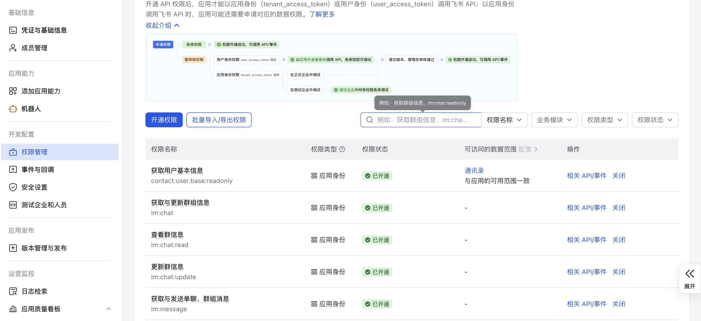
2. 填写版本号和更新说明，保存并发布。
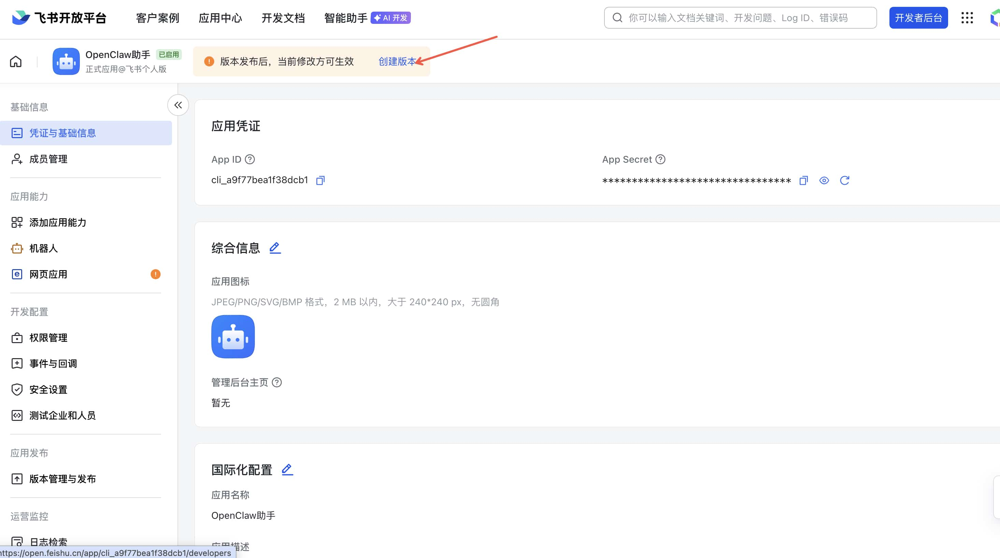
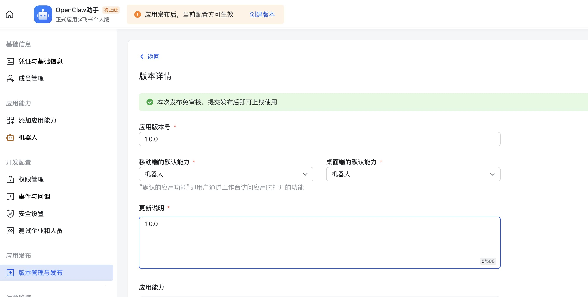
3. 在飞书客户端打开“工作台”，进入已发布应用。


预期结果：飞书中可正常收到 Media Saber 通知，且交互命令可执行。


### 步骤六：配对飞书聊天

1、在聊天页面发送任意消息到飞书
2、正常情况下，首次配对，消息会返回【未完成配对。请到消息通知中编辑飞书渠道，将“配对口令”设置为：CSE7PCLT，并保存后再次发送消息。】消息内容。这里面会有一个随机配对口令 5分钟有效   如果没有正常返回，请检查前面的App ID、App Secret是否填写正确，以及其他步骤是否完整
3、此时复制里面的口令 比如这里示例的CSE7PCLT
4、回到mediasaber 编辑飞书消息渠道，在配对口令的输入框中填写刚才的CSE7PCLT口令
5、点击保存
6、回到飞书机器人界面   发送任意消息
7、机器人返回 【配对成功，已开通交互权限】消息 就表示配对成功了。

8、下面就可以自由的和飞书聊天互动了。


## 🛠 Media Saber 中的飞书配置

飞书开发者平台配置完成后，回到 Media Saber 的“消息通知”页面，点击“添加渠道”，选择“飞书”。

根据后端动态表单 `message_channel.json` 与监听逻辑 `feishu_listener.go`，建议按以下字段填写：

- **App ID**：飞书应用的 App ID，必填
- **App Secret**：飞书应用的 App Secret，必填
- **AdminUser**：可执行交互命令的用户 open_id，多个值用分号分隔，可选
- **启用配对模式**：推荐开启。开启后，未配对用户发送任意消息会收到配对码
- **配对口令**：配对模式下用于完成绑定的口令，可选
- **接收者类型**：不启用配对模式时建议配置，群聊一般选择 `chat_id`
- **默认接收者 ID**：常规通知接收者 ID，配对模式下可留空

建议开启“是否交互”。飞书监听会基于长连接接收消息与卡片回调，并对交互事件做幂等处理和权限校验。

### 字段填写建议

1. 只做通知不做交互：
   填 App ID、App Secret、接收者类型、默认接收者 ID 即可。
2. 做交互（推荐）：
   开启“是否交互”和“配对模式”，首次用飞书给机器人发消息拿配对码，再填写“配对口令”完成绑定。
3. 限定可操作用户：
   在 AdminUser 中填写一个或多个 open_id（分号分隔）。

## 🔧 配置完成后的校验

1. 保存飞书渠道配置
2. 重启服务（当 App ID 或 App Secret 有变更时必须重启）
3. 向飞书机器人发送测试消息
4. 检查是否能收到 Media Saber 的回复或通知
5. 若启用了配对模式，先按提示完成配对，再执行交互命令

## ⚠️ 注意事项

1. 事件配置和回调配置建议使用长连接模式
2. 若飞书后台提示未建立长连接，优先检查 App ID、App Secret 是否正确并重新应用配置
3. 启用配对模式后，单渠道通常只绑定一个交互用户；要更换用户可清空配对口令后重新配对
4. 修改 App ID 或 App Secret 后，必须重启服务，否则监听仍使用旧配置
